<div align="center">

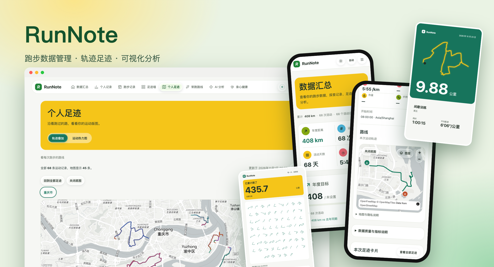

# RunNote

**Running data management and visual analytics**
Turn GPX / TCX / Mi Fitness runs into calendars, trends, footprint maps and shareable posters.

[](https://github.com/TingChieh/run_note/actions/workflows/ci.yml)
[](LICENSE)


[简体中文](README.md) · **English** · [Live site](https://run.aisaka.cc)

</div>

> The application UI is in Simplified Chinese. Design and operations docs under `docs/` are also in Chinese.

## Features

- **Multi-source import**: GPX, TCX and Mi Fitness, with batch import, hash/fingerprint de-duplication and data-quality warnings.
- **Server-authoritative metrics**: distance, duration and pace are computed and aggregated by the backend; the frontend only renders them.
- **Dashboard and personal records**: see the yearly calendar, weekly and monthly trends, streaks, personal bests and stats across years. Sign in to open a monthly or yearly running recap and export a share image, or explore an annual story with milestones and an animated footprint map. [Running recap](docs/92-running-recap.md) · [Annual story](docs/93-annual-running-story.md)
- **Running diary**: record mood, perceived exertion (RPE), weather and notes on your own run details, with up to six private photos per entry. [Running diary](docs/94-running-diary.md)
- **Footprint map and city exploration**: overlay all tracks, see the heatmap and highlighted regions, and revisit places you've run through the city catalog and exploration views. The map falls back to a local background if OpenFreeMap fails to load.
- **Frequent routes and route wall**: repeated routes are grouped automatically; the wall shows every run as a card.
- **Share posters**: route, sport, ticket-stub and big-number styles for a single run or the route wall, exported as PNG.
- **Automatic titles**: default titles become "Lakeside run", "Park run", etc., based on nearby OpenStreetMap features, computed entirely inside your own PostGIS.
- **AI running assistant**: sign in and consent to data use to start a conversation with a quick prompt, receive streaming replies and revisit saved chats. Server-side tools run predefined read-only queries for the current account's running statistics, activity metrics, personal records, goals and footprints. They cannot run arbitrary SQL or write data. [Assistant design](docs/engineering/runnote-ai-assistant-design.md)
- **Shoes, goals and settings**: assign shoes to runs, track their mileage and see reminders as they approach or reach the configured replacement distance. Set weekly, monthly and yearly mileage goals in Goals & Privacy. Settings also includes Account Overview and Shoes, with Site Settings and User Management available to the owner.
- **Owner showcase and managed accounts**: visitors can browse the owner's data without logging in; the admin can enable per-user showcases at `/p/{username}`. Open registration is disabled.
- **Dark mode and responsive layout**: follows the system, with a manual override; liquid-glass refraction is enabled on Chromium.

## Screenshots

<table>
  <tr>
    <td width="50%">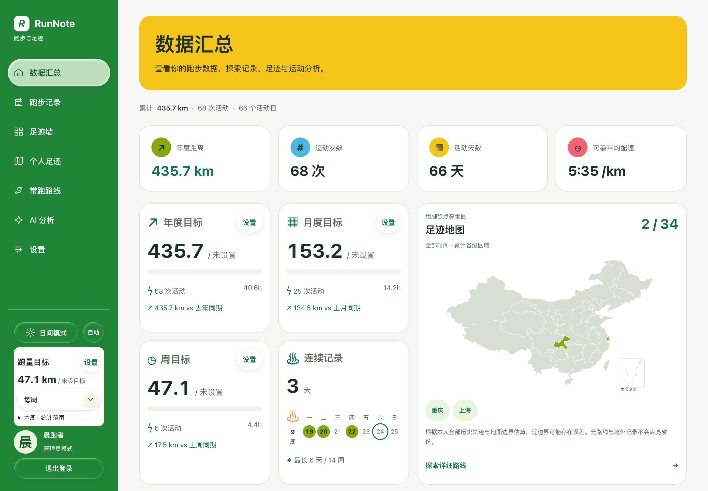</td>
    <td width="50%">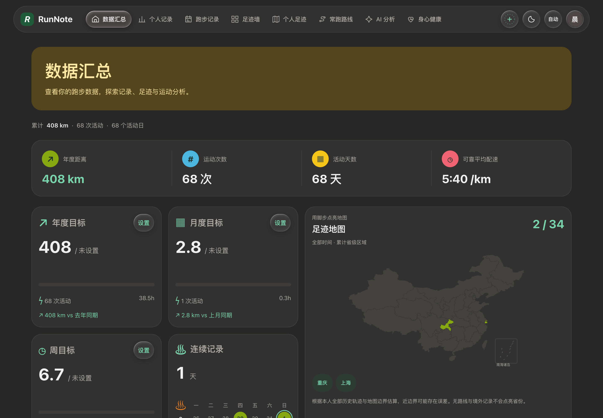</td>
  </tr>
  <tr>
    <td align="center">Dashboard</td>
    <td align="center">Dark mode</td>
  </tr>
  <tr>
    <td>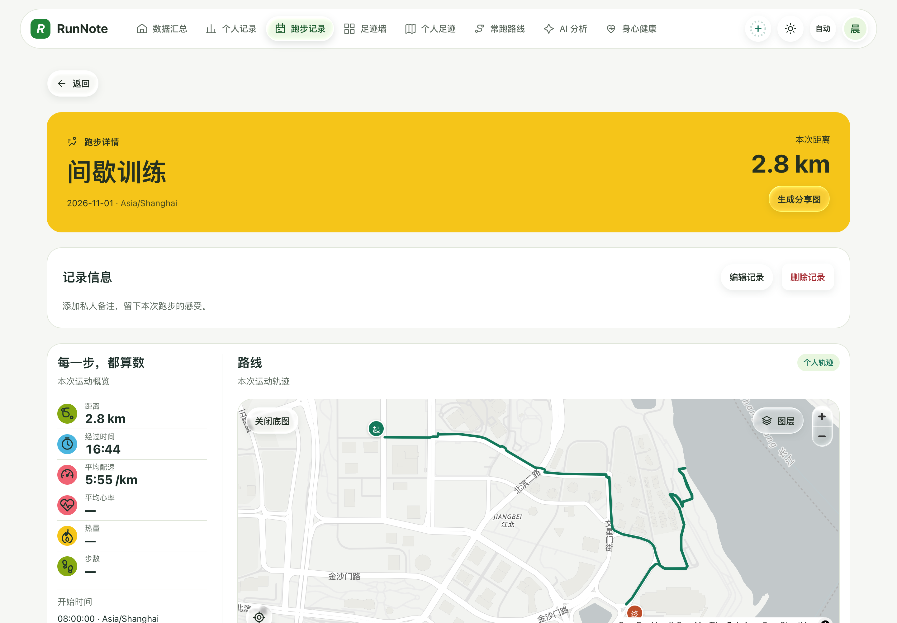</td>
    <td>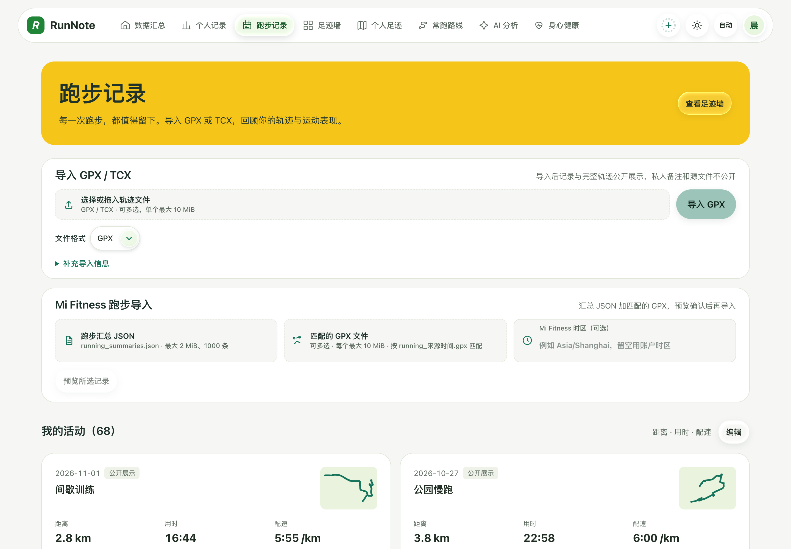</td>
  </tr>
  <tr>
    <td align="center">Run detail and route</td>
    <td align="center">Run list</td>
  </tr>
  <tr>
    <td>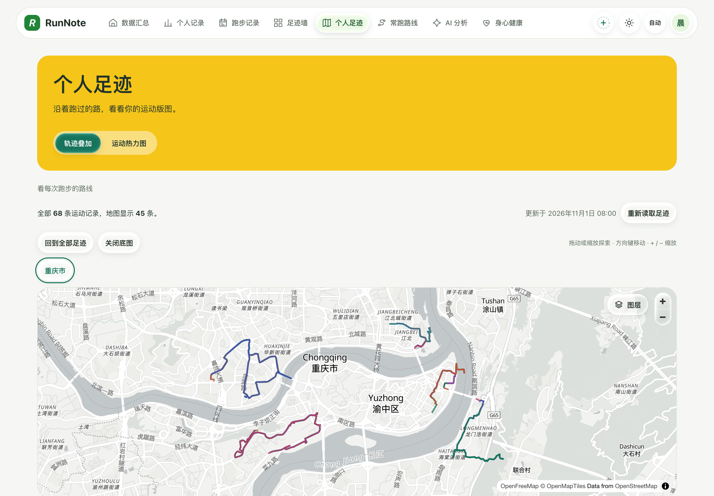</td>
    <td>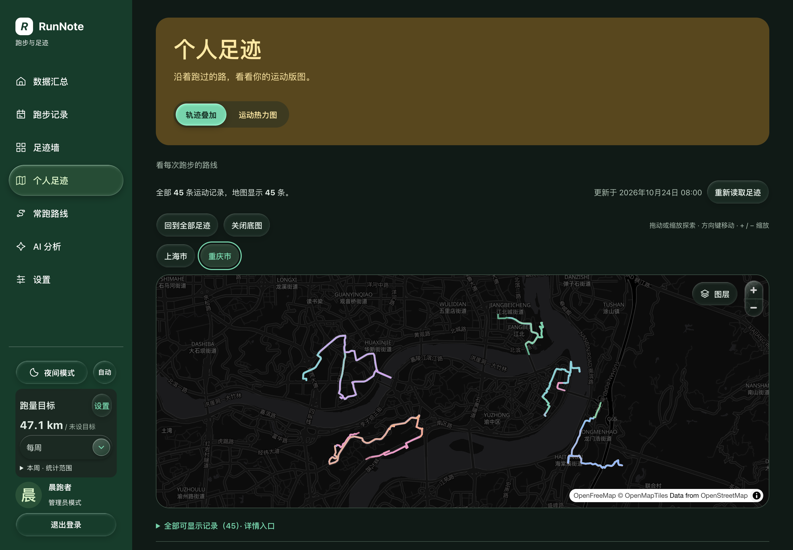</td>
  </tr>
  <tr>
    <td align="center">Footprints</td>
    <td align="center">Footprints (dark)</td>
  </tr>
</table>

<p align="center">
  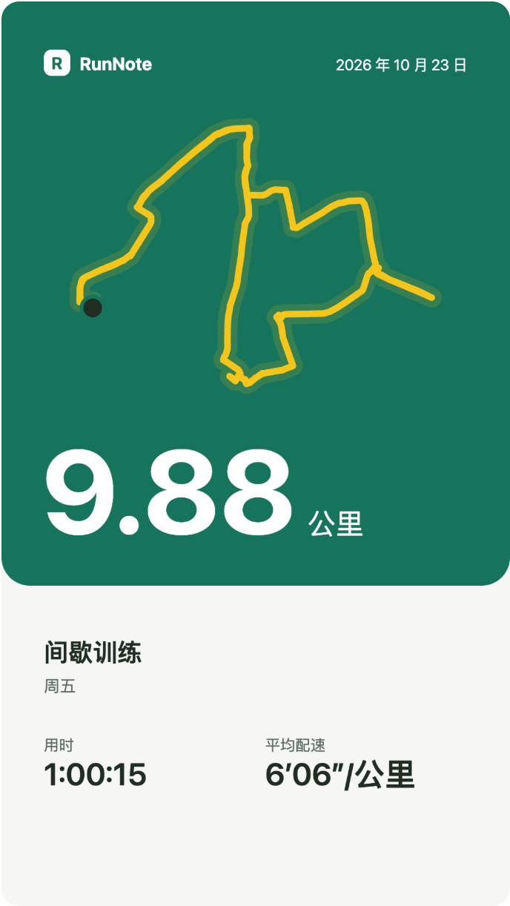
  &nbsp;
  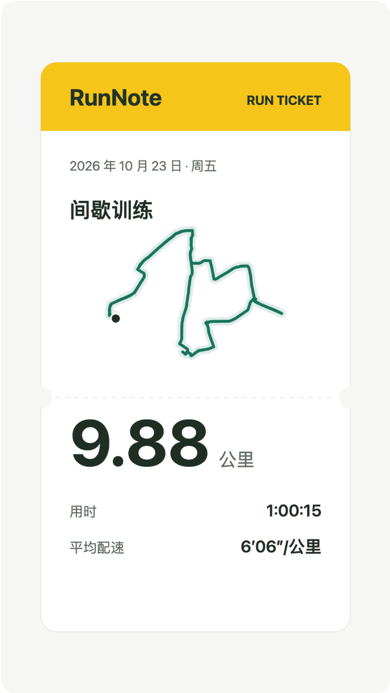
  &nbsp;
  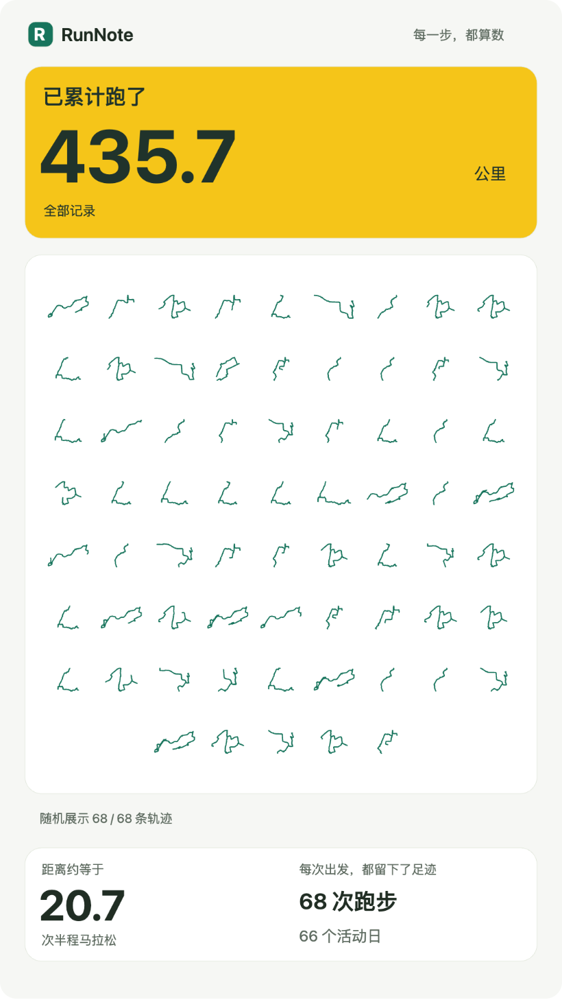
  &nbsp;
  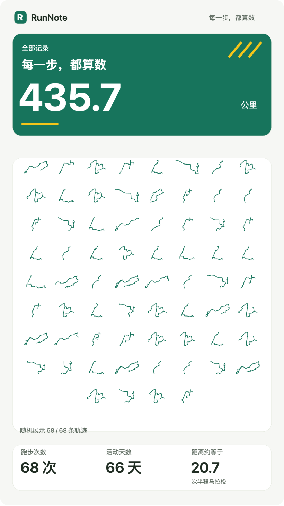
  &nbsp;
  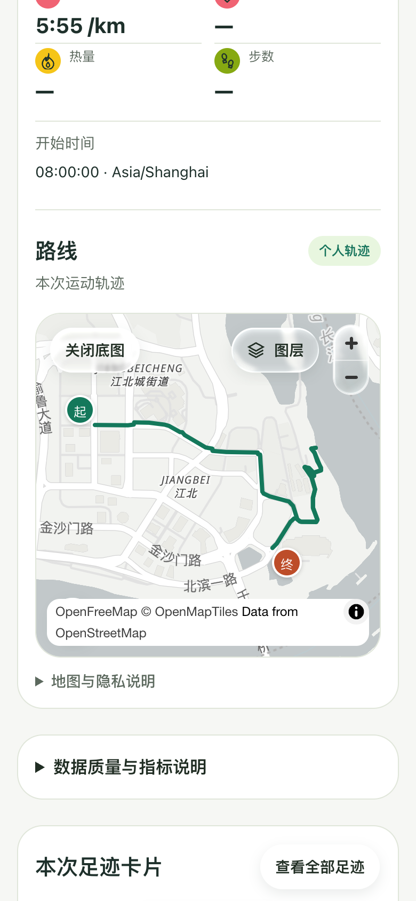
</p>

> Screenshots are generated from synthetic data and contain no real tracks or personal information.

## Live site

**<https://run.aisaka.cc>** is the owner's public showcase. Visitors can browse the dashboard, runs and footprints without logging in.

## Android companion

The web app remains the primary supported experience. The repository also includes a Capacitor 8 Android companion project (`android/`, requiring Android 10 / API 29 and System WebView 116+) that shares the existing SvelteKit UI via `server.url` while preserving Web SSR, server-authoritative metrics and the existing database schema.

- **Current baseline**: Phase 0–3 code is merged on `main` (current baseline `v2.5.0` / `801729e4`).
- **Capabilities merged in code**:
  - **Container and platform integration**: application identity and brand assets (`com.tingchieh.runnote`), build-time HTTPS origin checks and navigation allowlist, light/dark system bar sync, system back/gesture navigation, native connection error overlay and DocumentsUI file import (GPX / TCX / Mi Fitness).
  - **Read-only Health Connect, offline cache and incremental sync**: minimal read-only Health Connect bridge with 6 read permissions (no write or background health permissions); account-isolated IndexedDB read-only offline cache (excluding wellbeing journals, credentials, raw track files and offline basemap tiles) with sign-out/account-switch cleanup; incremental sync and reconnect retry via `GET /api/v1/activities/sync`.
  - **Native GPS recording**: shared recording UI (`/activities/record`, `/workspace/activities/record`), Android foreground location service (`foregroundServiceType="location"`, without `ACCESS_BACKGROUND_LOCATION`) with privacy-redacted lock-screen notification, pause/resume track segmentation, crash recovery, account-bound local track upload queue and idempotent upload/backoff retry via `POST /api/v1/gpx-imports` (`Idempotency-Key`).
- **Current distribution and verification status (not yet published)**: currently limited to debug and internal test builds; **no public release APK or store listing has been published**. Aside from the Phase 0 technical spike's initial real-device and public HTTPS gates, the following pre-release gates remain **pending** (not passed):
  - Signed production release APK build and sign-off;
  - Broader real-device validation across Phase 1–3 (Phase 1 real-device visual QA, Phase 2 Health Connect real-device grant/deny/revoke/no-data acceptance, Phase 3 real-device offline recording and recovery) and domestic-ROM background/process-kill testing;
  - Google Play background-location / foreground-service policy, Data Safety declaration and store review;
  - Full real-backend Playwright E2E verification.
- **Mobile-specific UI**: a dedicated phone UI direction has been approved at the design level and is **not implemented yet**.
- **Phase docs (Chinese)**: [Phase 0 spike](docs/95-android-capacitor-phase0.md) · [Phase 1 companion](docs/97-android-capacitor-phase1.md) · [Phase 2 health & offline cache](docs/98-android-capacitor-phase2.md) · [Phase 3 native recording](docs/99-android-capacitor-phase3.md)

## Stack and architecture

```text
Browser ──► Caddy (HTTPS) ─┬─ /api/*  ──► FastAPI (Uvicorn)  ──► PostgreSQL 18 + PostGIS 3.7
                           └─ others  ──► SvelteKit (Node)   ──► same-origin /api proxy ──┘
```

| Layer | Technology |
| --- | --- |
| Frontend | SvelteKit 3, Svelte 5 (runes), TypeScript, Tailwind 4, MapLibre GL, ECharts |
| Backend | Python 3.14, FastAPI, Pydantic 2, SQLAlchemy 2 (sync), Alembic, GeoAlchemy2, gpxpy |
| Database | PostgreSQL 18 + PostGIS 3.7, the single source of truth |
| Deployment | Native install (systemd + Caddy), **no Docker**; scripted release, migration, backup and restore drills |

The backend is a modular monolith with feature modules such as activities, footprints, statistics, ai_assistant, sharing and showcase organised around `router / service / schema / model`. The JSON API uses a `{data, error, meta.request_id}` envelope. The assistant streams replies with server-sent events (SSE).

## Quick start

Requirements are macOS or Linux, PostgreSQL 18 + PostGIS 3.7, Python 3.14 and Node.js 24. See `packageManager` for the pinned pnpm version. [`frontend/package.json`](frontend/package.json)

```bash
# 1. Configure (edit .env: database URL, etc.)
test -e .env || cp .env.example .env

# 2. Database: create it, enable PostGIS, then migrate
cd backend
python3.14 -m venv .venv
.venv/bin/python -m pip install --require-hashes -r requirements.lock
.venv/bin/alembic upgrade head
cd ..

# 3. Create the owner account offline and start the backend (port 8000 by default)
backend/.venv/bin/python scripts/site-owner.py create
backend/.venv/bin/python scripts/local-auth.py init
backend/.venv/bin/python scripts/local-auth.py serve

# 4. Start the frontend (another terminal)
cd frontend
pnpm install --frozen-lockfile
pnpm dev
```

Open <http://127.0.0.1:5173>. The admin entry is `/admin`. The Chinese docs cover local setup, test databases, deployment, the owner showcase and managed accounts. [Docs](docs/) · [Production deployment](docs/66-production-deployment.md) · [Owner showcase](docs/55-single-owner-showcase.md) · [Managed accounts](docs/56-admin-users-personal-showcase.md) · [Legacy README](docs/00-legacy-readme.md)

## Configuration and operations

- **Optional AI assistant**. Set `AI_BASE_URL`, `AI_MODEL` and `AI_API_KEY` in the backend environment to enable new prompts. Set `AI_ASSISTANT_ENABLED=false` to disable new prompts while keeping saved chats available to view. Store secrets only in the server environment (locally, the Git-ignored root `.env`). Keep them out of `PUBLIC_*` variables and the repository. [Environment example](.env.example) · [Assistant design](docs/engineering/runnote-ai-assistant-design.md)
- **Database upgrades**. Before using the new UI, upgrade the database to the release's Alembic head, which includes `0032_running_diary`, `0033_ai_assistant` and `0034_drop_ai_reports` (`0034_drop_ai_reports` irreversibly drops the legacy `ai_reports` table). Back up existing production databases and rehearse the restore before migrating. These migrations guard against unsafe downgrades when tables hold data or after irreversible drops. To recover after a migration, fix forward or restore the pre-migration backup according to the deployment guide. Restoring discards writes made after the backup. [Production deployment](docs/66-production-deployment.md)
- **Streaming proxy**. Reverse proxies must forward `text/event-stream` promptly, without buffering the response for compression or delivery. The bundled Caddy config sets `flush_interval -1` and a 60-second response-header timeout on the assistant message endpoint. The backend sends SSE headers before waiting for the model. The SvelteKit proxy allows 195 seconds for this endpoint, covering the backend's per-turn streaming deadline (90 seconds by default, up to 180 seconds). [Caddy config](infra/native/Caddyfile) · [Assistant design](docs/engineering/runnote-ai-assistant-design.md)

## Tests

```bash
# Backend
(cd backend && .venv/bin/pytest tests/unit -q && .venv/bin/ruff check app migrations tests)

# Frontend
(cd frontend && pnpm test && pnpm check && pnpm build)
```

Backend integration tests and e2e tests need a dedicated `_test` PostGIS database and never touch the development database; they are skipped when it is not configured.

## Privacy

- Email, file names, notes and raw GPX/TCX never appear in public responses.
- The browser renders track GeoJSON. The basemap service receives requests for public styles, fonts, sprites and tiles for the current viewport.
- After you consent, the assistant sends the configured model service a system prompt with the date and time zone, your current prompt, recent messages from the same chat, available tool definitions and allowlisted query results. These can include running statistics, individual activity metrics with UUIDs and dates, coarse place names such as provinces and cities with footprint counts, and frequent-route group summaries. Tool results exclude activity titles, tags, notes, precise coordinates, raw imports and their filenames, photos, account information and other users' data. Text you enter in the chat goes to the model with your prompt. You can revoke consent in the assistant. [Assistant design](docs/engineering/runnote-ai-assistant-design.md)
- Running diaries and photos are accessible only to the account that owns them and stay out of public showcases, share posters and AI context. Uploads become metadata-free PNGs. RunNote discards the originals and stores the processed images in PostgreSQL as part of the database backups. The separate wellbeing journal is also private to its owner and excluded from AI context. [Running diary](docs/94-running-diary.md)

## Documentation

Design, verification and operations records, the UI design system and the coding agent guide are maintained in the repository. [Docs](docs/) · [Design system](docs/design-system/README.md) · [Agent guide](AGENTS.md)

## License

[MIT](LICENSE) © 2026 TingChieh
