<div align="center">

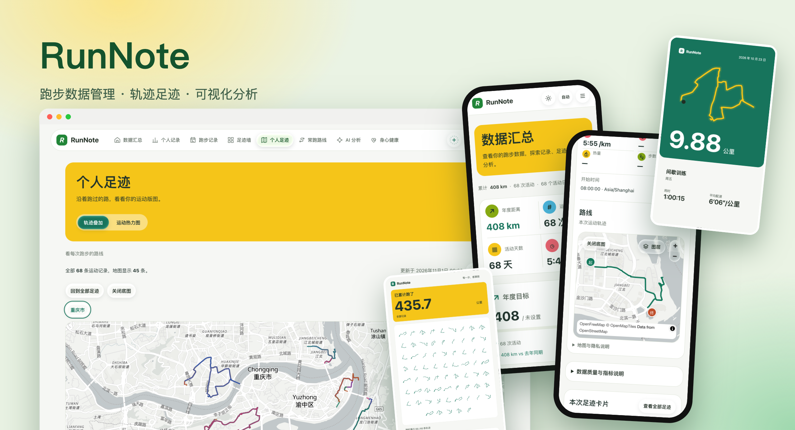

# RunNote

**Running data management and visual analytics**
Turn GPX / TCX / Mi Fitness runs into calendars, trends, footprint maps and shareable posters.

[](https://github.com/TingChieh/run_note/actions/workflows/ci.yml)
[](LICENSE)


[简体中文](README.md) · **English** · [Live site](https://run.aisaka.cc)

</div>

> The application UI is in Simplified Chinese. Design and operations docs under `docs/` are also in Chinese.

## Features

- **Multi-source import**: GPX, TCX and Mi Fitness, with batch import, hash/fingerprint de-duplication and data-quality warnings.
- **Server-authoritative metrics**: distance, duration and pace are computed and aggregated by the backend; the frontend only renders them.
- **Dashboard**: yearly calendar, weekly/monthly trends, weekly/monthly/yearly goals and streaks.
- **Footprint map**: all tracks overlaid, a running heatmap and lit-up provinces. The basemap comes from OpenFreeMap and degrades to a local background on failure; track data never leaves the browser.
- **Frequent routes and route wall**: repeated routes are grouped automatically; the wall shows every run as a card.
- **Share posters**: route, sport, ticket-stub and big-number styles for a single run or the route wall, exported as PNG.
- **Automatic titles**: default titles become "Lakeside run", "Park run", etc., based on nearby OpenStreetMap features, computed entirely inside your own PostGIS.
- **AI running analysis**: on-demand summaries and next-week suggestions from aggregated statistics only. No coordinates, GPX, email or notes are sent to the model; the feature shows as unavailable when not configured.
- **Owner showcase and managed accounts**: visitors can browse the owner's data without logging in; the admin can enable per-user showcases at `/p/{username}`. Open registration is disabled.
- **Dark mode and responsive layout**: follows the system, with a manual override; liquid-glass refraction is enabled on Chromium.

## Screenshots

<table>
  <tr>
    <td width="50%">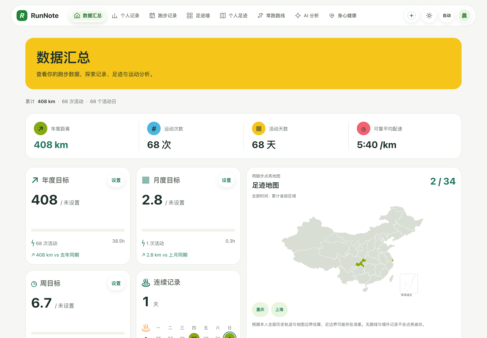</td>
    <td width="50%">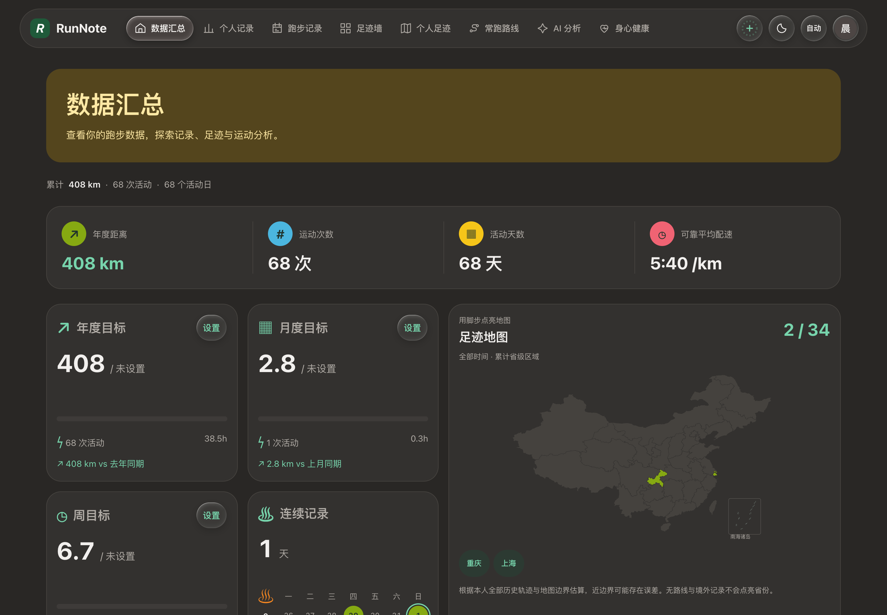</td>
  </tr>
  <tr>
    <td align="center">Dashboard</td>
    <td align="center">Dark mode</td>
  </tr>
  <tr>
    <td>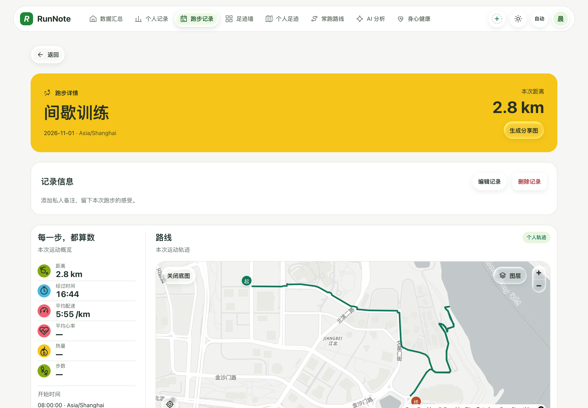</td>
    <td>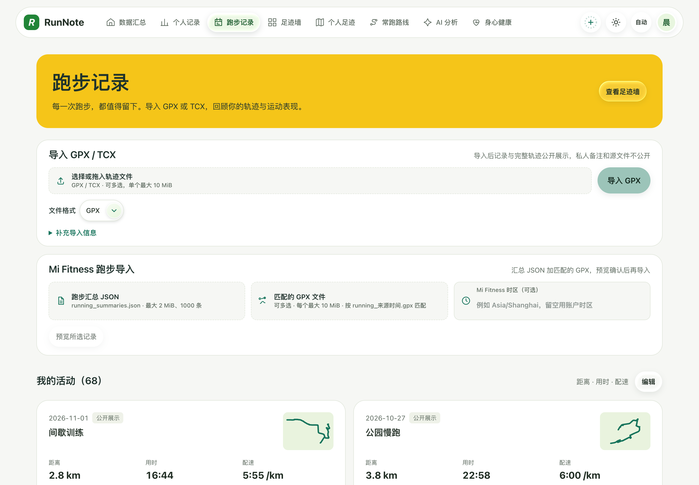</td>
  </tr>
  <tr>
    <td align="center">Run detail and route</td>
    <td align="center">Run list</td>
  </tr>
  <tr>
    <td>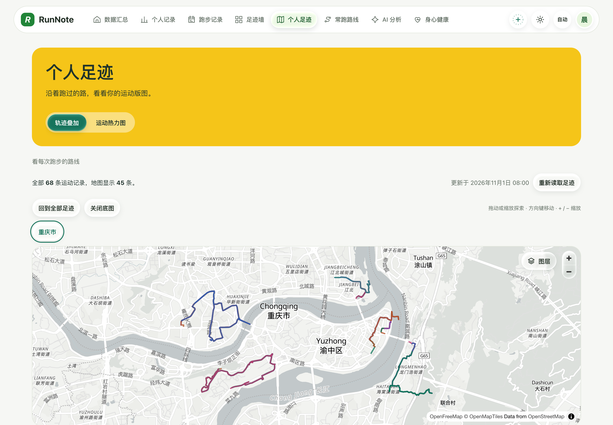</td>
    <td>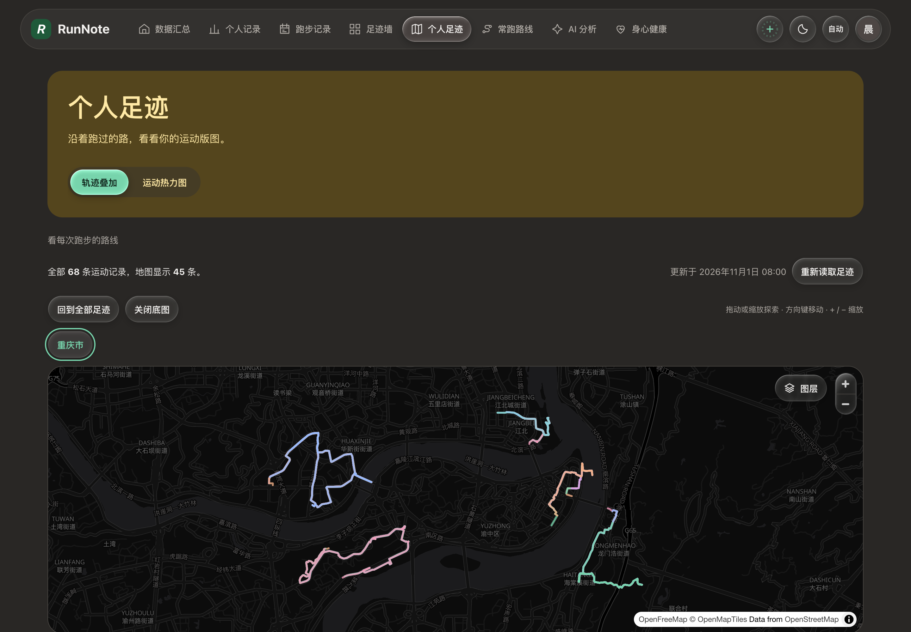</td>
  </tr>
  <tr>
    <td align="center">Footprints</td>
    <td align="center">Footprints (dark)</td>
  </tr>
</table>

<p align="center">
  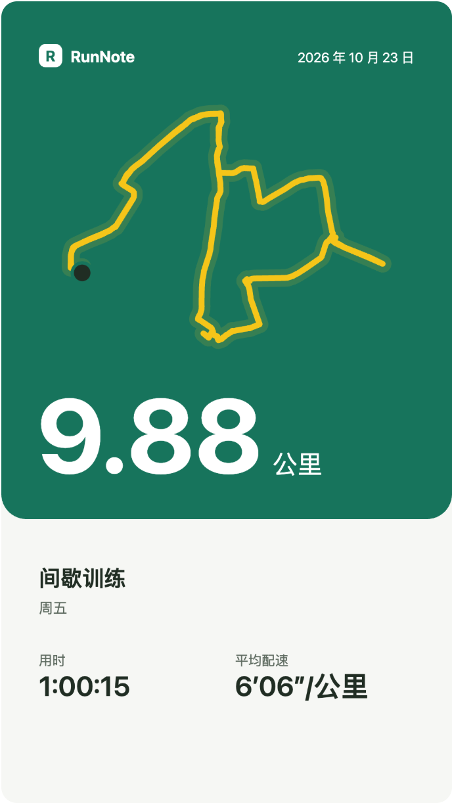
  &nbsp;
  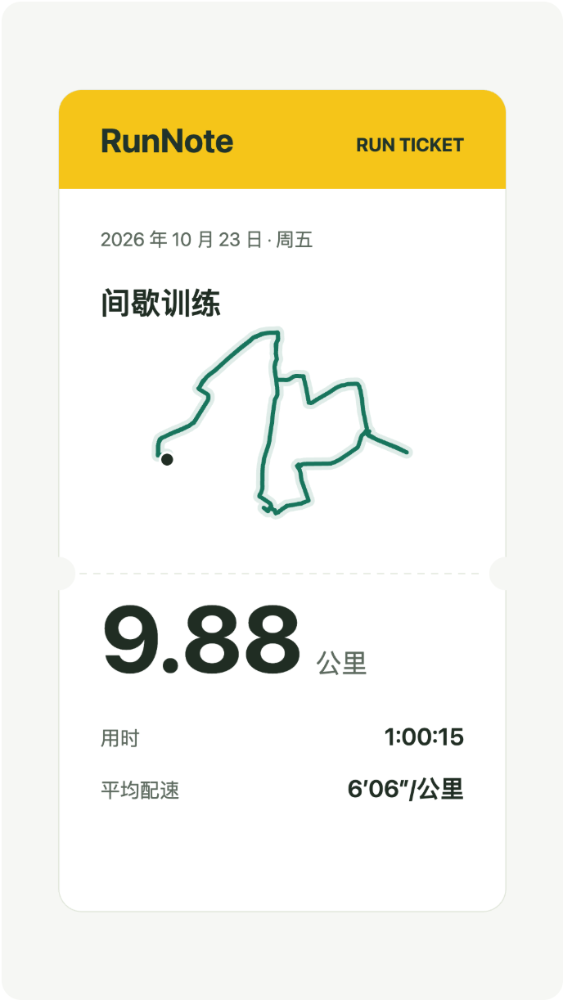
  &nbsp;
  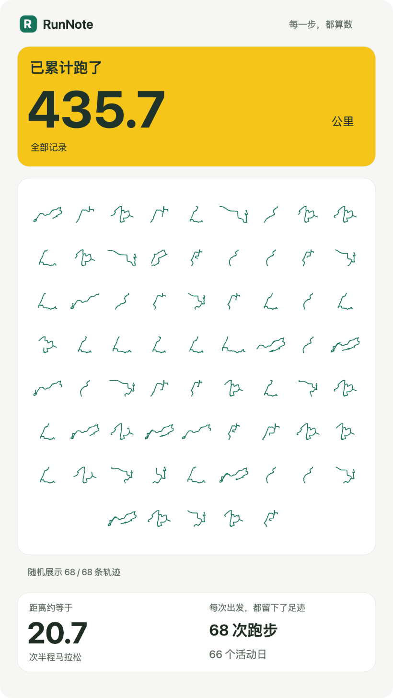
  &nbsp;
  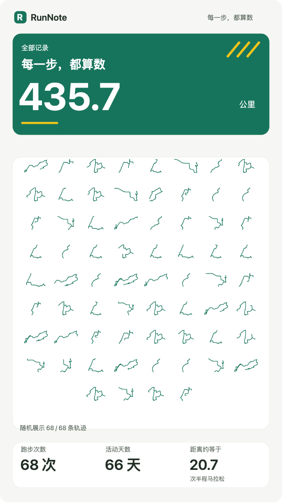
  &nbsp;
  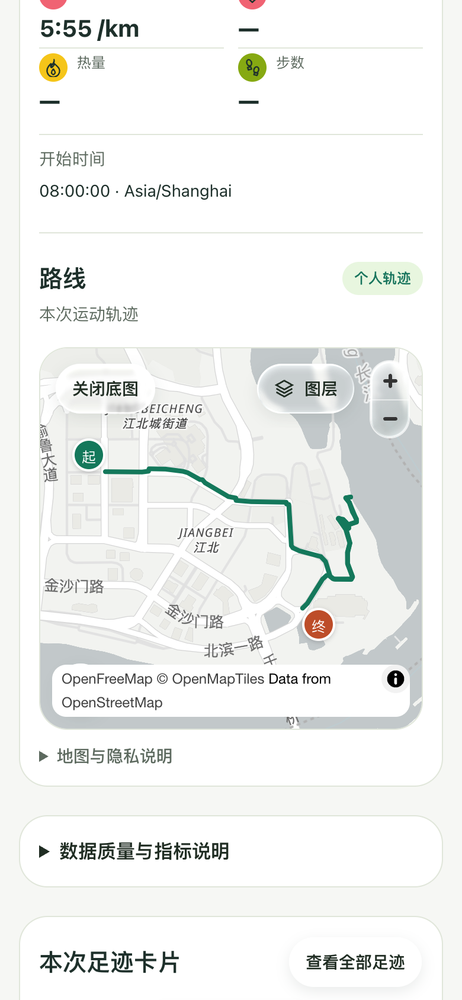
</p>

> Screenshots are generated from synthetic data and contain no real tracks or personal information.

## Live site

**<https://run.aisaka.cc>**: the owner's live showcase. Visitors can browse the dashboard, runs, footprints and AI reports without logging in.

## Stack and architecture

```text
Browser ──► Caddy (HTTPS) ─┬─ /api/*  ──► FastAPI (Uvicorn)  ──► PostgreSQL 18 + PostGIS 3.6
                           └─ others  ──► SvelteKit (Node)   ──► same-origin /api proxy ──┘
```

| Layer | Technology |
| --- | --- |
| Frontend | SvelteKit 3, Svelte 5 (runes), TypeScript, Tailwind 4, MapLibre GL, ECharts |
| Backend | Python 3.12, FastAPI, Pydantic 2, SQLAlchemy 2 (sync), Alembic, GeoAlchemy2, gpxpy |
| Database | PostgreSQL 18 + PostGIS 3.6, the single source of truth |
| Deployment | Native install (systemd + Caddy), **no Docker**; scripted release, migration, backup and restore drills |

The backend is a modular monolith. Each feature module (activities, footprints, gpx, tcx, mifitness, statistics, ai_reports, sharing, showcase, …) is organised as `router / service / schema / model`, and every response uses the `{data, error, meta.request_id}` envelope.

## Quick start

Requirements: macOS or Linux, PostgreSQL 18 + PostGIS 3.6, Python 3.12, Node.js 22.17+ or 24, pnpm 11.25.0.

```bash
# 1. Configure (edit .env: database URL, etc.)
test -e .env || cp .env.example .env

# 2. Database: create it, enable PostGIS, then migrate
cd backend
python3.12 -m venv .venv
.venv/bin/python -m pip install --require-hashes -r requirements.lock
.venv/bin/alembic upgrade head
cd ..

# 3. Create the owner account offline and start the backend (port 8000 by default)
backend/.venv/bin/python scripts/site-owner.py create
backend/.venv/bin/python scripts/local-auth.py init
backend/.venv/bin/python scripts/local-auth.py serve

# 4. Start the frontend (another terminal)
cd frontend
pnpm install --frozen-lockfile
pnpm dev
```

Open <http://127.0.0.1:5173>; the admin entry is `/admin`. Detailed environment setup, test databases, production deployment and operations are documented (in Chinese) under [`docs/`](docs/), e.g. [production deployment](docs/66-production-deployment.md) and the [legacy README](docs/00-legacy-readme.md).

## Tests

```bash
# Backend
cd backend && .venv/bin/pytest tests/unit -q && .venv/bin/ruff check app migrations tests

# Frontend
cd frontend && pnpm test && pnpm check && pnpm build
```

Backend integration tests and e2e tests need a dedicated `_test` PostGIS database and never touch the development database; they are skipped when it is not configured.

## Privacy

- Email, file names, notes and raw GPX/TCX never appear in public responses.
- Track GeoJSON stays in the browser; the basemap only requests public styles and the tiles of the current viewport.
- AI analysis only receives aggregated statistics.

## License

[MIT](LICENSE) © 2026 TingChieh
