<div align="center">

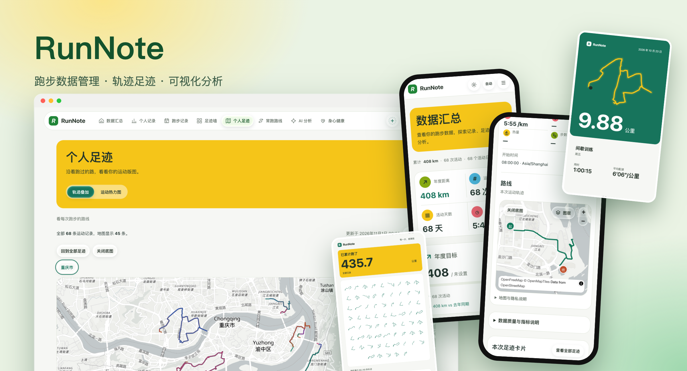

# RunNote

**跑步数据管理与可视化分析系统**
把 GPX / TCX / 小米运动健康的跑步记录，变成日历、趋势、足迹地图和可分享的海报。

[](https://github.com/TingChieh/run_note/actions/workflows/ci.yml)
[](LICENSE)


**简体中文** · [English](README.en.md) · [在线站点](https://run.aisaka.cc)

</div>

## 功能

- **多源导入**：GPX、TCX、小米运动健康，支持批量导入；文件哈希与指纹去重，质量问题会给出提示。
- **服务端权威指标**：距离、用时、配速全部由后端计算与聚合，前端只负责呈现，数据口径始终一致。
- **数据汇总与个人记录**：查看年度日历、周/月趋势、连续跑步记录、个人最佳成绩和历年数据。登录后可从个人记录打开月度或年度跑步回顾，导出分享图，也可查看包含跑步里程碑和足迹动画的年度故事。[跑步回顾](docs/92-running-recap.md) · [年度故事](docs/93-annual-running-story.md)
- **跑步日记**：在自己的跑步详情记录心情、主观疲劳（RPE）、天气和备注，每篇可添加最多六张私人照片。[跑步日记](docs/94-running-diary.md)
- **足迹地图与城市探索**：叠加全部轨迹，查看热力图和点亮的地区，通过城市图鉴与探索详情回看跑过的地方。OpenFreeMap 底图加载失败时自动降级为本地背景。
- **常跑路线与足迹墙**：自动归并重复路线；足迹墙以卡片展示每一次跑步。
- **分享海报**：单次跑步与路线墙可生成路线大图、运动海报、跑步票根、大字里程等样式，导出 PNG。
- **自动命名**：按轨迹附近的湖、河、海、公园、操场，把默认标题改成“湖边跑步”等（地物数据取自 OpenStreetMap，全程在本机 PostGIS 内计算）。
- **AI 跑步助手**：登录并同意数据使用后，可用快捷问题开启多轮对话，接收流式回复，并回看已保存的会话。服务端工具仅针对当前账号执行预定义的只读查询，可查看本人的跑步统计、活动指标、个人记录、目标和足迹。工具不支持任意 SQL 或数据写入。[助手设计](docs/engineering/runnote-ai-assistant-design.md)
- **跑鞋、目标与设置**：为跑步绑定跑鞋，累计每双鞋的里程，在接近或达到设定的替换里程时显示提醒。在「目标与隐私」设置周、月、年跑量目标。设置还包含「账户总览」和「跑鞋」，站主另有「站点设置」和「用户管理」。
- **站主展示 + 受管账号**：访客无需登录即可浏览站主内容；管理员可为其他用户开启 `/p/{username}` 个人展示，注册关闭。
- **深浅色与响应式**：跟随系统，可手动切换；桌面与手机布局一致，Chromium 上启用液态玻璃折射效果。

## 截图

<table>
  <tr>
    <td width="50%">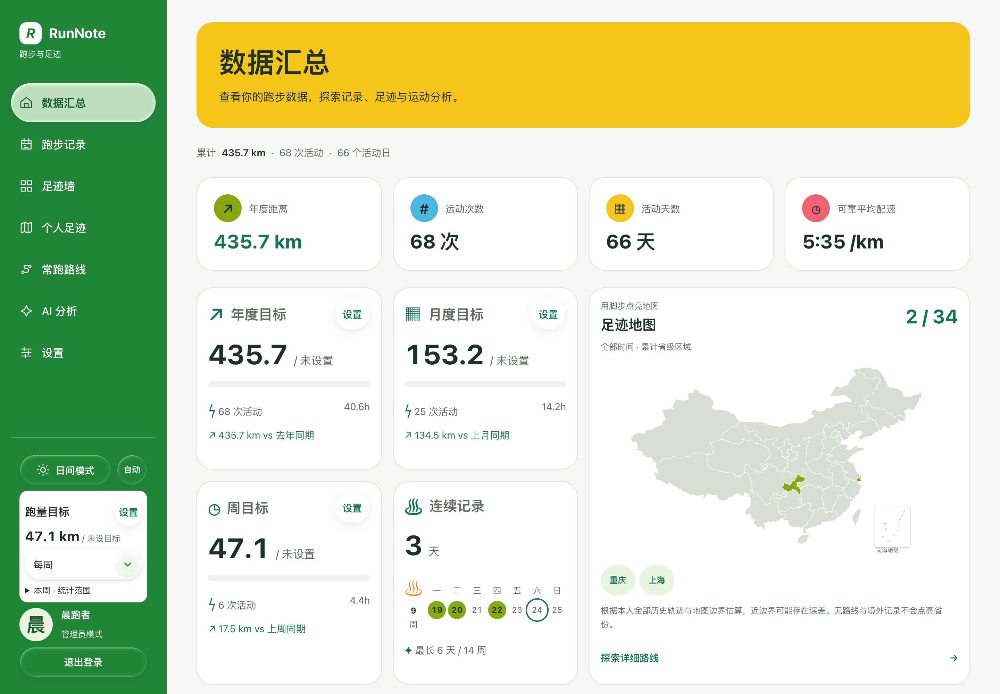</td>
    <td width="50%">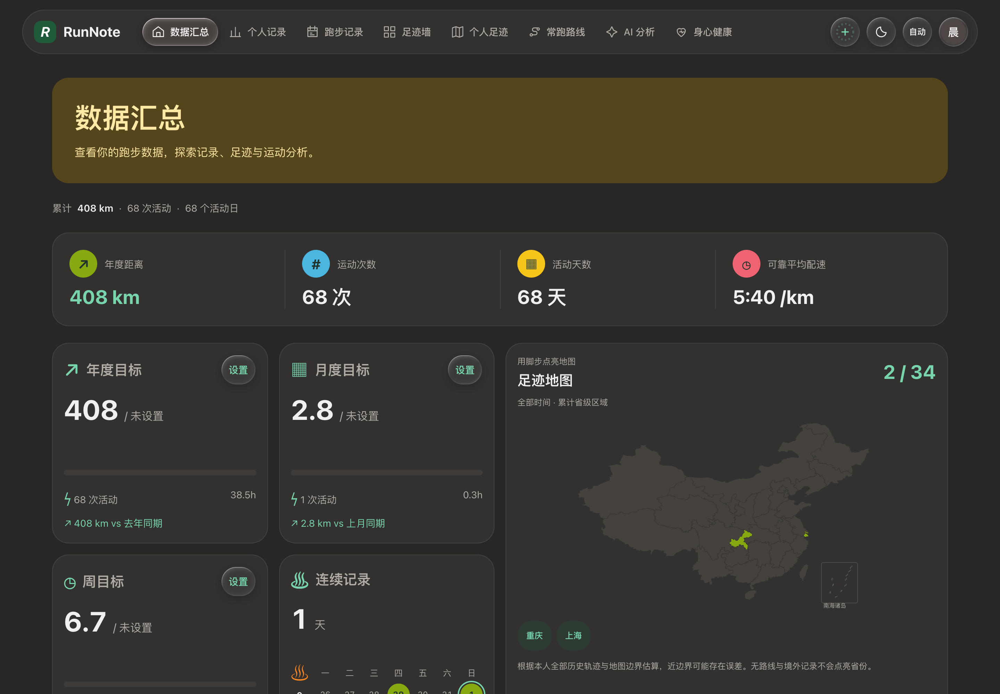</td>
  </tr>
  <tr>
    <td align="center">数据汇总</td>
    <td align="center">深色模式</td>
  </tr>
  <tr>
    <td>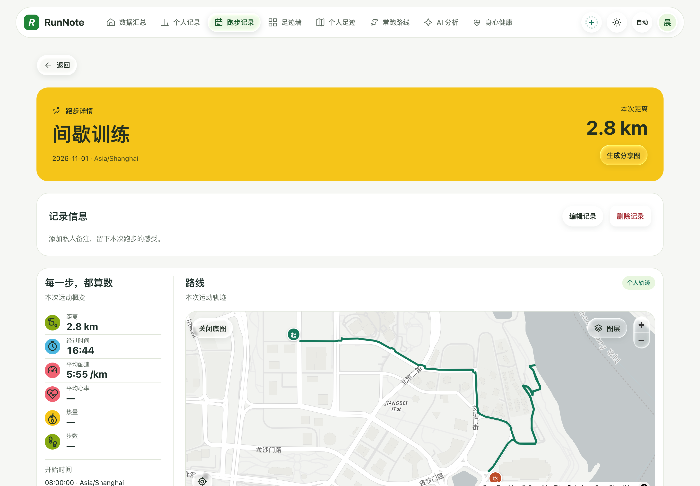</td>
    <td>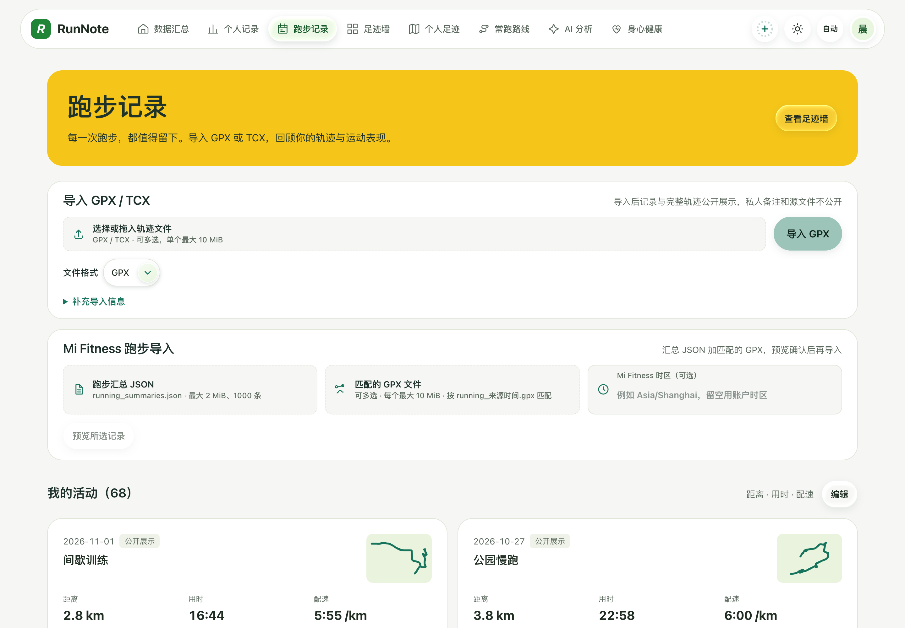</td>
  </tr>
  <tr>
    <td align="center">跑步详情与路线</td>
    <td align="center">跑步记录</td>
  </tr>
  <tr>
    <td>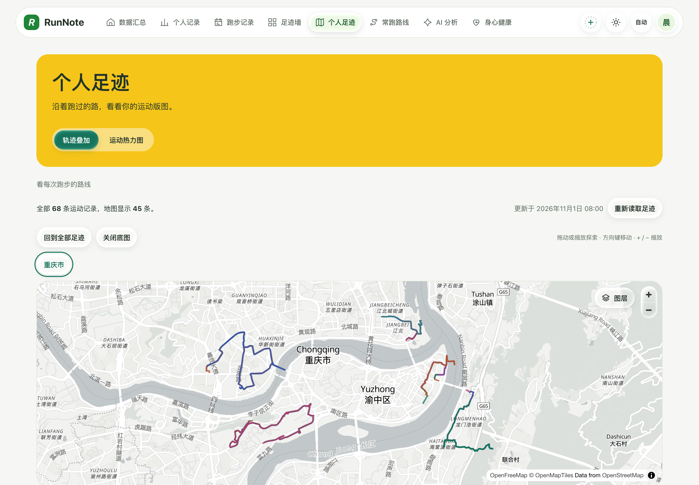</td>
    <td>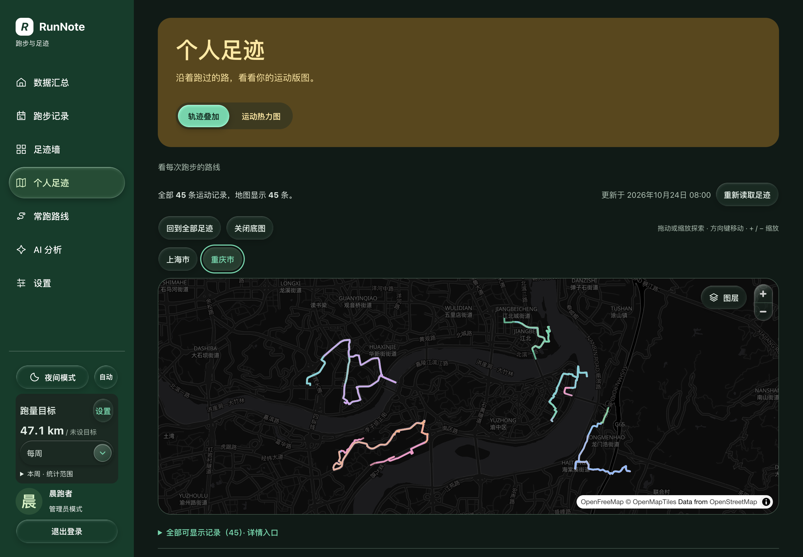</td>
  </tr>
  <tr>
    <td align="center">个人足迹</td>
    <td align="center">深色足迹</td>
  </tr>
</table>

<p align="center">
  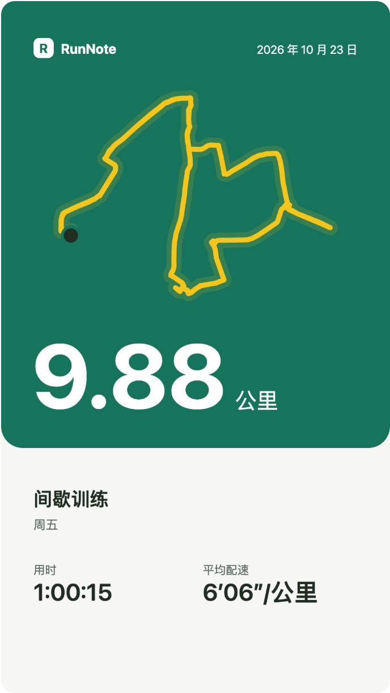
  &nbsp;
  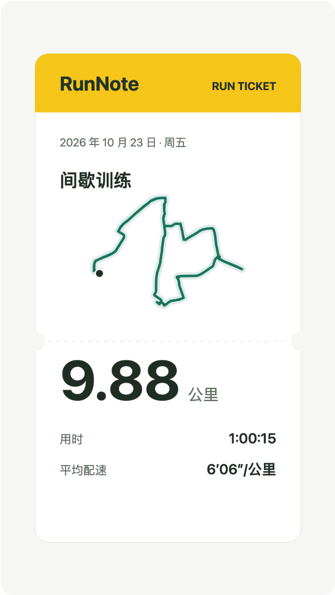
  &nbsp;
  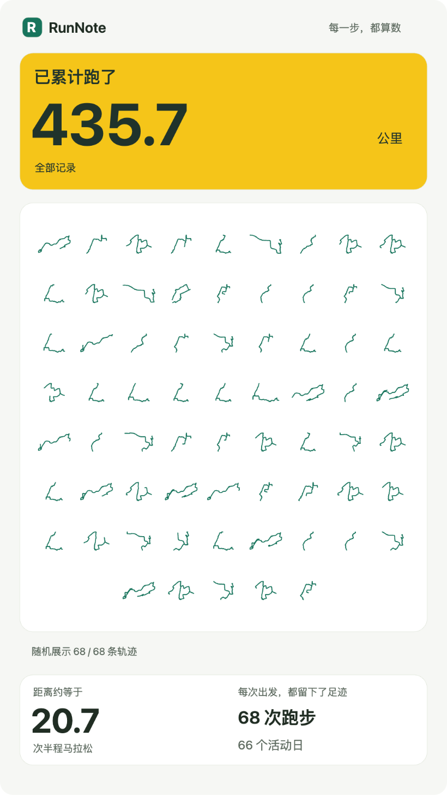
  &nbsp;
  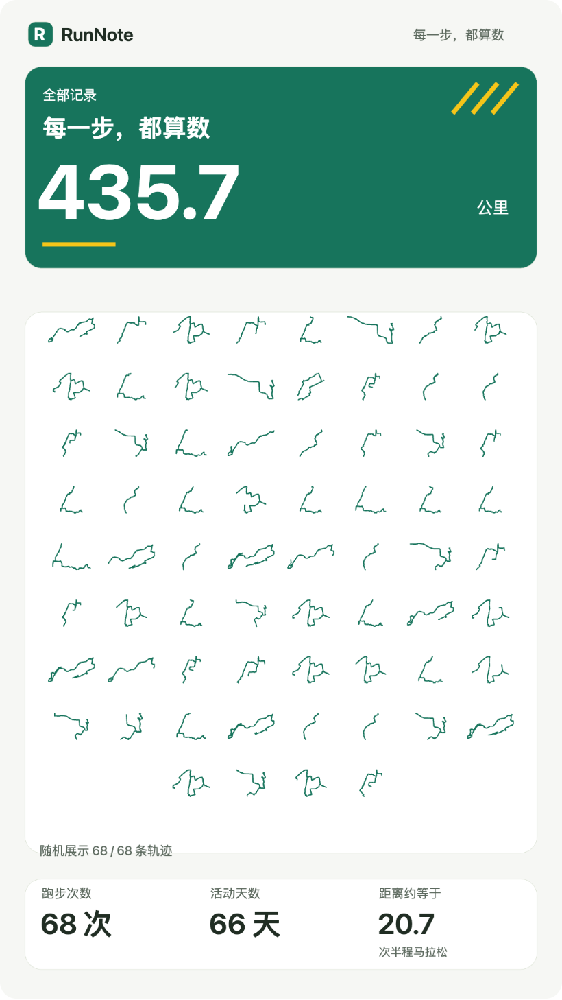
  &nbsp;
  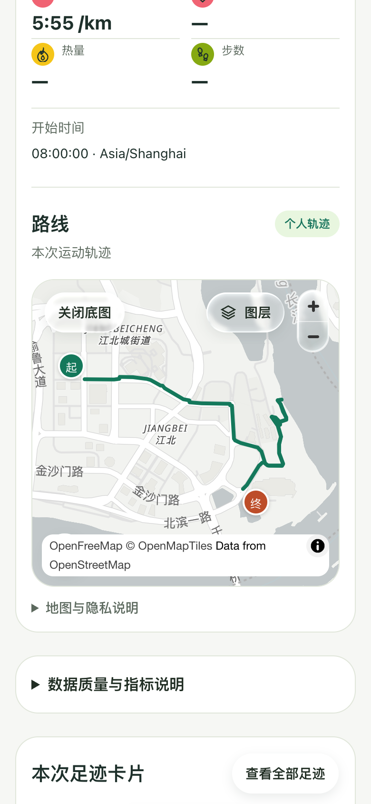
</p>

> 截图使用合成数据生成，不包含真实轨迹或个人信息。

## 在线站点

**<https://run.aisaka.cc>** 是站主的公开展示站点，访客无需登录即可浏览数据汇总、跑步记录与足迹。

## Android 客户端（Companion）

Web 端仍是 RunNote 的主要支持体验。仓库同时包含基于 Capacitor 8 的 Android Companion 工程（`android/`，最低要求 Android 10 / API 29、系统 WebView 116+），通过 `server.url` 复用现有 SvelteKit UI，不改动 Web SSR 架构、服务端指标权威或数据库 Schema。

- **当前基线**：Phase 0–3 代码已合入 `main`（当前基线 `v2.5.0` / `801729e4`）。
- **已合入代码的能力**：
  - **容器与基础适配**：应用身份与品牌资源（`com.tingchieh.runnote`）、构建时 HTTPS 来源校验与导航白名单、系统状态栏明暗同步、返回键/手势导航、原生断网提示与 DocumentsUI 文件导入（GPX / TCX / 小米运动健康）。
  - **只读健康数据、离线缓存与增量同步**：仅含 6 项只读权限（无写入与后台读取权限）的 Android Health Connect 桥接；基于 IndexedDB 的按账号隔离只读离线缓存（不含身心健康日记、敏感凭据、原始轨迹文件或离线底图瓦片）以及退出/切号清理；基于 `GET /api/v1/activities/sync` 的增量同步与断网重试。
  - **原生运动记录**：跨平台记录界面（`/activities/record`、`/workspace/activities/record`）、基于 Android 位置前台服务（`foregroundServiceType="location"`，不声明 `ACCESS_BACKGROUND_LOCATION`）的锁屏/后台 GPS 采集与锁屏脱敏通知、暂停/继续分段、崩溃恢复、账号绑定本地上传队列，以及复用 `POST /api/v1/gpx-imports`（`Idempotency-Key`）的幂等上传与退避重试。
- **当前分发与验证状态（尚未正式发布）**：目前仅支持本地 debug / 内部测试构建，**尚未发布正式安装包或上架应用商店**。除 Phase 0 技术验证的早期真机与公网 HTTPS 门禁已关闭外，以下发布前门禁仍**待完成**（均未记为通过）：
  - 正式签名 Release APK 构建与签收；
  - 覆盖 Phase 1–3 的完整真机验收（含 Phase 1 真机视觉检查、Phase 2 Health Connect 真机授权/拒绝/撤销/无数据验收、Phase 3 真机离线记录与恢复闭环）及主流国产 ROM 后台保活/杀进程实测；
  - Google Play 后台定位 / 前台位置服务政策、Data Safety 声明与商店审查；
  - 全量真实后端 Playwright E2E 回归验证。
- **移动端专属 UI**：面向手机端的专属界面与导航方案已作为设计方向获批，**尚未开始实现或合入代码**。
- **阶段记录**：[Phase 0 技术验证](docs/95-android-capacitor-phase0.md) · [Phase 1 只读 Companion](docs/97-android-capacitor-phase1.md) · [Phase 2 健康桥接与离线缓存](docs/98-android-capacitor-phase2.md) · [Phase 3 原生运动记录](docs/99-android-capacitor-phase3.md)

## 技术栈与架构

```text
浏览器 ──► Caddy (HTTPS) ─┬─ /api/*  ──► FastAPI (Uvicorn)  ──► PostgreSQL 18 + PostGIS 3.7
                          └─ 其他    ──► SvelteKit (Node)   ──► 同源 /api 代理 ──┘
```

| 层 | 技术 |
| --- | --- |
| 前端 | SvelteKit 3、Svelte 5（runes）、TypeScript、Tailwind 4、MapLibre GL、ECharts |
| 后端 | Python 3.14、FastAPI、Pydantic 2、SQLAlchemy 2（同步）、Alembic、GeoAlchemy2、gpxpy |
| 数据库 | PostgreSQL 18 + PostGIS 3.7，唯一持久化中心 |
| 部署 | 原生安装（systemd + Caddy），**不使用 Docker**；脚本化发布、迁移、备份与恢复演练 |

后端是模块化单体，功能模块（activities、footprints、statistics、ai_assistant、sharing、showcase 等）按 `router / service / schema / model` 组织。JSON API 使用 `{data, error, meta.request_id}` 响应信封，助手的实时回复使用服务端发送事件（SSE）。

## 快速开始

环境：macOS 或 Linux、PostgreSQL 18 + PostGIS 3.7、Python 3.14、Node.js 24。pnpm 版本见 [`frontend/package.json`](frontend/package.json) 的 `packageManager`。

```bash
# 1. 配置（编辑 .env，填入数据库连接串等）
test -e .env || cp .env.example .env

# 2. 数据库：创建库并启用 PostGIS，然后迁移
cd backend
python3.14 -m venv .venv
.venv/bin/python -m pip install --require-hashes -r requirements.lock
.venv/bin/alembic upgrade head
cd ..

# 3. 初始化站主账号并启动后端（默认 8000）
backend/.venv/bin/python scripts/site-owner.py create   # 离线创建站主账号（SITE_OWNER_EMAIL）
backend/.venv/bin/python scripts/local-auth.py init
backend/.venv/bin/python scripts/local-auth.py serve

# 4. 启动前端（另一终端）
cd frontend
pnpm install --frozen-lockfile
pnpm dev
```

打开 <http://127.0.0.1:5173>，管理入口为 `/admin`。完整的本地环境、测试库、生产部署与运维说明见 [`docs/`](docs/)，其中生产部署见 [66 生产部署](docs/66-production-deployment.md)，站主与受管账号见 [55](docs/55-single-owner-showcase.md) / [56](docs/56-admin-users-personal-showcase.md)，早期的详细环境说明保留在 [旧版 README](docs/00-legacy-readme.md)。

## 配置与运维

- **可选 AI 助手**。在后端环境配置 `AI_BASE_URL`、`AI_MODEL` 和 `AI_API_KEY` 后才可发送新问题。设 `AI_ASSISTANT_ENABLED=false` 可停用新提问，已保存的会话仍可查看。密钥仅放在服务端环境（本地使用 Git 忽略的根目录 `.env`），严禁放入 `PUBLIC_*` 变量或提交到仓库。[配置示例](.env.example) · [助手设计](docs/engineering/runnote-ai-assistant-design.md)
- **数据库升级**。使用新界面前，目标数据库需升到发布版本的 Alembic head，其中包含 `0032_running_diary`、`0033_ai_assistant` 和 `0034_drop_ai_reports`（`0034_drop_ai_reports` 会删除旧版 `ai_reports` 表且不可逆）。已有数据库在生产迁移前须备份并演练恢复。这些迁移均带有降级保护（表含数据或已删除不可逆表时会拒绝降级）。跨迁移回退需要前向修复，或按部署文档恢复迁移前备份，后者会丢失备份后的写入。[生产部署](docs/66-production-deployment.md)
- **流式代理**。反向代理需要即时转发 `text/event-stream`，避免缓冲或压缩缓冲。项目 Caddy 配置为助手消息端点设置了 `flush_interval -1` 和 60 秒响应头超时，后端先发 SSE 响应头再等待模型。SvelteKit 代理为此端点留出 195 秒，覆盖后端单轮流式截止时间（默认 90 秒，最多 180 秒）。[Caddy 配置](infra/native/Caddyfile) · [助手设计](docs/engineering/runnote-ai-assistant-design.md)

## 测试

```bash
# 后端
(cd backend && .venv/bin/pytest tests/unit -q && .venv/bin/ruff check app migrations tests)

# 前端
(cd frontend && pnpm test && pnpm check && pnpm build)
```

后端集成测试和 e2e 需要独立的 `_test` PostGIS 测试库，不会触碰开发库；未配置时会被跳过。

## 隐私

- 邮箱、文件名、备注、原始 GPX/TCX 不会出现在公开响应中。
- 地图在浏览器中渲染轨迹 GeoJSON，底图服务只收到公开样式、字体、图标和当前视口瓦片请求。
- AI 助手经用户同意后，向配置的模型服务发送包含日期和时区的系统提示、当前提问、同一会话近期对话、可用工具定义，以及查询所需的白名单结果。结果可包含运动统计、活动 UUID 和日期等单次运动指标、省市级等粗粒度地名及足迹计数、常跑路线组摘要。工具结果排除活动标题、标签、备注、精确坐标、原始导入文件及文件名、照片、账号资料和他人数据。用户自行输入的聊天内容会随提问发送，可在助手中撤回同意。[助手设计](docs/engineering/runnote-ai-assistant-design.md)
- 跑步日记及照片仅本人可访问，不进入公开展示、分享海报或 AI 上下文。上传照片转为无元数据 PNG，原始文件不保留，处理后的图片存入 PostgreSQL 并随数据库备份。独立的身心健康日记同样只供本人查看，也不进入 AI 上下文。[跑步日记](docs/94-running-diary.md)

## 文档

设计、验收与运维记录在 [`docs/`](docs/)；UI 规范在 [`docs/design-system/`](docs/design-system/README.md)；给 AI 编码 Agent 的工作指南在 [`AGENTS.md`](AGENTS.md)。

## 许可证

[MIT](LICENSE) © 2026 TingChieh
