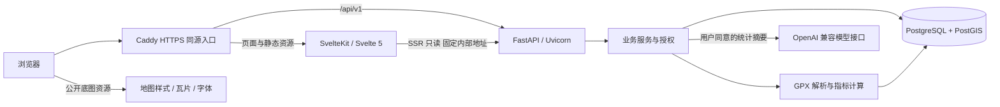
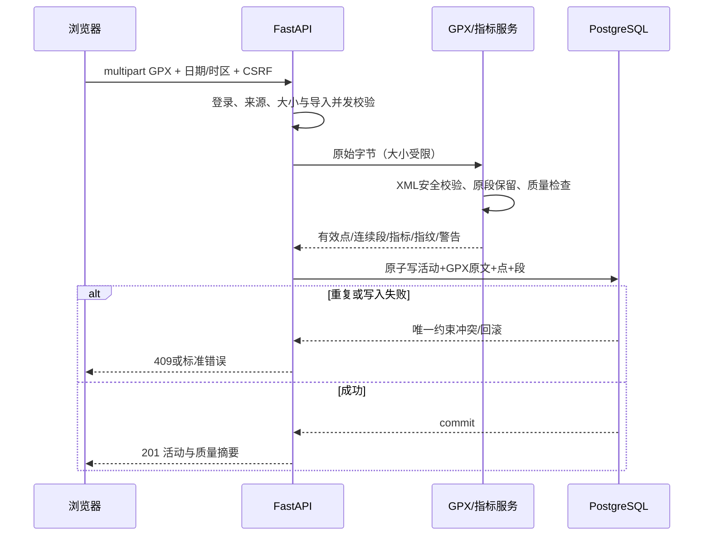

# 系统架构与目录设计

> 开发与部署方案于 2026-10-12 调整为非容器化。目录树包含已实现骨架与后续建议模块；当前实际文件及验证见 07-phase-one-implementation.md。

## 1. 整体架构

采用独立前端和模块化单体后端，数据库作为唯一持久化中心。



Caddy 将 `/api/*` 转发至 Uvicorn，保留路径；其他请求转发 SvelteKit Node 服务。浏览器使用同源 `/api/v1`，生产不配置宽泛 CORS。DB、Uvicorn 和 Node 端口不直接暴露公网。

地图底图来自阶段三确定的合法资源，浏览器直接加载其公开资源。活动坐标由本系统的有权限 API 提供；禁止将私人轨迹放入外部地图 URL、静态资源 URL 或外部分析脚本。

## 2. 前后端职责

| 能力 | 前端 | 后端 |
| --- | --- | --- |
| 认证 | 表单、会话 UI、CSRF 头、页面跳转 | 密码验证、会话与过期、限流、权限 |
| GPX 导入 | 文件选择、基本大小提示、结果与质量提示 | 权威大小/内容校验、解析、清洗、计算、去重、事务 |
| 记录 | 列表、编辑交互、筛选与分页状态 | 参数校验、归属查询、可编辑字段、CRUD |
| 单次地图 | MapLibre 图层、缩放、标记、信息面板 | 授权、简化轨迹、起终点与范围信息 |
| 日历与统计 | 渲染日格、切换维度、ECharts 格式化 | 日期边界、聚合、配速口径、数据覆盖率 |
| 叠加与热力 | 图层与图例、筛选交互 | 查询限制、空间网格、独立活动计数 |
| 分享 | 隐私说明、发布选择、链接复制 | 动态权限、令牌、安全公开模型 |
| AI | 明示数据范围、主动触发、文本呈现 | 统计快照、限额、模型请求、结果校验、持久化 |

前端可以显示已知限制，但不能成为唯一验证入口。MapLibre、ECharts 与 AI 都不生成权威运动指标。OpenAPI 派生的 TypeScript 类型属于接口契约，不是重复业务逻辑。

## 3. 后端分层与模块

每个功能模块按自己的 router、schema、service、model 组织；通用数据库和安全设施集中管理。避免为每个表建立空壳 Repository/Manager/Factory。

| 层/模块 | 职责 | 禁止承担的职责 |
| --- | --- | --- |
| Router | HTTP 参数、认证依赖、调用服务、响应 | 直接实现距离算法与多步骤事务 |
| Pydantic schema | 请求/响应类型、字段与跨字段校验 | 持有 DB 连接、外部请求 |
| Service | 业务规则、授权、事务、聚合协调 | 生成 UI 标记或依赖浏览器状态 |
| SQLAlchemy model / query | 表映射、必要查询及约束 | 信任请求中的 owner、自动发布数据 |
| GPX parser / metrics | 解析结果与计算结果的纯数据转换 | HTTP 响应、认证、AI 调用 |
| AI provider adapter | 固定服务器地址的请求、超时与响应转换 | 访问其他用户数据、接受用户任意 base URL |

简单查询可以直接写在模块 service；只有空间查询或复用复杂查询才单独拆 `queries.py`。授权集中为可复用策略，但每个入口执行；不能以“页面已登录”省略后端校验。

### 3.1 同步执行与事务

- SQLAlchemy 使用同步 Session 和 psycopg，常规 FastAPI 入口采用 `def`，由工作线程执行。禁止在 `async def` 中直接运行同步 DB 或重 GPX 计算。
- 每个请求持有自己的 Session，不共享全局 Session；提交边界由 service 管理，读取也及时结束事务。
- GPX 先在有时限、有限点数的解析流程中得到规范化结果，再短事务写入原文、活动、点和分段。失败全部回滚；唯一约束冲突转为 409。
- 所有活动写事务先锁定本人users行，再修改活动并递增activity_data_version；AI创建快照时采用相同用户锁，使快照和版本来自一致状态。解析期间不持有此用户行锁。
- 解析仍可能占用 CPU，线程不是无限扩容方案。MVP 每用户同时仅一个导入：使用PostgreSQL会话级非阻塞advisory lock，在专用自动提交连接上取得，解析期间不保持事务，最终在finally中解锁再归还连接；失败取得锁返回429。固定worker与连接池大小限制总容量，不引入队列。用户锁键固定算法生成，极低概率碰撞只会暂时拒绝而不会混淆归属。
- AI 限额与 pending 记录使用短事务，提交后调用供应商，完成再开启短事务写报告。外部调用期间不持有数据库事务或用户行锁。

## 4. 关键数据流

### 4.1 GPX 导入



距离使用 PostGIS 的 geography 线长查询在后端完成，指标服务负责将分段结果及时间口径组合成完整指标；不把数据库空间运算搬到前端。

### 4.2 统计与 AI

统计服务按 `owner_id` 和活动日期筛选活动摘要，生成日历、趋势与汇总。AI 使用同一统计服务的结果，保存生成时快照与用户数据版本。用户编辑或删除活动后版本递增，旧报告标记为过时，不静默改写旧分析。

## 5. 认证与 SSR 边界

采用至少 256 位随机会话令牌，Cookie 仅传原令牌，DB 存 SHA-256 哈希。密码采用 Argon2id。推荐验证后的邮箱长度上限 254、密码 12–128 字符；密码不静默截断。

生产 Cookie 使用 `__Host-run_session`、`Secure`、`HttpOnly`、`SameSite=Lax`、`Path=/`，不设 Domain。本地 HTTP 使用独立名称 `run_session`，只在明确开发模式允许不设 Secure。

会话绝对有效期7天、闲置有效期24小时；匿名预认证会话10分钟。服务端检查两种到期条件，Cookie到期不等于服务端撤销。登录/注册成功更换令牌与CSRF token，并撤销本次Cookie对应旧会话，无论旧会话匿名还是已登录；其他设备会话保留。登出撤销当前会话，修改密码撤销全部原会话。闲置时间最多每5分钟更新一次，减少每个GET的写负载；此节流误差纳入有效期说明。

CSRF 采用会话绑定的随机 token：`GET /auth/csrf` 建立匿名预认证会话或返回现有会话的 token；token 在响应中提供，由前端内存保存。所有非安全方法，包括注册、登录、GPX multipart、登出和删除，要求 `X-CSRF-Token`，并校验配置允许的外部 Origin。Origin 缺失时检查 Referer 来源，两者均无则拒绝。`SameSite` 是补充保护。

SvelteKit SSR 仅将当前请求的会话 Cookie 转发到固定 `INTERNAL_API_BASE_URL`；不转发全部 Cookie、不调用用户指定地址、不在全局变量保存当前用户。CSRF 取值与写操作由浏览器执行，SSR 不创建/轮换会话，也不写业务数据。

API 与私密 SSR 页面设置 `Cache-Control: private, no-store`。客户端退出后清空本人页面数据与 CSRF 状态。前端守卫只用于体验，FastAPI 始终重新鉴权。

## 6. 建议目录结构

下列树描述目标结构；后续业务模块只在相应阶段创建。生产配置在阶段八编写，本次不创建 unit 或 Caddyfile。

```text
run_note/
├── README.md
├── docs/
│   ├── 01-requirements.md
│   ├── 02-architecture.md
│   ├── 03-database-and-gpx.md
│   ├── 04-rest-api.md
│   ├── 05-development-roadmap.md
│   └── 06-risks-and-validation.md
├── frontend/                         # 阶段一创建
│   ├── package.json
│   ├── pnpm-lock.yaml                # 一个包管理器，一份锁文件
│   ├── pnpm-workspace.yaml           # 当前 SvelteKit 3 配置在 vite.config.ts
│   ├── vite.config.ts
│   ├── src/
│   │   ├── app.html
│   │   ├── app.css
│   │   ├── hooks.server.ts           # SSR会话读取，不实现认证算法
│   │   ├── lib/
│   │   │   ├── api/                  # 请求封装、错误映射、接口类型
│   │   │   ├── components/ui/        # shadcn-svelte组件
│   │   │   ├── features/
│   │   │   │   ├── auth/
│   │   │   │   ├── activities/
│   │   │   │   ├── map/
│   │   │   │   ├── statistics/
│   │   │   │   ├── sharing/          # 阶段六
│   │   │   │   └── ai/               # 阶段七
│   │   │   └── utils/                # 单位、日期显示；无权威指标算法
│   │   └── routes/
│   │       ├── (auth)/login/
│   │       ├── (auth)/register/
│   │       ├── (app)/+layout.server.ts
│   │       ├── (app)/activities/
│   │       │   ├── import/
│   │       │   ├── new/
│   │       │   └── [id]/
│   │       ├── (app)/dashboard/
│   │       ├── (app)/heatmap/
│   │       ├── (app)/settings/
│   │       ├── (app)/ai/
│   │       ├── u/[username]/          # 公开主页
│   │       ├── public/activities/[id]/ # 公开活动页面
│   │       └── s/[token]/             # 链接可见页面
│   └── tests/                        # 组件测试与浏览器E2E
├── backend/                          # 阶段一创建
│   ├── pyproject.toml
│   ├── requirements.lock             # 第一阶段固定生成与安装方式
│   ├── alembic.ini
│   ├── migrations/
│   │   ├── env.py
│   │   └── versions/
│   ├── app/
│   │   ├── main.py                   # 装配应用与路由
│   │   ├── core/
│   │   │   ├── config.py             # 环境变量与启动校验
│   │   │   ├── security.py           # 哈希、令牌、CSRF
│   │   │   ├── errors.py             # 统一异常与响应
│   │   │   └── logging.py            # request_id、脱敏
│   │   ├── db/
│   │   │   ├── base.py
│   │   │   └── session.py
│   │   ├── api/dependencies.py       # DB、当前会话和当前用户
│   │   └── modules/
│   │       ├── auth/                 # router/schema/service/model
│   │       ├── users/
│   │       ├── activities/
│   │       ├── gpx/                  # parser.py、metrics.py、fingerprint.py
│   │       ├── statistics/
│   │       ├── spatial/              # 阶段五，queries.py
│   │       ├── sharing/              # 阶段六
│   │       └── ai/                   # 阶段七，provider.py、prompts.py
│   └── tests/
│       ├── unit/
│       ├── integration/
│       ├── fixtures/gpx/
│       └── conftest.py
├── infra/                            # 阶段八原生部署配置（计划）
│   ├── Caddyfile
│   └── systemd/
│       ├── run-note-api.service
│       └── run-note-web.service
├── .env.example                      # 空值或非敏感开发占位
├── .gitignore
└── .github/workflows/ci.yml           # 使用GitHub时建立
```

私有活动页面 URL 为 `/activities/[id]`，公开活动页面 URL 为 `/public/activities/[id]`。页面分组不提供 URL 隔离，不能靠路由组区分公开与私有路径。

地图与 ECharts 在浏览器生命周期中初始化，避免 SSR 使用 `window`。离开页面销毁实例及监听器。Svelte 5 使用一致的响应式风格，不混用未经验证的旧组件版本。

## 7. 开发与部署环境

### 7.1 本地开发

- macOS 使用 Homebrew PostgreSQL 18.6 / PostGIS 3.6.4，数据库由原生服务管理，数据目录独立于项目源码和依赖目录。核对扩展 control/动态库目录及实际空间函数；禁止通过重建已有数据库来修复环境。
- Python 使用 backend/.venv 与带 hash 的 requirements.lock；前端使用 pnpm 和 pnpm-lock.yaml。记录运行时及系统依赖版本；已有 Homebrew 服务配置保持不变，新环境数据库端口仅监听本机。
- 前端与 API 在宿主机运行便于热更新；Vite 将 `/api` 代理到本地 Uvicorn，同源 Cookie 和 CSRF 行为不需要开发专用宽泛 CORS。
- 测试使用独立 PostgreSQL/PostGIS 数据库，不能以 SQLite 代替空间集成测试。
- 阶段一验证 Python、Node、SvelteKit、Tailwind、shadcn-svelte 的兼容组合后记录精确版本。建议 Python 3.12、Node 22 LTS 作为起点，实际锁定版本以兼容验证为准。

### 7.2 生产

采用 Linux 原生 PostgreSQL/PostGIS、Python 虚拟环境、SvelteKit adapter-node、Uvicorn 和 Caddy，不使用容器。systemd 分别管理 API 与 Node 服务，配置低权限运行用户、工作目录、绝对启动路径、受控 EnvironmentFile、失败重启和日志；Caddy 只对外开放 80/443，数据库与应用端口仅内部可达。

前端通过 pnpm 锁定安装并构建，生产启动 Node build/index.js；API 使用发布版本自己的 .venv/bin/uvicorn，不使用开发 --reload。Linux 系统包的 PostgreSQL/PostGIS 主版本及扩展目录需要单独验证，macOS 成功不等于 Linux 已验收。

发布顺序：核对运行时和扩展兼容版本 → 数据库备份 → 安装锁定依赖并构建 → 受控单次 Alembic 迁移 → systemd 启动/切换服务 → ready、浏览器与 HTTPS 验证。迁移不能由每个 Uvicorn worker 自行执行。应用回滚与数据库恢复分开规划，不承诺所有迁移可无损降级。

只信任来自受控 Caddy 的代理头；配置可信代理地址，而非任意 `X-Forwarded-For`。日志与限流中的客户端 IP 不得由浏览器伪造。健康检查和 DB readiness 分离，不泄露连接字符串。

### 7.3 测试、持久性与复现

自动化测试始终使用独立 PostgreSQL/PostGIS 测试库。CI 在 macOS runner 安装 Homebrew 包并创建独立临时集群，不用服务容器；CI 数据与用户本地数据完全分离。原生 PostgreSQL 持久性通过独立受控实例的写入、正常停止/启动及重读验证，不以容器卷为验收条件。已有日常实例不为测试擅自重启。

全新环境按 README 安装原生依赖、建立角色/库、由管理员启用 PostGIS、执行迁移和启动服务；保留版本与命令证据。Homebrew 可变配方不保证旧版本永久可安装，复现时须核对兼容组合并记录差异，不能直接升级已有实例。

仓库保留的 infra/compose.dev.yml 是停用历史文件，当前目录树、开发流程及验收不引用它执行任务。

### 7.4 环境变量清单

| 变量 | 所在端 | 用途 |
| --- | --- | --- |
| `APP_ENV` | 后端 | development/test/production，控制严格启动规则 |
| `DATABASE_URL` | 后端 | PostgreSQL连接；仅服务器可见 |
| `SITE_ORIGIN` | 后端/部署 | 单一外部来源，CSRF与分享地址构造 |
| `INTERNAL_API_BASE_URL` | SvelteKit服务端 | SSR固定内部API地址 |
| `SESSION_ABSOLUTE_TTL_SECONDS` | 后端 | 默认604800 |
| `SESSION_IDLE_TTL_SECONDS` | 后端 | 默认86400 |
| `GPX_MAX_BYTES` / `GPX_MAX_POINTS` | 后端 | 默认10485760 / 50000 |
| `GPX_MAX_SEGMENTS` / `GPX_PARSE_TIMEOUT_SECONDS` | 后端 | 默认1000 / 15 |
| `AI_BASE_URL` / `AI_API_KEY` / `AI_MODEL` | 后端 | 固定供应商地址、服务端密钥和模型 |
| `AI_DAILY_LIMIT` / `AI_TOTAL_TIMEOUT_SECONDS` | 后端 | 默认5次尝试/天，30秒总超时 |
| `PUBLIC_MAP_STYLE_URL` | 前端 | 可公开样式地址，禁止含服务器密钥 |
| `PUBLIC_MAP_ATTRIBUTION` | 前端 | 底图许可要求的署名 |

所有默认值在实现时集中配置；生产缺少必填配置即启动失败。`.env` 不提交，日志不输出密钥或完整连接串。公开地图访问 token 若供应商要求，应使用可公开且限定域名与额度的 token，不将 AI/数据库密钥放进 `PUBLIC_*`。

## 8. 架构约束

不预建通用插件系统、数据湖、事件总线或大型 Repository 框架。统计先按需聚合，空间查询先加合适索引与规模限制。性能证据明确不足时才引入缓存、派生网格表或后台任务，并补充失效和故障规则。
