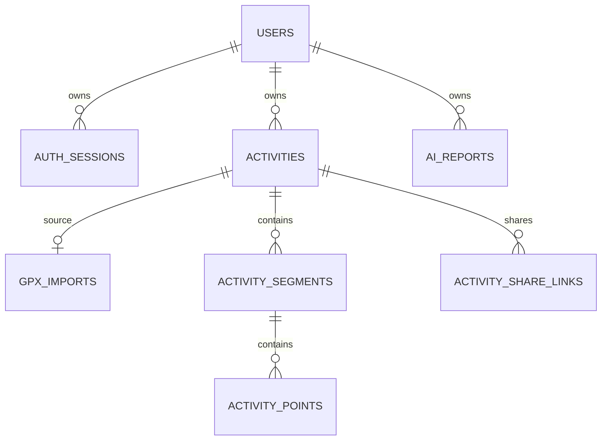

# 数据库与轨迹数据设计

## 1. 存储方案与取舍

采用三层轨迹数据：**原始 GPX bytea + 规范化有效轨迹点 + 派生连续轨迹段**。

| 数据 | 保存目的 | 使用边界 |
| --- | --- | --- |
| 原始字节 | 文件哈希、复现清洗、追溯原始错误 | 不进入普通列表/详情；不向公开接口提供 |
| 有效点 | 时间、高程、点序、后续重算与质量追溯 | 不将点密度当作运动频率 |
| 分段 geometry | 空间查询、距离、简化与地图 | 保留断点，不能连接两个独立段 |
| 活动摘要 | 列表、日历和统计快速查询 | 仅由后端导入或手动记录服务写入 |

原文使用 DB `bytea`，便于原文与摘要、点、段在一次事务中提交，级联删除与备份也只依赖 PostgreSQL。缺点是 DB 体积和备份增加。MVP 单文件上限 10 MiB，不在列表查询加载原文；验收数据集控制在 1000 条普通活动规模。

文件系统存原文同样合理，但需实现临时文件、提交后移动、失败清理、备份一致性及孤儿文件清扫。本项目优先避免这套额外生命周期。若原文总量超出目标服务器可用磁盘/备份窗口，先测量，再迁移到受控文件或对象存储；不在设计阶段添加存储服务。

仅保存 GeoJSON 难以精确保留点时间与高程，JSONB 也不能取代空间类型。仅保存点表则每次空间查询都要重建线路。分段几何是可重建的派生数据，不能与点表成为两个独立编辑来源。

## 2. 关联关系

`auth_sessions.user_id` 在预认证时可空，因此匿名会话不归属用户。`auth_rate_buckets` 使用账号/IP的哈希键，含未知账号，不建立user外键，因此未画入业务关系图。该辅助表不存明文邮箱或原始IP。

### 2.1 通用约定

- 业务实体主键 UUID；轨迹点使用 `(segment_id, point_index)` 复合主键，避免大量点 UUID 开销。
- 时间戳用 `timestamptz`，输入转 UTC，输出 ISO 8601 `Z`；数据库会话时区配置 UTC。
- 活动本地日期用 `date`，IANA 时区用 `varchar(64)`，在应用层验证。
- 指标用 `numeric(12,3)`，单位明确；约束为非负且小于 `1000000000`，同时通过 Pydantic 拒绝 NaN/Infinity。计算内部保留浮点精度，持久化才统一舍入。
- 不知道的指标用 `NULL`，不能用零占位。零距离可以是真实输入，但不能产生有效配速。
- JSONB 仅用于质量摘要、AI 统计快照等版本化结构；核心筛选、归属与指标不藏入 JSONB。
- MVP 硬删除活动，关联数据 `ON DELETE CASCADE`；不预建软删除回收站。账号删除不作为当前必做 UI，但表关联支持级联清理。

## 3. 表设计

### 3.1 users：用户

| 字段 | 类型/约束 | 说明 |
| --- | --- | --- |
| id | uuid PK | 用户ID |
| email_normalized | varchar(254), UNIQUE NOT NULL | 去外侧空白、统一小写；MVP邮箱比较口径 |
| username | varchar(30), UNIQUE NOT NULL | 3–30个小写字母/数字/下划线，公开URL；不可改名 |
| password_hash | text NOT NULL | Argon2id编码；不保存原密码 |
| display_name | varchar(80) NOT NULL | 显示名称，默认用户名 |
| timezone | varchar(64) NOT NULL | 默认Asia/Shanghai，IANA时区 |
| profile_is_public | boolean NOT NULL default false | 是否开放主页，不自动公开活动 |
| activity_data_version | bigint NOT NULL default 0 | 每次活动新增/修改/删除原子递增，标记AI报告过时 |
| created_at / updated_at | timestamptz NOT NULL | 维护时间 |

邮箱规范化是本系统账号规则，不声称所有邮件服务的本地部分均不区分大小写。注册冲突由唯一约束处理。

### 3.2 auth_sessions：会话

| 字段 | 类型/约束 | 说明 |
| --- | --- | --- |
| id | uuid PK | 服务端内部标识，不是Cookie值 |
| user_id | uuid FK users, nullable | 空值表示10分钟预认证会话 |
| token_hash | char(64), UNIQUE NOT NULL | 256位以上随机令牌的SHA-256 |
| csrf_token | varchar(64) NOT NULL | 独立随机值，仅与有效会话一起可用，响应给同源前端 |
| created_at / last_seen_at | timestamptz NOT NULL | 绝对/闲置有效期判断 |
| expires_at | timestamptz NOT NULL | 绝对到期时间 |
| revoked_at | timestamptz nullable | 撤销时间 |

CSRF token不是登录凭证，保存在服务器会话中以便多标签页读取稳定值；会话令牌只存哈希。登录/注册创建新会话并撤销本次Cookie对应旧会话（匿名或已登录），其他设备会话保留，拒绝会话固定。索引user_id、expires_at；定期清理过期会话可用单机维护命令，不引入调度平台。

### 3.3 activities：运动记录

| 字段 | 类型/约束 | 说明 |
| --- | --- | --- |
| id | uuid PK | 活动ID |
| user_id | uuid FK users NOT NULL | 所属用户 |
| source | varchar(10), CHECK gpx/manual | 来源 |
| title | varchar(120) NOT NULL | 标题 |
| notes | text NOT NULL default空串 | 最长5000字符，按文本展示 |
| activity_date | date NOT NULL | 日历/统计归属日期 |
| date_source | varchar(16), CHECK timestamp/manual | 从开始时刻得到或用户补录 |
| timezone | varchar(64) NOT NULL | 导入/创建时的时区快照 |
| started_at / ended_at | timestamptz nullable | 可信边界点时间；手动记录可为空 |
| distance_m | numeric(12,3) NOT NULL | 后端有效段二维距离/经验证的手动距离 |
| elapsed_seconds | numeric(12,3) nullable | 完整可靠时间的总耗时/手动耗时 |
| avg_pace_seconds_per_km | numeric(12,3) nullable | 正距离、正耗时才有值 |
| temporal_quality | varchar(16) NOT NULL | complete/incomplete/invalid/manual |
| quality_summary | jsonb NOT NULL | 质量码、输入/有效点/断段/去重等计数 |
| metrics_version | varchar(32) NOT NULL | 例如gpx-v1或manual-v1 |
| visibility | varchar(10), CHECK private/unlisted/public | 默认private |
| allow_shared_route | boolean NOT NULL default false | public和unlisted接口是否可返回路线 |
| created_at / updated_at | timestamptz NOT NULL | 维护时间 |

跨字段校验：非空开始/结束时间不能倒置；时序invalid时不保存可信ended_at，源点时间仍保留，详见算法口径。manual无GPX原文和轨迹；gpx只有成功写入后才建立活动。日期与时间关系由service校验，涉及IANA时区不依赖复杂DB CHECK。

索引 `(user_id, activity_date DESC, id DESC)`；公开列表索引 `(user_id, activity_date DESC)` 仅覆盖 `visibility='public'`。如仅按日期分页，必须加 id 作为稳定排序键。不要给每个字段无差别加索引。

### 3.4 gpx_imports：成功导入来源

| 字段 | 类型/约束 | 说明 |
| --- | --- | --- |
| id | uuid PK | 来源ID |
| activity_id | uuid UNIQUE FK activities NOT NULL | 一条GPX活动一个原文件 |
| user_id | uuid NOT NULL | 用于用户内唯一去重，必须与活动owner一致 |
| original_filename | varchar(255) NOT NULL | 只作为展示文本，丢弃路径部分 |
| raw_gpx | bytea NOT NULL | 原始上传字节，不是重新序列化的XML |
| byte_size | integer NOT NULL | 1–10485760，随配置上限验证 |
| raw_sha256 | char(64) NOT NULL | 原文指纹 |
| canonical_sha256 | char(64) nullable | 仅完整可靠时间轨迹启用强语义去重 |
| fingerprint_version | varchar(32) NOT NULL | 指纹规则版本 |
| parser_version | varchar(32) NOT NULL | 解析规则/实现版本 |
| created_at | timestamptz NOT NULL | 导入时间，不是运动日期 |

唯一约束 `(user_id, raw_sha256)`；部分唯一索引 `(user_id, fingerprint_version, canonical_sha256)`，只对非空 canonical 指纹生效。

为防止重复 owner 数据不一致，activities 增加 `UNIQUE(id,user_id)`，gpx_imports 使用复合外键 `(activity_id,user_id) → activities(id,user_id)`。用户ID来自认证依赖，不能取自上传参数。

此表只保存成功导入，不建立后台任务状态机。失败返回错误并写脱敏日志，不生成失败活动或永久保留失败原文。成功重导入返回409及本人已有活动ID，删除原活动后允许重新导入。

### 3.5 activity_segments：有效连续段

| 字段 | 类型/约束 | 说明 |
| --- | --- | --- |
| id | uuid PK | 连续段ID |
| activity_id | uuid FK activities NOT NULL | 所属活动 |
| segment_index | integer NOT NULL | 清洗后的连续段顺序，从0开始 |
| source_track_index / source_segment_index | integer NOT NULL | 原始trk/trkseg位置 |
| break_reason | varchar(32) NOT NULL | source_boundary/invalid_coordinate/time_gap/speed_jump等 |
| point_count | integer NOT NULL | 至少1 |
| geom | geometry(LineString,4326) nullable | 至少2个有效点才生成；单点段为NULL |

`UNIQUE(activity_id, segment_index)`，`activity_id` B-tree 索引、`geom` GiST 索引。几何使用 `[longitude, latitude]` 顺序，不是 `[latitude, longitude]`。

每个原 `trkseg`、非法点和清洗断点都形成新的连续段。单点段可以保留有效点，但不形成“假线”。活动地图将各非空段序列化为 MultiLineString/FeatureCollection，不再额外保存整条活动几何，避免重复维护。

### 3.6 activity_points：规范化有效点

| 字段 | 类型/约束 | 说明 |
| --- | --- | --- |
| segment_id | uuid FK activity_segments | 复合主键第一项 |
| point_index | integer >=0 | 复合主键第二项，清洗后段内序号 |
| source_point_index | integer >=0 NOT NULL | 原trkseg内序号，用于定位原文 |
| position | geometry(Point,4326) NOT NULL | 有限坐标，经度[-180,180]、纬度[-90,90] |
| elevation_m | double precision nullable | 有限数值，高程缺失不插补 |
| recorded_at | timestamptz nullable | 有明确UTC偏移量且可解析的时间 |

点表仅存规范化有效坐标，非法坐标在质量摘要及原文中追溯。点时间无法解释时保存NULL。通过点→段→活动归属查询，不冗余 user_id。MVP 不给每个点建空间索引，热力图使用段线；复合主键支持按段顺序读取。

### 3.7 activity_share_links：分享链接（阶段六）

| 字段 | 类型/约束 | 说明 |
| --- | --- | --- |
| id | uuid PK | 本人管理链接的ID |
| activity_id | uuid FK activities NOT NULL | 所属活动 |
| token_hash | char(64) UNIQUE NOT NULL | 随机分享令牌SHA-256 |
| expires_at | timestamptz nullable | 可选择不过期；默认30天 |
| revoked_at | timestamptz nullable | 撤销后永久无效 |
| created_at | timestamptz NOT NULL | 创建时间 |

令牌至少256位随机值，只在创建响应中返回原值。默认每活动最多5个未撤销且未过期链接，在锁定活动行的短事务内检查；没有新存储或队列。

访问时实时检查活动状态及 `allow_shared_route`，不能仅验证令牌。活动改private时撤销所有链接，再改unlisted/public也不恢复旧链接。列表只返回管理ID和状态，不返回令牌。

### 3.8 ai_reports：AI报告（阶段七）

| 字段 | 类型/约束 | 说明 |
| --- | --- | --- |
| id | uuid PK | 报告/调用尝试ID |
| user_id | uuid FK users NOT NULL | 所属用户 |
| request_key | uuid NOT NULL | 浏览器生成的请求幂等键，用户内唯一 |
| date_from / date_to | date NOT NULL | 左闭右开范围 |
| source_data_version | bigint NOT NULL | users.activity_data_version快照 |
| status | varchar(16) NOT NULL | pending/succeeded/failed |
| stats_snapshot | jsonb NOT NULL | 有版本的指标、覆盖率和时间范围，不含坐标身份 |
| model / prompt_version | varchar(100)/varchar(32) | 生成配置 |
| report_text | text nullable | 通过长度与格式校验的文字 |
| error_code | varchar(50) nullable | 自有错误码，不保存供应商原始错误 |
| input_tokens / output_tokens | integer nullable | 供应商提供时记录，不假装一定存在 |
| created_at / finished_at | timestamptz | 生命周期 |
| deleted_at | timestamptz nullable | 删除报告正文，保留最小调用计数信息 |

索引 `(user_id, created_at DESC)`、`UNIQUE(user_id,request_key)`；部分唯一索引 `user_id WHERE status='pending'` 防止多worker并发生成。每日限额按UTC日期、所有尝试计数，用户行锁保护计数与pending创建。不因切换账号时区重置额度。

在创建新报告/读取pending状态时，将超过`created_at + AI_TOTAL_TIMEOUT_SECONDS + 60秒`的遗留pending置failed；进程崩溃不应造成永久占位。只允许匹配pending状态的完成更新，避免迟到结果覆盖超时失败。调用期间无数据库长事务。

用户删除报告时清空report_text、stats_snapshot（置空对象），正文不可恢复；不立即删除用于当日额度的user_id、created_at、request_key、status等最小元数据。本人列表和详情排除deleted_at非空行；重复使用保留中的已删除request_key返回409 REPORT_DELETED，不能绕过限额重发。最小调用元数据自deleted_at起保留30天后清理，仍属于当日窗口的行不得清理；删除账号时级联清除。用户未删除的报告保留供历史比较，幂等保证仅适用于调用记录仍保留期间，客户端每个新尝试生成新UUID，不复用历史key。

### 3.9 auth_rate_buckets：认证限流辅助表（阶段二）

| 字段 | 类型/约束 | 说明 |
| --- | --- | --- |
| scope / subject_hash / window_start | varchar/char(64)/timestamptz 复合PK | login-account/login-ip/register-ip + 键哈希 + UTC固定窗口 |
| attempts | integer >=0 NOT NULL | 原子递增计数 |
| expires_at | timestamptz NOT NULL | 清理依据 |

短事务upsert实现所有worker共享的限流，不新增Redis。初始值：同账号登录10次/15分钟、同来源IP登录60次/15分钟、注册10次/小时、匿名CSRF会话创建60次/小时。计数包含成功尝试；返回429和Retry-After。阈值需结合部署实际调整，不能无期限锁住账号。

## 4. GPX解析与清洗算法

### 4.1 输入限制与安全

初始限制为原文10 MiB、50000个轨迹点、1000个原轨迹段、解析15秒。代理与应用均控制请求体大小；不能只相信Content-Length，读取时按累计字节限额。只接受未压缩单GPX文件，不接受ZIP或其它归档。

扩展名/MIME只作为提示，真正校验XML与GPX结构。推荐defusedxml进行禁止DTD、实体和外部资源的安全预检，再调用gpxpy；这项小依赖用于弥补解析安全边界，不引入新服务。不能假定gpxpy默认解析器安全，也不能只靠字符串搜索DOCTYPE。配置受限点遍历并检查处理时限，实测证明病态XML也受控；难以可靠限制时使用独立解析进程与强制终止，作为隔离实现而非引入消息队列。

拒绝空文件、无有效trkpt、无效XML、超限、仅rte/wpt数据；拒绝/提示规则由稳定错误码表示。清洗不执行XML扩展、文件路径或GPX内URL。

### 4.2 按源顺序处理

1. 计算原始字节SHA-256，快速检查本人重复；数据库唯一约束负责并发最终判定。
2. 按文档中的trk、trkseg与点顺序遍历，不按时间重新排序；保持原段边界。
3. 验证有限经纬度与范围。非法坐标不入点表，终止当前连续段；下一个有效点开始新段，不能桥接。
4. 相邻点若坐标、时间、高程都相同，移除重复点并计数；同位置不同时间保留，以表达停留。
5. 时间有明确偏移量才转UTC。缺时间、无偏移量或解析失败记NULL并标记；不假定服务器时区，不伪造时间。
6. 同一原段内，正时间差超过300秒、正位移但零时间差、时间倒退或速度超过12 m/s时，断开该相邻边。正常源段边界本来就不连线。
7. 时间完整但跨原段时间倒退或零时间差伴随空间位移，同样标记时间无效。不同段之间始终不计算空间速度或距离。
8. 缺时间情况下不能判定速度，距离仍按有效源段计算，但标明无法进行速度异常校验；不得自信宣称轨迹完全准确。
9. 每个有效连续段建立点及LineString；至少一个有效点可形成活动，零距离和无法计算配速必须有提示。
10. 验证日期、计算指标与指纹，在同一事务写入。

12 m/s及300秒是`gpx-v1`的初始清洗参数，可能误判非跑步活动或低频采样文件，必须可配置、版本化，并在质量摘要注明断边原因与数量。断边是对“边”的拒绝，通常保留两侧点，不能删除异常点后直接连接其前后点；连续异常点可产生单点段。

### 4.3 距离、耗时与配速

| 指标 | 后端定义 | 不可计算情况 |
| --- | --- | --- |
| distance_m | 对每个非空连续段计算`ST_Length(geom::geography)`并求和，WGS84椭球二维距离 | 无有效点则拒绝导入；只有单点则0 |
| elapsed_seconds | 完整可靠点时间下，末有效点UTC时间减首有效点UTC时间，包含暂停和原段间间隔 | 任一点时间缺失/无偏移量、全局时间倒退、正位移零时间差则NULL |
| avg_pace_seconds_per_km | `elapsed_seconds / (distance_m / 1000)` | distance≤0、elapsed≤0或elapsed为NULL则NULL |
| started_at / ended_at | started_at为首有效点可解释时间；ended_at为末有效点时间且全局时序没有invalid | 对应边界时间缺失则NULL；时序invalid时ended_at为NULL |
| activity_date | 有started_at则按活动timezone转换得日期；否则要求用户日期 | 未提供补录日期则422 ACTIVITY_DATE_REQUIRED |

几何空间异常与时间异常分别记录。速度断边或长时间缺测后，总耗时仍可能已知，但路线距离可能不完整；显示“基于有效段的配速，存在质量警告”，不能当作精确设备配速。原始海拔不计入二维距离。

temporal_quality的优先级固定为invalid > incomplete > complete：可比较的相邻源点出现倒退或正位移零时间差即invalid，即便另有缺时间；没有上述错误但存在无法解释的点时间为incomplete，否则complete。速度跳点/长缺测属于空间质量警告，不单独令可信时间invalid。invalid活动保留可解释的首点started_at用于日期，ended_at与耗时/配速置NULL；点表仍保留可解析的原始时间，不改写源值。

**禁止**将`ST_Length(geometry,4326)`或`Shapely.length`产生的角度当作米。Shapely仅作结构/拓扑辅助；测距统一走PostGIS geography。距离需要跨国际日期变更线正常测量；地图显示另行切分/换经度，不能改动权威指标。

对于异常严重但仍有有效坐标的文件，允许带警告导入；不自动修复。所有活动均显示质量状态，统计返回质量活动数量，AI快照注明数据质量。

### 4.4 指纹与重复导入

- 完全相同的原文：用户内raw哈希唯一，无论时间是否缺失，都返回409。
- 完整可靠时间的轨迹：在清洗前对有限合法坐标、原段结构、点顺序及UTC时间规范化，坐标取7位小数、时间取毫秒，再哈希；不含文件名、XML格式和元数据。不得使用距离或上传日期替代轨迹内容。
- canonical指纹只在所有轨迹点坐标/时间合法且时间完整可信时生成；含非法点、缺时间或时间异常的文件不做强语义拒绝。
- 同路线不同开始时间应得到不同指纹；微小重采样/坐标差异不做模糊自动去重。必要时仅提示“可能重复”，不阻止真实活动。
- unique约束是并发去重依据，不能只使用“先查再插”。语义指纹版本变更必须明确旧数据重算/兼容策略，MVP固定v1，不自动混用多个规则。

### 4.5 手动记录

用户输入日期、时区、距离及可选耗时，后端验证并计算配速，设置source=manual、temporal_quality=manual、metrics_version=manual-v1。不生成点、段或GPX来源。修改手动指标要重新计算配速并递增用户数据版本。

## 5. 地图数据与简化

地图API按权限返回GeoJSON FeatureCollection：每个连续线段一个Feature，单点可返回Point；起终点单独从完整有效点序列生成。活动起终点可能相同，但不能凭简化线推测位置。

展示轨迹简化不修改点表、原文和distance_m。地图端初始目标不超过5000个显示点，后端按照版本化分层简化并保留段端点；段多时确保最少端点数量不会突破响应上限，必要时返回明确超限错误，不能随机截去轨迹。

`zoom`只选择预定义简化档位，不允许客户端传任意SQL或无限精度。可对geography使用米尺度简化策略或在有适用范围的投影下简化；第一阶段实验先验证方法对目标地区可靠，再在阶段三固定算法。跨±180°路线显示时分割，不画横穿地图的长线。

## 6. 日历与统计口径

- 日历和统计按已保存的activity_date筛选，时区变化不重写历史。周为星期一至下星期一；月和年使用当地日期区间。
- 总次数为活动行数；总距离包含GPX和手动活动；总耗时只求和非NULL值，同时提供known_duration_count、missing_duration_count。
- **汇总配速**只对distance>0且elapsed>0的活动求`sum(elapsed) / (sum(distance)/1000)`，返回pace_eligible_count及pace_eligible_distance_m。不能算各次配速的简单平均，也不能将未知耗时活动距离放入分母。
- 空集合的次数、距离为0；已知耗时数量为0时duration_sum_seconds为NULL、配速为NULL，前端显示“暂无可靠耗时”，不误呈现0秒运动。
- 年度日历返回365/366个日格。跨午夜/跨年整次活动归开始日；不做按每分钟拆分的另一个统计口径。
- 统计不加载raw_gpx或activity_points，不做AI计算；公开统计查询加visibility='public'。

## 7. 空间热力图口径（阶段五）

定义为**一个网格被多少条不同活动的有效线路或有效单点经过**。同活动绕圈、停留或更密采样，每格仍只计1。先用线路与固定网格相交，再`COUNT(DISTINCT activity_id)`；单点按所属格归入，位于格边界时采用统一半开归属避免重复。

采用PostGIS生成固定EPSG:3857网格，原点(0,0)，初始grid_size为100/250/500/1000投影米，默认250。格索引i=floor(x/grid_size)、j=floor(y/grid_size)，cell_id固定为`grid_size:i:j`。EPSG:3857距离受纬度影响，图例必须称“投影网格”，不能宣称全球地面250米。纬度绝对值超过85°返回明确的不支持空间网格错误；本人的轨迹与距离仍可查看。跨日期变更线的线段先切分后投影。

候选网格范围包含有效线路、单点段的point_index=0位置及零长度线的代表点，再与viewport相交；不能只查询非空段geom。计数基于完整有效线，不基于显示简化线。

格范围为[x_min,x_max)×[y_min,y_max)。单点及零长度线按floor规则只入一格。正长度线路在格内有正长度部分才计入，仅端点碰触不计；完全沿共享边行进的正长度部分归东侧格（竖边）或北侧格（横边），不双计。相交几何长度检查结合边界归属实现这一规则，不直接用含闭边界的ST_Intersects作最终判定。同活动同格始终去重，测试固定穿格、触角、沿边和零长度四类。

查询只读取本人活动，时间范围最长366天、最多500条活动、viewport输出最多20000格。超限返回422并要求收窄日期/范围或增大网格；不静默截断后伪装完整统计。颜色归一化只影响展示，API必须返回原始activity_count、单位、grid_size和最大计数。

## 8. 迁移与一致性

Alembic先启用PostGIS再建表。应用账号只拥有所需schema权限，生产由受控迁移账号安装扩展；不能让HTTP请求执行DDL。

阶段二创建users、auth_sessions、认证限流、activities、gpx_imports、段和点；阶段六/七分别增分享与AI表。迁移文件、约束和索引纳入版本控制，启动不以`create_all()`替代迁移。

新增/修改/删除活动先锁本人users行，活动变化与activity_data_version递增在同一事务。AI新报告也先锁同一用户行，在该短事务内读取版本、汇总与创建pending，故活动不能在快照查询之间提交。轨迹段与点写入也在活动事务内，批量插入避免逐点提交。非正常删除、并发导入与分享撤销均由数据库约束和服务事务共同保证。
