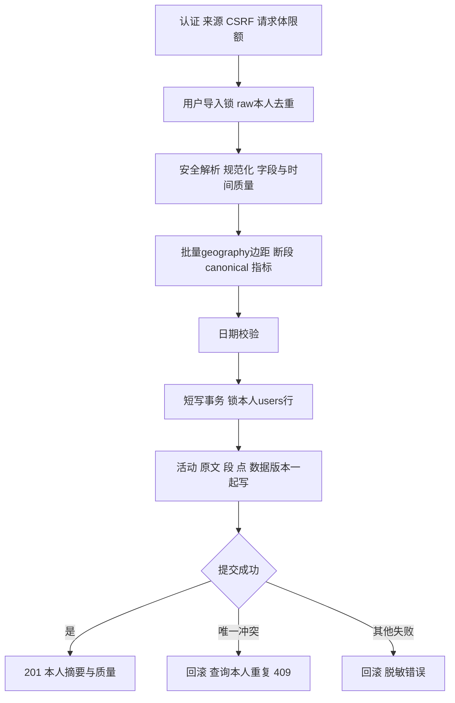

# 第二阶段技术方案与实施计划

> 日期：2026-10-12。状态：规划，未实现、未运行测试、未执行迁移。本次只交付文档，不授权自动开发或 Git 提交。
>
> 开始前已阅读 README、docs/01–06 的需求/架构/数据库/API/路线/风险，以及现有健康检查、配置、Session 和集成测试。仓库及已检查的上级路径未发现 AGENTS.md。第一阶段历史验证以 docs/07 为准，不将其当作第二阶段已经通过。

**目标**：用户可安全建立和撤销登录会话，上传受限 GPX，后端解析并原子保存本人活动、原文、有效点和连续段，正确计算距离/总耗时/平均配速并执行用户内去重。

**架构**：SvelteKit 只负责认证交互和展示，FastAPI 负责身份、权限、解析、指标与事务；PostgreSQL/PostGIS 是持久化中心。使用原生 Homebrew 数据库、backend/.venv、pnpm；生产继续计划 Linux + systemd + Caddy，不使用 Docker、Compose 或其他容器方案。

**实施方法**：后续获准实施时逐任务执行“独立预期测试 → 观察失败 → 最小实现 → 回归与证据记录”，不一次性生成全部模块，不自动提交或推送。

## 1. 范围、基线与必要调整

本阶段覆盖 R01、R02 及数据隔离基础，落实现有路线中的资料修改、密码修改与认证限流。最小前端只实现注册、登录、登出和个人资料视图。GPX 通过 API 和接口/浏览器请求测试验收；完整上传页面、记录列表/筛选/编辑/删除、手动活动和地图留在阶段三。公开主页、分享、AI、移动时间估算均不实施。

阶段二提供 `GET /activities/{id}` 的本人摘要查询，用于独立验证导入后的持久化和 owner 校验；不提供 route 或原文导出。响应不包含点坐标、原始文件、密码/令牌哈希。后续业务不能依赖前端登录守卫代替后端鉴权。

与既有设计的关系：

| 议题 | 现有基线与本计划决定 |
| --- | --- |
| Haversine 与 PostGIS | 用户要求实现 Haversine；既有指标是 WGS84 椭球距离。本计划推荐实现球面算法用于教学/独立对照，权威 distance_m 与配速仍使用 PostGIS。两者的误差标准分开，详见第 5 节 |
| 多 trk/trkseg | 一个文件一条活动，所有原段分别保留，绝不跨段连接 |
| 暂停时间 | 总耗时包含暂停和段间间隔；暂停/移动时间未知，不生成伪精确值 |
| 认证 | 延续 DB 会话 + HttpOnly Cookie + CSRF，无 JWT/localStorage 登录凭证 |
| 重复 | raw 强去重 + 完整可信时间的 canonical 强去重，均只在本人范围内 |
| 分层 | 沿用 modules/<功能>/router、schema、service、model；共用 Base 在 db，models/__init__.py 仅汇总导入，不再建第二套实体 |
| 当前 ready 陷阱 | health/service.py 和现有集成测试固定 0001_postgis；新增迁移时必须同步改为当前发布所需的 Alembic head 校验 |
| 当前错误层限制 | ApiError 只有 code/message，不能返回重复详情和 Retry-After；在受限白名单下扩展结构，继续脱敏 |

Haversine 的角色是本计划的明确推荐，尚未改动数据库或既有算法文档；如果改选球面距离为权威指标，必须先同步修订 docs/01、02、03、06 的距离口径、黄金样本、metrics_version 与统计基线，不能静默替换。

## 2. 认证方案与权限

### 2.1 选择与取舍

| 方案 | 收益 / 代价 | 决定 |
| --- | --- | --- |
| DB 随机会话 + Cookie | 易立即撤销，沿用 PostgreSQL；每次认证需查 DB | 推荐，适合单一同源 Web 应用 |
| JWT access/refresh | 多客户端可用；安全刷新、撤销、登出仍需要状态 | 本阶段不选 |
| SvelteKit 再实现认证或 BFF 会话 | 可集中页面登录态；易与 FastAPI 权限和会话重复 | 不增加第二套身份来源 |

密码采用 argon2-cffi 的 Argon2id，随机盐由库产生，编码哈希存 users.password_hash。起始参数建议 memory_cost=19456 KiB、time_cost=2、parallelism=1、salt_len=16、hash_len=32；在目标机实测耗时/并发内存后记录最终参数，并支持验证成功后 needs_rehash 升级。密码 12–128 字符，不 trim、不规范化、不静默截断，不强制拼凑字符类别。未知账号仍验证预计算 dummy hash，账号不存在/密码错误同为 401 INVALID_CREDENTIALS；不承诺严格恒定 HTTP 响应时间。

邮箱按既有规则去外侧空白/小写且最长 254，使用格式验证；username 为 3–30 个小写字母/数字/下划线、不可改名。注册并发冲突由唯一约束裁决，分别返回 EMAIL_EXISTS/USERNAME_EXISTS。邮箱存在性在受控 MVP 可见，公开注册前需要阶段八的验证邮件/找回与滥用评估。

### 2.2 会话与 CSRF 流程

1. 浏览器同源 GET `/auth/csrf`，必要时创建 10 分钟预认证会话。256 位以上随机 session token 的原值只进 Cookie，DB 只存 SHA-256；独立随机 csrf_token 存会话并返回给同源前端内存。
2. 注册/登录 POST 必须同时通过 Origin/Referer 与 X-CSRF-Token。Origin 精确匹配 SITE_ORIGIN（scheme/host/port）；Origin 缺失时检查 Referer，两者皆无则拒绝；Origin 已不合法时不能回退到 Referer 放行。
3. 成功时新建登录会话和 CSRF，撤销本次 Cookie 的旧会话（匿名/已登录均处理），用户与会话更新在同一事务；不撤销其他设备会话。
4. 登录会话绝对 7 天、闲置 24 小时，以服务器 UTC 为准；last_seen 最多每 5 分钟更新，明确存在最多 5 分钟的保守提前失效误差。临界时刻即判失效，不靠 Cookie Max-Age 判断有效性。
5. 每次资源请求验证哈希、撤销、绝对和闲置到期；预认证不能读取 /me 或导入。会话/CSRF 不放 localStorage，不在请求日志中记录 Cookie、密码、上传原文或坐标。
6. 登出需要有效登录会话、CSRF 与来源校验，撤销当前会话并用相同 Cookie 属性清除；无效会话返回 401，前端仍清理本地身份状态。修改密码校验旧密码，撤销全部原会话并清 Cookie，要求重新登录。

生产 Cookie：`__Host-run_session; Secure; HttpOnly; SameSite=Lax; Path=/`，无 Domain。明确 development 的本地 HTTP：`run_session`，HttpOnly/Lax/Path=/，不设 Secure。测试同样显式配置测试来源，不能把 CSRF 在 test 模式整体关闭。以 `127.0.0.1` 或 localhost 中的一个为本次统一浏览器来源，避免 host/Cookie/SITE_ORIGIN 混用。

SvelteKit SSR 只将当前请求中的目标会话 Cookie 转发给固定 INTERNAL_API_BASE_URL；身份存在 request.locals/本次加载结果，不存全局模块变量。SSR 只读取身份，不创建预认证会话或写业务数据；写操作由浏览器完成。退出/401 清理用户资料、CSRF 和本人状态，私密响应为 private,no-store。前端拦截只改善体验。

### 2.3 限流与 owner

认证计数使用 auth_rate_buckets 短事务原子 upsert，独立提交，使登录失败不会回滚计数。初值：账号登录 10/15分钟、IP 登录 60/15分钟、注册 10/小时、预认证创建 60/小时，包含成功尝试，超限 429 + Retry-After。未知账号计数也有效；固定窗口边界允许短时突发，不宣称滑动窗口。scope 须含 csrf-ip（补充原表说明中的 scope 列举）。

账号/IP 使用服务端密钥 HMAC-SHA256，避免普通邮箱/IP hash 被枚举；新增 AUTH_RATE_HASH_KEY 仅放服务端环境，轮换会使旧桶不再命中，记录此影响。IP 默认来自实际连接，仅接受已配置可信代理地址的转发头。无 Redis 或内存独占限流。

所有导入的 user_id 来自认证依赖；请求中的 owner_id/user_id/source/avg_pace 等未知字段拒绝 422。活动查询同时限制 id 与 user_id；别人的真实 ID 和不存在 ID 均 404。点/段通过 activity 的 owner 联表查询，没有可以绕过活动直接读取任意段/点的入口。每次成功新增活动才在同事务递增 users.activity_data_version；失败/重复不递增。

## 3. PostgreSQL/PostGIS 存储与迁移对象

沿用 docs/03 的详细字段，只创建以下七张表；不提前创建分享/AI 表。

| 表 | 本阶段保存内容 | 关键约束/索引 |
| --- | --- | --- |
| users | 邮箱、用户名、Argon2id、显示名、时区、默认私有开关、数据版本、时间 | 邮箱/用户名各 UNIQUE；密码不入响应 |
| auth_sessions | nullable user_id、token_hash、csrf_token、绝对/闲置/撤销时间 | token_hash UNIQUE；user_id/expires_at 索引，用户 FK |
| auth_rate_buckets | scope、HMAC 键、UTC 窗口、attempts、expires_at | 复合 PK 与原子计数；无明文账号/IP、无用户 FK |
| activities | owner、来源、标题/备注、日期/时区、边界时间、指标、质量/版本、私有状态 | UUID PK、UNIQUE(id,user_id)、owner/date/id 查询索引；指标有限非负 |
| gpx_imports | 原始 bytea、大小、安全展示文件名、raw/canonical hash、规则版本 | activity_id UNIQUE；复合 owner FK；两个用户内唯一条件 |
| activity_segments | 清洗段序、原 trk/trkseg 序、断段原因、点数、派生 LineString | UNIQUE(activity_id,segment_index)、活动 FK、geom GiST |
| activity_points | 段内序、原点序、Point、UTC time、高程 | PK(segment_id,point_index)、段 FK；不冗余 owner，不建点级 GiST |

关系为 users → activities → segments → points；activities → gpx_imports 为一对一；sessions → users 为可空多对一。FK 的级联删除是未来显式删除的基础，不在本阶段实现删除接口。

三层存储选择：原始 bytea 便于原子写入/统一备份；点表保存时间、高程与排序；连续段 geometry 支持空间查询。只存 GeoJSON 会弱化时间/约束，只存点表会反复重建线，只存 LineString 则丢失点级时间，均不推荐。

- position 为 `geometry(Point,4326)`，geom 为 `geometry(LineString,4326)`；坐标顺序 `[longitude,latitude]`，测距时转 geography。时间单独存 timestamptz，不塞进 M/Z 坐标；高程 nullable，仅供追溯，不计算三维距离。
- 每个连续段至少一个点；单点段 geom=NULL、距离 0；至少两点按 point_index 构建 LineString。同位置不同时间的停留点可形成零长度线，不将通用 ST_IsValid 检查用作拒绝这些停留记录的依据。
- 段线从点派生，只允许导入服务统一写入，禁止两个来源各自编辑。活动不另存整条 LineString/MultiLineString；阶段三从分段构造 FeatureCollection，避免跨段桥接。
- 段内 index 连续、point_count 等于实际点数、派生线点序与点表一致：由服务和数据库集成测试保证，不声称普通 CHECK 能跨行保证。类型/SRID/坐标范围/非负计数等可在 DB 约束。
- activities/gpx_imports 的 `(activity_id,user_id)` 复合 FK 防止原文归属不一致。成功活动的原文/段/点完整性由单事务保证；不预建复杂触发器，禁止导入接口绕过服务直接写表。
- 原始最多 10 MiB；列表/摘要查询显式选择字段，不加载 raw_gpx/点。指标 numeric(12,3)，耗时保存到毫秒；点的 UTC 时间保留解析器可提供的精度（PostgreSQL 最多微秒），不在时序校验前量化而制造零时间差。指纹单独量化到毫秒，不对中间边距逐边舍入。
- 新活动固定 source=gpx、visibility=private、allow_shared_route=false；预留字段不能成为本阶段公开入口。/me PATCH 只改 display_name/timezone，profile_is_public 开关留阶段六。

## 4. GPX 输入、分段与缺失处理

### 4.1 受限且安全的输入

仅单个未压缩 GPX multipart file，最多 10 MiB 原文、50000 源轨迹点、1000 原 trkseg，含空段和无效点的输入计数也必须计入限制；派生非空段最多 50000（每段至少一有效点）。读取按累计字节限额，不仅信 Content-Length；另限整个 multipart 请求体为 11 MiB、字段数/字段长度，拒绝多个 file、ZIP 或 URL。

先由 defusedxml 安全解析并禁 DTD、实体、外部资源，校验根是受支持的 GPX 1.0/1.1 命名空间和结构；MIME/扩展名仅作提示。gpxpy 负责 GPX 对象解析，不假定其默认解析器安全。不得网络获取 schema 或打开 GPX 引用的文件/URL。

在安全预检层识别原始 lat/lon/time/ele 是否存在、合法，不能把 gpxpy 的缺省 0 当真实坐标。严格将 XML 语法错误与单点字段错误区分：无坐标点按无效坐标处理；坏时间记 NULL；坏/缺高程记 NULL。若 gpxpy 对坏字段直接抛错，在受限安全树上为解析创建内存副本，移除已分类的坏可选字段/无效坐标点，并保存原始序号映射与断点信息；原始 bytea 不改写，不能因移除点而丢失断段边界。用对应样本验证其版本行为。

普通循环 deadline 无法中断 gpxpy 的整体解析。推荐解析过程在短时独立子进程中完成，15 秒预算覆盖安全预检、gpxpy 和清洗，超时终止/回收进程；子进程不持有 DB 连接或 .env/会话对象。这是本机资源隔离，不引入容器、队列或任务状态机。每个 API 进程同时最多一个解析任务，超限返回 IMPORT_BUSY，固定 worker 数并记录实际 CPU/内存；不得无限派生子进程。macOS spawn 模式必须单独测试。

### 4.2 多轨迹与清洗顺序

一个文件合并成一活动。按源 `trk → trkseg → trkpt` 顺序处理，分别记录 source_track_index/source_segment_index/source_point_index，不按时间重排、不按位置拼接、不把多段猜成多次运动。

1. 原文 SHA-256，查询本人 raw 重复；取得用户导入并发锁后再次确认。
2. 原段边界总是断开；空段记录质量计数，不创建空 segment。仅 rte/wpt、无有效 trkpt 拒绝。
3. 经纬度必须有限且在合法范围；非法/缺失坐标点不入点表，其前后断开，下一有效点重新起段。原文与质量计数保留问题信息。
4. 同一原段内相邻且坐标/可解释时间/高程都相同的有效点去重。缺失或无法解释时间的点不凭两个 NULL 假设同一次采样；保留并标记，避免不完整轨迹误压缩。不跨原段去重。
5. 时间有明确 Z/UTC 偏移才转 UTC；无偏移、缺失、坏文本为 NULL，不按服务器时区解释。时区 snapshot 仅用于日期展示，不给缺偏移时间补偏移。
6. 同一原段相邻可比较时间：dt>300s、dt<0、正位移且 dt=0、dt>0 且地理距离/dt>12m/s 时拒绝该边，保留两侧有效点并分段。dt=300、speed=12 不越阈值；停留 dt=0/distance=0 不制造负/无限配速。
7. 跨原段始终无距离/速度边，但可信时间倒退、同时间正位移仍标 invalid。遇缺时间后，下一个可信时间也与上一个可信时间检查倒退，避免 NULL 掩盖全局时序错误；不创建缺时间间的插值边。
8. missing time 不能判速度，仍计算合法源段距离，附 SPEED_CHECK_UNAVAILABLE；速度/缺测断边仅使空间质量有警告，不自动把可靠时间设 invalid。
9. 按清洗段生成 LineString、点序和质量摘要；至少一个有效点可导入，零距离/不可计算配速必须明确警告。

速度分类使用同一个 PostGIS geography 相邻点距离口径，批量查询源边距离，不逐点往返 DB；这些计算是只读，发生在写事务前。子进程只提取/规范化点与时间，父服务完成空间测距、边分类和派生几何。不要用 Haversine 的阈值判断再用不同地理距离入库造成临界边行为不一致。

新增补充规则（需要实施时同步 docs/03 与样本）：NULL 时间不构成可信重复点；跨 NULL 的可信时间倒退仍判 invalid。其他 12m/s、300s 和版本化规则沿用 gpx-v1，实施前统一冻结 parser/metrics/fingerprint v1 的规则文本。

## 5. Haversine、权威距离、耗时与配速

### 5.1 距离方案权衡

| 方案 | 优点 / 限制 | 推荐用途 |
| --- | --- | --- |
| Haversine 球面 | 可解释、纯函数易测试；与椭球测距存在系统差异，局部误差可接近 0.6% | 必须实现的算法对照，不改现有权威指标 |
| PostGIS geography 椭球 | 沿用 DB/空间能力与黄金基线；依赖真实 PostGIS | 权威 distance_m、异常边距离与平均配速分母 |
| 两者混算/取平均 | 没有明确地理模型，历史数据难解释 | 不采用 |

Haversine 固定平均地球半径 R=6371008.8m，纬经度转弧度，Δλ 规范化至 [-π,π]：

`a = sin²(Δφ/2) + cos(φ1)cos(φ2)sin²(Δλ/2)`

`d = 2R × atan2(sqrt(clamp(a,0,1)), sqrt(1-clamp(a,0,1)))`

只对最终接受的连续段内相邻边求和，不跨原段/异常断点；NaN/Infinity/非法范围在进入算法前拒绝。覆盖同点、近同点、赤道、极区、近对跖点和跨 ±180°，不使用 geometry 的度数 length 或 Shapely.length 作为米。

球面结果只保留在测试/研究对照，不增加第二套公开 distance 字段、不进入统计。固定赤道 0.01° 示例：Haversine 约 1111.950802m，PostGIS 约 1113.194908m；两者不是“相等才正确”。Haversine 同模型数值测试按解析球面参考值容差 max(0.001m,1e-9×参考距离)，与椭球对照仅观察模型差异，不用 PostGIS 的 0.1% 精度门槛否定球面算法。

权威活动距离：每个有效非空段 `ST_Length(geom::geography)` 求和，单点段贡献 0；中间不舍入，最终存三位小数。权威误差沿用 docs/06 的 max(1m,参考距离×0.1%)，预期来自独立 WGS84 参考值，不用被测函数生成自己的期望。

### 5.2 时间与暂停

| 指标/情况 | 规则 |
| --- | --- |
| complete | 所有有效源点时间可靠且按源顺序无时序错误；elapsed=末有效点 UTC−首有效点 UTC |
| incomplete | 至少一有效点缺/坏/无偏移时间，且没有 invalid；elapsed/pace=NULL，即使首尾有时间也不伪称完整 |
| invalid | 可信时间倒退，或正位移零时间差；优先级高于 incomplete，elapsed/pace/ended_at=NULL |
| started_at | 首有效点可解释时间；不从中间第一个有时间点猜起点 |
| ended_at | 最后有效点有可靠时间且不 invalid；incomplete 可保留可信末端，但不能由其算完整耗时 |
| activity_date | started_at 可信时按导入 timezone 得到本地日期，否则必须用户补录；不使用上传时间 |
| 暂停/段间间隔 | 时间完整时计入 elapsed；同坐标不同时间点保留，距离增量为 0 |
| >300s 缺测 | 断空间边；可能包含暂停/漏采样，不能把整个 gap 认定为暂停 |
| pause_seconds/moving_seconds | 当前没有可靠依据，不新增数值或默认 0，不调用 gpxpy 移动时间估计替代总耗时 |
| 平均配速 | distance>0 且 elapsed>0：`elapsed/(distance/1000)` 秒/公里；否则 NULL |

同位置停留例：1000m 有效距离、600s 起止时间，中间停留120s → 总耗时600s、配速600s/km；不能扣除120s声称移动配速。多原段完整时间含段间 gap，距离只累加段内线长。速度/缺测警告后的配速称“基于有效段的总耗时配速”，不冒充设备移动配速。

activity_date 必填时允许 1900–2100，timezone 为有效 IANA，默认本人时区；提供日期与可信开始时区换算日期不一致返回 ACTIVITY_DATE_CONFLICT。UTC 差用于耗时，跨日/夏令时不改变真实秒数，改用户时区不改历史活动快照。

## 6. 指纹、并发与原子写入

### 6.1 双指纹

| 比较方式 | 判断能力 | 使用规则 |
| --- | --- | --- |
| raw_sha256 | 字节完全相同，含无时间轨迹 | UNIQUE(user_id,raw_sha256)，重复 409 |
| canonical_sha256 | XML 排版、文件名/元数据不同但可信轨迹相同 | 仅所有源点坐标/时间合法且时序完整可信时启用 |
| 路线形状/距离近似 | 同路线不同日期可能是真活动 | 不自动拒绝，不增加模糊匹配系统 |

canonical 在清洗前生成，保留 trk/trkseg 边界、源点顺序、合法坐标与 UTC 时间，排除文件名、XML 格式、描述和高程；高程差异不改变本阶段的二维轨迹身份。坐标 Decimal 到 7 位小数、时间到毫秒，统一 ROUND_HALF_EVEN；规范化 -0 为 0；UTF-8、固定字段顺序、固定紧凑序列化，无随机 UUID/上传日期。记录 fingerprint_version=canonical-v1，坐标/时间量化可能合并亚厘米/亚毫秒差异，明确此边界。

raw 哈希来自未经重新序列化的原始字节。canonical 保留未清洗重复点和源结构，所以重采样、添加点或重新分段不承诺命中；仅 speed/gap 空间警告而时间完整的轨迹仍可生成 canonical。缺/坏坐标、缺/坏/无偏移时间或时序 invalid：canonical=NULL，不强制语义拒绝。UNIQUE(user_id,fingerprint_version,canonical_sha256) 为非空部分唯一索引。

版本变更不得直接启用新规则让旧指纹失效；须先在隔离库设计旧数据重算/冲突处理策略，本阶段固定 v1。A/B 可导入同一文件；409 details 只返回本人 existing_activity_id 与 duplicate_kind，不泄露另一用户资源。

### 6.2 导入流程和并发结果

每用户会话级 advisory lock 使用稳定 UUID→64位 key，在专用 autocommit 连接上 pg_try_advisory_lock；失败 429 IMPORT_BUSY。所有成功/失败/超时路径 finally 显式 unlock，不能把仍持锁的连接还池；解锁失败丢弃连接。跨 worker 测试实际锁释放，不用仅进程内字典代替。

源点解析不占写事务或用户行锁。只读测距完成后，关闭读取事务；再开启短写事务，锁 users 行，依次写活动、GPX、批量段与点并递增版本。连接/Session 的 autobegin 要显式管理，不能认证 SELECT 后盲目 begin 得到嵌套事务错误。SQLAlchemy 模型载入不等于提前提交。

初始池 size=5、max_overflow=0，每 worker 单解析任务和有限 worker 数控制锁连接/写连接/读连接预算；不为一个请求无界创建 engine。记录批量点 INSERT 的查询数、内存与耗时，避免50000次 INSERT/commit。唯一约束冲突只映射已知去重索引，其他 FK/DB 错误不能伪装 GPX_DUPLICATE。

同用户请求重叠时可得到 429，随后重试得到409；“并发重复只有一条活动”不意味着所有竞争响应必须立即409。集成测试既验证并发锁，也绕过前置查询验证唯一约束最后防线。任何失败/重复均无残留 activity/import/segment/point，无额外版本递增；进程在 commit 后掉线时，再次 raw 导入可查到本人已成功活动。

## 7. 本阶段接口契约

以下路径前缀 `/api/v1`，遵循现有 data/error/meta.request_id，写接口均校验来源与 CSRF；未知字段拒绝。表中结果是计划，不代表接口已存在。

| 方法/路径 | 输入 | 成功与主要失败 |
| --- | --- | --- |
| GET /auth/csrf | 无 | 200 csrf_token；必要时预认证 Cookie；限流429 |
| POST /auth/register | email,username,password,timezone可选 | 201 本人资料+新csrf；字段422、冲突409、来源/CSRF403 |
| POST /auth/login | email,password | 200 本人资料+新csrf；统一凭证401、限流429 |
| POST /auth/logout | 无 | 200 logged_out=true；撤销当前会话和清 Cookie |
| GET /auth/session | Cookie | 200 authenticated=true+本人资料；匿名/过期401 |
| GET /me | Cookie | 200 id,email,username,display_name,timezone,created_at；无哈希 |
| PATCH /me | display_name,timezone子集 | 200 本人资料；禁止修改email/username/public开关 |
| PATCH /me/password | current_password,new_password | 200 password_changed=true；撤销全部会话；旧密码错401 |
| POST /gpx-imports | multipart file,timezone/activity_date/title可选 | 201 activity摘要、import_id、warnings、点/段计数和metrics_version |
| GET /activities/{id} | UUID | 200 本人摘要、质量、has_route；他人/不存在404 |

GPX 错误：无效 XML 400 GPX_XML_INVALID；无有效点/仅rte/wpt 422 GPX_NO_VALID_POINTS（details 说明无支持的trk）；字节超限413 GPX_TOO_LARGE；点/段超限422 GPX_LIMIT_EXCEEDED；日期缺失/冲突422；处理超时503 GPX_PROCESSING_TIMEOUT；重复409 GPX_DUPLICATE；并发忙429 IMPORT_BUSY + Retry-After。

有限白名单 details 仅含字段/原因、本人既有活动 ID 和重复种类。扩展 ApiError 支持这些结构及 Retry-After，不允许服务直接把 psycopg/gpxpy 异常原文放入 details。413/断网/坏 JSON 的前端仍能兜底，不能只依赖后端 JSON 始终可用。

## 8. 实施顺序、文件与逐步验收

每个任务先写表中反例/独立预期测试并确认失败，再实现，运行对应测试和相关回归，保存命令/结果。下列文件为计划路径，本次不创建源码或迁移。

### S2-01：冻结规则、依赖和测试环境

**文件**：backend/pyproject.toml、requirements.lock、tests/fixtures/gpx/README.md、tests/conftest.py、core/config.py，.env.example 仅新增说明，不覆盖真实 .env。

- [ ] 制作合成/脱敏 GPX 黄金样本和预期清单，冻结算法、canonical、时间规则；依赖 gpxpy、defusedxml、argon2-cffi、GeoAlchemy2、python-multipart、邮箱校验辅助包只为明确用途引入。Shapely 本阶段非必需，不为未来地图提前安装。
- [ ] 在 .venv 核实与现有锁的兼容版本并重新生成 hash lock；不在规划稿捏造未验证版本，不升级数据库主版本或现有前端框架。
- [ ] 测试 DSN 必须以 _test 结尾、与 DATABASE_URL 指向的实际实例/数据库不同，并经显式允许；迁移测试不能只凭 _test 后缀认定安全。日常库、测试库、迁移账号明确区分。

**验收**：测试误指向 running_note 必须在任何 DDL 前拒绝；样本包含第 9 节所有分类，版本/规则说明可追溯；不得用跳过空间测试宣称通过。

### S2-02：新增模型、迁移和 ready 回归

**文件**：modules/auth/model.py、modules/users/model.py、modules/activities/model.py、modules/gpx/model.py、models/__init__.py；migrations/versions/0002_auth.py、0003_gpx_storage.py；db/schema.py（发布 schema 校验）；health/service.py；tests/integration/test_migrations.py、test_database.py。

- [ ] 先在隔离空库与阶段一快照副本写迁移/约束测试；新增 revision 分别为 0002_auth→0003_gpx_storage，父链从 0001_postgis 开始。
- [ ] 前一迁移建用户/会话/限流，后一建活动/来源/段/点；只新增表、约束与必需索引，过滤 PostGIS 自带对象的 autogenerate 差异。
- [ ] 把 ready 固定 INITIAL_REVISION 改成当前发布代码的唯一 Alembic head，启动缓存期望 revision，仅在 DB revision 完全匹配时 current；多 head 拒绝发布。更新原集成测试，不能接受任意非空 revision。

**验收**：两种路径升级到 head，重复 upgrade 无变化；旧表数据/空间参考保留；错误 SRID/owner FK/唯一指纹受约束；停在旧 revision 的 ready 503、升级后200，live不受影响。

### S2-03：认证安全原语与后端接口

**文件**：core/security.py；modules/auth/router.py、schema.py、service.py、rate_limit.py；modules/users/router.py、schema.py、service.py；api/dependencies.py、main.py；tests/unit/test_security.py、tests/integration/test_auth.py。

- [ ] 验证 Argon2id、密码边界、dummy verify、令牌哈希、可控时钟下的绝对/闲置过期及 HMAC 桶。
- [ ] 实现预认证、来源/CSRF、注册/登录轮换、登出、会话/资料查询、改资料/密码，原子计数与唯一冲突处理。
- [ ] 以两个用户/两个客户端/两个 worker 验证隔离、限流和全部会话撤销；未知输入字段不能进入模型。

**验收**：第 2/7 节契约逐项通过，DB 无原密码/原session token；不同用户同密码盐不同；旧会话/CSRF不可复用；响应、日志、错误无哈希或密钥。

### S2-04：安全解析与多段规范化

**文件**：modules/gpx/schema.py、parser.py、normalization.py、quality.py；tests/unit/test_gpx_parser.py、tests/fixtures/gpx/。

- [ ] 测试输入读取限额、安全 XML、缺/坏原属性、gpxpy 行为、源序号和重复点规则。
- [ ] 输出受限 ParsedGPX：原始索引、坐标/UTC时间/高程、源段结构、计数与质量码；不携带 Session 或当前用户到子进程。
- [ ] 验证子进程超时/异常退出/清理和每进程并发上限，异常请求后仍能正常解析。

**验收**：多trk/多段不合并边，丢非法点不桥接；实体不访问网络/文件；缺坐标不变0；超限/预算有稳定错误且无孤儿子进程。

### S2-05：Haversine、geography、时间和指纹

**文件**：modules/gpx/metrics.py、queries.py、fingerprint.py；tests/unit/test_metrics.py、test_fingerprint.py；tests/integration/test_spatial_metrics.py。

- [ ] 先完成球面解析预期测试，再 Haversine；同时使用真实 PostGIS/独立 WGS84 样本验收权威距离与批量边距。
- [ ] 落实第 4/5 节分段阈值、NULL/invalid 优先级、日期/暂停/配速，最终指标统一舍入。
- [ ] canonical 规范序列化、边界/UTC偏移/量化/版本及 raw 比较测试。

**验收**：球面与椭球各达自身标准；配速只用权威距离；跨段没有额外里程；缺时间不是0；跨日/夏令时正确；相同语义XML命中、不同运动时间不命中。

### S2-06：原子导入、详情查询与数据库隔离

**文件**：modules/gpx/router.py、service.py；modules/activities/router.py、schema.py、service.py；core/errors.py、api/dependencies.py；tests/integration/test_gpx_import.py、test_import_concurrency.py、test_owner_isolation.py。

- [ ] 在认证/来源/限额之后执行解析与导入锁，结束只读事务，再原子提交原文/摘要/段/点/用户版本。
- [ ] 批量建点/段，校验顺序和派生一致性；失败、超时、唯一冲突均回滚；锁与文件句柄全路径释放。
- [ ] 实现按 owner 的最小 GET 详情；响应白名单和 ApiError details/Retry-After 脱敏。

**验收**：A/B相同文件各一活动；A读B为404；同用户重叠请求至多一活动（429后重试409）；绕过预查询仍受 DB UNIQUE；注入中途写失败后四表无残留、版本不变。

### S2-07：最小认证前端与浏览器验证

**文件**：src/lib/api/client.ts、auth.ts、users.ts；src/hooks.server.ts、app.d.ts；routes/(auth)/login/+page.svelte、register/+page.svelte；现有 routes/settings/+page.svelte 和 +layout.svelte；tests/unit/auth.test.ts、tests/e2e/auth-import.spec.ts。

- [ ] 前端统一同源 fetch/401/错误兜底与内存 CSRF，登录成功替换 token，退出清状态；SSR仅固定内部地址和目标Cookie。
- [ ] 加登录/注册表单、个人资料/修改密码最小交互和登出，保留活动页占位，不重做导航或提前做地图。
- [ ] 浏览器上下文完成注册/登录/资料/登出；通过同 Cookie 的请求上下文提交 GPX（不是完整上传UI），核对摘要及另一账号拒绝。交替 SSR 请求不得混用户。

**验收**：真实 Cookie 属性与请求头正确；禁 localStorage 凭证；登录失败、过期/CSRF更新可解释；退出返回私密页面不会重新从API取得数据；pnpm test/check/build 与 E2E通过。

### S2-08：迁移发布演练和整阶段验收

**文件**：docs/03、04、05 受影响细则、README、第二阶段实际实施记录（实施后创建）、OpenAPI快照；.github/workflows/ci.yml 按新增依赖与测试调整。

- [ ] 在隔离原生环境执行升级、数据保留、备份恢复检查和全部回归；新版 Schema 说明与API契约相符。
- [ ] 验证独立原生实例重启后活动/原文hash/段点/指标/会话撤销状态保留，绝不为了测试擅自停日常PG。
- [ ] 记录普通与50000点样本的耗时/峰值资源/查询数；将实际结果与目标分开，没有结果不标通过。

**验收**：本计划最终清单全通过、无 P0 遗留；公开/地图/列表等范围外功能没有被写成完成；未执行的Linux/CI标未验证。不自动进入阶段三或提交Git。

## 9. 测试矩阵与预期证据

| 测试层 | 关键样本/场景 | 必须断言 |
| --- | --- | --- |
| 单元：密码/会话 | 长度边界、相同密码不同盐、过期临界、撤销、错误来源 | 不仅断言200；实际令牌轮换、过期拒绝、CSRF匹配 |
| 单元：解析 | 空XML、DTD/外实体、缺lat/lon、NaN、缺ele、坏time、无偏移、只rte/wpt | 稳定错误/NULL、正确源序号、无网络文件读取、无缺省坐标 |
| 单元：空间算法 | 球面赤道、同点、近对跖、±180°；多段/异常断边 | Haversine独立公式期望，有限结果、不跨段 |
| 单元：时序 | 同位置停留、倒退、跨NULL倒退、dt=0、dt=300/301、speed=12及略超 | temporal_quality优先级、断边阈值、暂停计入总耗时 |
| 单元：指纹 | 改文件名/缩进/元数据、UTC等价偏移、不同日期、缺时间、分段/采样改变 | raw/canonical不同角色及NULL门槛，量化规则稳定 |
| API：认证/资料 | 匿名、预认证、A/B、缺CSRF、恶意Origin、伪代理、改密码 | 401/403/429/422与响应白名单，所有原会话失效 |
| API：GPX | 正常/多trk/单点/日期补录/冲突/非法文件/超限/超时 | 201/409/413/422/503与质量详情，本人既有ID才可见 |
| DB：空间 | 六个赤道点，经度总差0.01°、间隔120s、总600s | 权威1113.194908m、耗时600s、配速约538.989s/km；不是六百秒两点被300s断边 |
| DB：多段/异常 | 两个远隔源段、非法中点、速度断边、单点/零长线 | 点表、point_count、几何和摘要一致；无桥接额外距离 |
| DB：事务/约束 | 复合owner FK、唯一hash、写点中断、同用户并发、跨用户同文件 | 无半条记录，版本增量正确；限制/重复不泄漏用户 |
| DB：迁移 | 空测试库、阶段一副本带既有表/哨兵数据、旧revision、新head | 无误删扩展/数据，多路径正确，旧schema ready503 |
| 浏览器 | 登录/登出、HttpOnly、两上下文、SSR交替、带Cookie导入 | 无身份混用，实际请求来源/CSRF和服务端持久化可复核 |
| 资源/故障 | 病态 XML、解析超时、DB断开、用户取消/重复请求 | 资源释放、脱敏响应；后续正常请求可用 |

单元测试不用SQLite冒充空间测试；API TestClient保留第一阶段兼容的 httpx2。真实集成只在独立 _test 库，并发测试使用不同连接/事务或不同 worker，不能用同一 Session 的顺序调用假装竞争。

计划检查命令（本次不运行）：backend 的 pytest unit/integration、ruff check/format --check；frontend 的 pnpm test、pnpm check、pnpm build、PLAYWRIGHT_CHANNEL=chrome pnpm test:e2e。集成与浏览器还需真实数据库/后端；未配置 DSN 导致 skip 不算通过。

普通3000点导入目标 p95≤3s；50000点解析预算≤15s、整体≤20s，记录硬件、worker、pool、样本seed和重复次数。原 docs/06 同时要求列表/统计/route 的极限并发场景涉及未实现阶段，完整场景留其所属阶段；本阶段测同期 /me、health 和已实现详情的可用性/耗时与资源，不伪称覆盖未来接口。

## 10. 安全迁移与现有数据保护

本次不连接数据库执行任何迁移。未来实施的迁移必须遵循：

1. 核对 DATABASE_URL 的 host/port/database/user（隐藏密码）、服务主版本、扩展版本、当前 revision、既有表及权限；若实际库与预期不符立即停止。现有 running_note 不重建、不清空，不改 PostgreSQL 服务配置。
2. 先用独立测试库验证，再从阶段一备份恢复到隔离升级副本；备份 PG 元数据与既有表行数/抽样hash。恢复是写隔离库，不覆盖现有库；先证明备份可恢复。
3. 人工审阅 Alembic 生成 diff/离线SQL。只允许预期新增七表/约束/索引；include_name/include_object 过滤 PostGIS自带spatial_ref_sys等对象。发现 DROP、重建同名既有对象、类型覆盖或数据冲突即停止，不靠删库解决。
4. 运行时账号不增加超级用户权限；扩展已经存在无需重装，缺扩展时由管理员在明确指定库处理。迁移账号与运行角色可以在受控环境分开。
5. 备份、审阅、隔离验证通过后，未来经实施授权才对目标库单次 upgrade；应用升级前后检查版本/旧数据/空间函数/ready，并保留命令和结果。
6. downtime/锁等待预算有界；迁移只取消短API statement_timeout，不无限等待DDL锁。应用部署不启动多个worker并发迁移。
7. 新表 downgrade 会删除第二阶段数据，不能把它当默认安全回滚。只在独立测试库演练；真实库优先修复前进或受控恢复，恢复会丢失备份后的写入须明确说明。禁止 HTTP DDL 和 create_all。

## 11. 完成标准与交付

- [ ] 注册、登录、登出、资料读取/允许修改、密码修改、会话轮换/绝对闲置过期、来源/CSRF、限流均有正反例证据。
- [ ] GPX 的原文、合法点、有效段、时间与质量完整保存，指标后端统一生成，日期可靠或显式补录。
- [ ] Haversine 已实现且独立测试通过；权威距离/配速采用 geography，球面差异在算法说明中清楚区分。
- [ ] 多轨迹/多段、缺/坏字段、非法点、暂停、倒退、跳点、阈值、跨日/跨经度及零指标按固定规则处理。
- [ ] raw/canonical去重与并发最终唯一约束有效；同用户最多一条、跨用户可独立导入，不发生owner泄漏或事务残留。
- [ ] 从阶段一安全升级并保留原数据；扩展与新版head一致，原生数据持久性/独立恢复可复核。
- [ ] 单元、API、真实PostGIS集成、浏览器、类型检查和构建实际通过；执行命令、环境、计数、失败修复和未验证项有记录。
- [ ] OpenAPI、数据库/算法版本和实施文档与实际一致；P0无遗留，范围外功能不写完成；不自动提交/部署/进入阶段三。

当前交付仅为本计划、README导航与路线引用。所有实施复选框保持未完成，现有 .env、业务代码、数据库、服务配置和依赖锁不改动。
