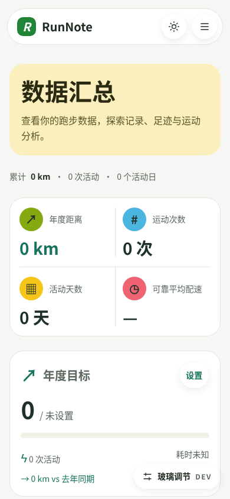
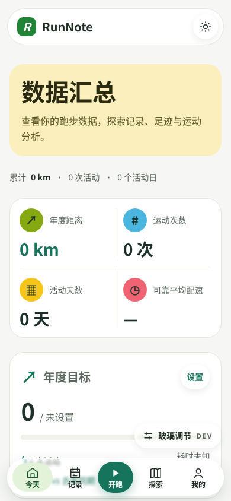
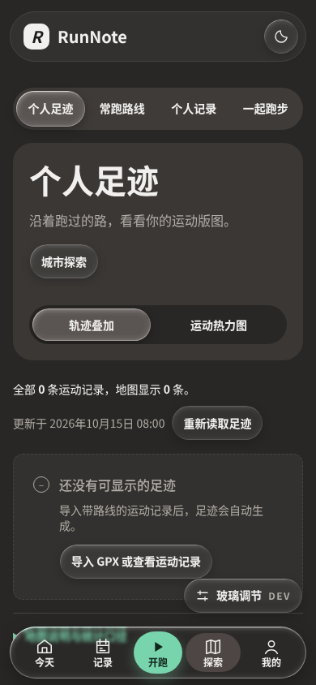
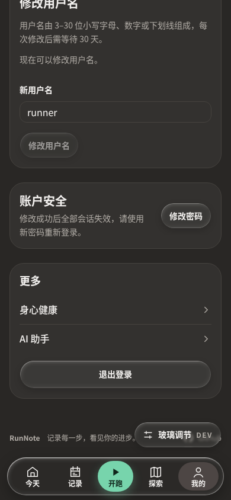
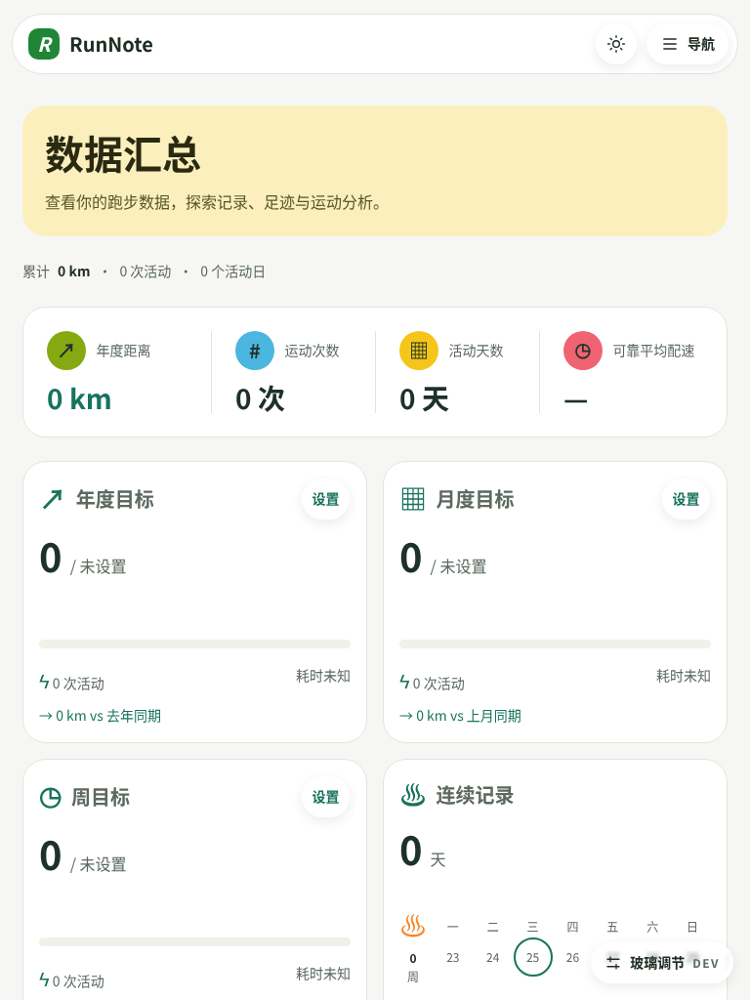
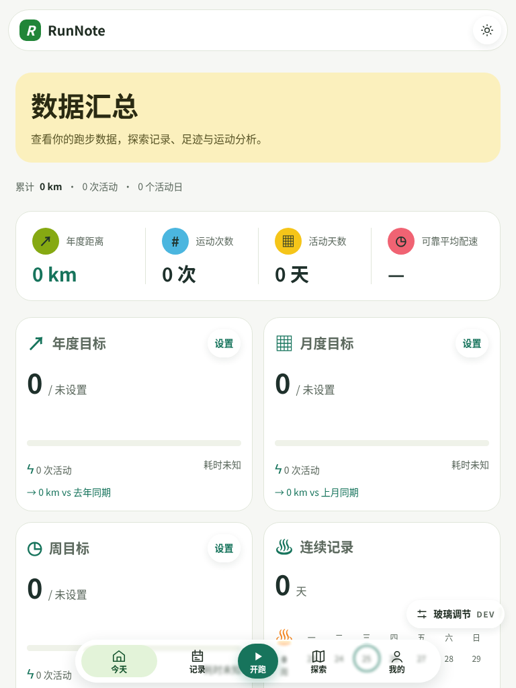
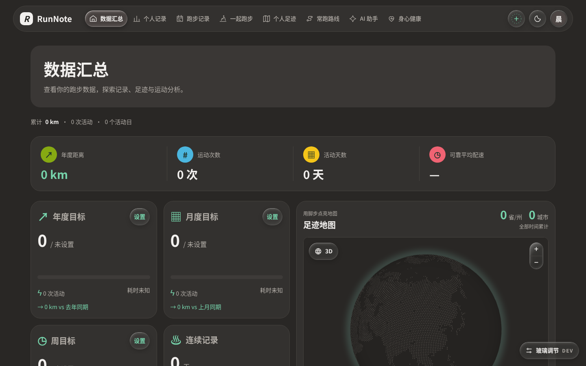

# 100 · 移动端外壳与 4+1 底部导航（Item 49 Phase 4a）

> 设计依据：PR #147 移动端设计稿（Owner 已确认 **方案 B**：4 平级 Tab + 居中「开跑」）。本期只做第一个移动端切片：外壳、底部导航与安全区基础。
> 基线：`main @ fabd0837`（v2.5.1）。

## 范围

做了：

- `<800px`（手机与平板）新增浮动底部标签栏 `今天 | 记录 | ▶ 开跑 | 探索 | 我的`，替代原顶部汉堡菜单；桌面（≥800px）顶部条不变。
- 「探索」落在个人足迹，四个区段根页面顶部用分区标签互相切换：个人足迹 / 常跑路线 / 个人记录 / 一起跑步。
- 「我的」落在账户总览（设置）；跑鞋、目标与隐私（含设备健康数据与离线同步面板）、站点设置、用户管理仍由设置分区标签进入，账户总览底部新增仅手机显示的「更多」分组：身心健康、AI 助手（沿用原可见规则）与退出登录。
- 安全区基础：`viewport-fit=cover`、`--safe-*` 令牌、`--bottom-chrome`（底部固定外壳占用高度，安全区只计一次）。

明确延后（本期未实现）：

- Q2「今天」相对完整数据汇总的内容精简：「今天」仍指向现有数据汇总页。
- Q4 记录页命令式重设计与防误停：记录页本身未改，只隐藏底栏。
- Q3 离线跑后元数据绑定。
- Q5 原生 Edge-to-Edge WindowInsets：本期只用 CSS `env(safe-area-inset-*)`，待 PKT110 真机验证后再决定是否改由 `MainActivity` 注入（二者只能选其一）。

## 使用方式

| 标签 | 站主（根展示） | 普通账户 | 匿名访客 / 具名展示 |
| --- | --- | --- | --- |
| 今天 | `/` | `/workspace/dashboard` | `/`、`/p/{username}/dashboard` |
| 记录 | `/activities` | `/workspace/activities` | `/activities`、`/p/{username}/activities` |
| ▶ 开跑 | `/activities/record` | `/workspace/activities/record` | 不显示 |
| 探索 | `/footprints` | `/workspace/footprints` | `/footprints`、`/p/{username}/footprints` |
| 我的 | `/settings` | `/workspace/settings` | 不显示 |

- 今天/记录/探索跟随当前浏览的视图；「我的」和「开跑」永远属于登录账户（普通账户在浏览站主展示时也进入自己的 `/workspace`）。
- 当前区段的标签带 `aria-current`：正好在该页为 `page`，区段内子页（如跑步详情、设置子页）为 `true`。点当前页的标签回到页顶，不重新加载。
- 「开跑」是进入沉浸式记录页的普通链接，不是有状态的标签，不带 `aria-current`。
- 底栏显示时根元素带 `scroll-padding-bottom`（底栏高度 + 间距 + 安全区），键盘 Tab 与 `scrollIntoView` 把焦点停在底栏之上，与桌面顶栏的 `scroll-padding-top` 对应。
- 底栏在实时记录页（`/activities/record`、`/workspace/activities/record`）不渲染；聚焦文本输入时隐藏，避免压在软键盘上；原生 dialog/popover 在顶层覆盖它。登录页、分享页等公开外壳没有底栏，公开外壳的顶部菜单保持原样。
- 进度环不再出现在手机外壳中；跑量目标仍在「今天」的目标卡片与「目标与隐私」。

## 接口与隐私

- 仅前端外壳改动：没有后端、接口、数据库、迁移、部署或 Android 原生代码改动。
- 导航链接只由已存在的路由与 `useViewContext().href` 生成，不新增数据请求；匿名访客看不到「我的」「开跑」，AI 与身心健康的可见规则与桌面列表共用 `canSeeAssistant` / `canSeeWellbeing`。
- Android `MainActivity.kt` 的返回键脚本里仍引用 `#app-navigation.nav-open` 选择器；菜单移除后它不会再匹配，只剩 `#public-mobile-menu` 分支生效，行为无害。按约束本期不改原生代码。

## 验证记录

全部在本机（Fedora，Node 24，Google Chrome 158）对合成 API 运行，未连接真实后端或数据库。

| 检查 | 命令 | 结果 |
| --- | --- | --- |
| 统一验证 | `DATABASE_URL=<CI 同值，仅进程变量> TZ=UTC python3 scripts/verify.py --full` | contract、ruff、backend unit（598 passed）、vitest（504 passed）、svelte-check、生产构建、infra ops 单测与 shellcheck 均 PASS；浏览器 UI 一步因上一次被中断的运行遗留 8191 端口而未启动，随后单独补跑（下一行） |
| 合成 API 全量浏览器 UI | `pnpm exec playwright test --config playwright.ui.config.ts` | 495 passed，5 skipped（与基线相同的条件跳过），0 failed，36.0 分钟 |
| 一起跑步专项 | `--config playwright.together.config.ts` | 20 passed，1 failed：`动态选择、地图详情和手机布局` 偶发滚动差 59px，基线 `b6b487c` 上同样 3/12 失败，属既有不稳定用例。另发现并修复本改动引入的 320px resize 瞬时溢出（探索分区的液态镜头副本），补了回归用例 |
| 修复溢出后的回归 | `mobile-tabbar`、`footprints`、`records`、`top-navigation`、`ui-shell`、`city-exploration` | 163 passed |
| 样式与类型 | `pnpm lint:style`、`pnpm check` | 通过，0 错误 |
| 新增单元 | `tests/unit/mobile-navigation.test.ts` | 路由映射（站主/普通账户/匿名/具名展示）、当前标签、记录页隐藏、探索分区、AI/身心健康可见规则 |
| 新增浏览器 | `tests/ui/mobile-tabbar.spec.ts`（15 个用例） | 标签跳转与唯一当前项、开跑进入记录页且底栏消失、同页点击回顶部、320/390/768 无横向溢出且触控目标 ≥44px、页尾不被遮挡、390×844 浅/深色从页首自然 Tab 到页脚「隐私政策」「GitHub」时焦点链接及其焦点环完整位于底栏之上、探索分区、我的入口与退出登录、SaveBar 与开发工具位于底栏之上、聚焦输入隐藏底栏、安全区（CDP `Emulation.setSafeAreaInsetsOverride` 顶 47/底 34：底栏距底 42px、内容留白 106px、顶栏 61px，未双倍计算）、桌面无任何手机导航、390/768/1440 浅深色截图且无控制台错误、resize 后任何一帧不加宽页面 |

视觉证据（合成数据，`docs/assets/2026-11-25-mobile-shell-phase4a/`）：

| 修改前 390 浅色 | 修改后 390 浅色 | 修改后 390 深色（探索） | 修改后 390 深色（我的·更多） |
| --- | --- | --- | --- |
|  |  |  |  |

| 修改前 768 浅色 | 修改后 768 浅色 | 修改前 1440 深色 | 修改后 1440 深色 |
| --- | --- | --- | --- |
|  |  |  |  |

桌面 1440×900 前后像素对比（`/`、`/footprints`、`/settings`，浅/深）：3 张逐像素相同，其余 3 张只有玻璃抗锯齿的个别像素差（无一像素差值超过 16/255），桌面无视觉回归。

未运行：后端集成测试（本机无 `_test` 库；本次无后端改动）、真实后端 e2e、部署演练（仅 CI）、`design-system.config.ts` 像素快照（基线只有 darwin 版本，Linux 上只能生成新快照，无法比较）、WebKit/Firefox 跨浏览器配置、真机（PKT110 / Android 17：安全区与 Edge-to-Edge、软键盘、强光、返回键）。

既有不稳定用例（基线同样复现，未修改）：`top-navigation.spec.ts` 的“scrolling down tucks the bar away…”（基线 2/30 失败）与上表一起跑步用例。
