# 101 · Editorial Receipt 第 1 阶段：共享基础与数据汇总

负责人确认的 Editorial Receipt × Liquid Glass 方向（[brand.md](design-system/brand.md) §8.1、§12）的第一个实施 PR：令牌与共享样式、`PageHeader`、数据汇总页（`/dashboard`，即首页 `/`）。其余页面按 brand.md §11 每页一个 PR 迁移。

## 使用方式

- **迁移一个页面**：页面根元素加 `.editorial-page`。该页内 `--radius-control` 变为 10px，内容区按钮（`.button-primary`、`.button-secondary`、`.button-text`）是平面按钮、不挂 Liquid Glass；页面内的地图浮层等浮动控件放进 `[data-glass-overlay]` 容器，继续用玻璃。
- **区块**：主区块用 `.section-rule`（2px 墨色节线），次级分组用 `.section-hairline`（1px 发丝线）；标题行 `.section-head` + `.section-meta`；数字后的单位用 `.figure-unit`。
- **页头**：`PageHeader` 新增可选 `meta`（h1 下一行等宽元信息，例如 `2026 · 截至 11.27`）；`description` 默认不传。h1 全站为 28px，黄色页头底色保留，已迁移页面的页头更紧凑（`--radius-header`）。
- **共享组件的新外观**（可选，未迁移的调用方不受影响）：`TrendChart appearance="receipt"`、`ProvinceMap appearance="ledger"`、`MetricSummary appearance="receipt"`。
- **视图切换**：`.underline-tabs`（`role="group"` + `aria-pressed`，或链接 + `aria-current`）。
- **浮动栏玻璃配方**：`attachFloatingGlass(node, TOP_BAR_GLASS | TAB_BAR_GLASS)`。

数据汇总的新结构：紧凑黄色页头（连体年份步进器）→ 年度距离主数字与三个辅助数字 → 目标压成一条四栏（年/月/周/连续记录）→ 运动趋势（7 栏）与足迹地图（5 栏）→ 运动日历 → 个人记录 → 运动足迹 → 统计口径。手机上同一顺序即使用顺序：年度数字 → 目标进度 → 趋势 → 地图 → 记录 → 浏览。

**手机无顶部条**（负责人后续要求，同一 PR）：<800px 不再渲染顶部条（原 `.mobile-bar` 及其滚动收起逻辑、样式全部删除），不留空条，也不再有第二条玻璃栏。页面从顶部安全区开始（`.page-content` 顶部 `calc(--safe-top + 16px)`），第一屏就是黄色页头和年份控件；导航只有底部液态玻璃 Tab 栏。主题切换：已登录在“我的”→ 设置账户页的“更多”面板（“外观”一行）；未登录没有“我的”，放在页脚（主题 + “登录”，仅手机）。≥800px 的桌面顶部条完全不变。

## 改动范围

| 区域 | 文件 | 意图 |
| --- | --- | --- |
| 令牌与共享样式 | `frontend/src/app.css` | 新增 `--control-border`、`--receipt-ink`、`--receipt-mark`、`--radius-sheet`、`--radius-header`、`--text-figure`、`--text-period-hero` 与别名 `--rule`/`--paper`/`--desk`/`--receipt`（不删旧令牌）；`--text-sport-title` 改为 28px；Editorial Receipt 共享类；手机 Tab 栏底色加密 |
| 玻璃边界 | `lib/styles/liquid-glass.ts`、`liquid-glass.css`、`menu-glass.ts`、`MobileTabBar.svelte` | `.editorial-page` 内容区排除、`[data-glass-overlay]` 保留；仅手机底部 Tab 栏按配方调折射与模糊（`TAB_BAR_GLASS`），桌面顶部条 `TOP_BAR_GLASS` 是基础光学（×1、无额外模糊），与 main 完全一致。未删除任何玻璃代码，DEV 调节器仍只在开发环境加载 |
| 手机外壳 | `AppNavigation.svelte`、`MobileAccountLinks.svelte`、`routes/+layout.svelte`（页脚）、`app.css`、`WellbeingReport.svelte`（打印样式里删掉已不存在的 `.mobile-bar`） | 删除手机顶部条；页面从安全区开始；主题切换移到“我的”面板（未登录时在页脚） |
| 组件 | `PageHeader`、`MetricSummary`、`TrendChart` + `trend-chart.ts`、`ProvinceMap`、`GoalOverview`、`RecordsBanner`、`RecordsBannerLoader`、`ActivityExplorer` | 见上；props 只增不减，`GoalOverview`/`ActivityExplorer` 只用于数据汇总，直接改为账页写法；`RecordsBanner` 去掉运动色圆形徽章（hero 变体保留卡片外框） |
| 页面 | `routes/dashboard/+page.svelte` | 新版面；数据读取、离线缓存、年份/日期/URL 状态、401 处理、重试与所有链接不变 |
| 纯逻辑 | `lib/api/milestones.ts` | `periodElapsed`：目标进度条上“按日期此刻应到的位置”竖线（只做日历计算，距离仍来自服务端） |
| 测试 | `tests/unit/milestones.test.ts`、`trend-chart.test.ts`；`tests/ui/dashboard.spec.ts`、`liquid-glass.spec.ts`、`records-banner.spec.ts`、`design-system.spec.ts`；showcase | 新增单元测试；4 处 UI 断言按新版面重定向（见“验证记录”），未删除用例、未放宽阈值 |
| 文档 | `docs/design-system/*`、本文 | 负责人决定、双层体系与跨端规则写入 brand.md；tokens/components/patterns/README 同步 |

未改动：后端、API 契约、数据库、Android、部署、鉴权、顶部条结构、设置页（`SettingsTabs` 的下划线外观留给设置页迁移，原因见 brand.md §12）。

## 接口与隐私

无新接口、无请求变化：数据汇总仍只读原有的统计、目标、连续记录、个人记录与足迹接口，离线缓存命名空间与 401 跳转不变。地图仍本地优先，轨迹不进入第三方请求。截图全部来自合成 UI API（`tests/fixtures/ui-api.mjs` + 测试内 `page.route` 合成数据），不含真实用户数据。

## 验证记录（2026-11-27，本机 Fedora，Node 24.18，Chrome，Playwright 1.65）

| 命令（`frontend/`） | 结果 |
| --- | --- |
| `svelte-kit sync && svelte-check --tsconfig ./tsconfig.json` | 0 errors / 0 warnings |
| `stylelint "src/**/*.{css,svelte}" "tests/fixtures/**/*.{css,svelte}"` | 通过 |
| `vitest run` | 79 files / 520 tests passed |
| `vite build` | 成功（既有的大 chunk 警告） |
| `node tests/fixtures/check-showcase-isolation.mjs` | PASS（生产产物无 showcase 标识）；生产产物中无“玻璃调节”调节器字符串 |
| `playwright test --config playwright.ui.config.ts`（合成 UI） | 首轮（5035e62）502 passed、5 skipped、0 failed。去掉手机顶部条后的全量运行：498 passed、5 skipped、1 failed（`theme.spec.ts` 仍在已登录手机数据汇总上找主题开关），改为到“我的”页查找后，该文件单独重跑 9 passed |
| `playwright test --config playwright.design-system.config.ts` | 7 个行为用例通过；2 个像素基线用例无法在本机比较（仓库只有 `-darwin` 基线），需在 macOS 上审阅后更新 |

`pnpm` 在本机不经 TTY 会要求重装依赖，因此按仓库习惯直接调用 `node_modules/.bin`；`scripts/verify.py` 依赖 `pnpm`，未整体运行。后端未改动，后端测试与集成测试未运行。

**桌面顶部条玻璃光学（评审 P2 修复）**：评审发现首版把 `TOP_BAR_GLASS` 调成折射 ×0.85、额外模糊 1px，违背“桌面顶部条完全不变”。现恢复为基础光学（×1、无额外模糊），`tests/unit/liquid-glass-settings.test.ts` 固定这一点。证据：在 1440×900 浮动态（浅色/深色）下，比较 main（734a038）、本修复与旧 0.85/1 配方的实际生成的 SVG 滤镜：本修复与 main 的 `feGaussianBlur stdDeviation`（0.00145 / 0.03125）与 `feDisplacementMap scale`（0.02035）完全相同，旧配方为 0.00218 / 0.046875 与 0.01730。768 宽度下顶部条处于 docked 态（实底，不挂折射），该态不涉及玻璃配方。UI 子集（liquid-glass、crossbrowser-glass、top-navigation、mobile-tabbar、ui-shell、theme、dashboard）143 passed、4 skipped、0 failed。

**CI 字体差异**：PR 首次 CI 的 `frontend-ui` 有 5 个用例在 320px 报横向溢出，本机（Noto 字体）没有复现。CI 的拉丁文字用 DejaVu Sans / DejaVu Sans Mono，数字更宽。把这两个字体以 `@font-face` 注入本机页面后复现：第三个辅助数字的单位 `/km` 超出 2px。现在 <480px 时三个辅助数字降为 `--text-section`，并允许单位换行；同样注入后 320–1440px 都不再溢出。

**UI 断言重定向（有意的版面变化）**

- `dashboard.spec.ts`“explorer map and trend chart start only when a reader scrolls near them”：趋势图按负责人要求上移为主区块，在 1440×1000 首屏附近会正常立即加载；改为在 1440×500 视口下验证两者仍延迟加载（断言不变）。
- `liquid-glass.spec.ts`“pause offscreen controls”：首屏下方的玻璃控件从“查看全部”链接（现为实底文字链接，数据区不挂玻璃）换成足迹地图的投影切换浮层（仍是玻璃）。
- `records-banner.spec.ts` 中宽横条：横幅去掉卡片内边距后，两栏加横条的视口区间从约 700–980px 变为约 700–915px，宽度改为 800/860/900。
- `design-system.spec.ts` records banner showcase：compact 变体改为断言 16px 顶部内边距与 1px 发丝线（hero 仍断言 24px 卡片）。

**手机无顶部条的 UI 断言**：`top-navigation.spec.ts` 中各个手机栏用例改为断言手机上没有顶部条（`.mobile-bar` 数量为 0、header 高度 0）、页头在顶部 24px 以内、滚动时顶部没有任何浮层；只有一个页面主题开关，在“我的”面板里。删除的用例只有“收起时的滑动动画”，因为该行为已不存在。`mobile-tabbar.spec.ts` 的安全区用例改为断言页面顶部 padding = 安全区 + 16px；`ui-shell.spec.ts` 与 `liquid-glass.spec.ts` 用来抽查玻璃按钮的对象从顶部条的主题按钮换成“我的”面板里的主题按钮（同一个组件，仍是玻璃）。

**手机核对**（合成数据，已登录与未登录，浅色与深色）：320×640、390×844、768×1024 页头顶部都在 16px，header 高度 0，横向溢出 0。滚到底时页脚最后一行在 Tab 栏上方。Tab 栏“我的”能进入设置，面板里的主题按钮能切换外观；未登录时页脚有主题与“登录”（指向 `/admin`），≥800px 时隐藏。1440×900 桌面页头位置与修改前一致（y=112）。页面错误 0。

| | 浅色 | 深色 |
| --- | --- | --- |
| 320×640 | 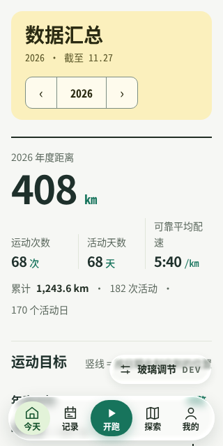 | 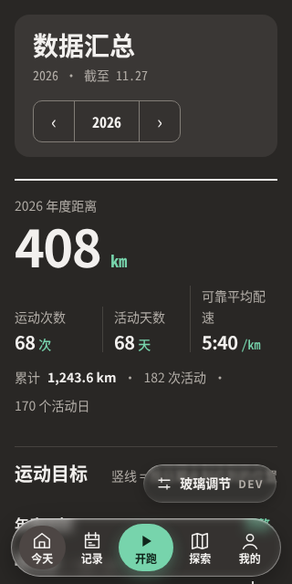 |
| 390 滚到底（页脚在 Tab 栏上方） | 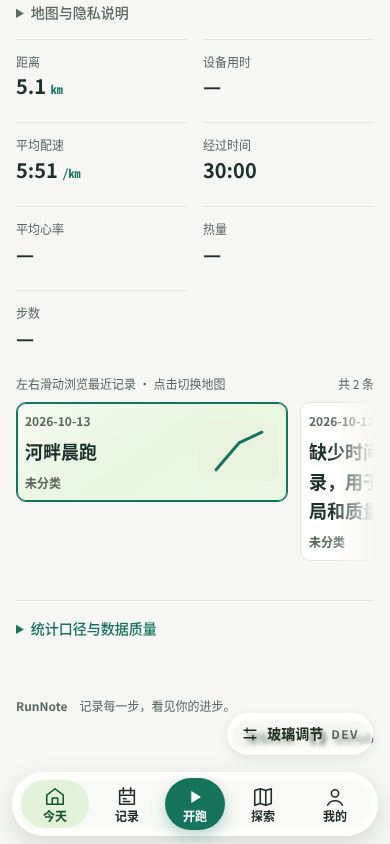 | 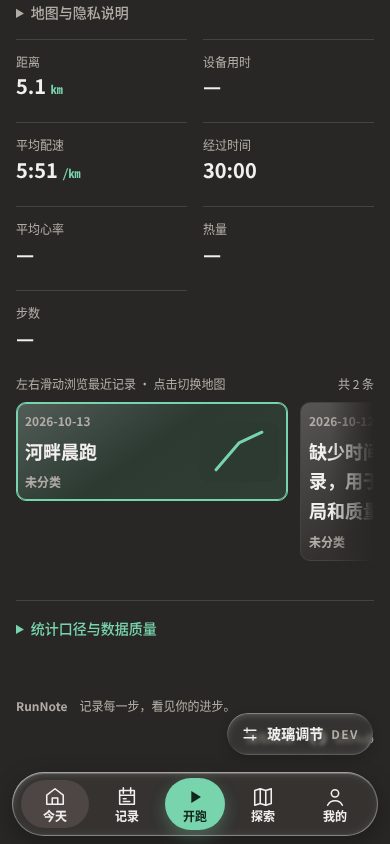 |
| “我的”面板 · 外观 | 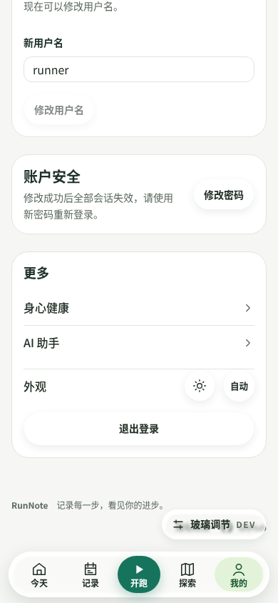 | 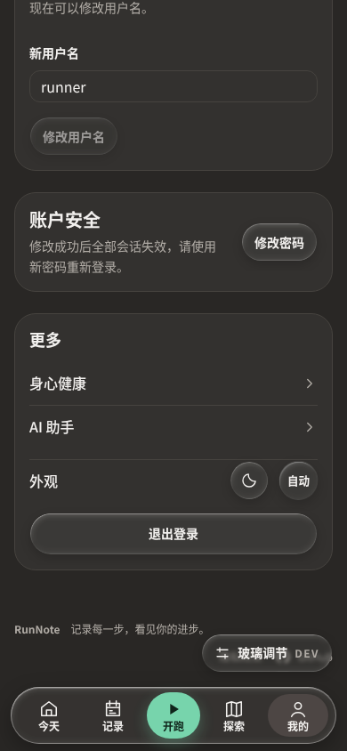 |
| 未登录页脚 | 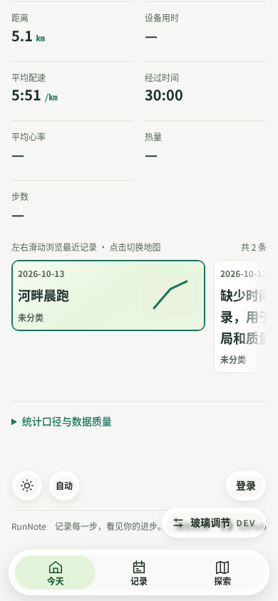 | 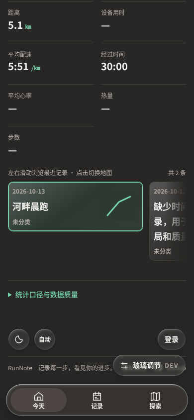 |

**视觉核对**（合成数据；1440×900、768×1024、390×844，浅/深色；控制台只有被阻止的外部底图请求 `ERR_FAILED`，与修改前相同；三档宽度横向溢出 0）

| 视口 | 修改前 | 修改后 |
| --- | --- | --- |
| 1440 浅 | 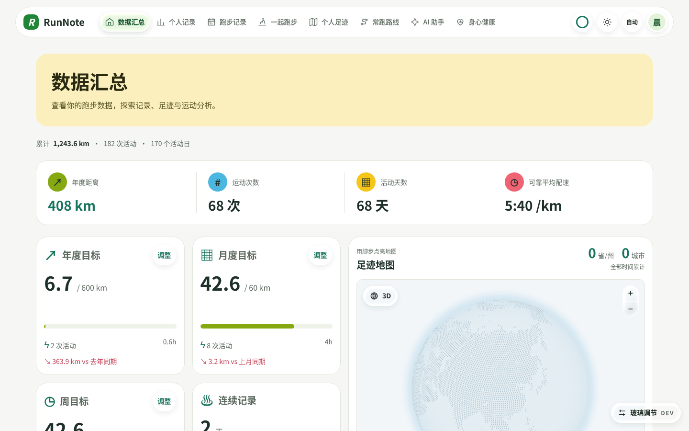 | 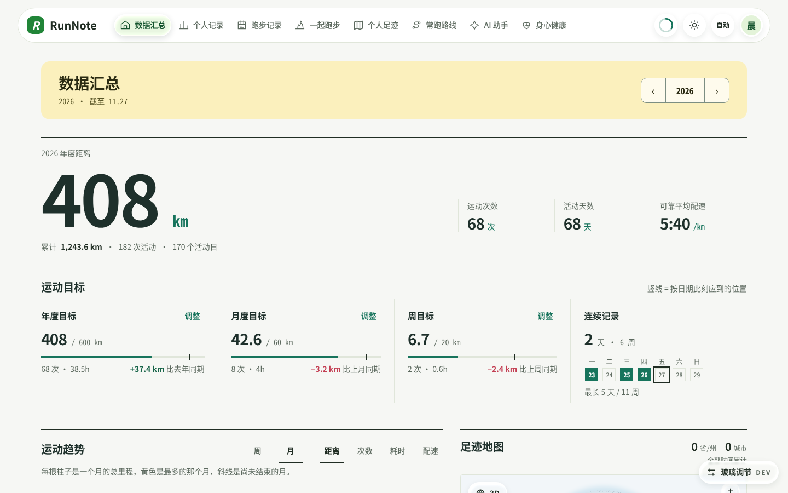 |
| 1440 深 | 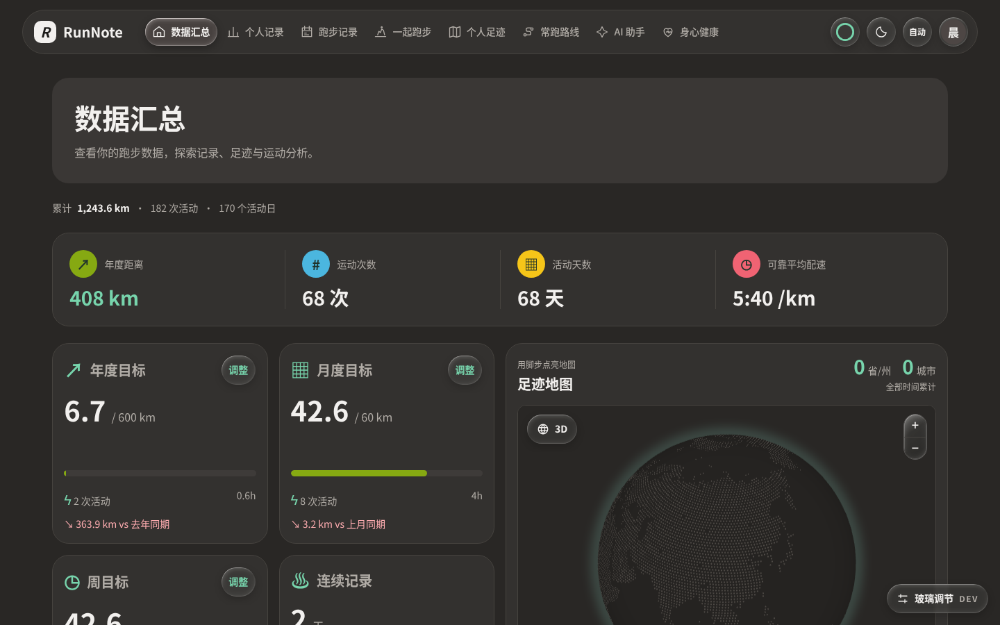 | 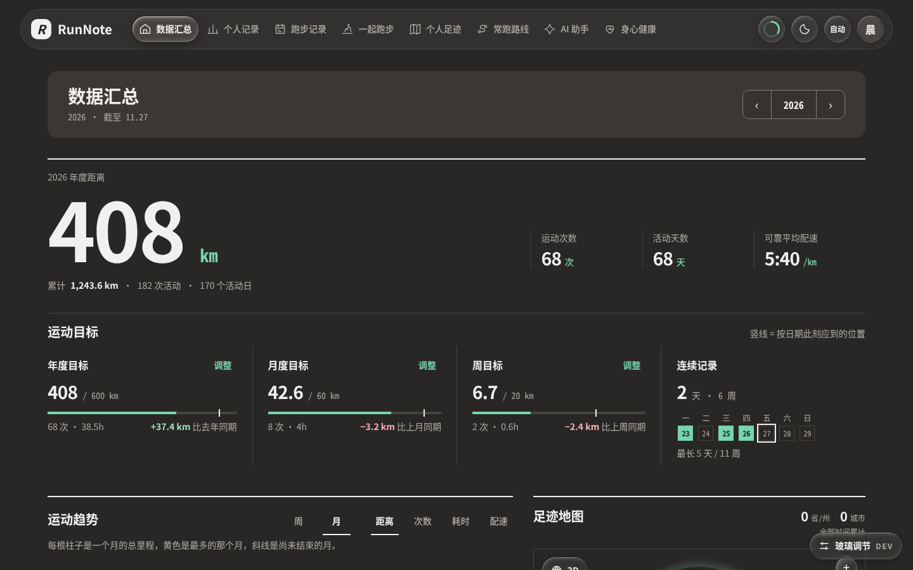 |
| 768 浅 | 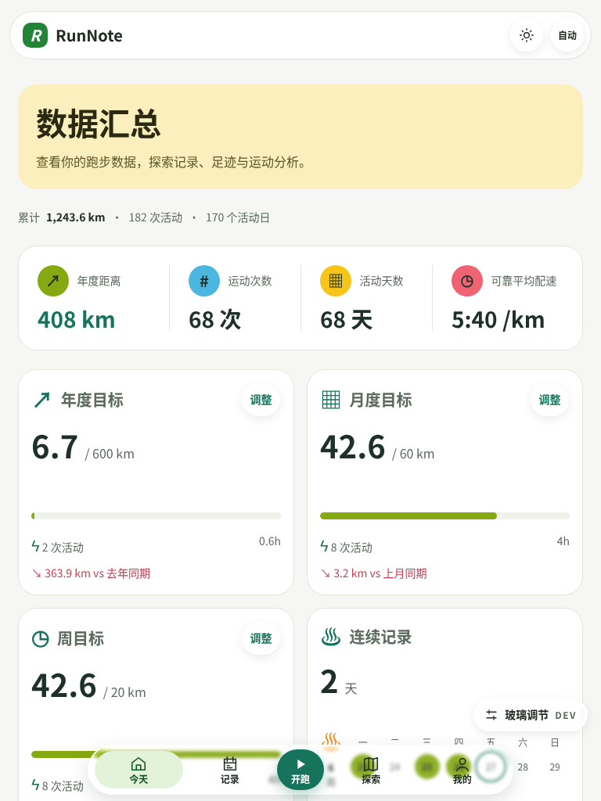 | 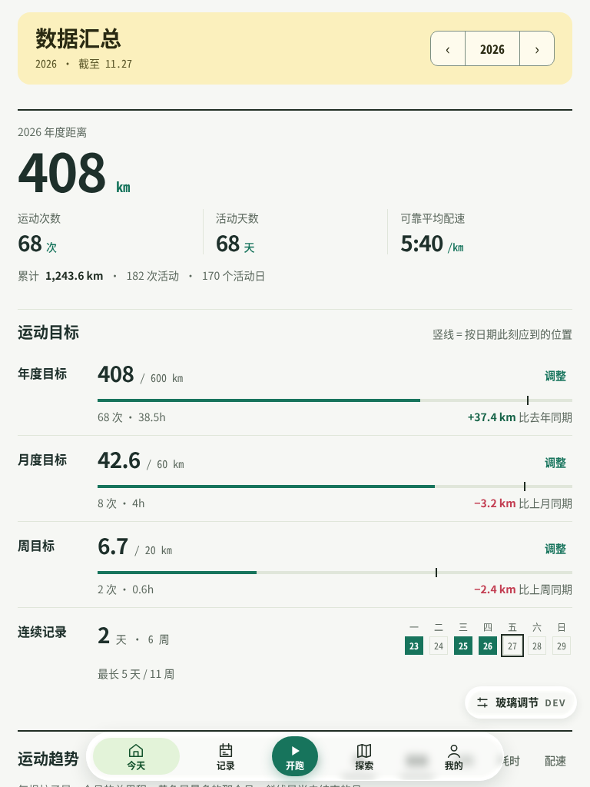 |
| 768 深 | 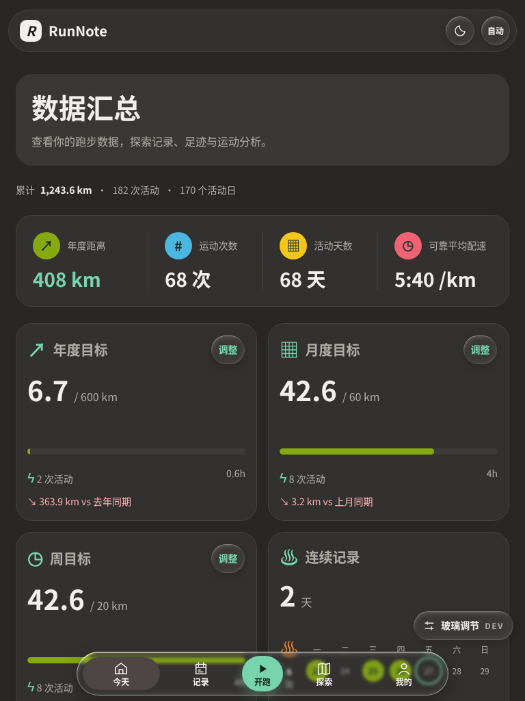 | 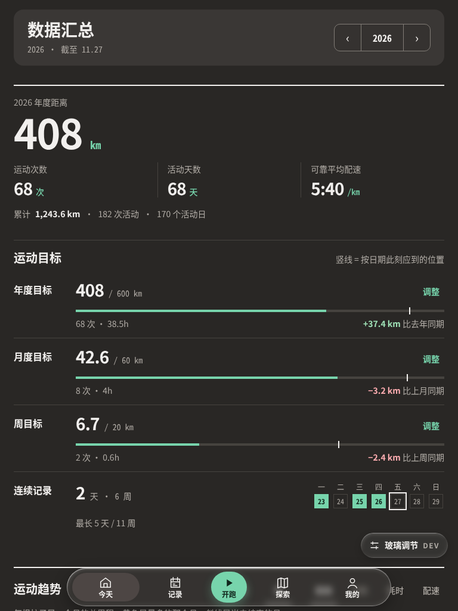 |
| 390 浅 | 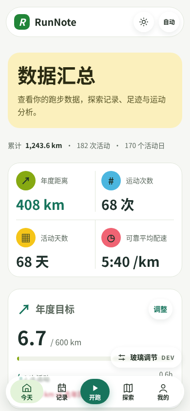 | 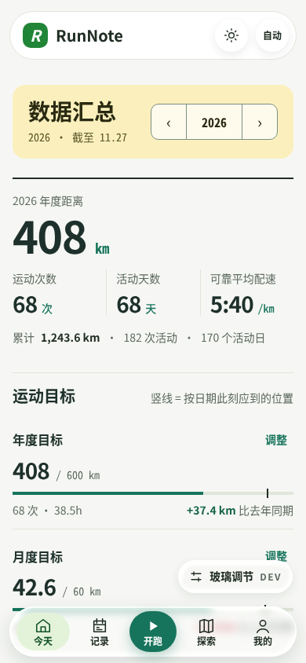 |
| 390 深 | 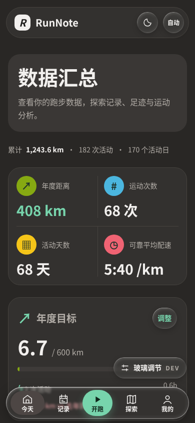 | 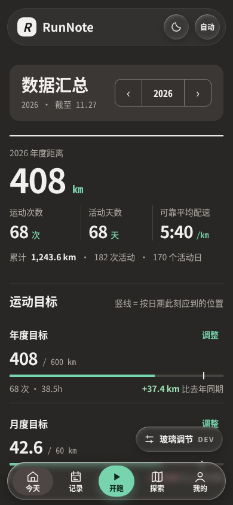 |

整页：[修改前 1440 浅](assets/2026-11-27-editorial-receipt-phase1/before-dashboard-1440-light-full.png)、[修改后 1440 浅](assets/2026-11-27-editorial-receipt-phase1/after-dashboard-1440-light-full.png)、[修改后 1440 深](assets/2026-11-27-editorial-receipt-phase1/after-dashboard-1440-dark-full.png)、[修改后 390 浅](assets/2026-11-27-editorial-receipt-phase1/after-dashboard-390-light-full.png)。玻璃导航滚动核对：[Tab 栏压在趋势图上 浅](assets/2026-11-27-editorial-receipt-phase1/tabbar-over-chart-390-light.png) / [深](assets/2026-11-27-editorial-receipt-phase1/tabbar-over-chart-390-dark.png)、[悬浮顶部条 浅](assets/2026-11-27-editorial-receipt-phase1/topbar-floating-1440-light.png) / [深](assets/2026-11-27-editorial-receipt-phase1/topbar-floating-1440-dark.png)。

修改前一组截图来自同一合成数据脚本的早期版本，其中目标区按周期映射的合成数值有误（年度目标显示了周数据）；页面结构与样式的对比不受影响。截图右下角的“玻璃调节 DEV”是开发服务器才有的调节器，生产构建不包含。

## 未确认事项与剩余风险

- `design-system` 像素基线（`composition-*-darwin.png`）因 h1 28px、`meta` 与 receipt 指标变体而变化，需在 macOS 上运行 `--update-snapshots` 并审阅。
- 真实后端 e2e 与后端集成测试未在本机运行（未改后端）；开发与生产实例未加载新代码。
- 玻璃配方只在 Chromium 上目视核对；WebKit 走既有磨砂回退，未在本机 Safari 验证（本机缺 WebKit 系统库）。
- 视口约 1024–1210px 时趋势图柱上只印峰值（容器宽 <640px 的规则），属有意取舍。
