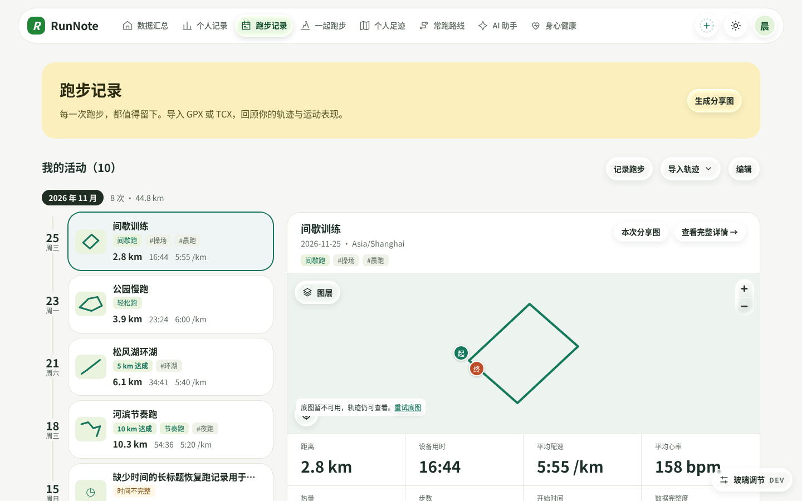
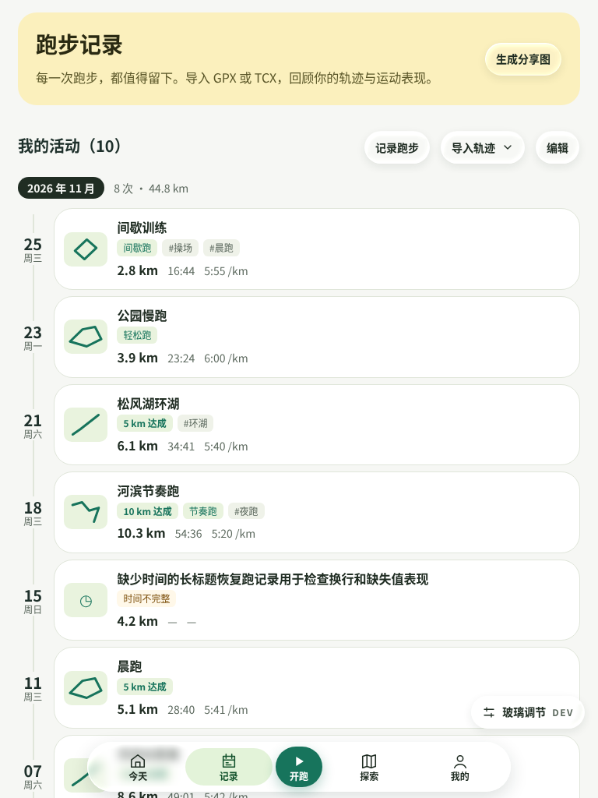
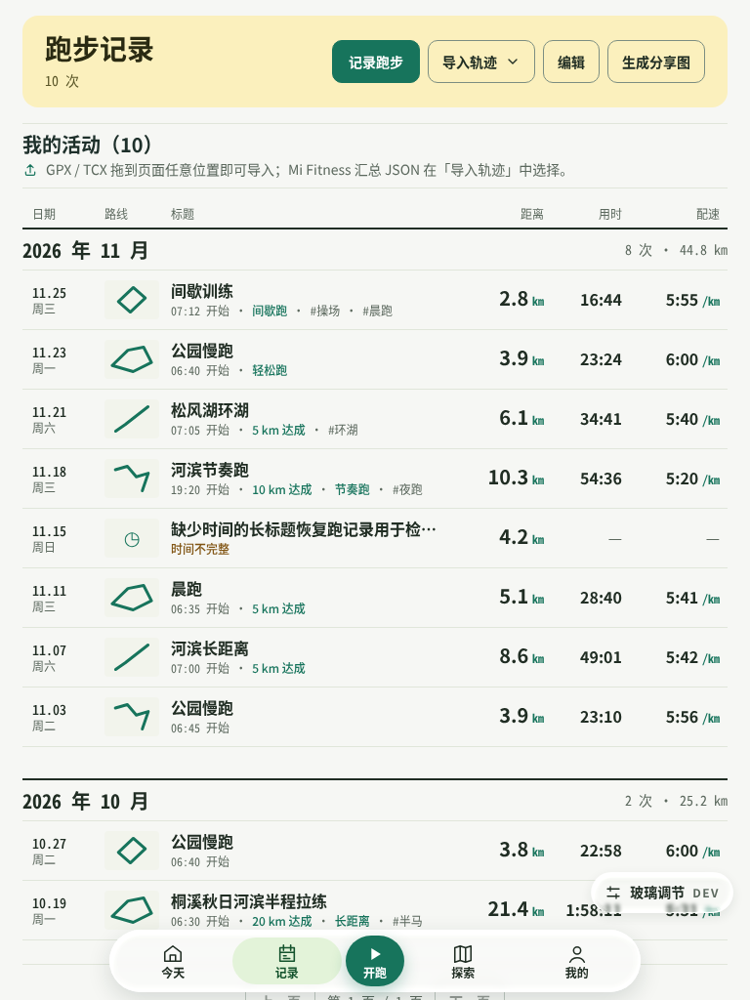
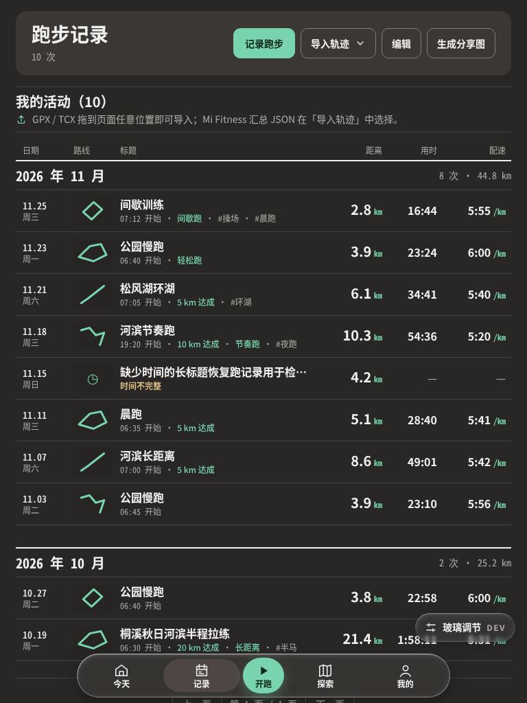
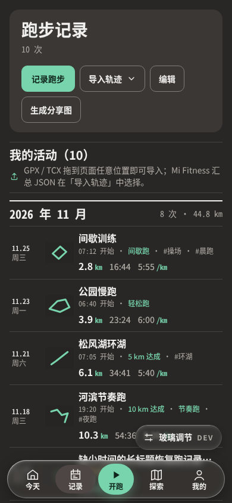

# 102 · Editorial Receipt Web 迁移（第一页）：跑步记录列表 `/activities`

延续 [101 · Editorial Receipt 第 1 阶段](101-editorial-receipt-phase1.md) 与 [brand.md](design-system/brand.md) 的按页迁移计划，本 PR 迁移 Web 跑步记录列表页（`/activities`，同步覆盖复用同一页面的 `/workspace/activities` 与 `/p/[username]/activities`），不改动活动详情、足迹、报告、设置或其他页面。

## 使用方式

- **页面级opt-in**：`/activities` 内容区包在 `.editorial-page.activities-page` 内，页头沿用紧凑奶油黄/暖炭灰底色（`PageHeader` 传 `meta` 等宽计数与页码，不再传叙述式 `description`），操作按钮（记录跑步、导入轨迹、编辑、生成分享图）以 10px 平面按钮收进页头右侧。
- **W-08 精简导入入口**：保留折叠式 `#import-region`（GPX/TCX 批量导入与 Mi Fitness 汇总导入，收起态 `inert` 且保留已选文件）与高度过渡动画；页头下改为一行带拖放反馈的提示条，并支持整页任意位置拖放 GPX/TCX 自动展开导入并载入文件。
- **共享组件可选外观（`appearance="ledger"`）**：
  - `ActivityTimeline`、`ActivityCard`、`ActivityPreview` 新增可选 `appearance?: 'default' | 'ledger'`（默认 `'default'`，`/together` 与 AI 助手中的既有消费者保持原样）。
  - `ledger` 外观：2px 墨色月节线 + 等宽月份标题与右侧月合计；表格化发丝线列表行（宽屏下 `日期 | 路线 | 标题 | 距离 | 用时 | 配速`，窄屏与编辑态通过容器查询自动折叠为紧凑两行）；去 24px 圆角内容卡与胶囊标签，改以纯文字元信息 + `.figure-unit` 等宽单位呈现；缺失值渲染 `—` 并附 `sr-only` 说明。
  - `ActivityPreview`（≥1024px 右栏吸顶）改为 2px 节线开头、4px 细框路线地图、三联发丝线核心指标、发丝线详情行与平面底部操作（删除为右侧红色文字按钮）；`RouteMap` 地图舞台显式标记 `data-glass-overlay`，地图浮层控件继续保留 Liquid Glass。
  - 编辑/删除原生 `<dialog>` 位于 `.editorial-page` 之外，保持弹层玻璃材质与焦点回退行为。

## 改动范围

| 区域 | 文件 | 意图 |
| --- | --- | --- |
| 共享样式 | `frontend/src/app.css` | `.editorial-page .page-actions` 换行与宽度约束、页头次级按钮悬停底色、`.editorial-page .file-pick` 3:1 控件描边 |
| 时间线样式与组件 | `frontend/src/lib/styles/activity-timeline.css`、`frontend/src/lib/components/ActivityTimeline.svelte` | 新增 `appearance="ledger"`：列头、2px 月节线、等宽月份标题、发丝线行、选中 3px 左墨线 |
| 记录行与预览栏 | `frontend/src/lib/components/ActivityCard.svelte`、`frontend/src/lib/components/ActivityPreview.svelte` | 新增 `appearance="ledger"`：表格化行、容器查询窄屏降级、去胶囊标签、三联指标 + 发丝线详情 |
| 地图玻璃边界 | `frontend/src/lib/components/RouteMap.svelte` | 地图容器加 `data-glass-overlay`，在 `.editorial-page` 内保留底图/缩放/回到路线浮层玻璃 |
| 导入子组件 | `frontend/src/lib/components/MifitnessImport.svelte`、`frontend/src/lib/components/ImportBatchPanel.svelte` | `.editorial-page` 内去 24px 卡片外框、改用发丝线与状态条；Mi Fitness 拖放阻止冒泡以免触发整页 GPX 拖放 |
| 列表页 | `frontend/src/routes/activities/+page.svelte` | `.editorial-page` 排版页头、整页拖放提示与处理、左右两栏主次比例（列表 `1fr` + 右栏 `23.75rem`/`20.5rem`）、对齐首行顶部 |
| 测试与文档 | `frontend/tests/ui/activities.spec.ts`、本文与 `docs/assets/2026-11-27-editorial-receipt-activities/` | 补充 Editorial Receipt 页头、首屏密度、整页拖放、缺失值读屏与明暗无溢出断言，留存修改前后合成截图 |

未改动：后端、API 契约、权限、CSRF、数据库、数据计算、版本文件、CHANGELOG、发布 workflow、顶部导航条、活动详情/足迹/报告/设置页及 `/together` 默认外观。

## 接口与隐私

不新增或修改任何接口、查询参数或权限边界；仍通过原有 `view-context` 读写本人或展示数据，离线缓存命名空间与 401 跳转不变。所有截图与新增测试均使用确定性合成数据，不含真实轨迹或用户信息。

## 验证记录（2026-11-27，本机 Linux，Node 24.18，Chrome，Playwright 1.65）

| 命令（`frontend/`） | 结果 |
| --- | --- |
| `./node_modules/.bin/svelte-kit sync && ./node_modules/.bin/svelte-check --tsconfig ./tsconfig.json` | 0 errors / 0 warnings |
| `./node_modules/.bin/stylelint "src/**/*.{css,svelte}" "tests/fixtures/**/*.{css,svelte}"` | 通过 |
| `./node_modules/.bin/vitest run` | 79 files / 521 tests passed |
| `./node_modules/.bin/vite build` | 成功（仅既有大体积 chunk 警告） |
| `node tests/fixtures/check-showcase-isolation.mjs` | PASS（1057 files，无 showcase 产物，5 路径均为 404） |
| `playwright test --config playwright.ui.config.ts tests/ui/activities.spec.ts` | 30 passed / 0 failed（含新增 Editorial Receipt 与整页拖放回归用例） |
| `playwright test --config playwright.activity-library.config.ts` | 62 passed / 0 failed（覆盖 cards / library / management / metrics / sport-detail / tcx） |
| `playwright test --config playwright.ui.config.ts tests/ui/activity-batch-import.spec.ts tests/ui/liquid-glass.spec.ts tests/ui/mobile-tabbar.spec.ts tests/ui/companion-phase3.spec.ts tests/ui/admin-users.spec.ts` | 全部通过（同批 144 项中仅 `ui-shell` 因空列表页高 1008px 处临界区失败一次；收紧折叠导入间距至 1000px 后重跑通过） |
| `playwright test --config playwright.ui.config.ts tests/ui/ui-shell.spec.ts tests/ui/crossbrowser-glass.spec.ts` | 28 passed / 4 skipped / 0 failed |
| `playwright test --config playwright.route-poster.config.ts` | 31/34 首跑时与并行抓图竞争 CPU；单独复跑 3 项后全部通过 |
| `playwright test --config playwright.together.config.ts` | 20/21 首跑；单独复跑 `together.spec.ts:288` 通过 |
| `mifitness.spec.ts`（通过 `playwright.ui.config.ts` 同构配置运行，避开旧 `playwright.mifitness.config.ts` 指向已下线 `/login` 的就绪探测） | 7 passed / 0 failed |
| `playwright test --config playwright.design-system.config.ts --grep-invert "visual baseline"` | 7 passed / 0 failed |

### 视觉验收矩阵（合成数据，浅/深色）

1440×900 首屏可见完整记录数由 **4 条** 提升至 **8 条**（符合 W-08），三档标准视口与 320×640 极窄屏横向溢出均为 0，页面错误为 0。

| 视口 | 修改前 | 修改后 |
| --- | --- | --- |
| 1440×900 浅色 |  |  |
| 1440×900 深色 |  |  |
| 768×1024 浅色 |  |  |
| 768×1024 深色 |  |  |
| 390×844 浅色 |  |  |
| 390×844 深色 |  |  |

状态与极窄屏核对：[320×640 浅色](assets/2026-11-27-editorial-receipt-activities/after-activities-320-light.png)、[导入展开态](assets/2026-11-27-editorial-receipt-activities/after-activities-1440-light-import-open.png)、[批量编辑态](assets/2026-11-27-editorial-receipt-activities/after-activities-1440-light-edit-mode.png)、[空状态](assets/2026-11-27-editorial-receipt-activities/after-activities-1440-light-empty.png)、[错误状态](assets/2026-11-27-editorial-receipt-activities/after-activities-1440-light-error.png)。

## 未运行项与剩余风险

- 真实后端 E2E（`playwright.config.ts`）与后端集成测试未在本机运行（未改动后端/数据库/API）；以 PR CI 结果为准。
- `design-system.spec.ts` 的像素快照对比（`composition-*-darwin.png`）仅存在 macOS 基线，未在 Linux 上比较（本次未修改展示页或基础组件默认外观）。
- 既有 `playwright.mifitness.config.ts` 的 `webServer` 仍探测已下线的 `/login`（返回 404），本 PR 未顺手改无关配置文件，而是以指向 `/admin` 的同构配置实测通过了 `mifitness.spec.ts` 全部 7 个用例。
- 未在真实 Safari/WebKit 真机上目视核对（本机 Linux 无 WebKit 系统库）；桌面与移动端视觉核对基于 Chromium 合成 API 环境。
