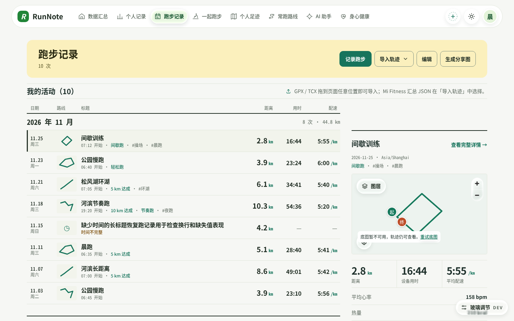
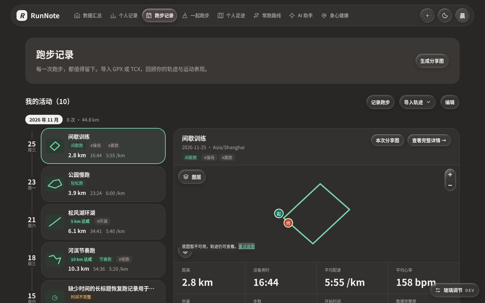
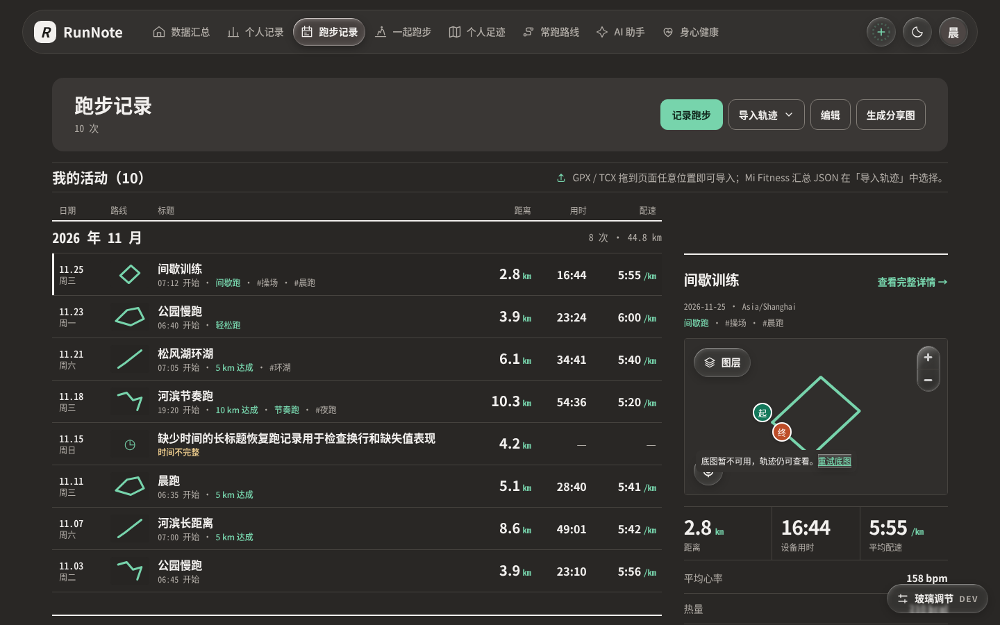
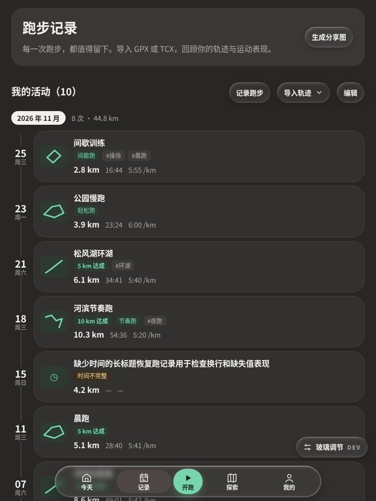
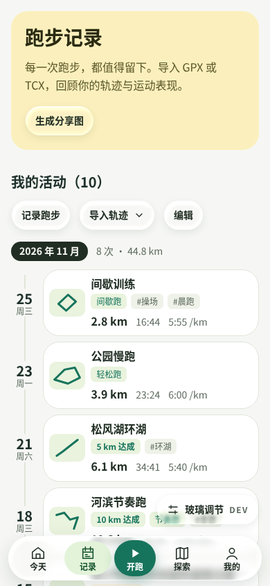
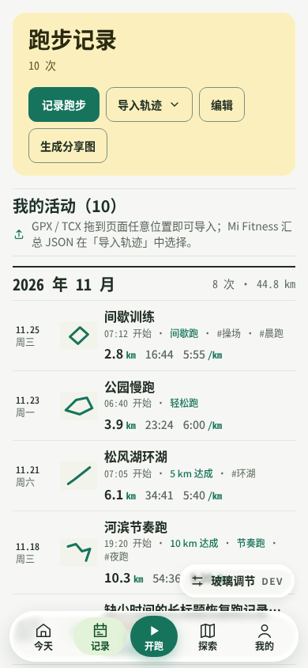
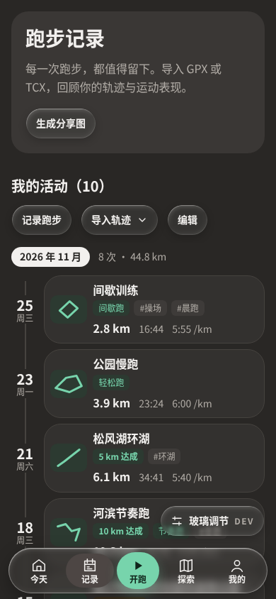

# 102 · Editorial Receipt Web 迁移（第一页）：跑步记录列表 `/activities`

延续 [101 · Editorial Receipt 第 1 阶段](101-editorial-receipt-phase1.md) 与 [brand.md](design-system/brand.md) 的按页迁移计划，本 PR 迁移 Web 跑步记录列表页（`/activities`，同步覆盖复用同一页面的 `/workspace/activities` 与 `/p/[username]/activities`），不改动活动详情、足迹、报告、设置或其他页面。

## 使用方式

- **页面级opt-in**：`/activities` 内容区包在 `.editorial-page.activities-page` 内，页头沿用紧凑奶油黄/暖炭灰底色（`PageHeader` 传 `meta` 等宽计数与页码，不再传叙述式 `description`），操作按钮（记录跑步、导入轨迹、编辑、生成分享图）以 10px 平面按钮收进页头右侧。
- **W-08 精简导入入口**：保留折叠式 `#import-region`（GPX/TCX 批量导入与 Mi Fitness 汇总导入，收起态 `inert` 且保留已选文件）与高度过渡动画；页头下改为一行带拖放反馈的提示条，并支持整页任意位置拖放 GPX/TCX 自动展开导入并载入文件。
- **共享组件可选外观（`appearance="ledger"`）**：
  - `ActivityTimeline`、`ActivityCard`、`ActivityPreview` 新增可选 `appearance?: 'default' | 'ledger'`（默认 `'default'`，`/together` 与 AI 助手中的既有消费者保持原样）。
  - `ledger` 外观：2px 墨色月节线 + 等宽月份标题与右侧月合计；表格化发丝线列表行（宽屏下 `日期 | 路线 | 标题 | 距离 | 用时 | 配速`，通过 `.card-link` 独立容器查询 `@container link (max-width: 31rem)` 按链接剩余宽度自动折叠为紧凑两行，编辑态在 `@container card (max-width: 26rem)` 下将操作按钮换行，确保 1440 / 1024 / 768 / 390 / 320 全宽编辑态下标题与指标均非零宽、不重叠、不塌陷）；去 24px 圆角内容卡与胶囊标签，改以纯文字元信息 + `.figure-unit` 等宽单位呈现；缺失值渲染 `—` 并附 `sr-only` 说明。
  - `ActivityPreview`（≥1024px 右栏吸顶）改为 2px 节线开头、4px 细框路线地图、三联发丝线核心指标、发丝线详情行与平面底部操作（删除为右侧红色文字按钮）；`RouteMap` 地图舞台显式标记 `data-glass-overlay`，地图浮层控件继续保留 Liquid Glass。
  - 编辑/删除原生 `<dialog>` 位于 `.editorial-page` 之外；`RoutePosterDialog` 与 `ActivityPosterDialog` 的 `<dialog>` 显式标注 `data-glass-overlay`，并通过 `.editorial-page` 按钮规则的 `:where(:not([data-glass-overlay] *))` 守卫与 `--radius-control` 复位，使分享弹窗内按钮在浅/深色下均保留完整 Liquid Glass 材质及 `Escape` 关闭后的焦点回退。

## 改动范围

| 区域 | 文件 | 意图 |
| --- | --- | --- |
| 共享样式 | `frontend/src/app.css` | `.editorial-page` 平面按钮规则加 `:where(:not([data-glass-overlay] *))` 守卫、`.editorial-page [data-glass-overlay]` 复位 `--radius-control`、页头次级按钮悬停底色（不向全局 `.editorial-page` 注入 `.page-actions` / `.file-pick`，避免影响 `/dashboard`） |
| 时间线样式与组件 | `frontend/src/lib/styles/activity-timeline.css`、`frontend/src/lib/components/ActivityTimeline.svelte` | 新增 `appearance="ledger"`：列头、2px 月节线、等宽月份标题、发丝线行、选中 3px 左墨线 |
| 记录行与预览栏 | `frontend/src/lib/components/ActivityCard.svelte`、`frontend/src/lib/components/ActivityPreview.svelte` | 新增 `appearance="ledger"`：表格化行、基于 `.card-link` 剩余宽度的双容器查询（`link` + `card`）适配窄屏与编辑态、去胶囊标签、三联指标 + 发丝线详情 |
| 地图与分享弹窗玻璃边界 | `frontend/src/lib/components/RouteMap.svelte`、`frontend/src/lib/components/RoutePosterDialog.svelte`、`frontend/src/lib/components/ActivityPosterDialog.svelte` | 地图容器与路线/单次分享图 `<dialog>` 显式标注 `data-glass-overlay`，在 `.editorial-page` 内保留浮层与弹窗 Liquid Glass 材质及焦点回退 |
| 导入子组件 | `frontend/src/lib/components/MifitnessImport.svelte`、`frontend/src/lib/components/ImportBatchPanel.svelte` | `.editorial-page` 内去 24px 卡片外框、改用发丝线与状态条；Mi Fitness 拖放处理后回调 `ondrophandled` 清理父级整页拖入高亮 |
| 列表页 | `frontend/src/routes/activities/+page.svelte` | `.editorial-page.activities-page` 排版页头、局部 `.page-actions` 换行约束、局部 `.file-pick:not([data-dragging='true']):not([data-filled='true']):not(:hover)` 保留拖入/已选 `--primary-soft` 反馈、整页拖放提示与 `ondragend`/`ondrophandled` 状态清理、左右两栏主次比例 |
| 测试与配置 | `frontend/tests/ui/activities.spec.ts`、`frontend/playwright.mifitness.config.ts`、本文与 `docs/assets/2026-11-27-editorial-receipt-activities/` | 修复 `playwright.mifitness.config.ts` 就绪探测地址（`/login` → `/admin`）；补充显式 `html[data-theme]` 明暗切换、1440/1024/768/390/320 编辑态几何与防重叠断言、整页 GPX 拖放并实际提交、Mi Fitness 拖放复位与 `.file-pick` 拖入/已选反馈、分享弹窗玻璃边界与 `Escape` 焦点回退用例，并留存合成截图 |

未改动：后端、API 契约、权限、CSRF、数据库、数据计算、版本文件、CHANGELOG、发布 workflow、顶部导航条、活动详情/足迹/报告/设置/数据汇总页及 `/together` 默认外观。

## 接口与隐私

不新增或修改任何接口、查询参数或权限边界；仍通过原有 `view-context` 读写本人或展示数据，离线缓存命名空间与 401 跳转不变。所有截图与新增测试均使用确定性合成数据，不含真实轨迹或用户信息。

## 验证记录（2026-11-27，返修后，本机 Linux，Node 24.18，Chrome，Playwright 1.65）

| 命令（`frontend/`） | 结果 |
| --- | --- |
| `./node_modules/.bin/svelte-kit sync && ./node_modules/.bin/svelte-check --tsconfig ./tsconfig.json` | 0 errors / 0 warnings |
| `./node_modules/.bin/stylelint "src/**/*.{css,svelte}" "tests/fixtures/**/*.{css,svelte}"` | 通过 |
| `./node_modules/.bin/vitest run` | 79 files / 521 tests passed |
| `./node_modules/.bin/vite build` | 成功（仅既有大体积 chunk 警告） |
| `node tests/fixtures/check-showcase-isolation.mjs` | PASS（1057 files，无 showcase 产物，5 路径均为 404） |
| `playwright test --config playwright.ui.config.ts tests/ui/activities.spec.ts` | 33 passed / 0 failed（覆盖 Editorial Receipt、显式明暗 `data-theme`、5 档编辑态几何断言、整页 GPX 拖放提交、Mi Fitness 拖放复位与 `.file-pick` 状态、分享弹窗玻璃与 `Escape` 焦点回退） |
| `playwright test --config playwright.mifitness.config.ts` | 7 passed / 0 failed（标准配置直接通过） |
| `playwright test --config playwright.activity-library.config.ts` | 66 passed / 0 failed |
| `playwright test --config playwright.ui.config.ts tests/ui/activity-batch-import.spec.ts tests/ui/liquid-glass.spec.ts tests/ui/ui-shell.spec.ts tests/ui/crossbrowser-glass.spec.ts tests/ui/mobile-tabbar.spec.ts tests/ui/companion-phase3.spec.ts tests/ui/admin-users.spec.ts` | 全部通过（同批除 `activities.spec.ts` 外 121 passed / 4 skipped / 0 failed） |
| `playwright test --config playwright.ui.config.ts tests/ui/dashboard.spec.ts` | 7 passed / 0 failed（确认 `/dashboard` 未受影响） |
| `playwright test --config playwright.activity-poster.config.ts` | 11 passed / 0 failed |
| `playwright test --config playwright.together.config.ts` | 21 passed / 0 failed |
| `playwright test --config playwright.design-system.config.ts --grep-invert "visual baseline"` | 7 passed / 0 failed |
| `playwright test --config playwright.route-poster.config.ts`（未过滤实测） | 32 passed / 2 failed（`route-poster.spec.ts:303` 与 `372` 在切换 radio 后 `preview src` 5s 超时；单独复跑 `372` 通过 11.7s，属既有基线 `RoutePosterDialog.svelte` 渲染时序抖动，未伪装为全绿） |

### 视觉验收矩阵（合成数据，浅/深色）

1440×900 首屏可见完整记录数由 **4 条** 提升至 **8 条**（符合 W-08），1440 / 1024 / 768 / 390 / 320 五档标准与编辑态横向溢出均为 0，页面错误为 0。

| 视口 | 修改前 | 修改后 |
| --- | --- | --- |
| 1440×900 浅色 |  |  |
| 1440×900 深色 |  |  |
| 768×1024 浅色 |  |  |
| 768×1024 深色 |  |  |
| 390×844 浅色 |  |  |
| 390×844 深色 |  |  |

编辑态几何实测（合成首条记录，无溢出、无缩略图/按钮重叠）：

| 视口 / 主题 | 行高 `cardH` | 标题 `h3` 宽 × 高 | 元信息高 | 距离 / 用时 / 配速宽 | 截图 |
| --- | --- | --- | --- | --- | --- |
| 1440×900 浅色 | 60px | 宽屏表列 | 单行 | 正常 | [1440 编辑态](assets/2026-11-27-editorial-receipt-activities/after-activities-1440-light-edit-mode.png) |
| 1024×1024 浅色 | 88px | 289px × 22px | 17px | 40px / 36px / 49px | [1024 浅色编辑态](assets/2026-11-27-editorial-receipt-activities/after-activities-1024-light-edit-mode.png) |
| 1024×1024 深色 | 88px | 289px × 22px | 17px | 40px / 36px / 49px | [1024 深色编辑态](assets/2026-11-27-editorial-receipt-activities/after-activities-1024-dark-edit-mode.png) |
| 768×1024 浅色 | 88px | 400px × 22px | 17px | 40px / 36px / 49px | [768 编辑态](assets/2026-11-27-editorial-receipt-activities/after-activities-768-light-edit-mode.png) |
| 390×844 浅色 | 164px | 194px × 22px | 34px | 40px / 36px / 49px | [390 编辑态](assets/2026-11-27-editorial-receipt-activities/after-activities-390-light-edit-mode.png) |
| 320×640 浅色 | 199px | 132px × 22px | 50px | 40px / 36px / 49px | [320 编辑态](assets/2026-11-27-editorial-receipt-activities/after-activities-320-light-edit-mode.png) |

状态、拖放复位与分享弹窗核对：[320×640 浅色](assets/2026-11-27-editorial-receipt-activities/after-activities-320-light.png)、[导入展开态](assets/2026-11-27-editorial-receipt-activities/after-activities-1440-light-import-open.png)、[Mi Fitness 拖放复位与已选态](assets/2026-11-27-editorial-receipt-activities/after-activities-1440-light-drop-reset.png)、[分享图弹窗浅色（玻璃边界）](assets/2026-11-27-editorial-receipt-activities/after-activities-1440-light-poster-dialog.png)、[分享图弹窗深色（玻璃边界）](assets/2026-11-27-editorial-receipt-activities/after-activities-1440-dark-poster-dialog.png)、[空状态](assets/2026-11-27-editorial-receipt-activities/after-activities-1440-light-empty.png)、[错误状态](assets/2026-11-27-editorial-receipt-activities/after-activities-1440-light-error.png)。

## 未运行项与剩余风险

- 真实后端 E2E（`playwright.config.ts`）与后端集成测试未在本机运行（未改动后端/数据库/API）；以 PR CI 结果为准。
- `design-system.spec.ts` 的像素快照对比（`composition-*-darwin.png`）仅存在 macOS 基线，未在 Linux 上比较（本次未修改展示页或基础组件默认外观）。
- `playwright.route-poster.config.ts` 本机未过滤运行为 32/34 通过（`route-poster.spec.ts:303` 与 `372` 偶发 `preview src` 5s 超时，单跑 `372` 通过），属既有 `RoutePosterDialog.svelte` 基线渲染时序抖动（未在本次 `/activities` 范围改动其内部渲染逻辑）；以 CI `frontend-ui` 结果复核。
- 未在真实 Safari/WebKit 真机上目视核对（本机 Linux 无 WebKit 系统库）；桌面与移动端视觉核对基于 Chromium 合成 API 环境。
