# 103 · Editorial Receipt Web 迁移（第二页）：活动详情 `/activities/[id]`

延续 [101 · Editorial Receipt 第 1 阶段](101-editorial-receipt-phase1.md)、[102 · 跑步记录列表](102-editorial-receipt-activities.md) 与 [brand.md](design-system/brand.md)（§2 票据页、§3–§6、W-04/05/07/09）的按页迁移计划，本 PR 将 Web 活动详情页 `/activities/[id]`（同步覆盖直接复用的 `/workspace/activities/[id]`、`/p/[username]/activities/[id]`，以及公开摘要页组件 `PublicActivityPage`）迁移至 Editorial Receipt 票据页语言。不改动后端、API、权限、CSRF、数据计算、版本文件、发布流程，也不顺手重构列表、足迹、报告或设置页。

## 使用方式

- **页面级 opt-in（`.editorial-page.detail-page`）**：保留既有全局顶部悬浮玻璃导航（≥800px）与手机底部 Tab 栏（<800px），不改变未迁移页面与 `/activities` 列表的 `appearance="ledger"` opt-in 边界。
- **顶部工具栏与安全操作边界**：左侧保留「返回」导航按钮；右侧放置「分享」（展开「生成分享图」「导出视频」，弹层继续保留 Liquid Glass）、「编辑记录」及「更多（`...`）」菜单。「删除记录」收进「更多」菜单（带 `data-tone="danger"` 保持危险态色值），触发原有原生 `<dialog data-glass-overlay>` 确认并保留 `Escape` 焦点回退至「更多」按钮。
- **W-07 左侧票据存根 + 右侧约 560px 地图**：
  - 左侧 `.receipt-sheet.stub`：单张票据纸面（`--paper`）与唯一黄色票头（浅色 `--receipt` / `--receipt-ink`，深色 `--receipt-ink` / `--primary`，展示 `YYYY-MM-DD 周几` 与活动时区起止时间）；`h1` 标题 + 时区/分类/标签纯文字副行（去除叙述式文案与胶囊标签）；`64–88px`（`--text-figure`）主数字距离 + 等宽小写单位；点线引导指标列表（`.leader-row`，缺失值以 `—` + `sr-only` 呈现）；带侧缺口的打孔虚线（`.receipt-perforation`）分隔「每公里配速」印刷条（最快公里以 `--receipt-mark` 与加粗文本 + 「最快」标签双重标记）与私人备注区（「添加备注」直接打开编辑器并聚焦备注框）。
  - 右侧 `.detail-main`：`RouteMap` 新增可选 `appearance="sheet"`（4px 细框、桌面端约 `35rem` / `560px` 高度，默认 `'default'` 不影响其他调用方）与可选 `controls` snippet 将「动态回放」浮层按钮与底图切换器并列置于地图左上角玻璃浮层区（`data-glass-overlay`），同时保留无障碍 `<h2 id="route-title" class="sr-only">路线</h2>`。
- **地图下方配速曲线与分段数据表（`ActivityPaceChart`）**：
  - 基于服务端 `/api/v1/activities/{id}/replay` 返回的真实 `distance_m`、`moving_s`、`pace_s_per_km` 渲染配速折线（2px `--primary` + 均值 1px 虚线参考线）与 `
` 每公里分段数据表，并与 `ActivityReplayDialog` 共享同一次回放请求避免重复拉取。
  - **关于海拔序列**：现有后端 `/activities/{id}`、`/route`、`/replay` 接口未返回逐点海拔数组，遵循 `brand.md §1`「真实数据，不虚构图形」与本任务「不改后端/API/数据计算」约束，当前图表仅渲染真实配速曲线并在标题如实标注为「配速曲线」。
- **次级分区去卡片化**：跑鞋（`ActivityShoe`）、设备指标（`DeviceMetrics`）、数据质量 `
`、本次足迹卡片（`ActivityWallPreview`）、跑步日记（`ActivityDiary`）、旧版分享链接（`SharePanel`）改为 `1px` 发丝线（`.section-hairline`）分组；编辑面板与删除/分享/回放原生弹窗保持 `data-glass-overlay` 与焦点管理。
- **公开摘要页（`PublicActivityPage`）**：延续 `PageHeader`（保留 `--header-tint` 页头底色 + `meta` 作者与日期）与 `MetricSummary appearance="receipt"`，不公开轨迹坐标。

## 改动范围

| 区域 | 文件 | 意图 |
| --- | --- | --- |
| 共享样式 | `frontend/src/app.css` | 完善 `.receipt-sheet` / `.receipt-header` / `.receipt-perforation`（含侧缺口描边与 `--background` 默认底色）与 `.leader-row` 虚线基线对齐 |
| 详情主页面 | `frontend/src/routes/activities/[id]/+page.svelte` | 迁移为 `.editorial-page.detail-page`：工具栏 + 「更多」菜单收纳删除、左侧票据存根（票头/主数字/点线引导/每公里印刷条/备注）+ 右侧 560px 地图与配速曲线、共享 replay 拉取、无障碍路线标题 |
| 分段与曲线 | `frontend/src/lib/api/activity-splits.ts`、`frontend/src/lib/components/ActivityPaceChart.svelte` | 从服务端 replay 数组切片生成每公里分段展示数据与配速曲线采样（仅展示层，不替代服务端权威汇总）；ECharts 按需动态加载、`watchSystemTheme` 明暗同步、`
` 分段数据表兜底 |
| 详情关联组件 | `frontend/src/lib/components/RouteMap.svelte`、`ActivityActions.svelte`、`ActivityEditor.svelte`、`ActivityReplayDialog.svelte`、`ActivityWallPreview.svelte`、`ActivityDiary.svelte`、`SharePanel.svelte`、`shoes/ActivityShoe.svelte`、`PublicActivityPage.svelte` | `RouteMap` 增加可选 `appearance="sheet"` 与 `controls` snippet；`ActivityActions` 暴露 `openEdit`/`openDelete` 与状态回调、弹窗显式标注 `data-glass-overlay`；`ActivityEditor` 支持 `initialFocus` 与 `--control-border`；`ActivityReplayDialog` 支持可选共享 replay 状态；其余详情子区块去 24px 卡片外框改为发丝线分组；`PublicActivityPage` 复用 `PageHeader` + `MetricSummary appearance="receipt"` |
| 测试与验收资产 | `frontend/tests/unit/activity-splits.test.ts`、`frontend/tests/ui/sport-detail.spec.ts`、`frontend/tests/ui/activity-management.spec.ts`、`frontend/tests/ui/footprint-card-deck.spec.ts`、`frontend/tests/e2e/activity-management.spec.ts`、本文及 `docs/assets/2026-11-27-editorial-receipt-detail/` | 补充 `activity-splits` 单元测试、详情页票据结构/更多菜单删除/分享弹窗玻璃边界/图表与 4 视口×明暗几何断言；适配删除迁入「更多」菜单后的交互路径（不弱化断言）；留存修改前后合成截图 |

未改动：后端代码、数据库迁移、API 契约、权限与 CSRF、权威指标计算、版本号文件、`CHANGELOG.md`、发布 workflow、全局顶部导航、`/activities` 列表 `ledger` 外观、`/dashboard`、`/together`、足迹、报告与设置页。

## 接口与隐私

不新增或修改任何 API 路径、查询参数或权限校验。私人备注、编辑/删除、跑鞋、跑步日记、旧版分享链接与分享图/视频导出仍严格受 `view.manage` / `viewsOwnRecords` 控制；公开摘要页继续使用字段白名单且不暴露坐标。所有测试与截图均基于合成数据，不含真实轨迹或用户信息。

## 验证记录（2026-11-27，本机 Linux，Node 24，Chrome，Playwright 1.65）

| 命令（`frontend/`） | 结果 |
| --- | --- |
| `pnpm check`（`svelte-kit sync && svelte-check`） | 0 errors / 0 warnings |
| `pnpm lint:style`（Stylelint） | 通过 |
| `pnpm test`（Vitest） | 80 files / 528 tests passed |
| `pnpm build`（adapter-node） | 成功（仅既有大体积 chunk 警告） |
| `node tests/fixtures/check-showcase-isolation.mjs` | PASS（1057 files，无 showcase 产物，5 路径均为 404） |
| `playwright test --config playwright.activity-management.config.ts` | 36 passed / 0 failed（覆盖 `activities.spec.ts` + `activity-management.spec.ts`） |
| `playwright test --config playwright.activity-poster.config.ts` | 11 passed / 0 failed |
| `playwright test --config playwright.together.config.ts` | 21 passed / 0 failed（确认 `/together` 未受影响） |
| `playwright test --config playwright.design-system.config.ts --grep-invert "visual baseline"` | 7 passed / 0 failed |
| `playwright test --config playwright.ui.config.ts tests/ui/sport-detail.spec.ts tests/ui/dashboard.spec.ts tests/ui/liquid-glass.spec.ts tests/ui/ui-shell.spec.ts tests/ui/mobile-tabbar.spec.ts tests/ui/admin-users.spec.ts tests/ui/companion-phase3.spec.ts tests/ui/seo-routes.spec.ts tests/ui/theme.spec.ts` | 133 passed / 0 failed |
| `playwright test --config playwright.ui.config.ts tests/ui/sport-detail.spec.ts tests/ui/activity-replay.spec.ts tests/ui/footprint-card-deck.spec.ts tests/ui/shoes.spec.ts tests/ui/running-diary.spec.ts tests/ui/privacy.spec.ts tests/ui/p2.spec.ts tests/ui/map-framing.spec.ts tests/ui/basemaps.spec.ts tests/ui/admin-readonly-activities.spec.ts` | 104 passed / 0 failed（最后一次微调前的全量关联集；微调仅涉及 `data-tone="danger"`、`sr-only` 路线标题与图表 `$effect` 依赖追踪，随后由上行 `sport-detail` 与 `activity-management` 复核） |

### 视觉验收矩阵（合成数据，4 视口 × 浅/深色）

1440×900、768×1024、390×844、320×640 四档视口在浅色与深色模式下横向溢出均为 0、页面错误为 0，票据主数字实测位于 64–88px 区间，删除已收进「更多」菜单并保留原生弹窗确认，分享弹窗保留 Liquid Glass 边界与 `Escape` 焦点回退。

| 视口 / 主题 | 修改前 | 修改后 |
| --- | --- | --- |
| 1440×900 浅色 | 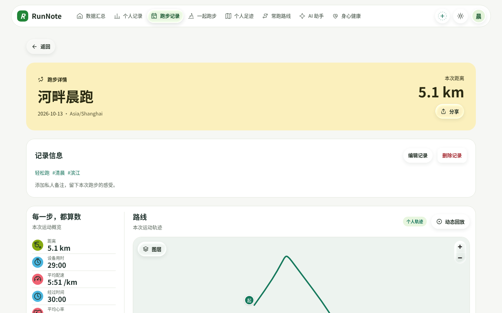 | 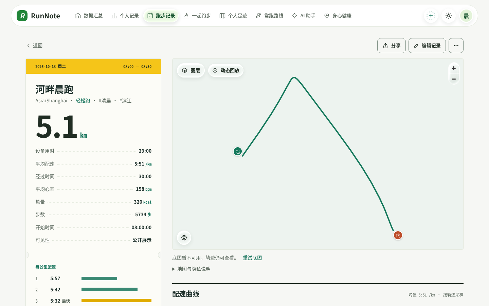 |
| 1440×900 深色 | 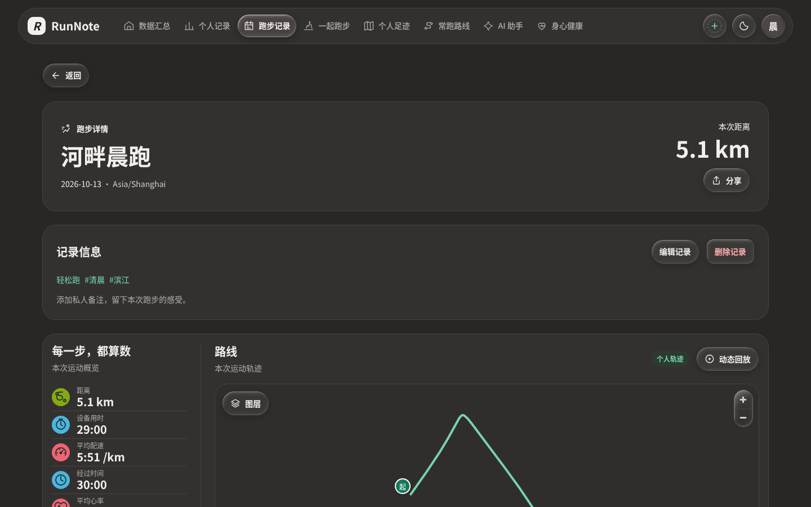 | 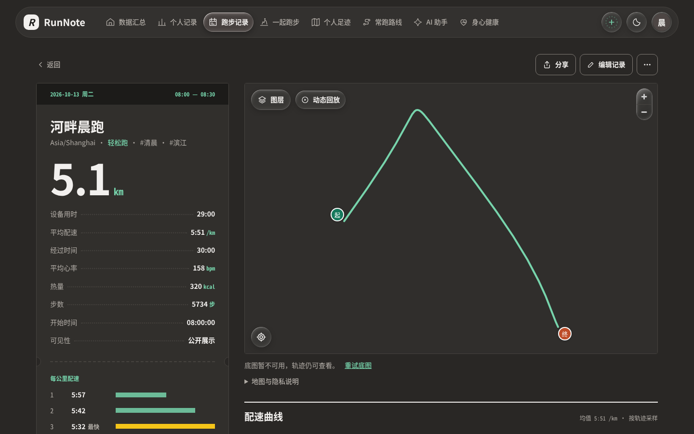 |
| 768×1024 浅色 | 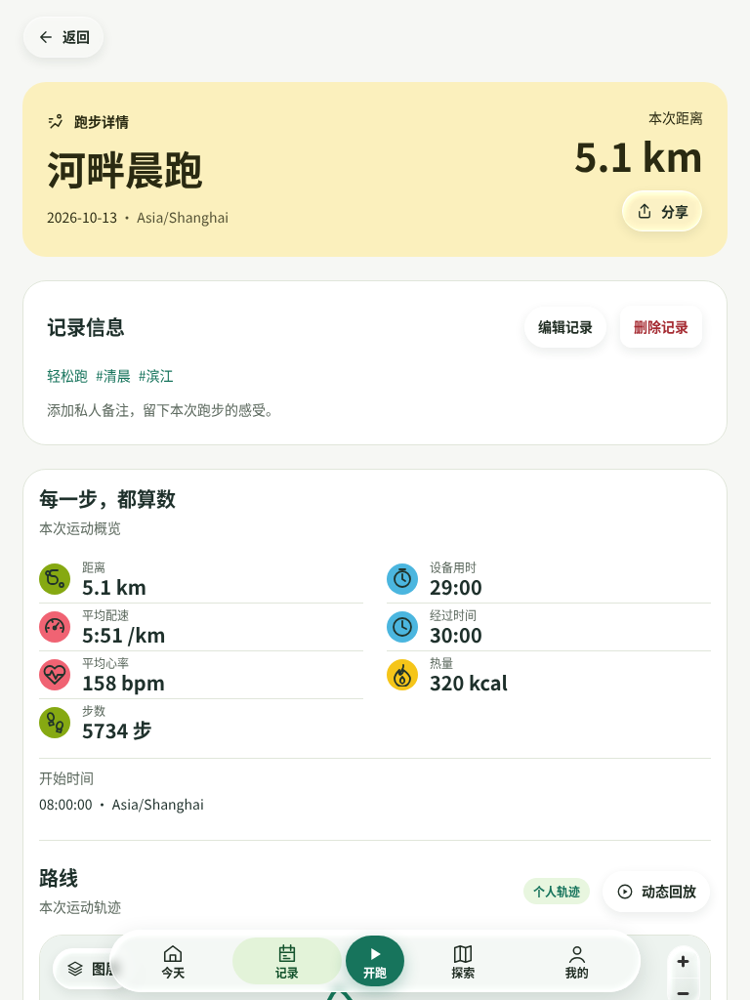 | 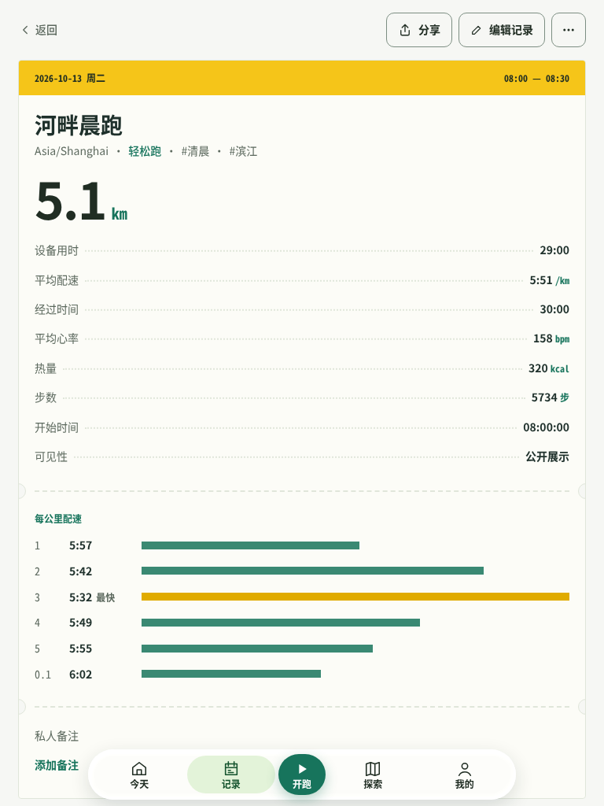 |
| 768×1024 深色 | 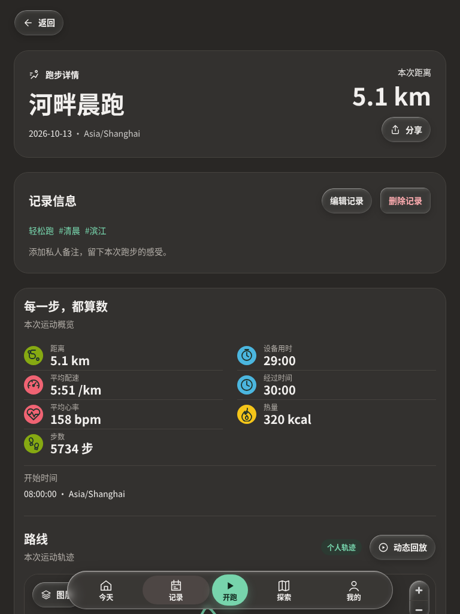 | 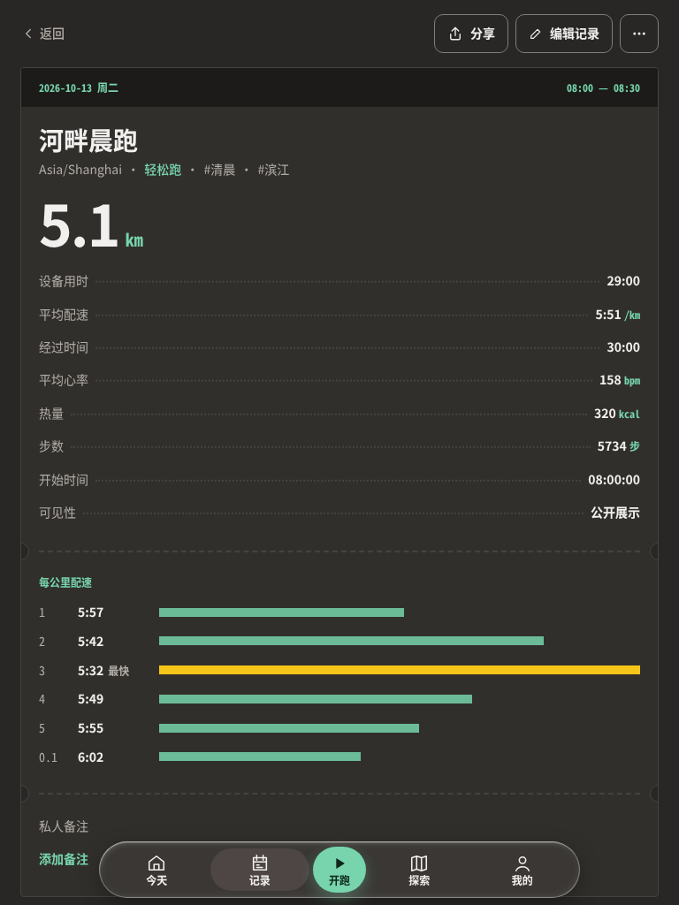 |
| 390×844 浅色 | 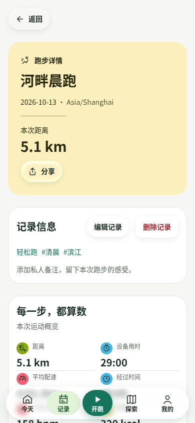 | 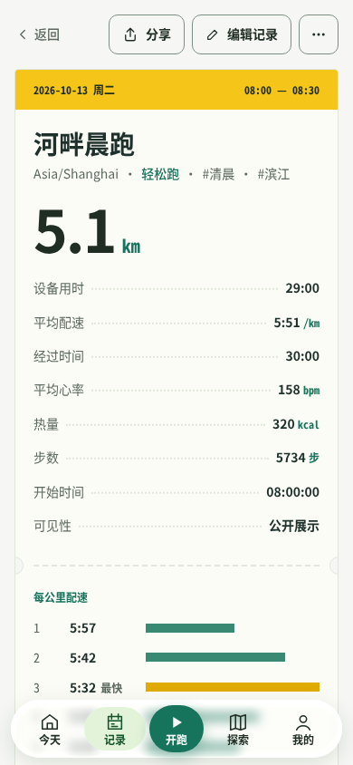 |
| 390×844 深色 | 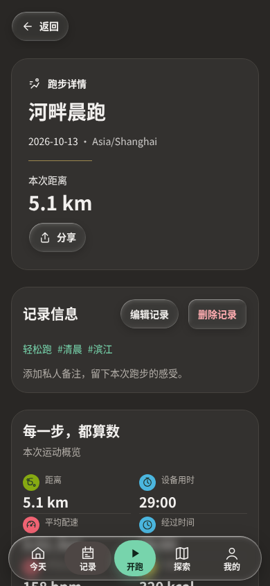 | 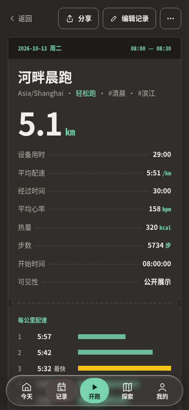 |
| 320×640 浅色 | 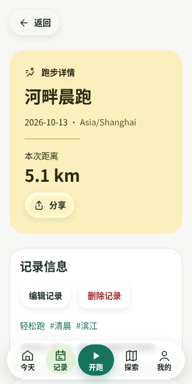 | 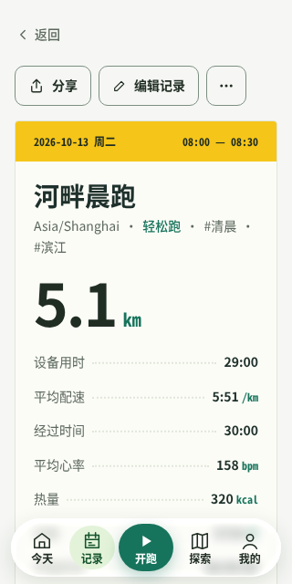 |
| 320×640 深色 | 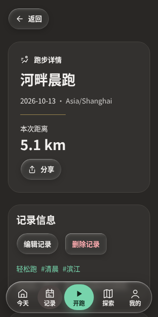 | 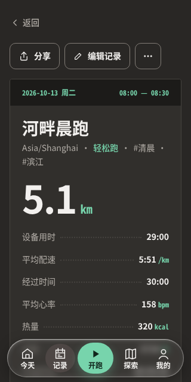 |

整页与交互态核对：[1440 浅色整页](assets/2026-11-27-editorial-receipt-detail/after-detail-1440-light-full.png)、[1440 深色整页](assets/2026-11-27-editorial-receipt-detail/after-detail-1440-dark-full.png)、[更多菜单](assets/2026-11-27-editorial-receipt-detail/after-detail-1440-light-more-menu.png)、[删除确认弹窗](assets/2026-11-27-editorial-receipt-detail/after-detail-1440-light-delete-dialog.png)、[分享图弹窗](assets/2026-11-27-editorial-receipt-detail/after-detail-1440-light-poster-dialog.png)。

## 未验证项与剩余风险

- **真实后端 E2E（`playwright.config.ts`，含 `tests/e2e/activity-management.spec.ts`）与后端集成测试**：未在本机运行（本机未配置独立 `_test` 库，且本次未改动后端/数据库/API）；已在 `tests/e2e/activity-management.spec.ts` 同步更新删除按钮的「更多」菜单入口路径，完整 `frontend-ui` 结果以 PR CI 为准。
- **`design-system.spec.ts` 像素快照对比**：基线仅包含 macOS（`*-darwin.png`），未在 Linux 上执行像素级 diff（本次未改动设计系统 showcase 页面或基础组件默认外观）。
- **真机 Safari / WebKit**：本机 Linux 无 WebKit 系统库，未做真实 Safari 目视核对；所有浏览器视觉验收均基于 Chromium 合成 API 环境。
- **海拔曲线**：因现有后端接口不返回逐点海拔数据，详情图当前仅展示真实配速曲线，未虚构海拔序列；后续若后端补充海拔字段可按 `brand.md §5` 叠加 `--recap-well` 面积层。
