# 105 · Editorial Receipt Web 迁移：跑步回顾 `/workspace/records/recap`

延续 [101 · Editorial Receipt 第 1 阶段](101-editorial-receipt-phase1.md)、[102 · 跑步记录列表](102-editorial-receipt-activities.md)、[103 · 活动详情](103-editorial-receipt-activity-detail.md) 与 [brand.md](design-system/brand.md)（§2 票据页、§3–§6、§9 `web.html?page=report`、W-04/05/06/11/12）的按页迁移计划，本 PR 将 Web 周期报告/跑步回顾页 **`/workspace/records/recap`**（及其专属子组件 `RecapDistribution`、`RecapRhythmSpread`、`RecapShare`）迁移至 Editorial Receipt 票据页语言。不新建重复 `/report` 路由，不改动 `frontend/src/app.css` 或全局共享组件（与并行设置页 PR 零样式冲突），不改动后端、API、Schema、CSRF、权限、数据计算、版本文件或发布流程。

## 使用方式

- **页面级 opt-in（`.editorial-page.recap-page`）**：保留既有全局悬浮顶部玻璃导航（≥800px）与手机底部 Tab 栏（<800px）；内容区按钮打印为 10px 平面按钮（无玻璃无阴影），原生分享图弹窗显式标注 `data-glass-overlay` 以保留弹层 Liquid Glass 边界与 `Escape` 焦点回退。
- **紧凑页头与周期筛选**：左侧保留「‹ 返回个人记录」（`/workspace/records`）与 `28px`（`--text-stat`）`h1` 标题；右侧以 `.underline-tabs`（2px 墨色下划线）替换原胶囊分段切换「月度 / 年度」，配合 10px 平面步进按钮（`‹` / `›`）、年份 `<select>` 或月度 `DatePicker`（统一 `--control-border` 描边、保留读屏 `label`）、「回到今年 / 回到本月」及「生成分享图」主按钮。
- **双栏布局（≥1080px 左票据分析 + 右常驻分享台）**：
  - **主票据纸（`.receipt-sheet.report-sheet`，`data-testid="recap-overview"`）**：取代原深森绿渐变 `.monolith` 卡片；顶部为唯一票头（`.receipt-header`，浅色 `--receipt` / `--receipt-ink`，深色 `--receipt-ink` / `--primary`），展示周期名称、日期范围及「已封存」或「进行中 · 截至 MM.DD」；主体依次呈现超大等宽主里程（桌面 `--text-period-hero`、手机 `--text-recap-hero`）与等宽主色单位 `km`、等效全马/单次均距/峰值参照、4px 平面占比标尺；经打孔虚线（`.receipt-perforation`）进入**逐月/逐周打孔节律**（`data-testid="recap-punch-rhythm"`，每格 ≈ 峰值 / 10，峰值柱以 `--receipt-mark` 与加粗标签双重标记，点击可与下方里程地形及出勤节律双向联动）；再经打孔虚线进入底部双栏：**全年/本月合计**（`.leader-row` 点线引导，缺失值以 `—` + `sr-only` 呈现，覆盖注记改用 `.status-strip`）与年度模式下的**年度故事入口**（`data-testid="recap-story-entry"`，链接至 `/workspace/records/story?year=YYYY`）。
  - **02 · 里程地形与累计轨迹（`RecapDistribution`）**：去除 24px 白色卡片与胶囊巡检条，改为 `2px` 墨色节线（`.section-rule`）开头与发丝线平底巡检条；保留双轴 SVG 曲线、峰值标记、鼠标/键盘（`ArrowLeft`/`ArrowRight`/`Home`/`End`/`Enter`/`Space`）联动及 `
`「查看完整数据表」。
  - **03 · 出勤节律与均配速走势（`RecapRhythmSpread`）**：去除双卡片外框、胶囊徽章与环形进度（遵循 `brand.md §1.3`），改为 `1px` 发丝线分组（容器查询 ≥48rem 并排、窄屏纵排）；03A 出勤节律矩阵改用平面纸面账格 + 3px 底部进度条，保留全部按钮与选中联动；03B 均配速走势保留反纵轴折线、周期均线与最快期高亮。
  - **右侧常驻分享台（`RecapShare`，`data-testid="recap-poster-dock"`）**：桌面端吸顶展示 9:16 实时缩略预览（去除倾斜旋转与渐变底）、浅色纸面/深色暖炭双段切换、`.underline-tabs` 版式快切（A 特刊 / B 环道 / C 存根）、「打开高清预览与保存」及隐私说明；平板（640–1079px）自动折为 2px 节线下的横向两栏，手机（<640px）单列堆叠。保留原有 1080×1920 原生 `<dialog data-glass-overlay>` 导出 PNG 与系统分享能力。
- **与 `web.html?page=report` 原型的差异与诚实省略**：
  - **未展示去年同期增量（原型 `比 2024 年多 212.3 km`）**：`/api/v1/statistics/report` 仅返回所选单周期的聚合结果，不提供去年同期差值；遵守「不改后端/API、不虚构指标」原则予以省略。
  - **未在回顾页内嵌年度叙事标题、最长连续周、探索城市、01–05 章节与分享图城市/路线脱敏开关**：上述数据来自 `/api/v1/statistics/annual-story`，已由独立伴生路由 `/workspace/records/story?year=YYYY` 承载（且仅存在年度维度，不适用于月度回顾）。本页在年度模式下于票据纸右下保留「查看年度故事」直达入口，不额外发起跨页面请求，也不重复实现年度故事页面；`/workspace/records/story` 与 `/records`（含 `PeriodReportCard`）保持原样，留待各自页面迁移。

## 改动范围

| 区域 | 文件 | 意图 |
| --- | --- | --- |
| 回顾主页面 | `frontend/src/routes/workspace/records/recap/+page.svelte` | 迁移为 `.editorial-page.recap-page`：28px 排版页头与 `.underline-tabs` 周期切换、10px 平面控件与月度 `DatePicker` 基线对齐、双栏票据纸 + 常驻分享台布局、黄票头/大数字/双打孔虚线/逐月或逐周打孔节律/点线合计/年度故事入口，保留全部加载/切换中/空/错误/趋势失败重试/401 跳转逻辑 |
| 里程地形组件 | `frontend/src/lib/components/RecapDistribution.svelte` | 去 24px 卡片与胶囊巡检条，改为发丝线平底巡检条与 `--receipt-mark` 峰值标记；保留双轴对齐、键盘导航与 `
` 完整数据表 |
| 出勤与配速组件 | `frontend/src/lib/components/RecapRhythmSpread.svelte` | 去双卡片、胶囊徽章与环形进度，改为容器查询发丝线双栏、平面出勤账格与 2px 配速折线；保留全部 `aria-pressed` 联动与轴标签防重叠保证 |
| 分享台组件 | `frontend/src/lib/components/RecapShare.svelte` | 迁移为右侧常驻编辑台（9:16 实景缩略、浅/深双段外观切换、`.underline-tabs` A/B/C 版式切换、高清弹窗显式标注 `data-glass-overlay` 保留模态玻璃边界与焦点回退） |
| 合成 UI 测试 | `frontend/tests/ui/recap.spec.ts` | 将本域请求断言由硬编码 `5191` 改为当前 `page.url()` origin（不弱化断言），新增 Editorial Receipt 结构、打孔节律三方联动、平面按钮与弹层 `data-glass-overlay` 回归用例 |
| 验收文档与截图 | 本文、`docs/assets/2026-11-28-editorial-receipt-report/` | 记录修改前后 4 视口×浅/深色、整页、月度、分享弹窗、空态与错误态合成截图与验证结果 |

未改动：`frontend/src/app.css`、全局共享组件、后端代码、数据库迁移、API 契约、权限与 CSRF、权威指标计算、`VERSION`、`CHANGELOG.md`、发布 workflow、`/records`、`/workspace/records/story`、`/settings` 及其他页面。

## 接口与隐私

不新增或修改任何接口、查询参数或权限校验。`/workspace/records/recap` 继续由服务端工作区会话门控保护，仅使用本人会话调用 `GET /api/v1/statistics/report` 与 `GET /api/v1/statistics/trends`，401 时清空私人状态并跳转 `/admin?reason=expired&next=...`。9:16 分享图继续严格执行白名单，仅在浏览器本机 Canvas 2D 绘制周期日期、服务端汇总数字与无坐标分桶分布，不含姓名、账号、坐标、地点、备注或身心健康数据。全部截图与测试均基于合成数据。

## 验证记录（2026-11-28，本机 Linux，Node 24.18，Chrome，Playwright 1.65）

| 命令（`frontend/`） | 结果 |
| --- | --- |
| `./node_modules/.bin/svelte-kit sync && ./node_modules/.bin/svelte-check --tsconfig ./tsconfig.json` | 0 errors / 0 warnings |
| `./node_modules/.bin/stylelint "src/**/*.{css,svelte}" "tests/fixtures/**/*.{css,svelte}"` | 通过 |
| `./node_modules/.bin/vitest run` | 80 files / 528 tests passed |
| `./node_modules/.bin/vite build` | 成功（仅既有大体积 chunk 提示） |
| `playwright test --config playwright.recap.config.ts --reporter=list` | 17 passed / 0 failed（覆盖登录门控、历史导航与加载态锁定、空态/报告失败/趋势失败保留总览重试/401 跳转、地形/出勤/打孔联动、1440/768/390/320 明暗无溢出与标签防重叠、A/B/C 三款 1080×1920 PNG 本地导出与 Object URL 释放、Editorial Receipt 结构与弹窗玻璃边界） |
| `playwright test --config playwright.ui.config.ts tests/ui/annual-story.spec.ts tests/ui/records.spec.ts --reporter=list` | 21 passed / 0 failed（验证从 `/records` 与 `/workspace/records/recap` 进入年度故事及 `/records` 零回归） |

### 视觉验收矩阵（合成数据，4 视口 × 浅/深色）

`1440×900`、`768×1024`、`390×844`、`320×640` 四档视口在浅色与深色模式下横向溢出均为 0、控制台与页面错误均为 0；逐月/逐周打孔节律、双轴地形图、出勤账格与配速曲线均无裁切或标签重叠；月度 `DatePicker` 与年份选择器对齐一致；分享弹窗保留 Liquid Glass 边界与 `Escape` 焦点回退。

| 视口 / 主题 | 修改前 | 修改后 |
| --- | --- | --- |
| 1440×900 浅色 | 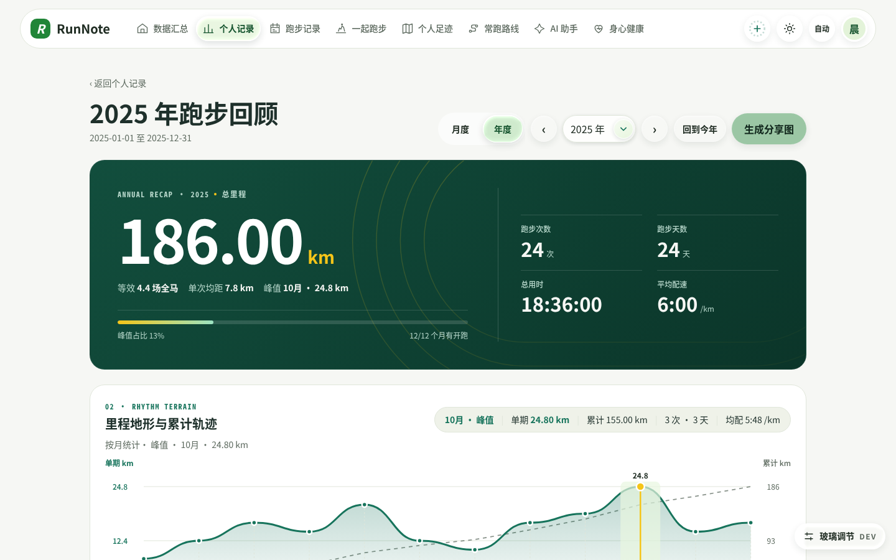 | 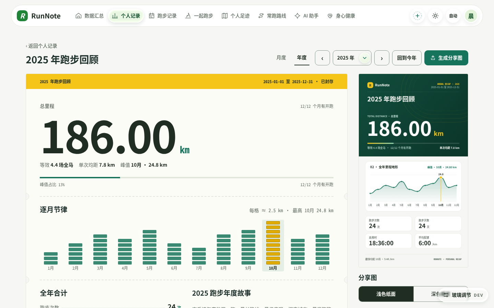 |
| 1440×900 深色 | 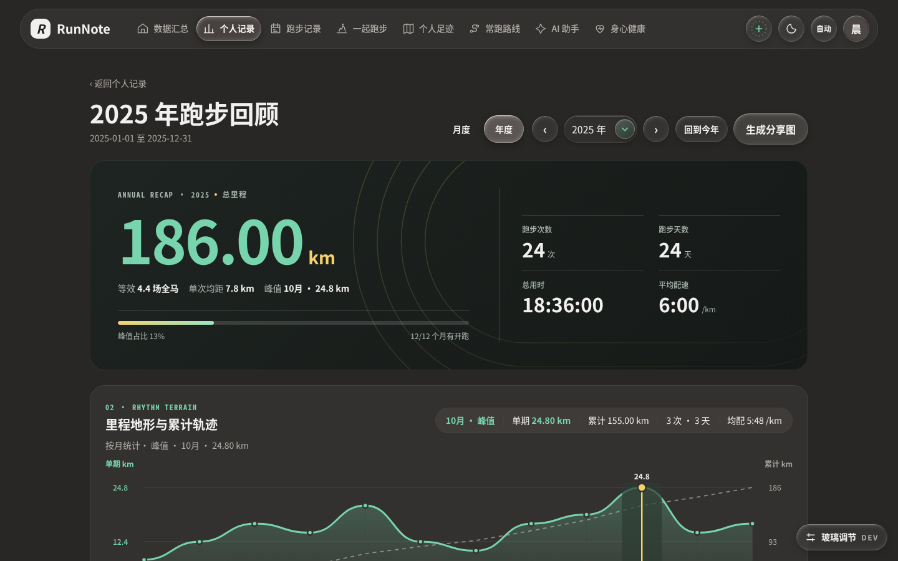 | 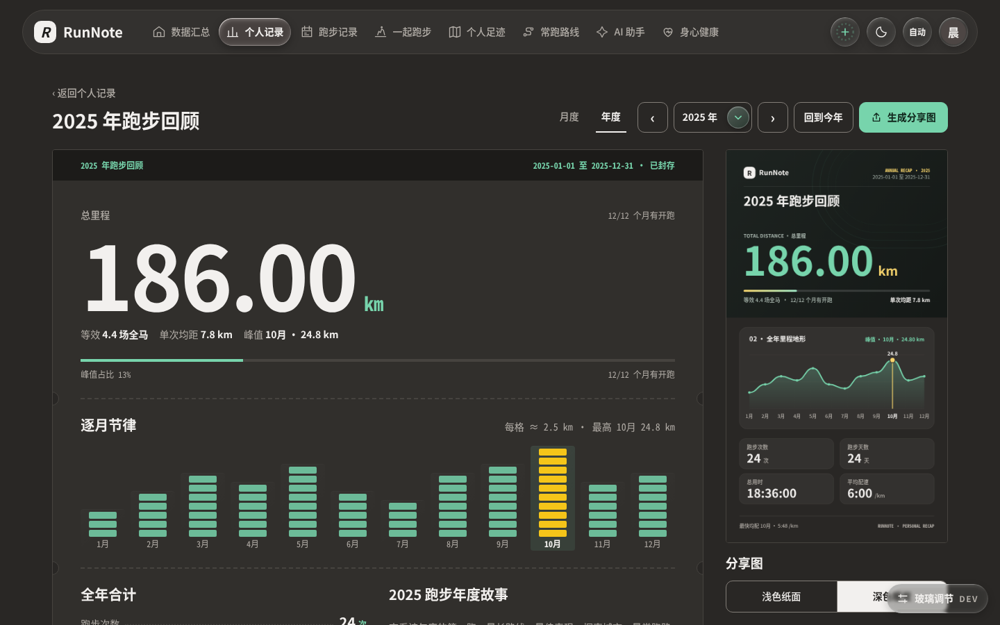 |
| 768×1024 浅色 | 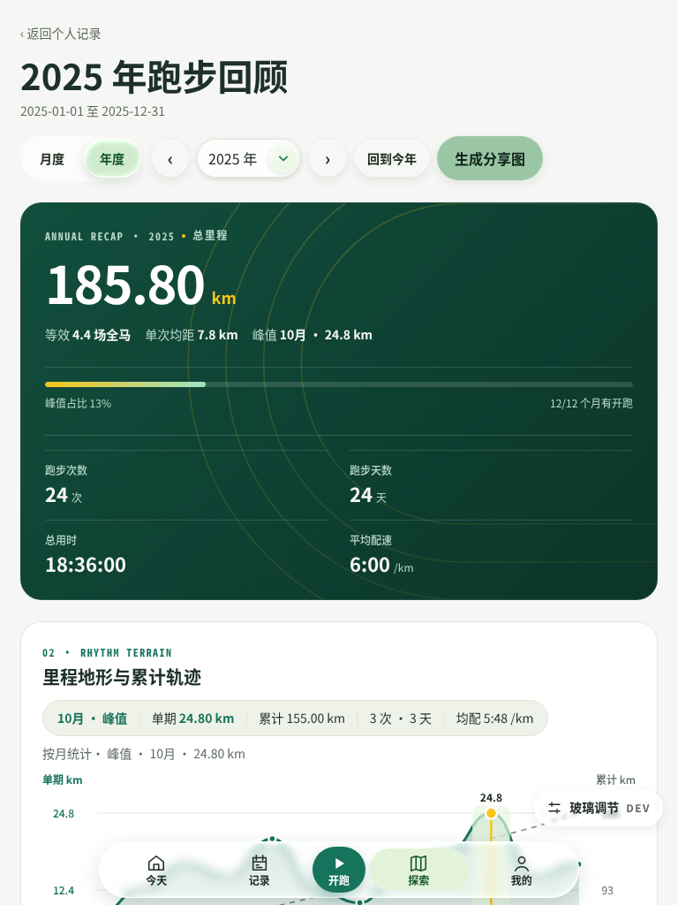 | 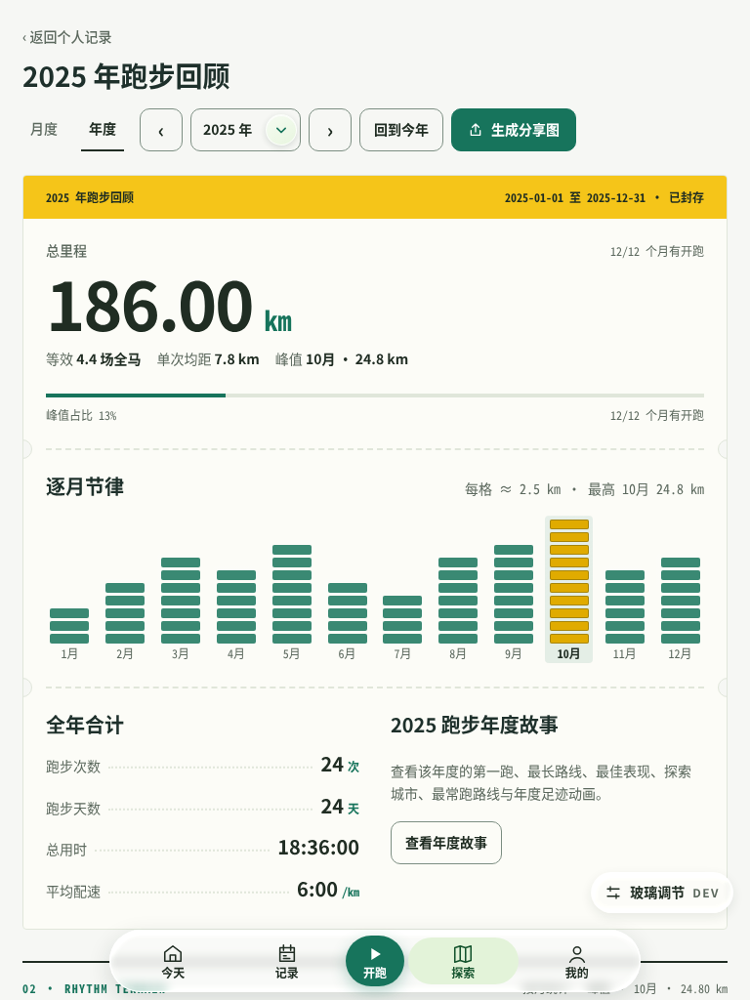 |
| 768×1024 深色 | 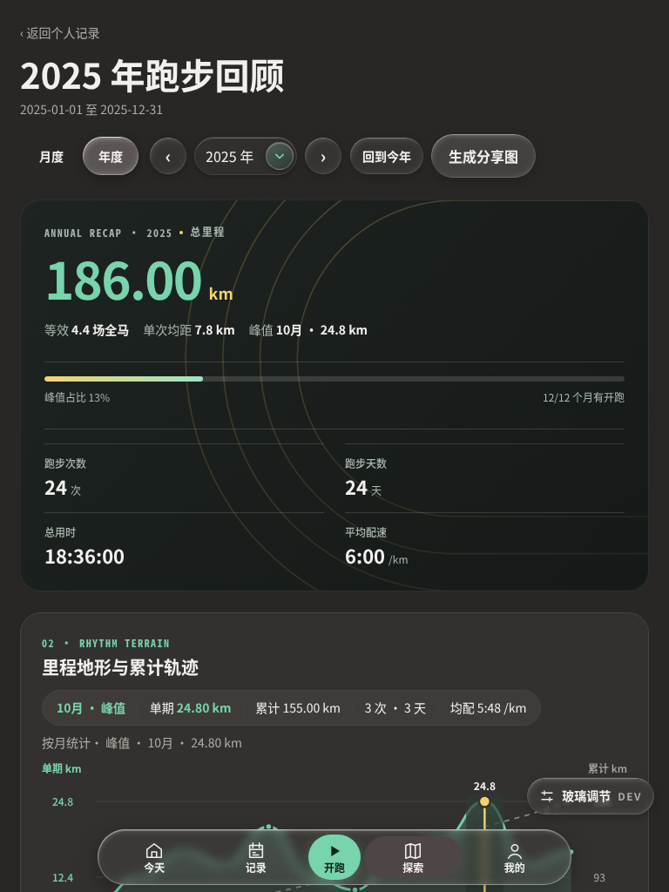 | 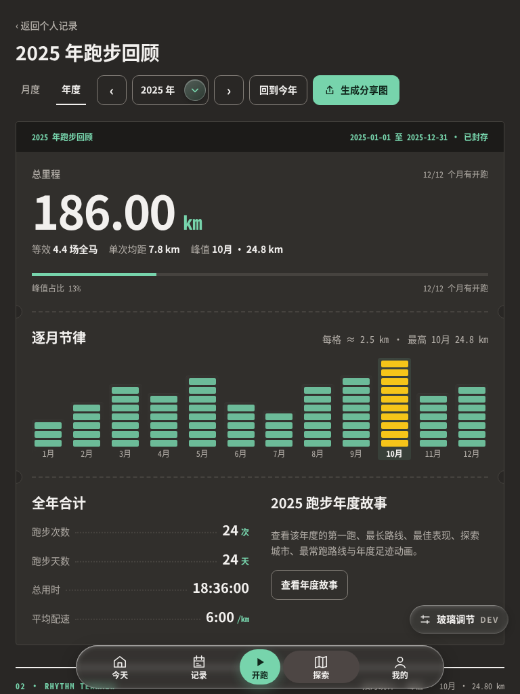 |
| 390×844 浅色 | 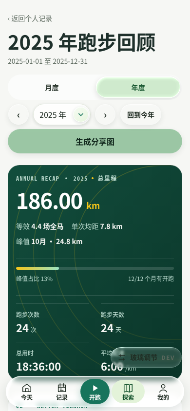 | 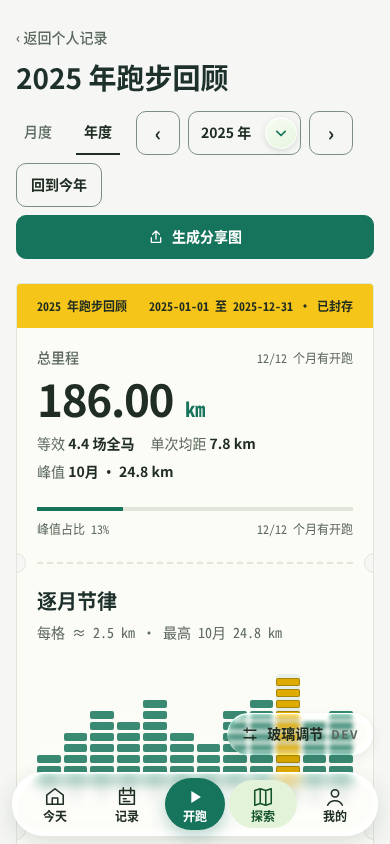 |
| 390×844 深色 | 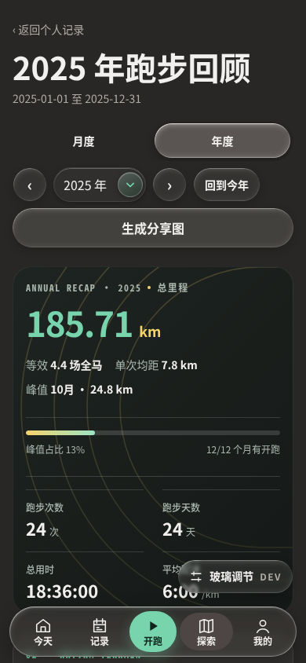 | 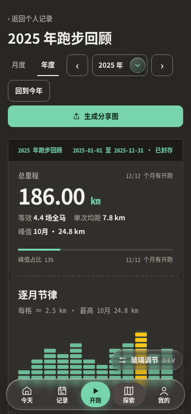 |
| 320×640 浅色 | 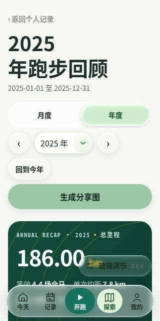 | 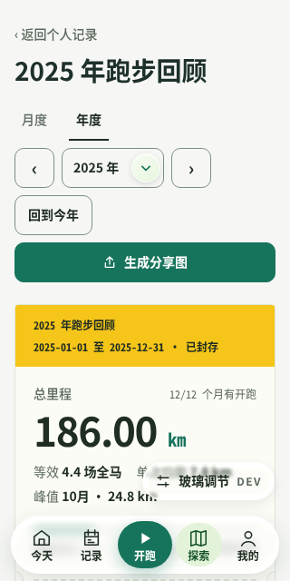 |
| 320×640 深色 | 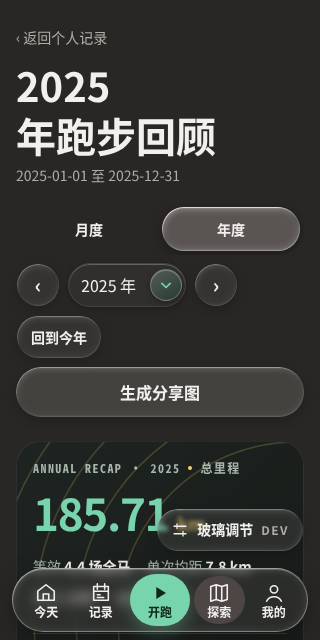 | 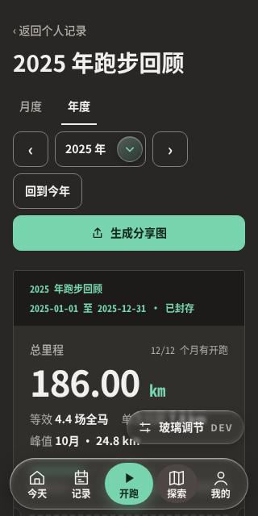 |

整页与交互态核对：[1440 浅色整页](assets/2026-11-28-editorial-receipt-report/after-report-1440-light-full.png)、[1440 深色整页](assets/2026-11-28-editorial-receipt-report/after-report-1440-dark-full.png)、[月度回顾](assets/2026-11-28-editorial-receipt-report/after-report-1440-light-month.png)、[分享图弹窗](assets/2026-11-28-editorial-receipt-report/after-report-1440-light-share-dialog.png)、[空周期状态](assets/2026-11-28-editorial-receipt-report/after-report-1440-light-empty.png)、[读取失败状态](assets/2026-11-28-editorial-receipt-report/after-report-1440-light-error.png)。

## 未验证项与剩余风险

- **真实后端 E2E（`playwright.config.ts`，含 `tests/e2e/period-report.spec.ts`）与后端集成测试**：未在本机运行（本机未配置独立 `_test` 库，且本次未改动后端/数据库/API）；以 PR CI 结果为准。
- **`playwright.design-system.config.ts` 像素快照对比**：仓库基线仅含 macOS（`*-darwin.png`），本次未改动 `app.css` 或公共设计系统组件，未在 Linux 上重录像素基线。
- **真机 Safari / WebKit 与 Firefox**：本机 Linux 环境以 Chromium 合成 API 完成视觉与功能验收，未做真机 Safari 实测。
- **独立伴生路由 `/workspace/records/story` 与 `/records`**：不在本次 `/workspace/records/recap` 迁移范围内，保留原样待后续按页迁移。
