# 107 · Editorial Receipt 移动端六屏落地（Item 147，agy 重做，参考 #166）

延续 [101 · Editorial Receipt 第 1 阶段](101-editorial-receipt-phase1.md)、[103 · 活动详情](103-editorial-receipt-activity-detail.md)、[105 · 报告与回顾页](105-editorial-receipt-reports.md)、[106 · 设置中心](106-editorial-receipt-settings.md) 与 [brand.md](design-system/brand.md)、[tokens.md](design-system/tokens.md)、[mobile.html](design-system/prototypes/mobile.html) 及 [mobile-ui-design](mobile-ui-design/README.md) 的设计规范，本分支在 `origin/main`（`92c5f9b4`，含 `#168` / `#169`）基础上重新实现并验证移动端 Editorial Receipt 六屏落地（只读参考旧 PR `#166` 的已审行为，代码独立实现）。

覆盖六屏范围：

1. **首页（`home`）**：`/dashboard`（手机端 `<800px` 目标排序「本周 → 连续记录 → 本月 → 年度」，`<640px` 本周 7 日叠块打卡）
2. **准备开跑（`pre-run`）**：`/activities/record`（空闲与待恢复态：大号 GPS 精度读数、2px 节线准备清单、高对比吸底 `开始跑步` 主按钮与平铺发丝线上传队列）
3. **户外记录与暂停（`recording` / `paused` + 结束确认弹窗）**：`/activities/record`（`<800px` 沉浸式极简高对比记录界面：单点状态行 `● 记录中 · GPS ±6 m · 离线`、主距离 `min(8.5rem, 31vw)`、双列 `3.25rem` 用时/配速、76px 单主按钮 `暂停` + 52px 锁屏防误触；暂停态「继续跑步」+ 1.5 秒长按结束并保存及 WCAG 2.5.1 安全区居中确认弹窗）
4. **跑步完成票据（`done`）**：`/activities/record`（`--desk` 桌面衬底 + `.receipt-sheet.receipt-serrated` 锯齿底边票据、品牌标、本机分段预览、最快完整公里高亮、诚实同步状态条 `.status-strip`、保存后自动 `window.scrollTo(0, 0)` 回顶）
5. **活动详情（`detail`）**：`/activities/[id]`（`<800px` 视觉与 DOM/键盘 Tab 顺序一致为「路线地图 → 工具栏 → 票据存根 → 配速图」，`<640px` 全宽出血地图与 3 列发丝线核心摘要，平均心率前置到前 3 项，工具栏浮层与 Escape 焦点还原）
6. **分享弹窗（`share`）**：`StoryShareDialog`、`RecapShare`、`ActivityPosterDialog`（兼容 `#168` 的 `.section-rule` / `.status-strip` / `--paper` / `--desk` / `--recap-well` / `var(--font-mono)`；保留 `data-glass-overlay` 同时修复 `.underline-tabs > button` 玻璃白底白字冲突；`320×640` 首屏可见 `保存 PNG`）

不改动后端、数据库迁移、API 契约、CSRF/鉴权、版本号或发布脚本。

## 审查闭环项核对

| 闭环项 | 实现要点 | 自动化验证 |
| --- | --- | --- |
| 原生实时分段（7 位小数点集补齐、仅满整公里标记、失败最多重试 2 次、静止不偏移、暂停不跨段、950–999m 尾段不误标整公里、最快只比完整公里） | `recording-splits.ts` 逐段步进切片：`deltaM === 0` 静止耗时原位计入当前未完公里；跨 `segmentIndex` 不连线不跨段计距/计时；`formatPartialTailLabel` 将 950–999m 格式化为 `0.95`–`0.99` 且 `isFullKm: false`；`fastest` / `findFastestFullSplit` 仅比较完整 1,000m 公里。`RecordingWorkspace.svelte` 的 `syncNativeLivePoints` 仅在拉回点集真实算满整公里后递增 `nativePointsCompletedKms`，并在桥接失败时将连续失败上限锁定在 2 次（不空转）。 | `recording-splits.test.ts`（6 用例）+ `mobile-editorial-receipt.spec.ts` 用例 2（999.64m 不误标整公里、增量补齐后展示 `上一公里`、完成票据最快为 `第 2 km` 而非 `0.2 km` 冲刺尾段、桥接失败调用次数 `1 → 2 → 2` 封顶） |
| 首页本周打卡独立于浏览年份；跨年周/缺距/零距有活动日显示 active dot、0 blocks | `week-punch.ts` 严格按正距离映射 1–5 块；有活动但缺失或零距返回 `blocks: 0, showActiveDot: true`。`GoalOverview.svelte` 按年缓存 `weekYearDays`，浏览历史年时本周打卡保持不变，当年直接复用父级 `calendar` 不额外请求 `/calendar`，跨年周或直达历史年仅独立拉取缺少年份。 | `week-punch.test.ts`（4 用例）+ `mobile-editorial-receipt.spec.ts` 用例 1（切换 2025 后本周仍显示 2026 打卡、缺距/零距活动日呈现 active dot 且 0 blocks、`<800px` 顺序 week → streak → month → year）+ `dashboard.spec.ts` |
| `320×640`：暂停「长按 1.5 秒结束并保存」与 story「保存 PNG」首屏可见；结束确认弹窗安全区/居中；保存后 receipt 滚回顶部 | `RecordingWorkspace.svelte` 在 `<360px` / 暂停态紧缩垂直间距，保证 `继续跑步` 与 `长按 1.5 秒结束并保存` 同屏可见；`<dialog class="finish-dialog">` 设 `margin: auto` 及安全区约束宽高居中；保存完成后 `window.scrollTo({ top: 0, left: 0, behavior: 'instant' })`。`StoryShareDialog.svelte` 在 `<768px` 采用纵向 flex + 紧凑预览盒 + 吸底 `.dialog-actions`，保证 `保存 PNG` 首屏可见且预览图不溢出 `.dialog-stage`。 | `mobile-editorial-receipt.spec.ts` 用例 2（`stopBox` 在 640px 视口内、`finish-dialog` 中心对齐且距边 ≥8px、`window.scrollY === 0`）+ 用例 4（`320×640` `保存 PNG` 首屏可见、预览图严格在 `.dialog-stage` 内不遮挡主题标签） |
| `recording` 主距离 `min(8.5rem, 31vw)`、双列 `3.25rem`；状态行 `● 记录中 · GPS ±6 m · 离线` 可见；`detail` 地图在前、工具栏浮层/焦点顺序 | `app.css` 新增 `--text-rec-hero: min(8.5rem, 31vw)`（`>=100 km` 自适应收缩以兼容 320px 下的 `123.45 km`）、`--text-rec-sub: 3.25rem`、`--rec-bg` / `--rec-ink`；`RecordingWorkspace.svelte` 单行展示状态点+状态+GPS+离线标识并屏蔽 `<800px` 壳层离线横幅与 dev 玻璃浮条；`activities/[id]/+page.svelte` 借助 `matchMedia('(max-width: 799px)')` + `{#snippet detailToolbar()}` 在不卸载 `<RouteMap>` 的前提下令 `<800px` 的 DOM/Tab 与视觉同为 Map → Toolbar → Stub → Pace，并将全宽出血仅作用于地图画布避免裁切底图提示文案。 | `mobile-editorial-receipt.spec.ts` 用例 2（390px 实测距离字号 `≈120.9px`、双列 `52px`、状态行三要素、320px `123.45 km` 零溢出）+ 用例 3（DOM 与几何顺序一致、更多菜单 Escape 焦点回退）+ `sport-detail.spec.ts` |
| `StoryShareDialog` 兼容 `#168` 且无白底白字冲突 | 保留 `#168` 的 `.section-rule`、`.status-strip`、`--paper`、`--desk`、`--recap-well`、`var(--font-mono)` 与 `data-glass-overlay`；修复 `liquid-glass.css` 中各按钮选择器补齐 `:not(.underline-tabs > button)`（与 `liquid-glass.ts` 保持一致），使 `<dialog data-glass-overlay>` 内的下划线标签不再叠加玻璃背景/阴影，实测对比度 ≥ 7:1。 | `mobile-editorial-receipt.spec.ts` 用例 4（校验 `data-glass-overlay`、`section-rule`、`status-strip`、`tabHasGlassClass === false`、`boxShadow === 'none'`、计算对比度 ≥ 7:1）+ `annual-story.spec.ts` + `liquid-glass.spec.ts` |
| 390/320 浅深色、768/1440 基本回归；无横向溢出；空/错/离线态；键盘焦点 | 全 6 屏覆盖 390/320 浅深色与 768/1440 回归、空路线与离线状态检查、弹窗 Escape 焦点恢复；`companion-phase3.spec.ts` 全量 42 条并发/崩溃恢复/锁竞争用例通过。 | `mobile-editorial-receipt.spec.ts` + 10 套受影响 UI 回归套件 + `playwright.activity-poster.config.ts` |

## 改动范围

| 区域 | 文件 | 意图 |
| --- | --- | --- |
| 纯逻辑与单测 | `frontend/src/lib/week-punch.ts`、`frontend/src/lib/recording-splits.ts`、`frontend/tests/unit/week-punch.test.ts`、`frontend/tests/unit/recording-splits.test.ts` | 首页 7 日叠块/active dot 映射与实时/完成态逐公里分段切片算法及边界单测 |
| 令牌、全局样式与玻璃边界 | `frontend/src/app.css`、`frontend/src/lib/styles/liquid-glass.css`、`docs/design-system/tokens.md` | 增补户外记录高对比色与字号令牌、锯齿底边 `.receipt-sheet.receipt-serrated`、直角 `.status-strip` 边框、沉浸记录态壳层钩子；对齐 `liquid-glass.css` 排除 `.underline-tabs > button` |
| 首页 | `frontend/src/routes/dashboard/+page.svelte`、`frontend/src/lib/components/GoalOverview.svelte` | 透传 `calendar`/`calendarYear`，独立按年缓存本周打卡并在 `<800px` 置顶本周与连续记录、`<640px` 呈现 7 日叠块 |
| 准备/记录/暂停/完成四屏 | `frontend/src/lib/components/RecordingWorkspace.svelte` | 保留既有并发锁、账号认领、崩溃恢复与幂等上传队列；实现四态 Editorial Receipt 界面、原生增量点集分段补齐（有限重试）、1.5 秒长按结束与居中确认弹窗、完成锯齿票据与自动回顶 |
| 活动详情 | `frontend/src/routes/activities/[id]/+page.svelte` | 平均心率前置至核心前 3 项；`<800px` 保持地图在前且 DOM/Tab 顺序与视觉一致；`<640px` 地图全宽出血（不裁切底图提示）与 3 列发丝线摘要 |
| 分享弹窗 | `frontend/src/lib/components/StoryShareDialog.svelte`、`frontend/src/lib/components/RecapShare.svelte`、`frontend/src/lib/components/ActivityPosterDialog.svelte` | 兼容 `#168` 视觉样式与 `data-glass-overlay`；优化 `<768px` 预览盒防溢出与吸底操作区确保 `320×640` 首屏可见 `保存 PNG`；对齐桌面/移动弹窗 `--desk` 与安全区边距 |
| UI 测试与验收文档 | `frontend/tests/ui/mobile-editorial-receipt.spec.ts`、`frontend/tests/ui/sport-detail.spec.ts`、`frontend/playwright.ui.config.ts`、本文及 `docs/assets/2026-11-28-editorial-receipt-mobile-agy/` | 新增六屏端到端 UI 闭环测试、更新 `sport-detail` `<800px` 地图在前断言并留存合成验收截图 |

## 接口与隐私

不新增或修改任何后端接口、请求字段、响应结构、数据库表或权限策略。户外记录离线暂存、账号隔离认领与分享图隐私脱敏（无真实经纬度/起终点/邮箱/身心健康数据）保持不变。所有测试与截图仅使用合成数据，不含真实用户信息、本机绝对路径或密钥。

## 验证记录（2026-11-28，本机 Linux，Node 24.18，Chromium，Playwright 1.65）

| 命令（`frontend/`，除注明外） | 结果 |
| --- | --- |
| `pnpm check`（`svelte-kit sync && svelte-check`） | 0 errors / 0 warnings |
| `pnpm lint:style`（Stylelint） | 通过（0 errors） |
| `pnpm test`（Vitest） | 82 files / 539 tests passed |
| `pnpm build`（adapter-node） | 成功（仅既有大体积 chunk 警告） |
| `playwright test --config playwright.ui.config.ts mobile-editorial-receipt.spec.ts` | 4 passed / 0 failed |
| `playwright test --config playwright.ui.config.ts companion-phase3.spec.ts` | 42 passed / 0 failed |
| `playwright test --config playwright.activity-poster.config.ts` | 11 passed / 0 failed |
| `playwright test --config playwright.ui.config.ts sport-detail.spec.ts annual-story.spec.ts records.spec.ts recap.spec.ts settings-hub.spec.ts dashboard.spec.ts milestones.spec.ts mobile-tabbar.spec.ts liquid-glass.spec.ts` | 121 passed / 1 skipped（`settings-hub.spec.ts` 仅环境变量触发的既有截图用例）/ 0 failed |

### 视觉验收矩阵（合成数据）

全部 32 张截图已逐一人工检视，并在审查中发现并修复了以下 4 类实测视觉/交互缺陷后重拍确认：
1. `StoryShareDialog` 在 `320×640` 下 `.dialog-body` Grid 行收缩导致海报预览溢出压住主题标签 → 改为 `<768px` 纵向 Flex + 显式预览尺寸 + `overflow: hidden`，并加断言防止回归。
2. `activities/[id]` `<640px` 全宽出血负边距作用于整个 `.route-panel`，裁切了底图降级文案左首字 → 改为仅作用于 `.route-stage > :global(.sheet)` 与 `.route-placeholder`。
3. 沉浸记录态下 dev-only 玻璃调节悬浮条遮挡 `320×640` 底部 `暂停` 按钮 → 在 `<800px` 沉浸态隐藏 `.glass-tuner`。
4. 录制主按钮 `.btn-rec` 继承全局按钮色彩过渡，切换明暗主题瞬间出现低对比中间灰帧 → 对 `.btn-rec` / `.btn-rec-hold` 设为 `transition: none`。

| 屏幕 | 390×844 浅色 | 390×844 深色 | 320×640 浅色 | 320×640 深色 |
| --- | --- | --- | --- | --- |
| 首页 `home` | 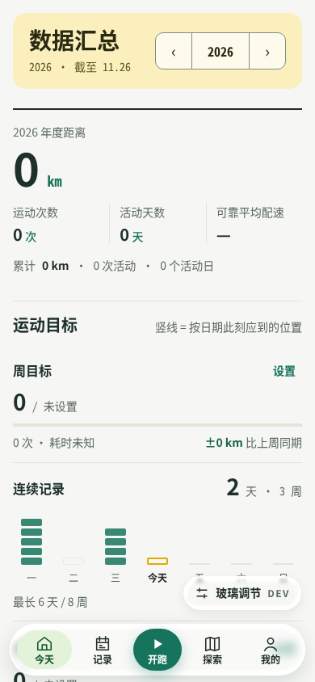 | 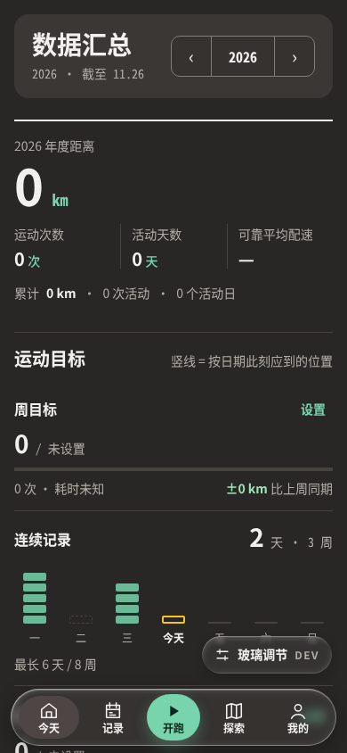 | 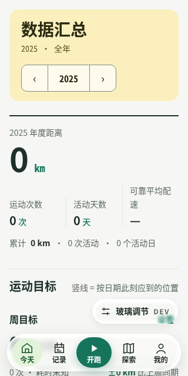 | 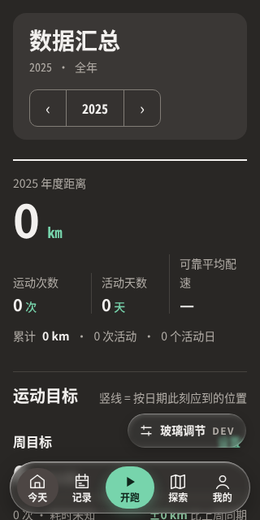 |
| 准备开跑 `pre-run` | 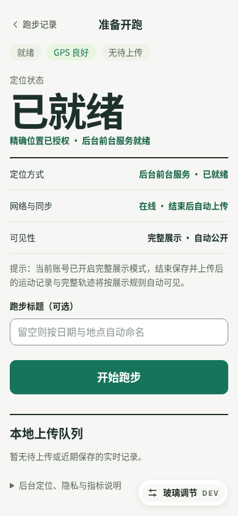 | 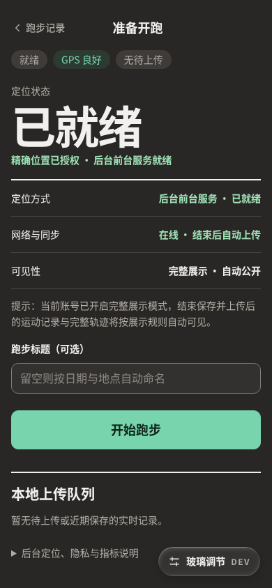 | 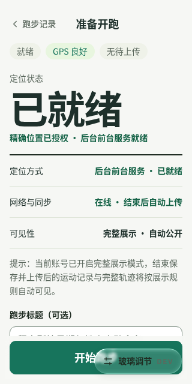 | 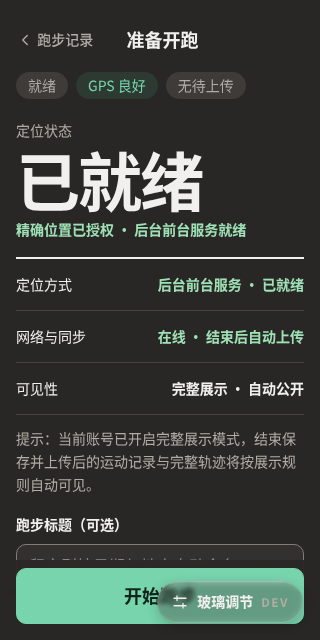 |
| 户外记录 `recording` | 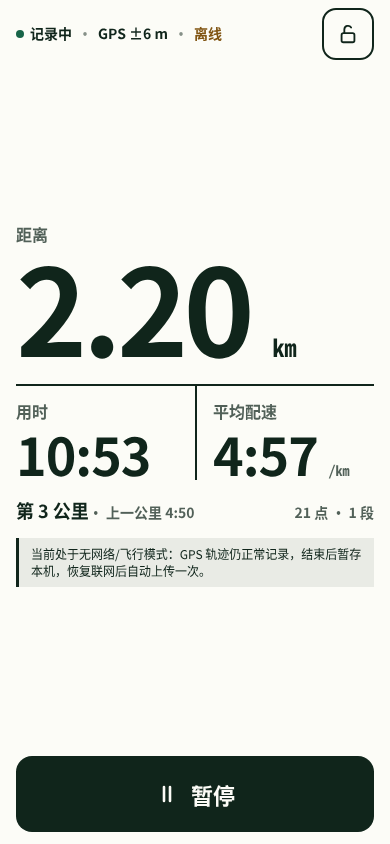 | 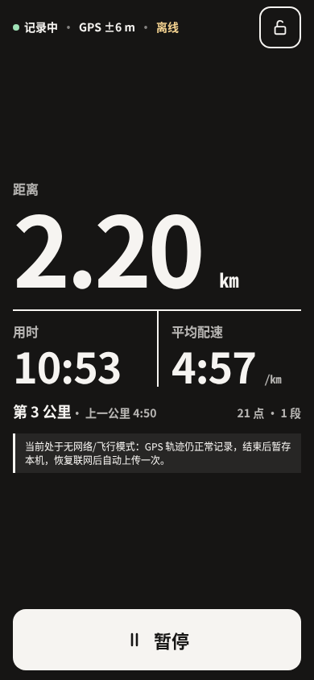 | 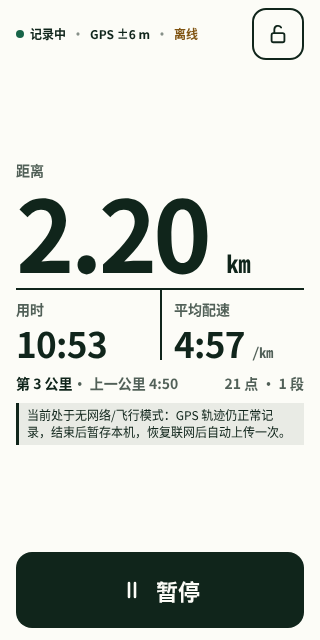 | 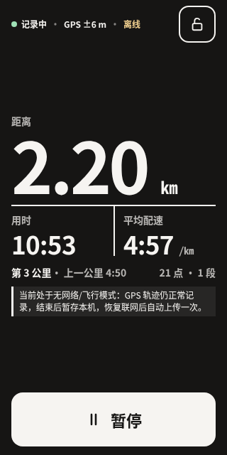 |
| 暂停 `paused` | 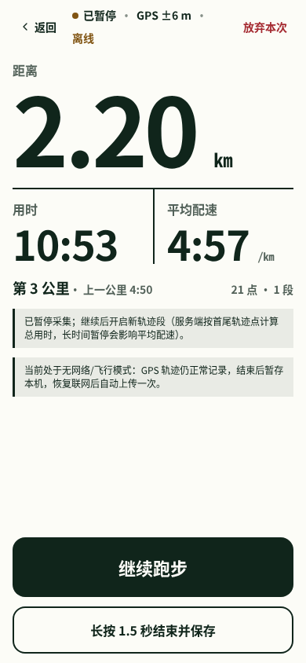 | 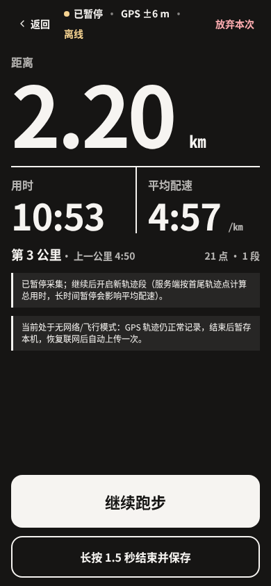 | 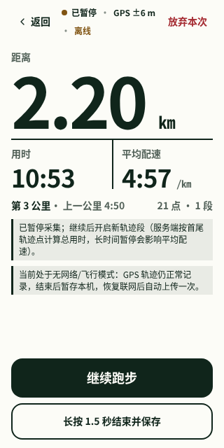 | 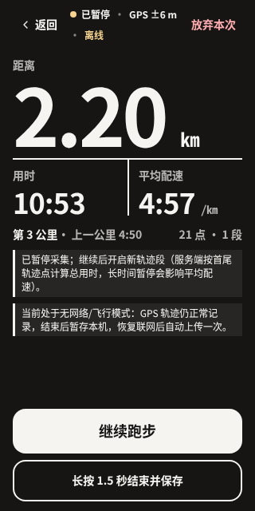 |
| 完成票据 `done` | 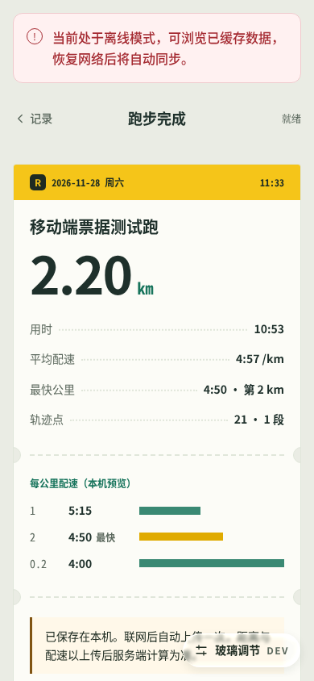 | 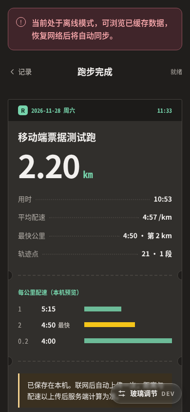 | 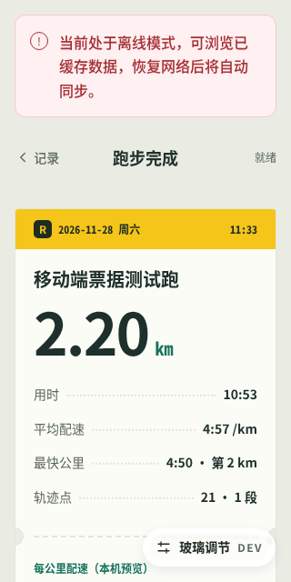 | 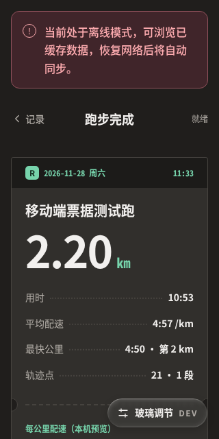 |
| 活动详情 `detail` | 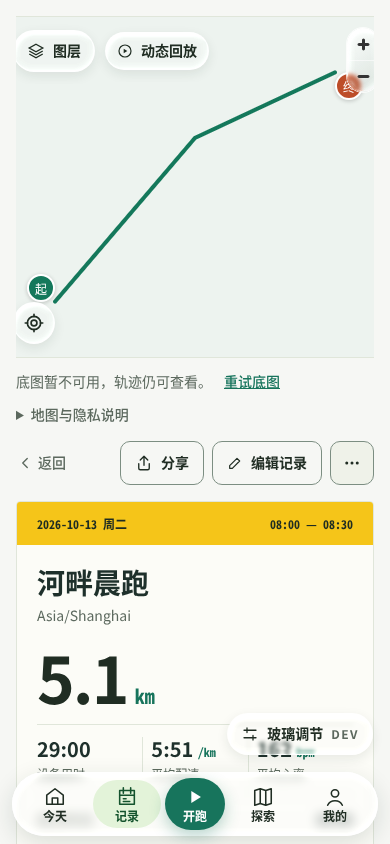 | 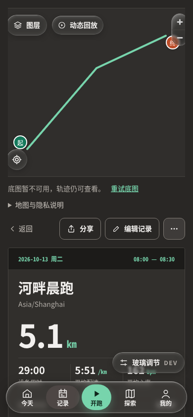 | 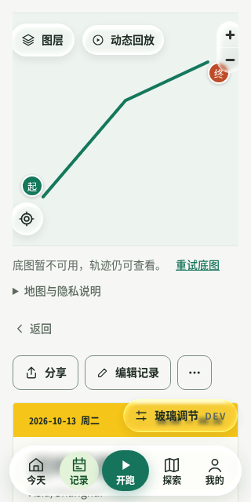 | 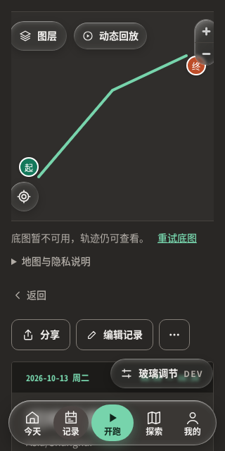 |
| 年度故事分享 `share` | 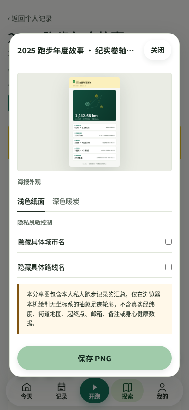 | 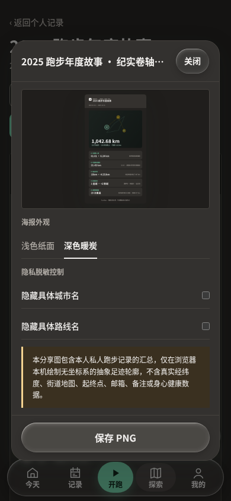 | 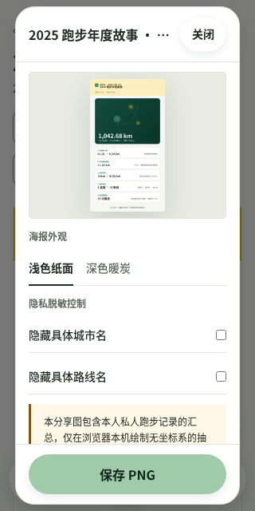 | 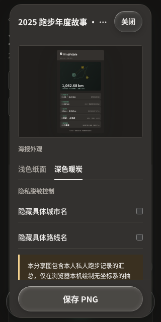 |

平板与桌面回归抽检（浅色）：

| 页面 | 768×1024 | 1440×900 |
| --- | --- | --- |
| 首页 `home` | 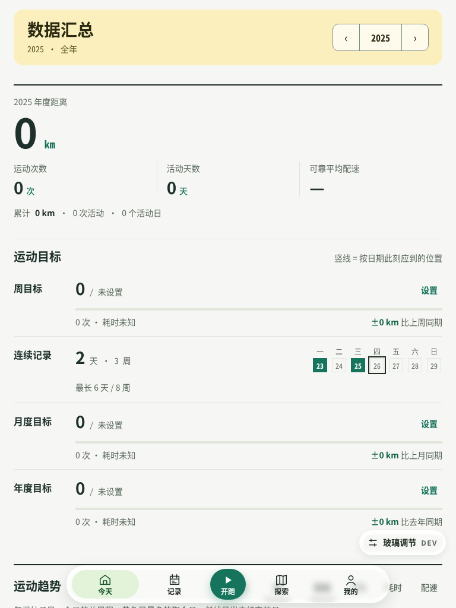 | 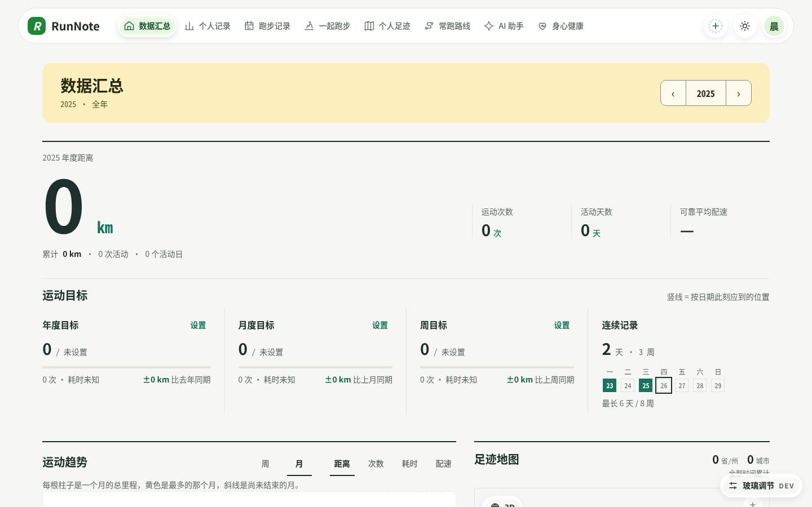 |
| 活动详情 `detail` | 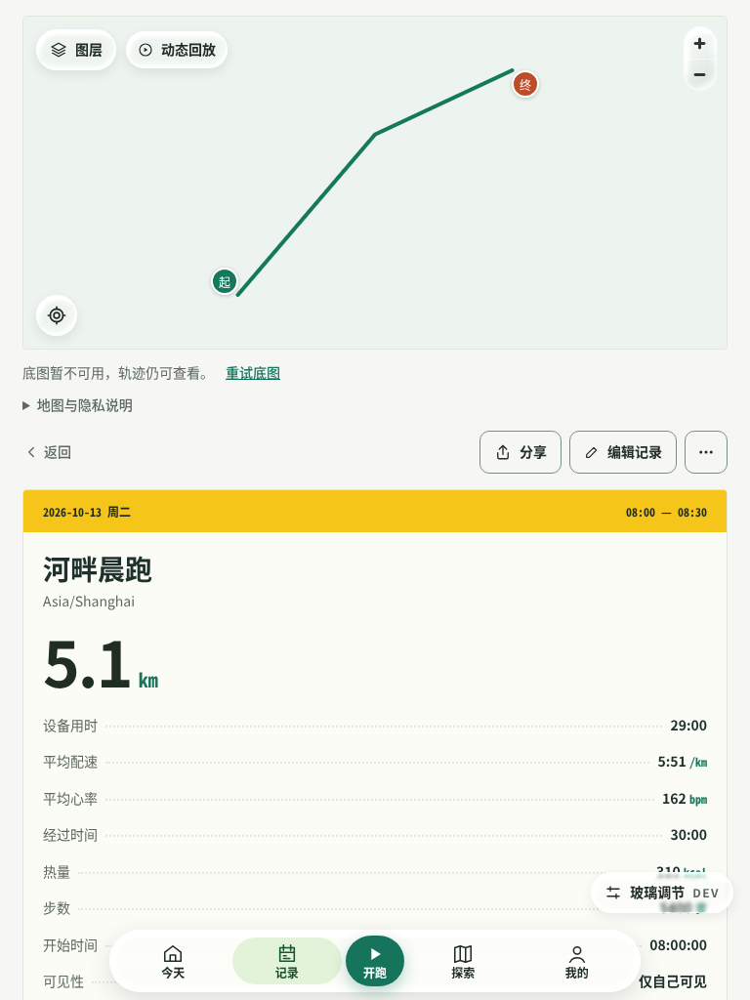 | 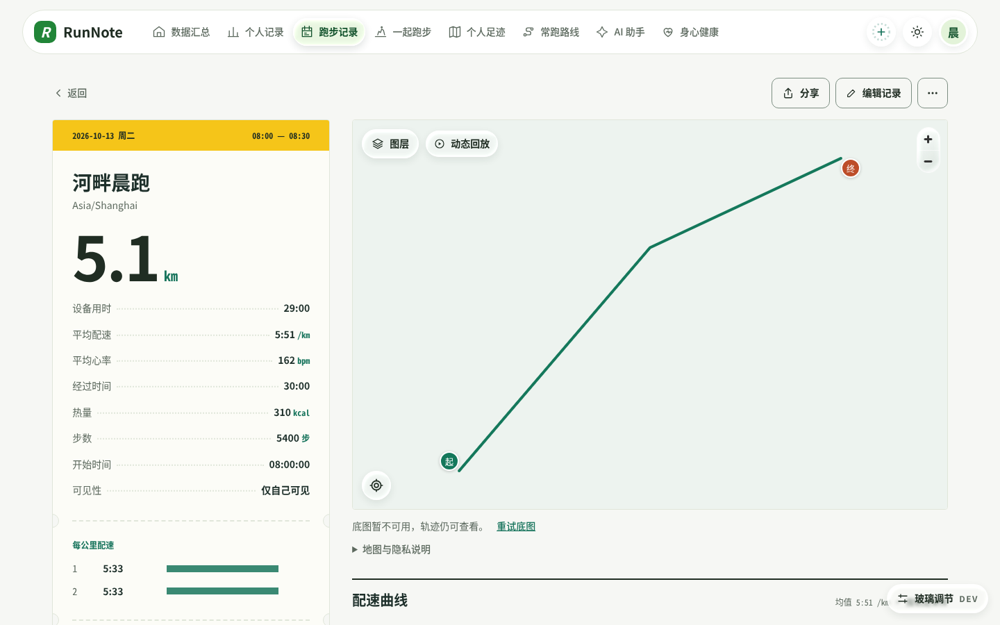 |

## 未验证项

- 真机 Android Capacitor WebView 实跑 GPS 定位、前台服务与 1.5 秒触控长按手感（本次通过 mock 原生插件桥接验证状态机、点集补齐与有界重试）。
- 真机 iOS Safari / WebKit 渲染、安全区 `env(safe-area-inset-*)` 与系统分享面板（本次在 Linux Chromium 下验证）。
- 真实 PostgreSQL/PostGIS 后端 E2E 与后端集成测试（本次未改动后端与数据库，仅运行前端契约/单测/构建/合成 UI 回归，由 PR CI 补充全量检查）。
