# 107 · Editorial Receipt 移动端六屏落地（`home` / `pre-run` / `recording` / `done` / `detail` / `share`）

延续 [brand.md](design-system/brand.md)（§2–§6、§6.9 户外记录模式、§8 移动端六屏）、[tokens.md](design-system/tokens.md)、[100 · 移动端导航外壳](100-mobile-shell-navigation.md) 与 [101](101-editorial-receipt-phase1.md)–[103](103-editorial-receipt-activity-detail.md) 的 Editorial Receipt 视觉体系，本 PR 在既有移动路由与组件上完整落地六张移动端参考屏（**不新增重复路由**），保持既有认证、GPS 采集、离线上传队列、跨标签页租约/归属保护、活动详情、分享海报导出及桌面端布局完全向后兼容。

## 六屏路由映射与落地要点

| 参考屏 | 既有路由 / 组件 | 移动端落地要点（390×844 / 320×640 浅深色） |
| --- | --- | --- |
| 1. `home`（今天） | `/`（`/dashboard`、`/workspace/dashboard`、`/p/[username]/dashboard`）· `GoalOverview.svelte`、`dashboard/+page.svelte` | 延续 `PageHeader` 黄色票头与 `MetricSummary` 主数字；`<800px` 通过 CSS `order` 将「周目标」与「连续记录」排至「月/年目标」之前（桌面端保持等高 4 列原顺序）；`<640px` 在连续记录行基于真实 `calendarDays` 每日里程渲染 7 天打卡堆叠块（今日以 `--receipt-mark` 标亮、休息日虚线空位、未来日细线占位，绝不虚构数据）。 |
| 2. `pre-run`（准备开跑） | `/activities/record`（`/workspace/activities/record`）· `RecordingWorkspace.svelte` | 精简顶部栏（`← 跑步记录` + `准备开跑` + 存在待传项时展示 `队列 N` 快捷跳转）；以 `--text-figure` 展示真实 GPS 就绪/精度状态（未有实测精度时不虚构 `±Xm`）；2px `--rule` 清单展示定位模式、网络与同步状态、完整展示提示与 `16px / 48px` 防缩放标题输入框；粘底高对比 `开始跑步` 主按钮清除 `--safe-bottom`；发丝线本地上传队列所有按钮 ≥44px（移除 `.button-compact`）。 |
| 3. `recording` / `paused`（记录中 / 已暂停） | `/activities/record` · `RecordingWorkspace.svelte`、`recording-splits.ts` | 切换至全屏户外高对比表面（`--rec-bg` / `--rec-ink`，`[data-recording-immersive]` 自动隐藏页脚）；大字号等宽主距离（`--text-rec-hero` / 320px 下 `--text-rec-hero-narrow`）、2px 分割线双列用时与平均配速（`--text-rec-sub` + 小号 `/km` 单位防止 320px 拥挤）、基于真实轨迹点计算的实时分段与点数提示；`<800px` 记录态仅暴露单个 `76px` 高对比「暂停」按钮与右上角 `52px` 防误触锁屏按钮（锁定时禁用暂停并提示解锁；桌面端 `≥800px` 保留直接「结束并保存」以完全兼容并发竞态契约）；暂停态展示「继续跑步」、支持 1.5 秒长按与点击/键盘弹窗确认双路径（WCAG 2.5.1，`recording-finish-dialog`）的「结束并保存」，以及右上角「放弃本次」危险确认。 |
| 4. `done`（跑步完成回执） | `/activities/record` · `RecordingWorkspace.svelte`、`recording-splits.ts` | 结束保存后在 `--desk` 桌面底色（`[data-recording-done]`）上呈现带底部锯齿撕边（`.receipt-sheet.receipt-serrated`）的票据小票：品牌字标 + 时区本地日期与起止时间黄色票头、距离主数字、点线引导指标行、打孔虚线分隔的真实每公里配速预览条（由 `extractRecordedSplits` 严格按同 `segmentIndex` 轨迹点计算，不跨暂停段虚构）、以及如实反映同步状态（离线暂存 / 上传中 / 失败重试 / 已同步服务端权威指标）的 `.status-strip`；操作按钮置于纸面之外，并同步保留下方 `recording-upload-queue` 实时队列状态。 |
| 5. `detail`（活动详情） | `/activities/[id]`（`/workspace/activities/[id]`、`/p/[username]/activities/[id]`）· `activities/[id]/+page.svelte` | `<800px` 采用地图优先顺排（`.route-panel` 置顶全宽约 296–340px，随后为 `.stub` 票据存根与 `.detail-pace` 配速曲线）；`<640px` 将存根前 3 项核心指标（设备用时 / 平均配速 / 平均心率）编排为 3 列发丝线摘要行并完整保留全部 8 条 `.leader-row` DOM；`≥800px` 与桌面端 `1440px` 左右双栏布局保持原样。 |
| 6. `share`（分享海报） | `StoryShareDialog.svelte`、`RecapShare.svelte`、`ActivityPosterDialog.svelte` | 为年度故事与周期总结分享弹窗接入 `.editorial-page` 扁平内容控件边界，避免 `liquidGlass()` 将内部分段按钮覆写为白底透明玻璃态；`StoryShareDialog` 在 `<768px` 收敛为紧凑顶栏（单行标题 + ≥44px `关闭`）、`--desk` 预览台、连体二段式外观切换（高对比激活态）、1px 发丝线隐私开关行、3px 左侧竖线隐私声明条及底部导出按钮（首屏可见并预留 `--safe-bottom`）；`RecapShare` 与 `ActivityPosterDialog` 统一使用 `--desk`、`--control-border`、`--radius-field` 与 ≥44px 触控目标，完整保留 `expectPosterDialogFits` 几何不变量。 |

## 改动范围

| 区域 | 文件 | 意图 |
| --- | --- | --- |
| 设计令牌与共享样式 | `frontend/src/app.css`、`docs/design-system/tokens.md` | 新增户外记录表面令牌（`--rec-bg` / `--rec-ink`）、户外大字号排版令牌（`--text-rec-hero` / `--text-rec-hero-narrow` / `--text-rec-sub` / `--text-rec-action` / `--tracking-rec` / `--line-height-rec`）、锯齿撕边票据 `.receipt-sheet.receipt-serrated`、沉浸记录/完成页壳层钩子，以及 `.status-strip` 锐角左边界修正 |
| 首页移动端层次 | `frontend/src/lib/components/GoalOverview.svelte`、`frontend/src/routes/dashboard/+page.svelte` | 传入真实 `calendarDays`，新增 `<640px` 7 天打卡堆叠块与 `<800px` 周目标优先排序；桌面 4 列布局不变 |
| 实时记录三屏与分段 | `frontend/src/lib/components/RecordingWorkspace.svelte`、`frontend/src/lib/recording-splits.ts`、`frontend/tests/unit/recording-splits.test.ts` | 重构 `pre-run` / `recording`+`paused` / `done` 视觉与防误触交互；新增纯函数分段计算（不跨暂停段、零虚构数据）及单元测试 |
| 活动详情移动端顺排 | `frontend/src/routes/activities/[id]/+page.svelte` | `<800px` 地图置顶、`<640px` 前三指标 3 列发丝线摘要行；调整 `leaderMetrics` 排序把设备用时/平均配速/平均心率置前 |
| 分享弹窗移动端统一 | `frontend/src/lib/components/StoryShareDialog.svelte`、`frontend/src/lib/components/RecapShare.svelte`、`frontend/src/lib/components/ActivityPosterDialog.svelte` | 统一 Editorial Receipt 扁平分段、发丝线隐私开关、`--desk` 预览台与安全区适配，保留 `data-glass-overlay` 边界与既有测试契约 |
| 测试与验收资产 | `frontend/tests/ui/mobile-editorial-receipt.spec.ts`、`frontend/tests/ui/sport-detail.spec.ts`、`frontend/playwright.ui.config.ts`、本文及 `docs/assets/2026-11-28-editorial-receipt-mobile/` | 新增 6 屏移动端 Editorial Receipt 专项 Playwright 用例并注册至 `playwright.ui.config.ts`；`sport-detail.spec.ts:154` 适配 `<800px` 地图置顶预期（保留 `800–1023px` 与 `≥1024px` 原断言）；留存 58 张合成前后对比与响应式截图 |

未改动：后端代码、数据库迁移、API/OpenAPI 契约、权限与 CSRF 逻辑、权威运动指标计算、版本文件（`VERSION` / `package.json` / `pyproject.toml` / Android `build.gradle`）及发布脚本。

## 接口与隐私

不新增或修改任何 API 路径、查询参数或权限边界。实时记录仍严格遵循既有账号声明（claim）、跨标签页 Web Lock 租约、离线幂等上传（`Idempotency-Key`）与退出登录清理策略；预览指标与服务端 PostGIS 权威指标明确区分；分享弹窗保留完整本机绘制与脱敏说明。所有测试与截图均使用合成数据，不含真实账号、真实轨迹或本机敏感路径。

## 验证记录（2026-11-28，本机 Linux，Node 24，Chrome，Playwright 1.65）

| 命令（`frontend/`） | 结果 |
| --- | --- |
| `pnpm check`（`svelte-kit sync && svelte-check`） | 0 errors / 0 warnings |
| `pnpm lint:style`（Stylelint） | 通过（0 errors） |
| `pnpm test`（Vitest，含 `recording-splits.test.ts` 与 `architecture.test.ts`） | 81 files / 532 tests passed |
| `pnpm build`（adapter-node） | 成功（仅既有大体积 chunk 提示） |
| `playwright test --config playwright.ui.config.ts mobile-editorial-receipt.spec.ts` | 3 passed / 0 failed（6 屏 390/320 明暗、锁屏防误触、暂停确认弹窗、离线→重连完成小票、0 溢出） |
| `playwright test --config playwright.ui.config.ts companion-phase3.spec.ts` | 42 passed / 0 failed（含权限、离线幂等、崩溃恢复、跨标签页并发与账号隔离） |
| `playwright test --config playwright.activity-poster.config.ts` | 11 passed / 0 failed（含 390×800 / 844×390 / 1024×700 / 1280×720 / 1440×800 明暗几何拟合） |
| `playwright test --config playwright.ui.config.ts` 其余受影响套件（`annual-story` 7、`dashboard` 7、`liquid-glass` 18、`milestones` 14、`mobile-tabbar` 17、`recap` 16、`sport-detail` 10、`top-navigation` 64、`ui-shell` 22） | 175 passed / 0 failed（连同上表共 231 项 UI 测试全绿） |

## 视觉验收矩阵（合成数据，390×844 & 320×640 浅/深色 + 768/1440 响应式回归）

所有 30 项自动截图采集（6 屏 × 390/320 × 浅/深色 + 768/1440 浅色）横向溢出均为 `0`、页面异常均为 `0`；目视逐屏核对确认无裁切、重叠、文字不可读或安全区遮挡（首轮目视发现并修复了 `StoryShareDialog` 分段按钮被全局玻璃样式覆盖、`320px` 记录态配速 `/km` 贴边及 `.status-strip` 圆角偏离三处细节，并已完成复拍验证）。

### 390×844 浅色对比

| 屏幕 | 修改前 | 修改后 |
| --- | --- | --- |
| 1. `home`（今天） | 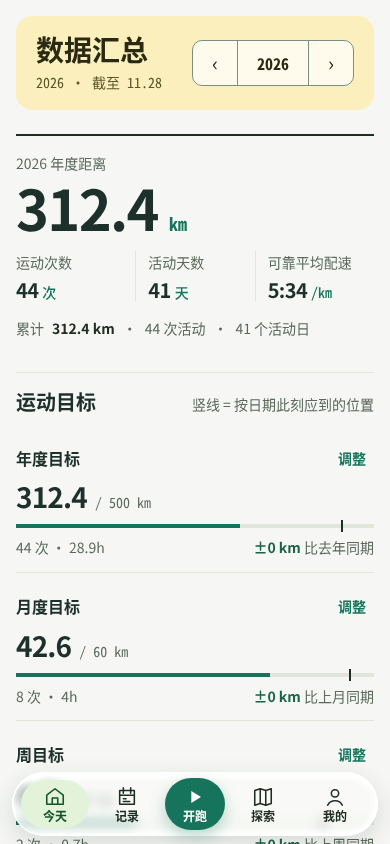 | 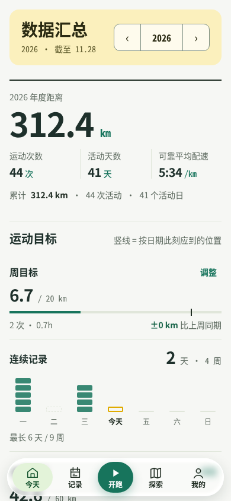 |
| 2. `pre-run`（准备开跑） | 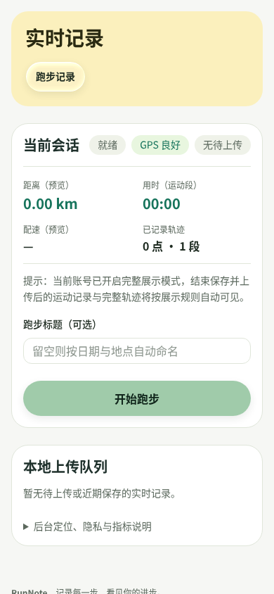 | 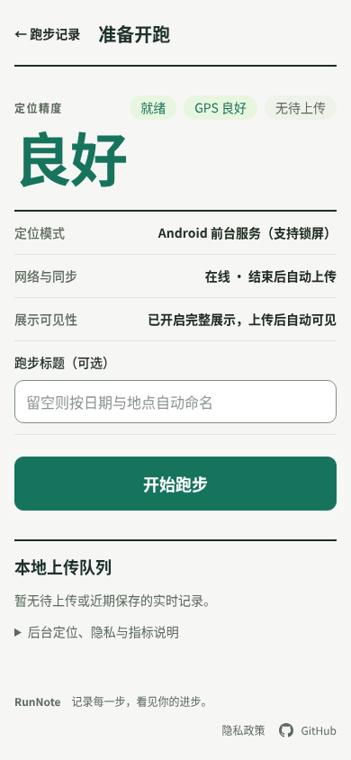 |
| 3. `recording`（记录中） | 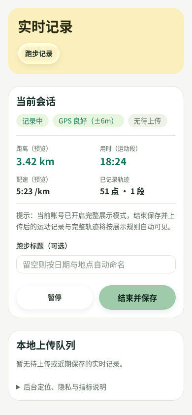 | 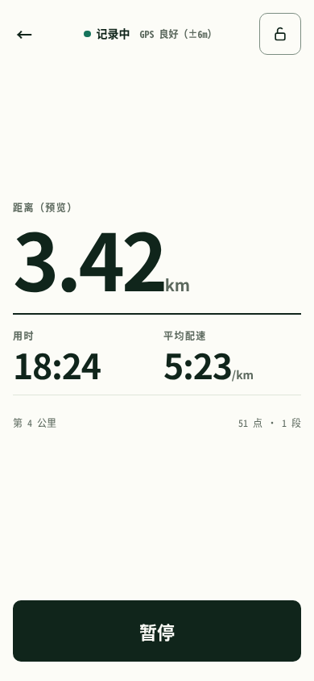 |
| 3b. `paused`（已暂停） | — | 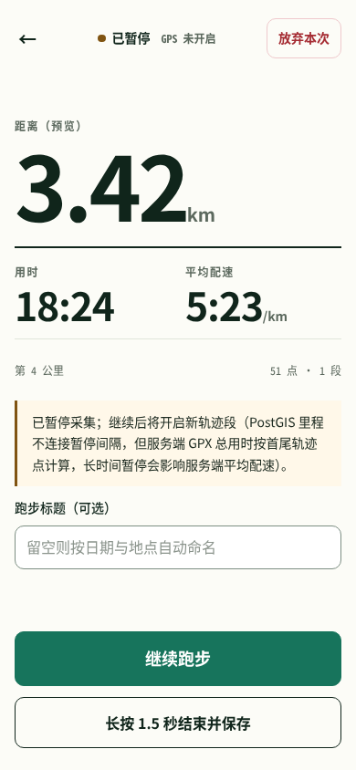 |
| 4. `done`（完成回执） | 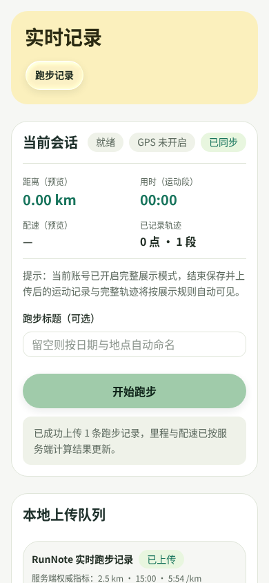 | 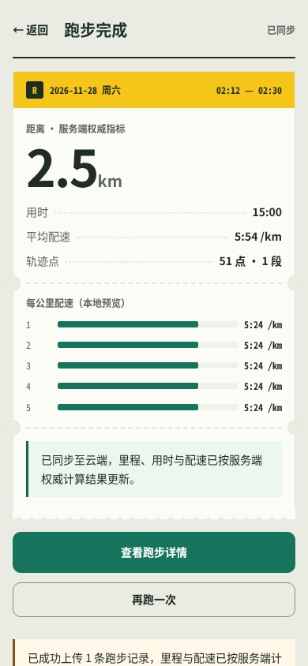 |
| 5. `detail`（活动详情） | 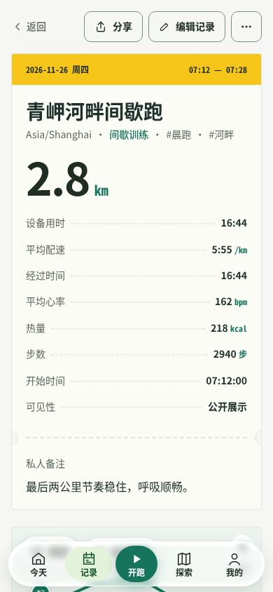 | 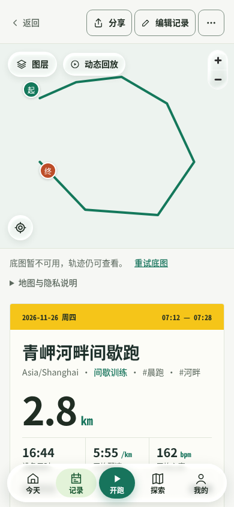 |
| 6. `share`（分享弹窗） | 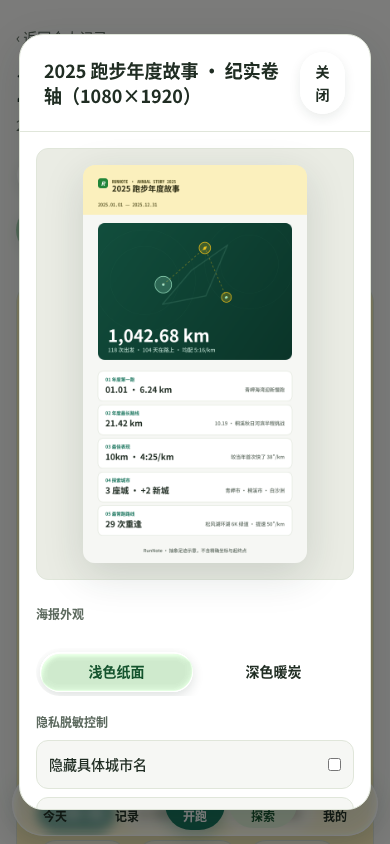 | 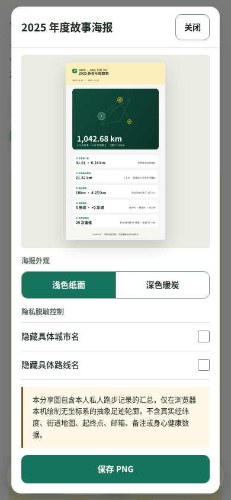 |

### 390×844 深色对比

| 屏幕 | 修改前 | 修改后 |
| --- | --- | --- |
| 1. `home`（今天） | 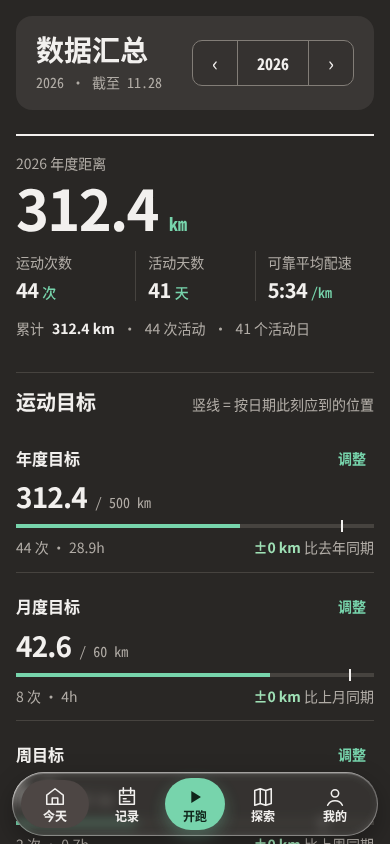 | 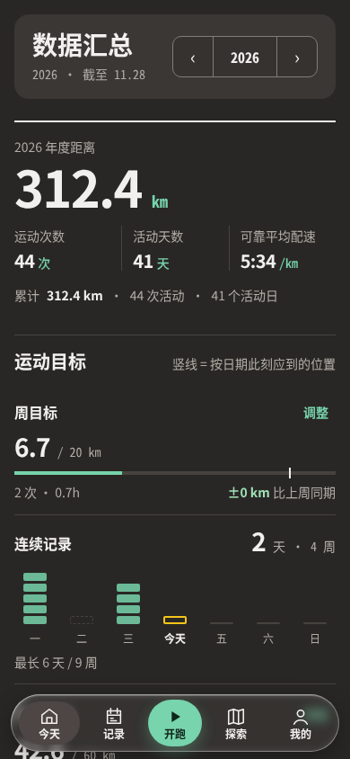 |
| 2. `pre-run`（准备开跑） | 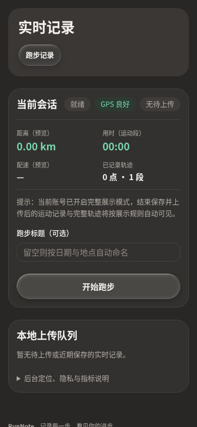 | 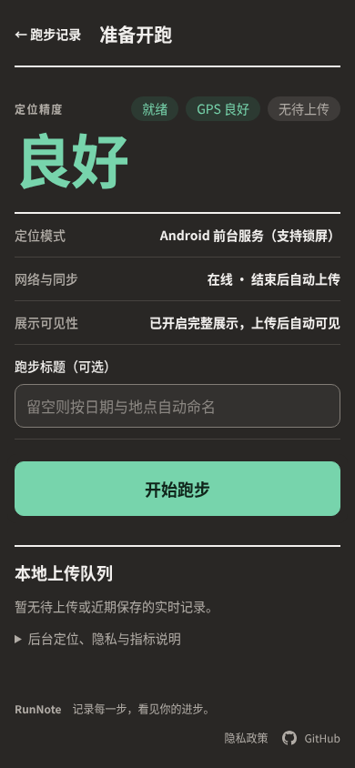 |
| 3. `recording`（记录中） | 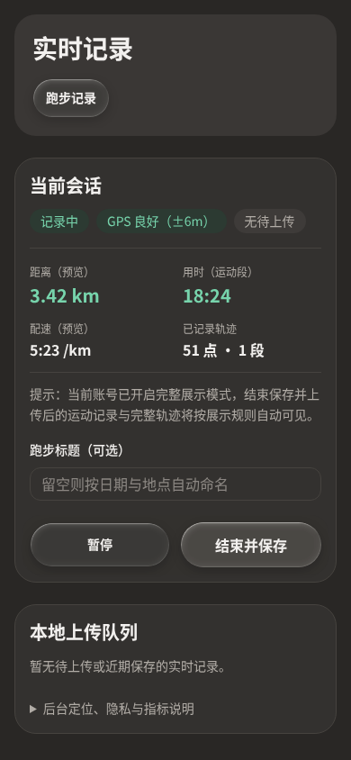 | 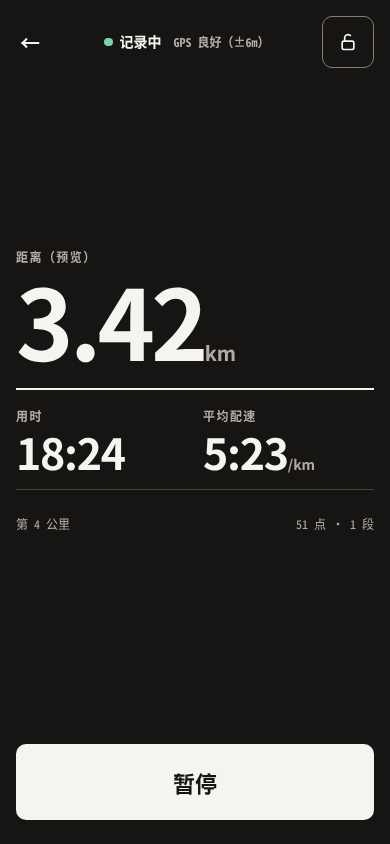 |
| 3b. `paused`（已暂停） | — | 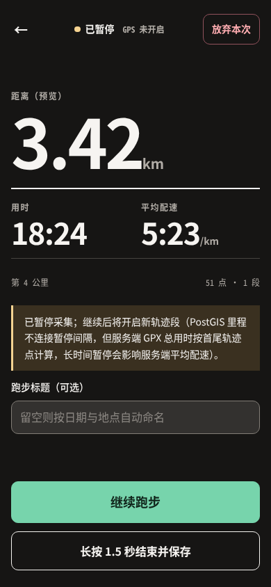 |
| 4. `done`（完成回执） | 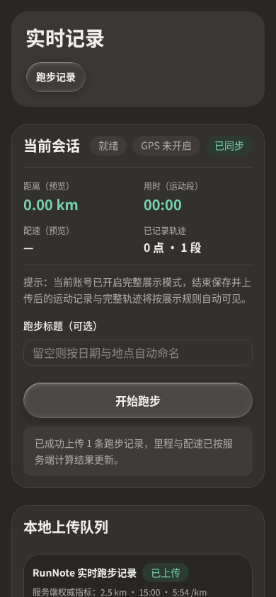 | 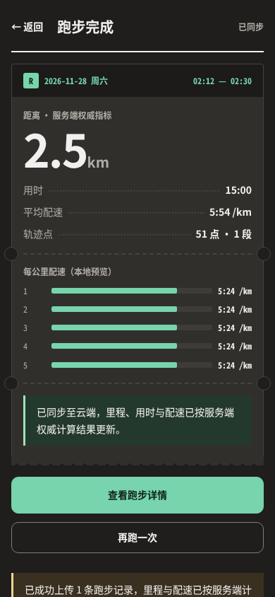 |
| 5. `detail`（活动详情） | 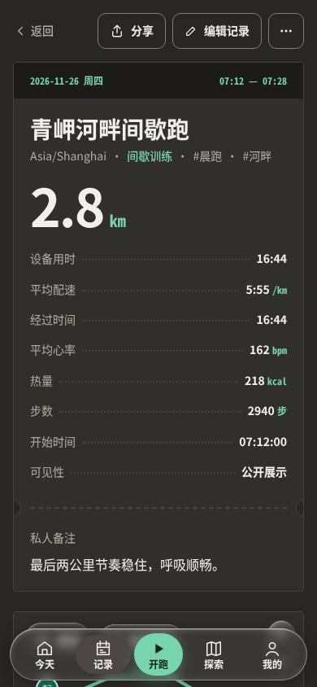 | 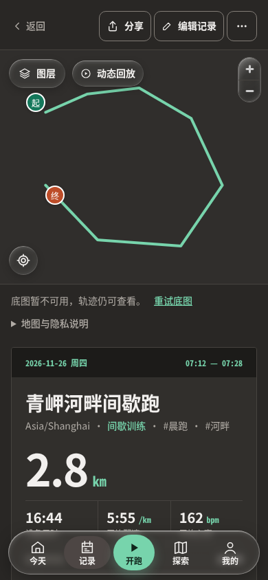 |
| 6. `share`（分享弹窗） | 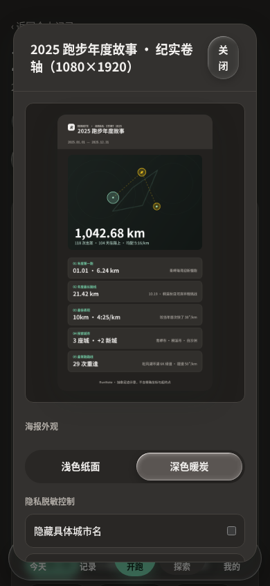 | 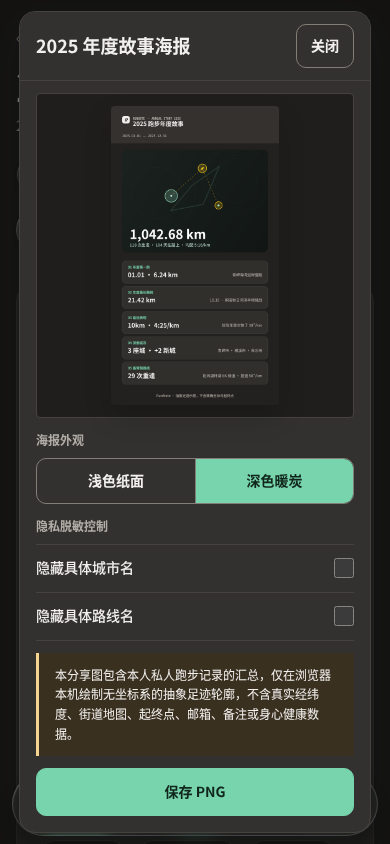 |

### 320×640 极限窄屏对比（浅色 / 深色）

| 屏幕 | 320 浅色（修改前 → 修改后） | 320 深色（修改前 → 修改后） |
| --- | --- | --- |
| 1. `home` | [前](assets/2026-11-28-editorial-receipt-mobile/before-home-320-light.png) → [后](assets/2026-11-28-editorial-receipt-mobile/after-home-320-light.png) | [前](assets/2026-11-28-editorial-receipt-mobile/before-home-320-dark.png) → [后](assets/2026-11-28-editorial-receipt-mobile/after-home-320-dark.png) |
| 2. `pre-run` | [前](assets/2026-11-28-editorial-receipt-mobile/before-prerun-320-light.png) → [后](assets/2026-11-28-editorial-receipt-mobile/after-prerun-320-light.png) | [前](assets/2026-11-28-editorial-receipt-mobile/before-prerun-320-dark.png) → [后](assets/2026-11-28-editorial-receipt-mobile/after-prerun-320-dark.png) |
| 3. `recording` | [前](assets/2026-11-28-editorial-receipt-mobile/before-recording-320-light.png) → [后](assets/2026-11-28-editorial-receipt-mobile/after-recording-320-light.png) | [前](assets/2026-11-28-editorial-receipt-mobile/before-recording-320-dark.png) → [后](assets/2026-11-28-editorial-receipt-mobile/after-recording-320-dark.png) |
| 3b. `paused` | [后](assets/2026-11-28-editorial-receipt-mobile/after-paused-320-light.png) | [后](assets/2026-11-28-editorial-receipt-mobile/after-paused-320-dark.png) |
| 4. `done` | [前](assets/2026-11-28-editorial-receipt-mobile/before-done-320-light.png) → [后](assets/2026-11-28-editorial-receipt-mobile/after-done-320-light.png) | [前](assets/2026-11-28-editorial-receipt-mobile/before-done-320-dark.png) → [后](assets/2026-11-28-editorial-receipt-mobile/after-done-320-dark.png) |
| 5. `detail` | [前](assets/2026-11-28-editorial-receipt-mobile/before-detail-320-light.png) → [后](assets/2026-11-28-editorial-receipt-mobile/after-detail-320-light.png) | [前](assets/2026-11-28-editorial-receipt-mobile/before-detail-320-dark.png) → [后](assets/2026-11-28-editorial-receipt-mobile/after-detail-320-dark.png) |
| 6. `share` | [前](assets/2026-11-28-editorial-receipt-mobile/before-share-320-light.png) → [后](assets/2026-11-28-editorial-receipt-mobile/after-share-320-light.png) | [前](assets/2026-11-28-editorial-receipt-mobile/before-share-320-dark.png) → [后](assets/2026-11-28-editorial-receipt-mobile/after-share-320-dark.png) |

### 768×1024 平板与 1440×900 桌面回归截图

- 平板 768×1024 浅色：[home](assets/2026-11-28-editorial-receipt-mobile/after-home-768-light.png)、[pre-run](assets/2026-11-28-editorial-receipt-mobile/after-prerun-768-light.png)、[detail](assets/2026-11-28-editorial-receipt-mobile/after-detail-768-light.png)
- 桌面 1440×900 浅色：[home](assets/2026-11-28-editorial-receipt-mobile/after-home-1440-light.png)、[pre-run](assets/2026-11-28-editorial-receipt-mobile/after-prerun-1440-light.png)、[detail](assets/2026-11-28-editorial-receipt-mobile/after-detail-1440-light.png)

## 未验证项与剩余风险

- **Android 真机（如 PKT110 / Capacitor WebView 硬件 GPS 与系统手势条）**：本机无连接的物理 Android 设备，原生定位权限/前台服务与手势栏安全区均通过 Playwright CDP `Emulation.setSafeAreaInsetsOverride` 与模拟 `Capacitor.Plugins.LocationRecorder` 验证。
- **真实 Safari / iOS WebKit**：本机 Linux 环境无 WebKit 系统库，未做真实 Safari 渲染与长按手势实测；所有浏览器测试均基于 Chromium。
- **真实后端 E2E（`playwright.config.ts`）与后端集成测试**：未改动后端/数据库/API，本机未连接独立 `_test` 库，全量 CI 流水线将在 PR 中验证。
- **`design-system.spec.ts` 像素快照对比**：基线仅包含 macOS（`*-darwin.png`），未在 Linux 本机做像素级 diff。
