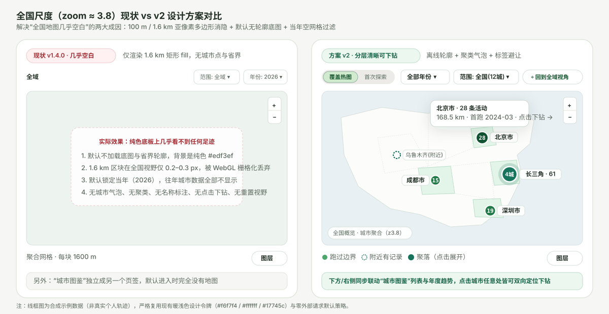
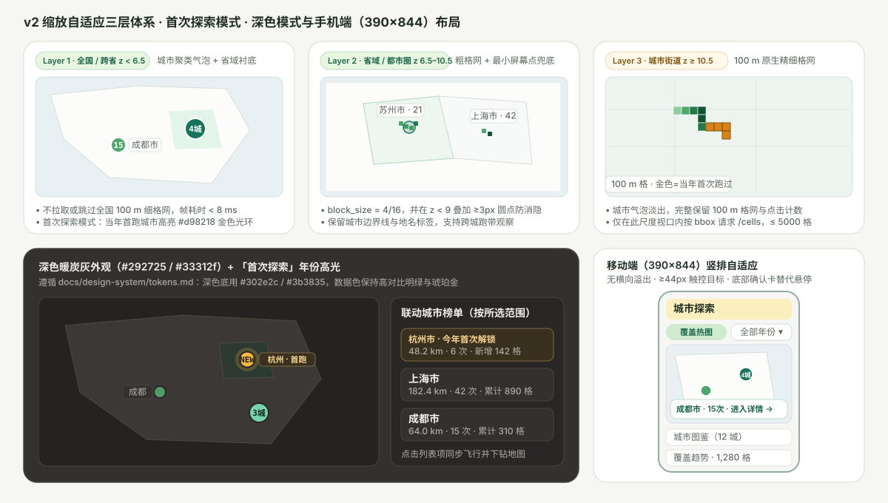

# 96 城市探索与足迹总览 v2 设计方案

日期：2026-11-23  
基线：`main` @ `8bf806db`（2.0.1）  
关联议题：#100（城市探索与足迹成就）、#121（v1.4.0 初版实现 `07fa0be`）  
状态：设计评审稿（本文档仅作设计规范，不包含业务代码实现）

---

## 1. 现状审计（Current-State Audit）

经逐文件核对现网实现，目前「城市探索」及相关足迹地图在**信息架构、缩放渲染、数据过滤与交互**四个层面存在明确瓶颈，导致整体体验偏单薄，且在全国/大尺度视野下“地图几乎一片空白”。

### 1.1 已实现且可复用的基础能力

| 模块 / 文件 | 已具备能力 | 核对结论 |
| --- | --- | --- |
| `backend/app/modules/footprints/exploration.py` | `ExplorationReads`（双线程冷读去重、30 s 只读事务超时、`activity_data_version` + `atlas_version` + `ALGORITHM_VERSION` 缓存键）、`YearGrid`、`GridHistory` | 后台缓存与版本失效机制完备；`_catalog` 已汇总 `boundary` 与 `nearby` 城市及 `regions` |
| `backend/app/modules/footprints/exploration_queries.py` | `CITY_DISTANCES` 按轨迹在城市多边形内的长度比例分摊里程；`GRID_HISTORY` 按 100 m EPSG:3857 格网聚合每年每格频次与首跑年月 | 权威里程与首次探索口径已严格建立，无需推翻重算 |
| `backend/app/modules/footprints/global_atlas.py` | `_atlas()` 常驻内存，含 4,555 个一级行政区（`center`/`bounds`）、369 个中国市级多边形（`center`/`bounds`）与 6,883 个全球点城市（`lon`/`lat`） | 现成具备所有已访城市和区域的几何中心与包围盒，仅未透传给城市探索接口 |
| `backend/app/modules/footprints/router.py` | 三个私有只读端点（`/cities`、`/{scope}/{code}`、`/{scope}/{code}/cells`），均使用 `get_read_identity` 与 `Cache-Control: private, no-store` | 隐私边界完整，有 `test_city_exploration.py` 与 `test_architecture.py` 守护 |
| `frontend/src/routes/footprints/exploration/+page.svelte` 及 `workspace` 变体 | 城市图鉴分页、全域/区域/城市切换、年份切换、月度新增/累计趋势柱图与 `
` 数据表、pending 轮询与 401 处理 | 趋势统计、口径说明、无障碍表格与错误恢复骨架扎实 |
| `frontend/src/lib/data/world-base.json` / `china-provinces.json` | 已随前端打包的离线国家与省界轮廓（被 `ProvinceMap.svelte` 使用） | 可零外部请求提供清晰大陆/国界/中国省界底板 |

### 1.2 分尺度失败清单与根因定位

#### A. 页面信息架构割裂
- **事实**：`frontend/src/routes/footprints/exploration/+page.svelte`（L216-220、L260-314）将页面拆为「城市图鉴」与「探索详情」两个 tab。默认进入 `/footprints/exploration` 时（无 `scope` 查询参数），页面只渲染 `MetricSummary` 与两列纯文本列表（`跑过的城市` / `附近有记录`）以及分页质量指标，**完全没有地图**。必须点击「探索详情」或某个城市链接后才出现地图。

#### B. 为什么「全国视野下地图几乎什么都看不见」（三大叠加根因）

1. **视觉与几何根因：亚像素多边形在 WebGL 中消隐**  
   - `backend/app/modules/footprints/exploration.py` L432：`zoom < 8` 时设置 `block = 16`（即 `16 × 100 m = 1.6 km`），仅当视口内格网块超过 `MAX_FEATURES = 5000`（L26、L468）时才将 `block *= 4`。对于只在几个城市跑过步的用户，全国范围总块数远小于 5,000，因此服务端返回 **`block_size = 16`（1.6 km × 1.6 km 方块）**。  
   - `frontend/src/lib/components/ExplorationMap.svelte` L51-81、L177-185 仅将这些格网转为真实地理经纬度 `Polygon`，通过单一 `fill` 图层（`exploration-grid-fill`）渲染，**没有任何 `circle` 兜底、城市气泡、聚类或文字标注**。  
   - 在全国视野（`1440×900` 或 `390×844` 下 `zoom ≈ 3.2–4.2`），1 屏幕像素约跨 `5–10 km`；一块 `1.6 km` 的正方形仅占 **`0.16–0.32 px`**，在 WebGL 三角形光栅化阶段被直接丢弃或退化为肉眼不可见的噪点。
2. **底图缺失根因：初始状态是纯色矩形，无任何地理参照**  
   - `ExplorationMap.svelte` L37：`let active = $state<BasemapPreference | null>(null)`，且 `onMount`（L149-207）仅加载 `createRouteMapStyle(dark)`（L164），即一张纯色 `#edf3ef` / `#302e2c` 画布，直到用户手动点击页脚「图层」才调用 `createBasemapController`（L82-102）。  
   - 这源于隐私策略（`frontend/tests/ui/city-exploration.spec.ts` L122 明确断言初始加载 `external` OpenFreeMap 请求为 `0`），但组件未像 `ProvinceMap.svelte` 那样接入本地离线轮廓 `world-base.json`，结果就是**“纯色空白画布 + 0.2 px 隐形方块”**。
3. **数据默认过滤根因：强制锁定当年 `currentYear`，往年城市完全消失**  
   - `exploration/+page.svelte` L44-47：当 URL 不含 `year` 时默认回退到 `currentYear`；而 `exploration.py` L420 仅读取 `history.years.get(year)`，**不支持跨年累计（`all`）格网视图**。  
   - 若跑者在往年去过多个城市而当年尚未前往（或每年年初），切入「全域探索」时地图连亚像素格网都为 0，与「城市图鉴」展示全部历史城市严重割裂。

#### C. 交互与主足迹地图的同类问题

| 尺度 | `ExplorationMap.svelte` 现状 | `FootprintMap.svelte` + `footprint-cities.ts` 现状 |
| --- | --- | --- |
| **全国 / 跨省**（`z < 6.5`） | 纯色空白底板 + 0.2 px 格网消失；无省/市气泡、无聚类、无标签、无悬浮/点击预览；`scrollZoom: false`（L170）无法滚轮缩放；`framed` 一次性置位（L139-142），无「回到全域」重置按钮 | `tracks` 模式下仅在 `maxzoom: 8` 绘 7 px 无标签绿点（L547-559），长三角/珠三角密集城市直接重叠，无次数/里程缩放，无法悬停查看；**`heatmap` 模式下 `cityMarkerData()` 返回空数组（L149）**，100 m 热区多边形在全国尺度同样因亚像素而不可见 |
| **省域 / 都市圈**（`z 6.5–10.5`） | `block_size = 4` 或 `16`（400 m–1.6 km），仍偏细碎且无边界衬底、无城市标签辅助定位 | 3 px 轨迹线在城区团聚成噪点；`maxzoom: 8` 后城市点立即消失，`z 8–10` 处于无标志物真空带 |
| **城市 / 街道**（`z >= 10.5`） | `100 m` 格网可用，但 `heatmap`（固定 4 档绿色，L182 未适配深色高对比且与 `block_size > 1` 计数语义混用）与 `new`（仅改外框色 `#805412`，L137）视觉区分弱；点击仅在页脚打印数字 | `tracks` / `heatmap` 在城市尺度可用，支持点击查记录与定位 |

#### D. 接口数据缺口（`exploration_schema.py`）
- `ExplorationPlace`（`backend/app/modules/footprints/exploration_schema.py` L11-19）目前只返回 `code, name, region_name, kind, first_date, last_date, activity_count, distance_m`，**缺少 `region_code`、`country_code`、`lon`、`lat`、`bounds`**，且 `/cities` 强制分页（`limit <= 100`，前端默认 `20`），无法直接支撑地图首屏渲染全量城市气泡。

---

## 2. 目标与非目标（Goals / Non-Goals）

### 2.1 目标
1. **彻底消除全国尺度“空白地图”**：默认进入「城市探索」即可在离线地理轮廓上清晰看到**去过的省份底色、城市探索气泡、密集区聚类簇、城市名称标签**与核心统计，同时保持默认 0 第三方地图请求。
2. **升级为可下钻的探索总览**：建立「全国总览 → 省域/都市圈过渡 → 城市 100 m 精细格网」的三级平滑过渡，支持地图点击下钻、列表双向定位、「回到全国 / 回到全域」一键复位，以及**「全部年份」累计视图**。
3. **保持模式语义一致与高区分度**：在全部缩放层级上清晰区分「覆盖热图（累积强度/热区）」与「首次探索（新解锁城市/首次跑过格网）」以及「边界内跑过」与「附近有记录（`nearby`）」。
4. **严格守护隐私与权威口径**：所有聚合计数、边界分摊里程与首跑日期继续以服务端为准；严禁在公共路由暴露或向第三方发送任何轨迹坐标。
5. **同步修补主足迹地图低倍盲区**：为 `FootprintMap.svelte` 的 `heatmap` 与 `tracks` 低倍视角提供一致的城市聚合点与标签规范（放入分阶段演进中落地）。

### 2.2 非目标（v2 不做）
- **不做数据库结构迁移**：不新建城市/网格物化缓存表，复用既有 `activity_global_footprint_caches`、`footprint_activity_caches` 与 `ExplorationReads` 内存缓存。
- **不将 `/footprints/exploration` 公开化**：仍为登录态私有页面，不接入 `/showcase` 或 `/p/[username]`。
- **不引入付费或非标准瓦片服务**：继续使用仓库离线 `world-base.json` + 用户主动选择时的 `OpenFreeMap`。
- **不在第一切片引入复杂成就勋章体系或社交分享海报**：聚焦地图与图鉴总览本身可用性（海报分享已有独立链路）。

---

## 3. 推荐设计方案：三层缩放自适应探索总览

### 3.1 信息层级与缩放策略总览

保留底层一个统一的 MapLibre `Map` 实例（禁止调用 `map.setStyle`，主题与模式变化一律通过 paint/layout 属性或 source `setData` 原地更新），按 `zoom` 连续/分段切换渲染层级：

| 层级 | Zoom 区间（参考） | 展示主体 | 数据来源 | 交互行为 |
| --- | --- | --- | --- | --- |
| **Layer 0：本地离线底板** | 全程（`z 0–19`） | 大陆/国家轮廓、中国 34 省级行政区细线与**已访省份浅色填充**（热图模式浅绿，首次探索模式当年新解锁省浅琥珀） | 前端本地 `world-base.json`（仅在未开启外部矢量底图时显示强轮廓，开启外部底图后仅保留极淡已访省晕染置于底图之上、数据层之下） | 零外部请求；仅作视觉衬底，不拦截点选 |
| **Layer 1：全国 / 跨省** | `z < 6.5` | **城市聚合气泡 + GeoJSON 屏幕聚类** + 碰撞避让短名标签 | 服务端城市总览标记点（见第 4 节方案 C） | 悬停显示摘要卡；点击聚类放大展开；点击单城触发预览或下钻至 `scope=city` |
| **Layer 2：省域 / 都市圈** | `6.5 <= z < 10.5` | 聚类解散为独立城市点 + 目标区域轮廓淡描边 + **粗格网（`block_size >= 4`，400 m–1.6 km）+ 屏幕像素兜底圆点（`z < 9` 时给离散块补 ≥3 px 圆点防消隐）** | 标记点 + `GET /{scope}/{code}/cells` | 可直接看清跨城跑带与郊区越野轨迹分布；城市短标签降透明度保留路标感 |
| **Layer 3：城市 / 街道** | `z >= 10.5`（或选定 `scope=city`） | 城市气泡淡出（`z 10→11` 平滑透明），完整呈现 **100 m × 100 m EPSG:3857 精细格网** | `GET /{scope}/{code}/cells`（按当前视口 `bbox` 拉取，`<= 5000` 格） | 点击格网显示「N 条活动经过」或「YYYY 年首次跑过」 |

> **关键修复细节**：
> 1. **亚像素兜底**：Layer 2 在 `6.5 <= z < 9.5` 期间，除渲染 `fill` 多边形外，同步从同批 `cells` 生成点质心叠加一层 `circle` 图层（`circle-radius: ['interpolate', ['linear'], ['zoom'], 6.5, 2.5, 9.5, 1.5]`，在 `z >= 9.5` 淡出），确保哪怕只有一条孤立乡村跑道（`block_size = 16`），在省级视野也绝对不会消失。
> 2. **启用滚轮缩放与清晰控件**：将 `scrollZoom` 由 `false` 改为 `true`（与 `FootprintMap` 一致；若嵌入长页面存在误滚动顾虑，至少在全屏/主地图容器允许或提供明确切换，建议参考 `FootprintMap.svelte` 默认开启 `scrollZoom`），并在地图左上角工具条常驻 **「回到全国」** / **「回到全域」** 按钮。

### 3.2 「覆盖热图」与「首次探索」双模式在全尺度的区分

| 视觉维度 | 覆盖热图（`heatmap`） | 首次探索（`new`） |
| --- | --- | --- |
| **默认年份** | 支持 `全部年份 (all)`（默认）及单年份 | 选择具体年份 `YYYY`（默认当年；若当年尚无新格网，提示并保留切换历史年份入口） |
| **Layer 1 城市气泡** | **大小**：按 `distance_m` 或 `activity_count` 分 4 档半径（`7 / 10 / 13 / 16 px`）；**颜色**：沿用 `--calendar-1..4` 绿阶（浅 `#8dcc9c` → `#105332`），`nearby` 为空心虚线绿环 | **今年首跑新解锁城市**：实心琥珀金（浅 `#d98218` / 深 `#f5b942`）+ 外部微光圈；**往年已解锁但当年有新增格网的城市**：绿底金边；**当年无新增的旧城**：低饱和灰绿退后 |
| **Layer 2/3 格网** | 浅/深色自适应 4–5 档色阶（参照 `HEAT_LEVELS` 与 `--calendar-1..4`，深色提亮以在 `#302e2c` 上保持清晰） | `block_size = 1` 时首次跑过格网高亮琥珀金填充 + `#805412` 细边（深色 `#f5b942` / `#806b41`）；粗聚块模式以「该块内新增 100 m 格数」分级着色 |
| **数字徽章** | 气泡内/旁标注城市短名 + 活动次数（如 `上海 · 42`） | 新解锁城市优先显示标签（如 `杭州 · 首跑`） |

### 3.3 `fitBounds` 与「回到全国 / 回到全域」重置机制

- **首次进入相机逻辑**：
  1. 若用户全部足迹集中在中国境内（`country_code == 'CHN'` 占比 100% 或默认国内视野），`fitBounds` 对齐**所有城市包围盒的并集**（带 `padding: { top: 56, right: 48, bottom: 48, left: 48 }`、`maxZoom: 12`）；若仅跑过 1 座城市，则以 `maxZoom: 11` 居中展示该城并保留外围省界上下文（避免一进总览就缩进街道里）。
  2. 若用户足迹跨多国（海外 + 国内），初次 `fitBounds` 对齐全部足迹并集，同时在复位菜单/按钮提供：
     - **「回到全域」**（`fitBounds(allCityBounds)`，有海外记录时展示全球）
     - **「聚焦中国」**（当同时存在 `CHN` 与境外城市时快捷切换 `DEFAULT_CHN_BOUNDS = [73.5, 18.0, 135.0, 53.5]`，让海外单次跑不至于把中国压缩成一小角）。
- **复位状态机**：取消原先一次性 `framed = true` 锁死；改为 `viewPinned: 'overview' | 'scope' | 'free'`。用户拖拽/缩放后进入 `'free'`，顶部/角标显示 **「回到全域」**（或当前 `scope` 的 **「重置视野」**），点击后动画飞行（尊重 `prefers-reduced-motion: reduce`，`duration: 0`）回到目标范围。

---

## 4. 聚合数据源方案对比与选型

针对「低倍全国/省域视角需要什么数据才能又快又准地画出来」，评估以下三种方案：

### 方案 A：纯客户端屏幕空间聚类（基于现有 `/cells` + `/cities`）
- **做法**：前端先请求 `/cities?limit=100` 和全域 `/cells`，再在浏览器用 `china-cities.json`（1.25 MB）做点/块归属匹配与聚类。
- **问题**：
  1. `GET /cities` 上限 `limit=100` 且**无 `lon/lat/bounds`**；`china-cities.json` 仅含中国大陆及港澳 369 城，不含台湾 25 城及全球 6,883 个 `nearby` 城市。
  2. 全域 `/cells` 的 `block_size=16/64` 本质是纯空间方块，不含城市语义（边界内里程、首次跑步日期、`nearby` 记录），无法支持“按城市聚合 + 点击下钻”。
  3. 移动端主线程/Worker 解码 1.25 MB 多边形图集额外增加 150–400 ms 冷启动开销。

### 方案 B：服务端粗网格 / 省级多边形实时聚合接口
- **做法**：新增服务端 SQL/内存逻辑，把 `GridHistory` 按一级行政区（`world-regions.json.gz`）或更大网格（如 25 km × 25 km）做聚合返回多边形集合。
- **问题**：
  1. 省级填色地图已在 `/dashboard`（`ProvinceMap.svelte`）承载；本页核心产品心智是**「城市探索」**，25 km 方块或整省色块缺乏城市粒度的成就感与识别度，且 `nearby` 城市无几何网格仍会遗漏。
  2. 若做严格省内格网去重与覆盖率，涉及 4,555 个多边形的空间裁剪，不建新表缓存会导致 `ExplorationReads` 冷读耗时上升。

### 方案 C（推荐）：服务端 Atlas 城市/区域聚合标记接口 + 视口按需细格网
- **做法**：
  1. **新增轻量只读端点** `GET /api/v1/me/footprints/exploration/markers`（支持可选 `year: int | None = None`，`None` 即累计全部年份）：
     - 复用服务端进程内已缓存的 `_atlas()`（`center` / `bounds` / `lon` / `lat` / `region_code` / `country_code`）与 `ExplorationReads`。
     - 返回当前用户所有已访问城市（无 20 条分页截断，单用户通常 1–500 城，未压缩 JSON < 40 KiB）及汇总区域列表，字段包含：`code, name, short_name, region_code, region_name, country_code, kind ('boundary'|'nearby'), lon, lat, bounds, activity_count, distance_m, first_date, last_date, is_new_in_year, new_cells_in_year`。
  2. **同时增强现有 `/cells` 与 `/{scope}/{code}`**：允许 `year=all`（或可选 `year: int | None = None`，默认保留向后兼容或由前端显式传 `year=0` / 新增 `all_years` 查询约定；**为避免破坏既有 `Year = Query(ge=1900, le=2100)` 校验与单元测试，建议增加可选查询参数 `all_years: bool = False` 或在 `/markers` 与 `/cells` 支持 `year: int | None = None`（不传 `year` 即全部年份）** — 详见第 7 节契约设计）。
  3. **前端渲染分工**：
     - **Layer 1（全国 `z < 6.5`）**：直接将 `/markers` 转为 MapLibre GeoJSON Source，开启原生 `cluster: true, clusterMaxZoom: 6, clusterRadius: 42`，由 MapLibre C++/WebGL 线程（Worker）毫秒级完成碰撞与聚合。**全国缩放期间完全不请求 `/cells`**！
     - **Layer 2/3（`z >= 6.5` 或下钻至 `region`/`city`）**：按需请求 `GET /{scope}/{code}/cells`，与城市边界/点标记平滑叠加。

### 方案横向对比表

| 维度 | 方案 A（纯客户端聚类） | 方案 B（服务端粗格网/省聚合） | 方案 C（推荐：服务端城市标记 + 按需格网） |
| --- | --- | --- | --- |
| **全国首屏性能** | 需下载 1.25 MB `china-cities.json` + 全域 cells，慢 | 需传输多边形 GeoJSON 或大量粗方块 | **极快**：`/markers` 仅数 KB–数十 KB，MapLibre 原生聚类 0 卡顿 |
| **城市信息完整度** | 缺全球/台湾城市坐标，缺 `nearby` 语义 | 仅粗方块/省级，缺失单城精细下钻锚点 | **完整**：100% 覆盖 `boundary` + `nearby` + 全球城市与里程 |
| **API 与缓存** | 无新增接口，但受 `/cities` 分页限制 | 新增重型空间聚合端点 | 1 个轻量只读 `/markers` 端点，直接复用 `ExplorationReads` LRU 缓存 |
| **隐私合规** | 客户端含完整图集，但仍为私有 | 私有接口 | **零泄漏**：仅返回归属城市中心与聚合计数，不含轨迹点；`private, no-store` |
| **DB 迁移成本** | 0 迁移 | 0 迁移（若不做物化表则冷读较重） | **0 迁移** |

---

## 5. UX 与视觉方向（UX / Visual Direction）

严格遵循 [Design System](design-system/README.md)、[页面模式](design-system/patterns.md) 与 [设计令牌](design-system/tokens.md)：暖浅色背景 `#f6f7f4` / 卡片 `#ffffff`、暖炭灰深色 `#292725` / 卡片 `#33312f`、品牌强调绿 `--primary`（`#17745c` / `#77d4ac`）、系统字体 + `tabular-nums` 等宽数字，以及 **Do not narrate the interface**（不堆砌欢迎语、教程横幅与冗余解释文案）。

### 5.1 信息架构重构：总览优先（Overview-First）+ 地图/图鉴/趋势三向联动

将原本割裂的「城市图鉴」与「探索详情」整合为统一的 **「城市探索」工作台**（同时完全兼容 `?scope=...&code=...&year=...` 深链）：

1. **顶部页头（`PageHeader`）**：标题 `城市探索`（省略 `description`），右侧返回或快捷操作（如当前在具体城市/区域时提供 `回到全国总览`）。
2. **核心指标条（`MetricSummary`）**：随当前 `scope` 与 `year` 动态响应：
   - 全域视角：`已解锁城市`（`boundary_count + nearby_count`）、`覆盖省份/区域`、`边界内累计跑量`、`当年新增格网`（或切换 `全部年份` 时显示 `累计探索格网`）。
   - 城市视角：保留现有 `城市边界内累计跑量`、`首次跑步记录`、`新增/累计格网`。
3. **主工作区（桌面 `2fr : 1fr` 左右分栏，`< 980px` 单栏纵排）**：
   - **左栏（主视觉）— 探索地图卡片**：
     - 顶部工具栏：左侧面包屑/范围下拉（`全域 > 华东 / 江苏省 > 苏州市`）+ **「回到全国」** 按钮；右侧模式分段切换（`.settings-tabs`：`覆盖热图` / `首次探索`）+ 年份选择器（`全部年份` / `2026` / `2025`…）。
     - 地图画布（桌面 `min-height: clamp(24rem, 54vh, 36rem)`，移动 `min-height: 20rem`）：内嵌右上角缩放控件、右下角归属（开启外部底图时）、底部图例与 `BasemapPicker`（`图层`）。
   - **右栏（联动侧栏）— 城市图鉴榜单 & 覆盖趋势**：
     - 全域/区域视角下：上方展示**当前视野/范围的城市榜单**（支持「全部 / 边界内 / 附近」轻量筛选及搜索/排序切换：按里程 / 按次数 / 按首跑日期；分页或虚拟滚动保持流畅），下方紧接该范围的**覆盖趋势月度柱图**与 `
` 逐月数据表。
     - 点击右侧城市榜单任一项 → 地图平滑飞行到该城并高亮下钻；点击地图上任意城市气泡 → 右侧同步切至该城详情与月度趋势。
     - 若用户位于旧版链接 `/footprints/exploration?scope=city&code=310000&year=2025`，页面直接以该城市聚焦态打开，保持 100% URL 兼容。
4. **页尾折叠区**：`数据质量`（未分配跑量、无轨迹活动、未归入城市）与 `
统计口径
` 统一收于页尾，不干扰主视线。

### 5.2 图例与交互反馈设计

- **动态图例（随缩放层级 & 模式自动切换）**：
  - `z < 6.5`（热图）：`气泡大小 = 里程/次数` · 实心绿圆 `边界内跑过` · 虚线环 `附近有记录` · 深绿大圆 `密集城市聚落（点击展开）`。
  - `z < 6.5`（首次探索）：琥珀金圆 `当年首跑城市` · 绿底金环 `今年有新格网` · 灰绿圆 `往年城市`。
  - `z >= 6.5`：保留 `每块 N m` / `100 m 投影网格` 色阶说明及点选格网实时读数。
- **点击 vs 悬停**：
  - 桌面端（hover 可用）：鼠标悬停城市气泡显示轻量浮层（`北京市 · 28 次 · 168.5 km · 首跑 2024-03-12`），点击直接下钻至该城或展开聚落。
  - 触屏端（无 hover）：轻触城市气泡先在地图底部弹出**单行确认操作条**（`北京市 · 28 次 · 168.5 km` + `[进入城市详情 →]` 按钮），避免手指误触直接跳走而不知点中哪座城；再次点击同一气泡或点按钮进入详情。

### 5.3 状态设计（加载 / 空态 / 整理中 / 失败 / 无网）

| 状态 | 表现与恢复动作 |
| --- | --- |
| **首次骨架加载** | 使用 `PageSkeleton`，与真实地图/侧栏尺寸匹配，防止布局跳动（CLS = 0） |
| **历史足迹整理中（`pending`）** | 保留 `FeedbackState kind="loading"` + 3.5 s 自动轮询 + `重新读取` 按钮；若 `/markers` 已就绪而 `/cells` 仍在后台构建，**优先显示城市气泡总览**，仅在地图角标轻提示「精细格网整理中…」，不阻塞全图 |
| **空态（0 活动 / 无轨迹活动）** | 与现有逻辑一致，展示清晰空态卡片与「查看活动 / 导入轨迹」入口 |
| **当年无新增（`year=2026` 下 `new` 为空）** | 地图仍保留灰色/淡轮廓底板与往年城市参照（或清晰浮层提示「2026 年暂无新增探索，切换至全部年份查看历史」+ 一键切换按钮），绝不显示纯白板 |
| **接口失败 / 401** | `FeedbackState kind="error"`（`role="alert"`）+ `重试`；401 清除私人状态并跳转 `/admin?reason=changed` |
| **外部底图离线/超时** | `BasemapPicker` 提示底图不可用并重试；内置 `world-base.json` 本地轮廓与城市气泡/格网全程不受影响 |

### 5.4 主题、无障碍与减少动态效果

- **深/浅主题**：复用 `watchSystemTheme` 与 `createRouteMapStyle(dark)`，浅色底板海 `#e8f0f4` / 陆 `#fcfdfb` / 已访省 `#e3f4e8`；深色暖炭灰海 `#252321` / 陆 `#3b3835` / 已访省 `#2c3a32`。`applyMapTheme(map, dark)` 通过 `setPaintProperty` 即时换肤，保留当前相机与选中状态。
- **对比度**：城市气泡白字数字与深绿底（`#17745c` / `#105332`）及深色模式下深字（`#10251b`）配薄荷绿（`#77d4ac`），确保文字与关键图形对比度 ≥ 4.5:1；标签均配 `text-halo-color` 描边。
- **键盘与屏幕阅读器**：
  - 地图容器保留 `role="region"`、`aria-label` 与操作帮助（方向键平移、`+`/`−` 缩放、`0` 回到全国）；城市标签与榜单链接均支持 `Tab` + `Enter`/`Space` 聚焦与触发，保留 2 px 焦点环与 3 px offset。
  - 图表与地图均提供完整 `
` 表格/列表兜底，所有动态状态通过 `aria-live="polite"` 播报。
- **减少动态效果（`prefers-reduced-motion: reduce`）**：所有 `flyTo` / `fitBounds` / 聚类展开动画均设 `duration: 0`；无脉冲/闪烁动画。

---

## 6. 静态线框与前后对比

为直观展现改动效果，本方案配套制作了两张静态矢量线框图（存放于 `docs/assets/2026-11-23-city-exploration-v2/`，仅使用合成示例数据，未接入生产代码）：

1. **全国尺度前后对比**（v1.4.0 空白纯色画布 + 0.2 px 隐形方块 vs v2 离线轮廓 + 聚类气泡 + 标签 + 悬浮摘要卡）：  
   

2. **三级缩放自适应、深色暖炭灰主题与移动端 390×844 布局**：  
   

---

## 7. 分阶段实施计划（Implementation Plan）

采用“先契约与数据、再地图层级、后页面整合与主地图对齐”的四个可独立验证切片，全程 **0 数据库迁移**。

### 切片 1：后端 `/markers` 标记接口与累计年份（`all_years`）支持
- **目标**：提供全量已访城市/区域坐标与跨年累计格网能力，消除“年初空图”与坐标缺失。
- **涉及文件**：
  - `backend/app/modules/footprints/exploration_schema.py`：新增 `ExplorationMarker`、`ExplorationMarkersResponse`（均继承 `ExactView`）；为 `ExplorationPlace` 补充可选 `lon`/`lat`/`bounds`/`region_code`（或仅放在 `ExplorationMarkersResponse` 中，保持 `/cities` 响应体极致精简，推荐后者以减小 `/cities` 变更面）。
  - `backend/app/modules/footprints/exploration.py` & `exploration_queries.py`：
    - 新增 `markers(reads, owner, version, year)`：复用 `_catalog` 与 `_grid` 中的 `first_year` 统计，拼装 `_atlas()` 的 `center`/`lon`/`lat`/`bounds`/`region_code`/`country_code`；当 `year is not None` 时按年份过滤或标记 `is_new_in_year` / `new_cells_in_year`。
    - 为 `GridHistory` 增加 `all_years: YearGrid`（累加各年 `heat`，`first_seen` 取是否曾首次出现，或直接复用 `history.years` 聚合），支持 `detail` / `cells` 传入 `year=None` 或 `all_years=True` 返回全时段累计热图（注：`router.py` 中对现有 `/{scope}/{code}?year=...` 若改为 `year: Year | None = None` 需注意 `api-contract.test.ts` 与既有 `test_city_exploration.py`，最稳妥方式是新增可选查询参数 `all_years: bool = False`，`year` 仍必传或默认当前年，完全不破坏现有调用方）。
  - `backend/app/modules/footprints/router.py`：注册 `GET /api/v1/me/footprints/exploration/markers`（带 `get_read_identity`、`Cache-Control: private, no-store`、`response_model=ApiResponse[ExplorationMarkersResponse]`，以及按 `test_architecture.py` 要求补充 `test_city_exploration.py` 跨用户与未登录校验）。
  - 重新生成前端契约：`cd backend && .venv/bin/python -m app.contract.typescript`。
- **切片 1 明确非目标**：不改前端 UI 布局，不改 `FootprintMap.svelte`，不新增数据库表。

### 切片 2：`ExplorationMap.svelte` 离线轮廓、三级缩放与聚类气泡
- **目标**：彻底解决全国尺度看不到足迹的问题，支持鼠标滚轮、模式高区分、点击/悬停交互与复位控件。
- **涉及文件**：
  - `frontend/src/lib/map/exploration-layers.ts`（新建纯函数与 MapLibre 图层/配色配置模块，方便单测）：封装 `world-base.json` 载入与省域染色、markers GeoJSON 转换与聚类配置、`heatmap` vs `new` 深浅色表达式、Layer 2 质心圆点兜底逻辑。
  - `frontend/src/lib/components/ExplorationMap.svelte`：接收 `markers` 与 `cells`，实现 `z < 6.5`（聚类气泡 + 标签 + 省填充）、`z 6.5–10.5`（解聚 + 粗格网 + 圆点兜底）、`z >= 10.5`（100 m 细格网），接入 `onselectcity` / `onresetview` 回调，开放 `scrollZoom` 与键盘复位，保留 `data-ready` / `data-drawn` 供自动化断言。
  - `frontend/src/lib/api/exploration.ts`：新增 `readMarkers()` 及严格运行时类型校验函数 `parseMarkers()`。

### 切片 3：`exploration/+page.svelte` 总览一体化与联动
- **目标**：消除两套页签割裂，默认首屏呈现地图 + 城市榜单 + 趋势联动。
- **涉及文件**：
  - `frontend/src/routes/footprints/exploration/+page.svelte`：默认入口即渲染「全国探索总览」（含 `全部年份` 选项、范围面包屑、地图与右侧联动城市列表/趋势图），保持 `?scope=...&code=...&year=...` 与 `/workspace/footprints/exploration` 100% 兼容。
  - `frontend/tests/ui/city-exploration.spec.ts` & `frontend/tests/unit/exploration.test.ts`：更新合成 API 夹具增加 `/markers` 响应，补充全国视野气泡/聚类/复位/下钻/触屏确认条断言。

### 切片 4：`FootprintMap.svelte` 主足迹地图低倍聚合对齐（独立跟进）
- **目标**：修复 `/footprints` 主地图在 `heatmap` 模式下低倍无城市标记、`tracks` 模式下 7 px 绿点无聚类无标签的问题。
- **涉及文件**：
  - `frontend/src/lib/components/FootprintMap.svelte`、`frontend/src/lib/map/footprint-cities.ts`：支持从 `heatmap` 格网包围盒中心估算城市点（或复用服务端城市标记），在 `footprint-cities` GeoJSON Source 启用 `cluster: true` + 碰撞标签，统一 `z < 8` 视觉体验。

### 发布与回滚策略
- **渐进开关（可选）**：前端可在 `exploration/+page.svelte` 保留清晰的模块边界；由于 `/markers` 为纯只读增量端点且不改数据库 schema，后端可先行合并上线并由 `ExplorationReads` 自然预热，回滚仅需回退前端/路由提交，零数据回滚风险。

---

## 8. 验收标准与测试计划（Acceptance Criteria & Test Plan）

### 8.1 功能与视觉验收标准

1. **全国尺度可见性（核心验收）**：
   - 在合成多城用户数据（如分布于华北、华东、华南、西南及 1 个 `nearby` 城市）下，以 `zoom < 5` 打开 `/footprints/exploration`，**无需手动切换底图**，画布必须渲染出陆地/中国省界轮廓、已访省份底色、至少 1 个聚落簇（如长三角多城聚合）与单城气泡及城市短名标签，`data-drawn="true"`。
2. **三级缩放与下钻复位**：
   - `z < 6.5` 点击聚落可自动放大展开；点击单城可下钻至 `scope=city`（桌面一次点击或先预览再下钻，移动端先出底部确认条防误触）；缩放至 `z >= 10.5` 时城市气泡平滑淡出，100 m 格网清晰可点。
   - 点击「回到全域 / 回到全国」按钮可在 `<= 1` 次操作内恢复总览视野。
3. **双模式与跨年视图**：
   - 切换 `覆盖热图`（`all_years` 与单年）与 `首次探索`（单年），城市气泡配色、图例文字与格网高亮须即时同步，且不重建 Map 实例。
4. **响应式与双主题（必须实测以下 6 个矩阵组合）**：
   - 视口：`1440×900`（桌面）、`768×1024`（平板）、`390×844`（手机）。
   - 外观：`light`、`dark`（遵循 `runnote-theme` 与 `prefers-color-scheme`）。
   - 全部组合须满足 `document.documentElement.scrollWidth <= window.innerWidth`（无横向溢出）、常用触控目标 `>= 44×44 px`、文字与气泡标签对比度 `>= 4.5:1`、0 JS `pageerror`。
5. **异常与边界态**：
   - 空数据（0 活动 / 0 轨迹）、`pending` 轮询、`503` 错误重试、`401` 跳转登录、`prefers-reduced-motion: reduce`（动画 `duration: 0`）。

### 8.2 性能预算（对齐 `docs/91-map-interaction-performance-baseline.md`）

| 指标 | 目标预算 | 说明 |
| --- | --- | --- |
| `/markers` 接口冷读 / 热读响应 | 冷读 `< 800 ms`（典型用户），热读 `< 30 ms`；包体 `< 64 KiB` | 仅包含城市级摘要与坐标，不含轨迹点阵 |
| `/cells` 单次返回格网上限 | 严格 `<= 5000` 格（沿用 `MAX_FEATURES`） | `z < 6.5` 默认不请求全国细格网，避免无效载荷 |
| 桌面端平移/缩放帧间隔（`1440×900`） | 均值 `<= 16.7 ms`，p95 `<= 28 ms`，Long Task `= 0` | 对齐基线报告中 `FootprintMap` 实测水平（均值 ~16.5 ms） |
| 移动端（`390×844`） | 均值 `<= 25 ms`，p95 `<= 45 ms`，无长时间卡顿 | 离线底板控制在 `world-base.json`（已验证约 7 ms 解析级别） |

### 8.3 隐私与安全核查清单

- [ ] 默认加载地图时抓包确认 **0 条发往 `tiles.openfreemap.org` 或任何外部域名的请求**（仅当用户主动切换外部底图才按视口拉取公开矢量瓦片）。
- [ ] 所有 `/api/v1/me/footprints/exploration/*` 响应头均含 `Cache-Control: private, no-store`；未登录返回 `401`；`/api/v1/showcase/footprints/exploration/*` 返回 `404`。
- [ ] 新增 `/markers` 端点在 `backend/tests/integration/test_city_exploration.py` 覆盖跨用户不可见与参数校验，且不将真实经纬度或 `bbox` 打入应用访问日志（沿用 `backend/app/core/logging.py` 脱敏规则）。
- [ ] 全量自动化门禁：`backend/.venv/bin/pytest tests/unit tests/integration/test_city_exploration.py`、`frontend` 下 `pnpm check`、`pnpm test`（含 `architecture.test.ts` 与 `api-contract.test.ts`）、`pnpm lint:style`、`pnpm exec playwright test --config playwright.ui.config.ts city-exploration.spec.ts` 及真库 `e2e` 均须通过。

---

## 9. 待项目负责人确认的开放问题（Open Questions）

以下 4 项决定直接影响产品交互、接口契约或首期范围，请在进入开发前确认：

1. **「探索详情」默认年份是否改为「全部年份（累计）」？**  
   - **现状**：默认强制使用当前自然年（`currentYear`），导致年初或跨年未重跑的老城市在地图上完全消失。  
   - **建议**：在「覆盖热图」模式下默认选择「全部年份（累计）」，仅在「首次探索」模式下默认当前年（或最近有记录的年份）。是否同意？
2. **「城市图鉴」与「探索详情」是否合并为单页「总览优先」布局？**  
   - **现状**：进入 `/footprints/exploration` 先看到纯文字图鉴列表，需点第二个 tab 才看到地图。  
   - **建议**：合并为一个页面，首屏直接展示「全国聚类地图 + 联动城市榜单 + 趋势图」，同时保留 `?scope=...&code=...` 深链与顶部/右侧筛选能力。是否同意取消纯文字独立首页签？
3. **主足迹页 `/footprints`（`FootprintMap.svelte`）是否纳入本次 v2 同批交付，还是作为切片 4 独立推进？**  
   - **现状**：`FootprintMap.svelte` 的 `heatmap` 模式在全国视野下存在完全相同的亚像素消隐问题，`tracks` 模式城市点无聚类无标签。  
   - **建议**：切片 1–3 先把 `/footprints/exploration` 做到体验闭环，切片 4 紧接着把同一套聚类+标签规范复用回 `FootprintMap.svelte`；如需同步上线则可合并排期。
4. **跨国/海外足迹与 `nearby`（点匹配）城市在全国图上的默认取景策略？**  
   - **建议**：若用户全部记录都在中国，默认居中聚焦中国；若同时拥有境外城市记录，初次打开适配全部足迹，但在工具条旁常驻「聚焦中国 / 回到全球」双快捷按钮，防止单次境外旅行把国内数十座城市挤成一团。`nearby` 城市是否以虚线空心圆同屏展示并允许点击查看（目前点 `nearby` 只能跳回全域，无法看局部）？
