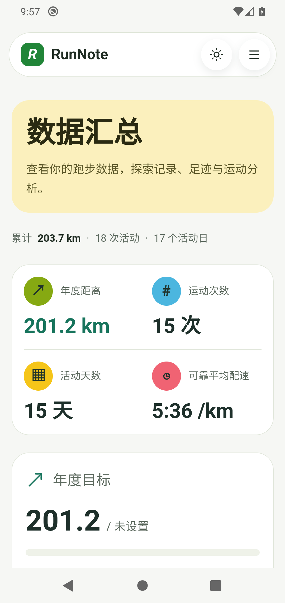
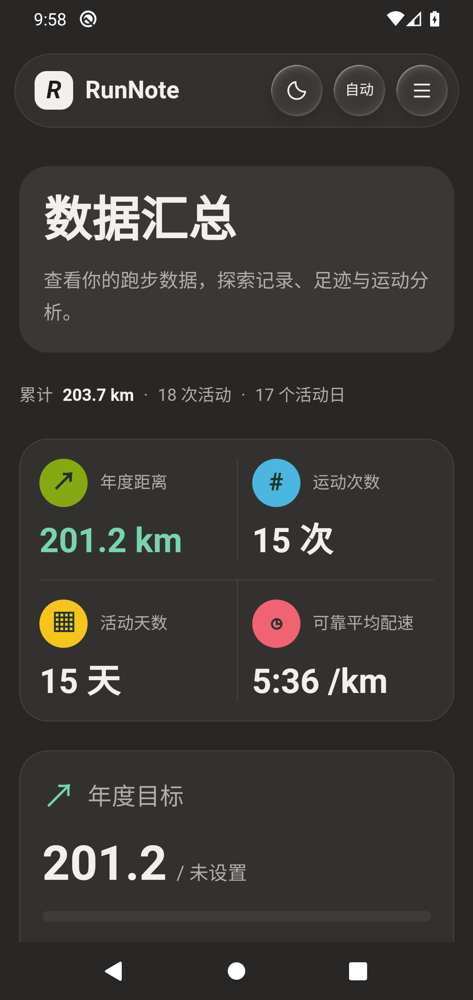
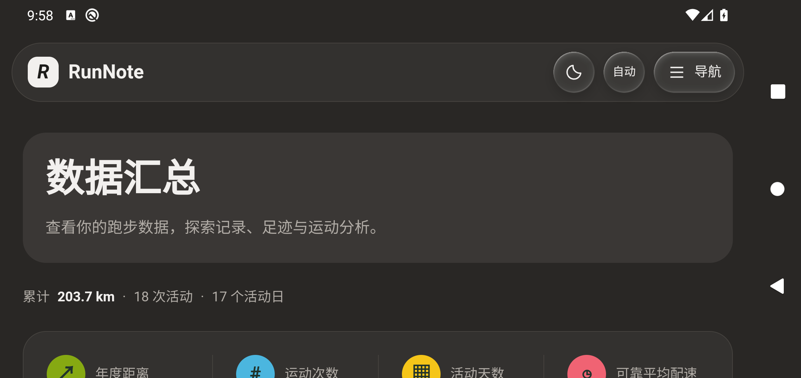
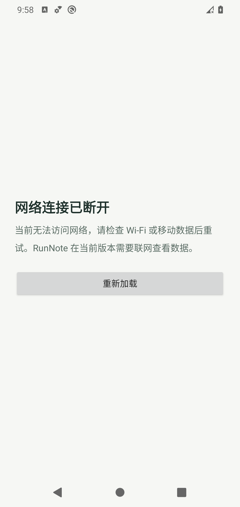
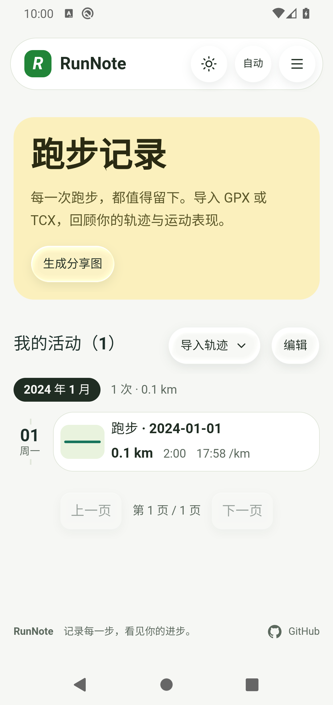
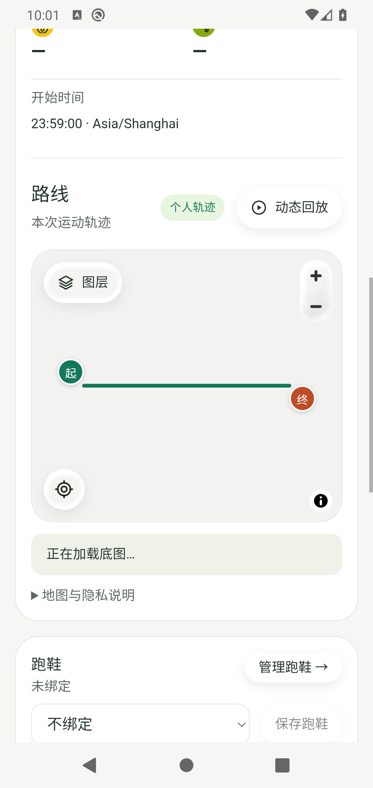
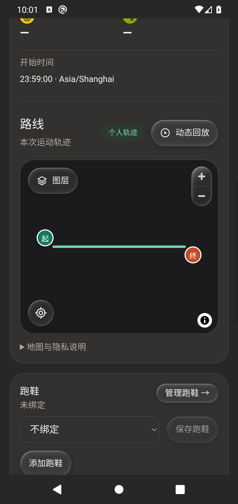
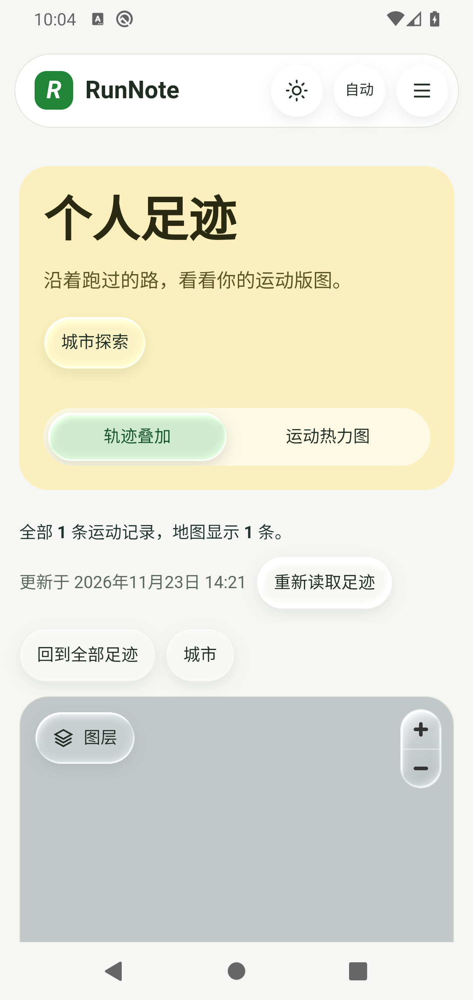

# Android Phase 1：Capacitor 只读 Companion

范围为 #132（父 issue #130），基于 Phase 0 技术验证结论（[95 Phase 0 记录](95-android-capacitor-phase0.md)）与 `main` 基线 `b0ae4de1dc8dd3628a8941af5e31047f8a438960`（v2.2.0）实施。将 Phase 0 调试工程升级为可安装的 Android 只读 Companion，复用同一套 RunNote Web UI，不改 Web SSR 架构、不引入 Android 页面 fork、不进入 Phase 2–3。

## 1. 应用身份、版本与品牌资源

| 项目 | 配置值 | 说明 |
| --- | --- | --- |
| 应用 ID（`applicationId` / `namespace`） | `com.tingchieh.runnote` | 替换 Phase 0 的 `org.runnote.phasezero`（Java 包名、Gradle、Manifest、`strings.xml`、`capacitor.config.json` 与测试包名全部同步）。 |
| 应用名称 | `RunNote` | `strings.xml` 与 `capacitor.config.json` 一致。 |
| 版本号 | `2.3.0`（`versionCode = 20300`） | 与 `backend/pyproject.toml`、`frontend/package.json`、`android/package.json` 同步；`versionCode` 按 `MAJOR * 10000 + MINOR * 100 + PATCH` 递增。 |
| 最低系统 / WebView | Android 10（API 29） / WebView **116+** | 保留 Phase 0 启动前原生检测与中文升级引导页。 |
| 图标与启动页 | RunNote 品牌绿 `#218538` + 白色斜体 `R` | 保守沿用现有 Web 端 `.brand-mark` 视觉标识；启动页与窗口背景匹配 Web `--background`（浅色 `#F6F7F4` / 深色 `#292725`），移除 Capacitor 默认占位图。 |

## 2. 构建、Server URL 注入与签名发布

仓库内**不硬编码** staging 或生产域名，也不提交任何 APK 或 keystore：

- **Server URL 构建时注入**：通过 Gradle 属性 `-Prunnote.serverUrl=<origin>` 或环境变量 `RUNNOTE_SERVER_URL` 注入 `BuildConfig.RUNNOTE_SERVER_URL`，再经 `ServerUrlPolicy` 校验后以代码方式构造 `CapConfig`。
  - `debug` 构建默认回退到 `http://localhost:15297`（仅环回地址允许 HTTP；非环回地址仍强制 HTTPS）。
  - `release` 构建强制要求显式提供非环回 `https://` 源地址；缺失、明文 `http://` 或指向环回地址时 Gradle 在任务图阶段直接失败。
- **网络安全配置**：
  - `release`（`src/main/res/xml/network_security_config.xml` + `android:usesCleartextTraffic="false"`）：禁止明文 HTTP，仅信任系统 CA，不信任用户 CA，关闭 `webContentsDebuggingEnabled`。
  - `debug`（`src/debug/res/xml/debug_network_security.xml`）：仅对环回地址允许明文，并在 `debug-overrides` 中允许用户 CA 便于隔离测试。
- **签名发布**：keystore 与口令文件存放在仓库外（例如 `$HOME/.local/share/runnote-android/keystore/`，目录权限 `0700`，文件权限 `0600`），通过环境变量或 Git 忽略的 `android/native/keystore.properties` 注入：

```sh
pnpm --dir android install --frozen-lockfile
pnpm --dir android sync

# Debug 构建（默认 http://localhost:15297）
(cd android/native && ./gradlew --no-daemon testDebugUnitTest assembleDebug)

# Release 签名构建（强制 HTTPS 与仓外 keystore）
(
  cd android/native && \
  RUNNOTE_SERVER_URL="https://your-runnote.example" \
  RUNNOTE_KEYSTORE_PATH="$HOME/.local/share/runnote-android/keystore/runnote-release.jks" \
  RUNNOTE_KEYSTORE_PASSWORD="<store-password>" \
  RUNNOTE_KEY_ALIAS="runnote" \
  RUNNOTE_KEY_PASSWORD="<key-password>" \
  ./gradlew --no-daemon assembleRelease
)
```

### 本次验证产物指纹（不含密码，APK/keystore 均未入库）

| 产物 | 构建类型 | SHA-256 | 签名与证书指纹 |
| --- | --- | --- | --- |
| `app-debug.apk`（默认环回） | debug | `d71be12cb1f02903eb7797a9aa95aaf0202ea039f4c3d2c17b93447ae525d95b` | Android 默认调试签名 |
| `app-release.apk`（staging HTTPS 验证包） | release | `7dea606bd8ac93c57be6e552b9ca21c69809256d00092558de02bc63f15ee12c` | APK Signature Scheme v3（RSA 4096），证书 SHA-256：`8c3ea62a1b9843f177fb6d15dfbcb06ea419f87bc7d0ee32a9d08f20698f637c` |

## 3. 容器策略与跨平台前端适配

- **导航白名单（`NavigationPolicy` + `RunNoteWebViewClient`）**：
  - 与 `RUNNOTE_SERVER_URL` 严格同源（scheme + host + 有效端口一致）的页面留在 WebView 内；
  - 外部 `http(s)` 链接通过 Chrome Custom Tab（回退至系统浏览器 `ACTION_VIEW`）打开，WebView 保持原页不动；
  - `mailto:` 通过 `ACTION_SENDTO` 交系统邮件应用处理；
  - `javascript:`、`file://`、`content://`、`data:`、`blob:`、`vbscript:`、`intent://`、`about:` 及未知 scheme 全部拦截拒绝。
- **状态栏与安全区适配（`SystemAppearancePlugin` + `SystemBarStyleHelper` + `frontend/src/lib/capacitor-theme.ts`）**：
  - 解决 Phase 0 遗留项：无论跟随系统还是在浅色系统下手动切换 Web 深色模式，系统状态栏与底部导航/手势栏背景色（`#F6F7F4` / `#292725`）及图标对比度均同步切换；屏幕旋转（横/竖屏）后保持生效；内容避开挖孔与系统栏，无横向溢出。
  - 前端仅通过通用 Capacitor 插件接口调用，无 Android 专属分支，便于后续 iOS 复用；同时在容器侧提供针对旧版 Web 部署的轻量级 `data-theme` 兜底监听。
- **返回键与手势（`BackNavigationHelper` + `frontend/src/lib/capacitor-back.ts`）**：
  - 优先级依次为：原生连接错误层 → `<dialog>` → Popover → 移动端导航抽屉 → WebView/SPA 单步历史回退（防连点双导航）→ 根页退出。
- **加载、断网与错误态**：
  - 冷启动/主文档跳转顶部显示轻量进度条；主文档断网、超时或 TLS 校验失败（`onReceivedSslError` 一律 `handler.cancel()`）时展示原生中文提示层（`view_connection_error.xml`），提供「重新加载」与「返回上一页」，且不暴露原始 URL 或堆栈，不覆盖服务端 403/404/500 页面。
  - Web SPA 运行期监听 `online`/`offline` 事件，在 `+layout.svelte` 展示断网提示横幅。
- **文件导入与仅 Web 可用入口**：
  - 沿用 Phase 0 的 `RunNoteWebChromeClient` + `FilePickerIntentHelper`（SAF DocumentsUI，零宽泛存储权限；仅声明 `INTERNET` 与 `ACCESS_NETWORK_STATE`）。
  - 为 GPX/TCX 与 Mi Fitness 的 `<input type="file">` 补充取消选择反馈（`oncancel`）。
  - 在原生 Capacitor 运行时下，对依赖浏览器 `blob:` 下载或 `window.print()` 的海报 PNG 保存（无系统分享能力时）、回放 MP4 视频导出、身心健康报告打印/CSV 导出给出清晰中文说明，避免静默失效按钮；普通 Web 浏览器行为保持 100% 不变。

## 4. 接口、安全与隐私边界

- 不修改任何后端 API 路由、数据库 schema、认证协议或 SSR 代理头白名单。
- 继续使用同源 `HttpOnly; Secure; SameSite=Lax` 的 `__Host-run_session` Cookie + CSRF + Origin，不向 JS 暴露会话（`document.cookie` 为空），不新增 Token，`onPause()`/`onStop()` 主动 `CookieManager.flush()`。
- 不记录密码、Token、Cookie、轨迹坐标或个人资料；所有截图均来自 staging 隔离合成测试账号并经人工核对脱敏。

## 5. 验证环境与实测结果

### 5.1 Android 原生单元测试与构建检查

- 命令：`pnpm --dir android sync && (cd android/native && ./gradlew --no-daemon testDebugUnitTest assembleDebug)`
- 结果：**PASS**，JUnit **21/21** 通过（0 failures / 0 errors）：
  - `WebViewSupportTest`（4/4）、`FilePickerIntentHelperTest`（4/4）——原有 8 项全部保留通过
  - `ServerUrlPolicyTest`（4/4，含最终 app id `com.tingchieh.runnote` 与版本 `2.3.0`/`20300` 断言）
  - `NavigationPolicyTest`（4/4）、`SystemBarStyleHelperTest`（2/2）、`BackNavigationHelperTest`（3/3）
- 签名 release 负向测试：`RUNNOTE_SERVER_URL=http://... ./gradlew assembleRelease` 被 Gradle 拒绝（**PASS**）；`apksigner verify --verbose --print-certs` 验证通过（**PASS**）。

### 5.2 API 29 模拟器全流程验证（393×751 CSS 视口，等效 390×844 竖屏 + 横屏）

- **环境**：API 29 Google APIs x86_64 模拟器（`1080×2280 @ 440 dpi`），`com.google.android.webview 133.0.6943.137`，对接公网可信 CA HTTPS 的 staging 实例与隔离测试账号。
- **签名 Release APK 实测**：
  - 安装校验：`versionCode=20300`、`versionName=2.3.0`、`apkSigningVersion=3`、无 `DEBUGGABLE`、无 `ALLOW_BACKUP`、权限仅 `INTERNET` + `ACCESS_NETWORK_STATE`。
  - 浅色首页与手动切换深色模式：状态栏与导航栏像素色由 `(246, 247, 244)`（`#F6F7F4`）同步切换为 `(41, 39, 37)`（`#292725`），图标对比度同步反色；横屏（`2280×1080`）无破版、无遮挡。
  - 断网与恢复：关闭 Wi-Fi/移动数据冷启动展示 `connection_error_overlay`（“网络连接已断开” + “重新加载”）；恢复网络点击「重新加载」成功进入首页。
- **CDP 联调验证（staging Debug APK，开启 WebView 调试）**：
  - 运行时：`window.isSecureContext === true`、`Capacitor.isNativePlatform() === true`、`Plugins.App` 与 `Plugins.SystemAppearance` 可用、`document.cookie.length === 0`。
  - 认证与会话：登录跳转 `/workspace/dashboard`（`/api/v1/auth/session` 200）；`am force-stop` 重启后会话保持（200）；无 CSRF 退出返回 403，带合法 CSRF 退出返回 200，退出后会话返回 401 且访问 `/workspace/dashboard` 重定向至 `/admin?next=...`。
  - 核心页面：仪表盘、跑步记录列表、活动详情 + MapLibre 路线地图（浅/深色）、个人足迹均正常加载且 `scrollWidth <= innerWidth`（无横向溢出）。
  - 返回键链路：抽屉关闭、底图 Popover 关闭、`<dialog>`（生成分享图）关闭、详情 → 列表 → 仪表盘逐级回退、根页退出至桌面，无双导航或卡死。
  - 外链拦截：点击页脚 GitHub 链接跳转外部 Chrome，WebView 停留在原足迹页。
  - 文件导入（DocumentsUI）：取消选择正常返回应用；选择合成 GPX（`p1_synth_track.gpx`）成功导入后即刻通过 CSRF 删除清理，保持测试账号干净。
  - 控制台与异常：全程 `console_errors = []`、`exceptions = []`。

### 5.3 真机门禁状态（明确标为未完成）

- **真机验证：未完成**。
- 当前接入设备 `F50`（Android 13 / SDK 33，480×854）：系统 `dumpsys webviewupdate` 报告 `Current WebView package is null`、`com.android.webview is NOT installed`，仅预装 Chrome `106.0.5249.126`（`< 116` 且 ROM 不识别 `com.google.android.webview` 替代项），不满足运行条件，**不作为真机通过证据**。需在具备 WebView 116+ 的可用真机（例如此前 Phase 0 的 PKT110）重新接入后补跑真机门禁。

### 5.4 Web / 后端 / 运维回归验证

- 前端：`pnpm test`（69 files / 426 passed）、`pnpm check`（0 errors / 0 warnings）、`pnpm lint:style`（PASS）、`pnpm build`（PASS）、`pnpm format:check`（新增 TS 文件 PASS）。
- 后端：`pytest tests/unit`（586 passed，含 `test_version.py` 2.3.0 同步断言）、`ruff check`（PASS）、`ruff format --check`（PASS）；后端集成测试与真实后端 E2E 因本机未配置独立 `_test` 库 **未在本机运行**（以 PR CI 为准）。
- 运维：`unittest discover -s infra/native/tests`（139 OK）。

### 5.5 脱敏截图（API 29 模拟器）

| 仪表盘（浅色 · Release） | 仪表盘（深色 + 系统栏同步 · Release） | 横屏适配（深色 · Release） | 断网原生错误层（Release） |
| --- | --- | --- | --- |
|  |  |  |  |

| 跑步记录列表 | 活动详情与轨迹地图（浅色） | 活动详情与轨迹地图（深色） | 个人足迹 |
| --- | --- | --- | --- |
|  |  |  |  |

## 6. 已知限制与 Phase 2 / Phase 3 边界

- **已知限制**：
  1. 本期仍依赖在线 `server.url` 加载，离线时仅展示原生断网提示与重试，无本地活动只读缓存。
  2. 原生 WebView 内不支持 `blob:` 直接下载与 `window.print()`，相关导出入口已标注仅浏览器可用（待后续按需接入原生 Share/MediaStore 插件）。
  3. 本次未在可用真机（WebView 116+）上完成真机签收；后续合入前或发布前需补跑真机门禁。
  4. Play 商店对 WebView 容器类应用的功能与体验政策评审仍需在正式上架前单独核对。
- **Phase 2（#133）边界**：接入 Health Connect（Android）/ HealthKit（未来 iOS）只读健康数据导入、权限最小化与去重，并引入离线只读缓存与增量同步（服务端仍保持指标权威）。
- **Phase 3（#134）边界**：接入跨平台后台 GPS 定位、前台服务通知、锁屏/进程恢复与离线轨迹幂等上传，覆盖主流国产 ROM 真机与后台定位政策评审；iOS App 容器也在独立阶段推进。
