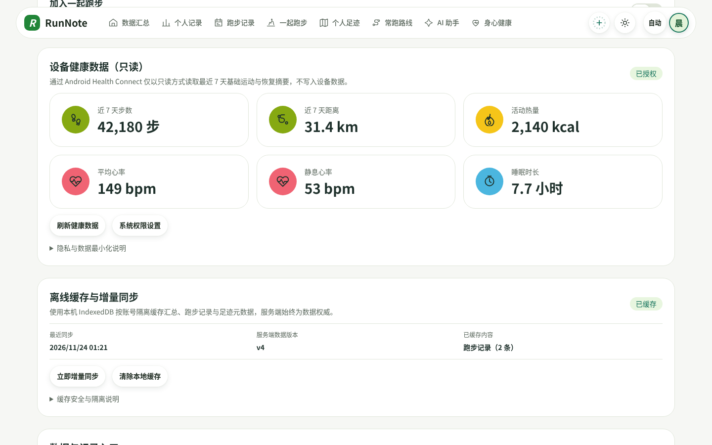
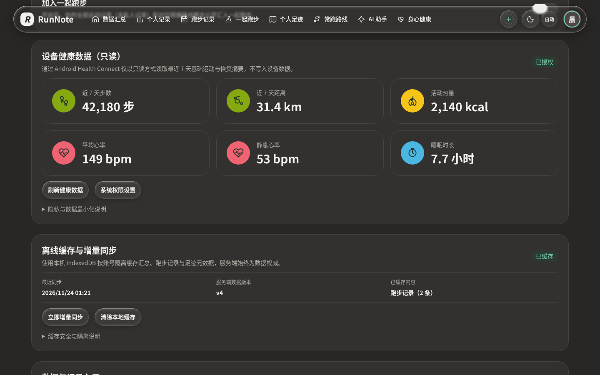
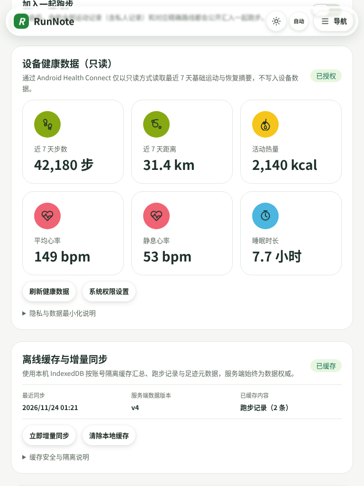
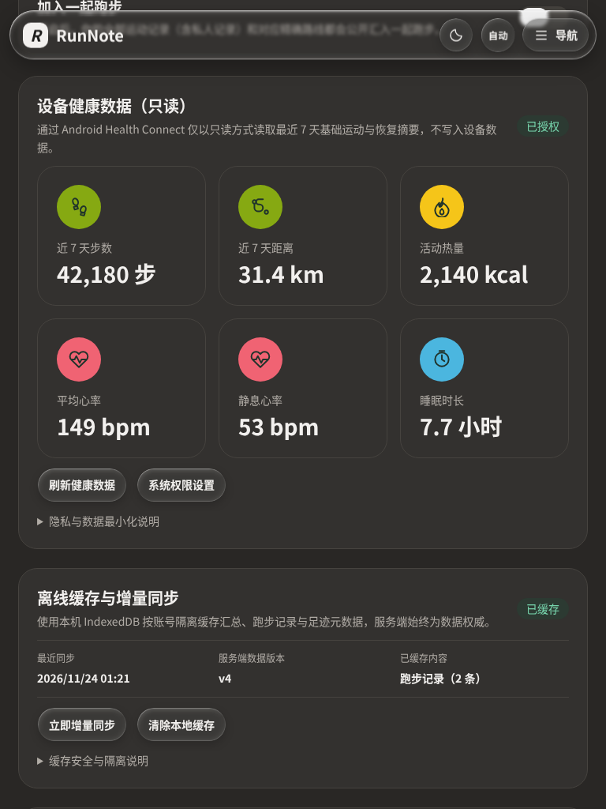
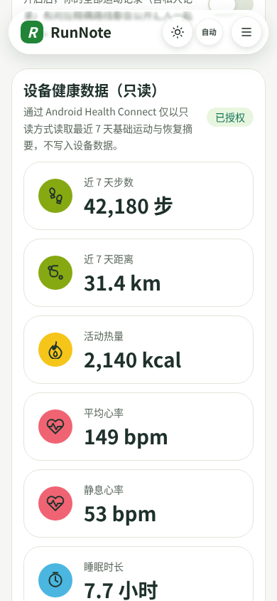
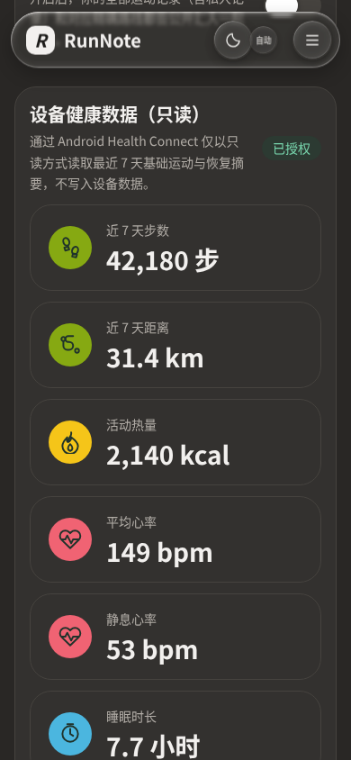

# Android Phase 2：Capacitor 只读健康数据、离线缓存与增量同步

范围为 #133（父 issue #130），基于 Phase 1 基线 `0005ec18`（v2.3.0，见 [97 Phase 1 记录](97-android-capacitor-phase1.md)）实施。将版本同步升级至 **`2.4.0`**（Android `versionCode = 20400`），在不改 Web SSR 架构、不另做原生 UI 的前提下，为 Companion 补齐：

1. Android Health Connect **只读**健康数据桥接（统一 TS 接口预留未来 iOS HealthKit 接入）；
2. 基于 IndexedDB 的按账号隔离离线缓存（数据汇总、活动列表/详情、足迹元数据）；
3. 基于后端 `GET /api/v1/activities/sync`（`activity_data_version` + `updated_at` 游标）的增量同步、分页、去重、删除对齐与断网重试。

## 1. 健康插件选型与最小原生桥接结论

### 1.1 候选 Capacitor 8 插件评估

| 方案 | Capacitor 8 兼容性 | 维护与许可 | 权限清单风险 | 结论 |
| --- | --- | --- | --- | --- |
| `@capgo/capacitor-health` `8.13.0` | 兼容（`>=8.0.0`） | 活跃，MPL-2.0 | 库内 `AndroidManifest.xml` 静态声明 ~45 项权限，包含 ~22 项 **`WRITE_*`** 写入权限以及营养/血糖/血压等无关权限；依赖 `tools:node="remove"` 黑名单剔除，上游次版本升级易重新引入越权风险 | **不采用** |
| `capacitor-health` (`@mley`) `8.4.0` | 兼容（`>=8.0.0`） | 较活跃，MIT | 虽无 `WRITE_*`，但仍声明 `READ_NUTRITION`、`READ_WEIGHT`、`READ_BODY_FAT`、`READ_EXERCISE_ROUTE`（GPS 轨迹），且缺少 RunNote 身心健康页对应的 `READ_SLEEP` 与 `READ_RESTING_HEART_RATE` | **不采用** |
| **仓库内最小只读桥接 `HealthDataPlugin`**（基于官方 `androidx.health.connect:connect-client:1.1.0`） | 原生适配 Capacitor 8.6.2 | 直接跟踪 Google AndroidX 官方 SDK | **严格白名单**：仅声明 6 项只读权限，零 `WRITE_*`、零轨迹/后台读取权限，并由 JUnit 与 `aapt2 dump permissions` 自动门禁校验 | **采用** |

### 1.2 维护成本说明

- Android 原生桥接代码集中在 3 个精简文件（`HealthConnectPolicy.kt`、`HealthDataPlugin.kt`、`HealthPermissionsRationaleActivity.java`，合计约 450 行），直接构建在 Google 官方 Jetpack `androidx.health.connect:connect-client:1.1.0` 之上，不依赖第三方封装层的更新节奏。
- 未来接入 iOS HealthKit 时，仅需在 iOS 工程提供同名 `HealthData` Swift 插件（实现 `getAvailability` / `checkPermissions` / `requestPermissions` / `readSummary` / `openSettings` 5 个方法），**无需改动任何 Svelte 页面或 `frontend/src/lib/capacitor-health.ts` 消费代码**。

### 1.3 最小化只读数据类型与权限

| 统一指标 ID | 展示名称 | Android Health Connect 权限（只读） | 对应 RunNote 业务语义 |
| --- | --- | --- | --- |
| `steps` | 步数 | `android.permission.health.READ_STEPS` | 对应活动 `steps` 与日常运动量 |
| `distance` | 距离 | `android.permission.health.READ_DISTANCE` | 对应活动 `distance_m` |
| `active_calories` | 活动热量 | `android.permission.health.READ_ACTIVE_CALORIES_BURNED` | 对应活动 `calories_kcal` |
| `heart_rate` | 心率 | `android.permission.health.READ_HEART_RATE` | 对应活动平均/最小/最大心率 |
| `resting_heart_rate` | 静息心率 | `android.permission.health.READ_RESTING_HEART_RATE` | 跑者恢复基线参考 |
| `sleep` | 睡眠时长 | `android.permission.health.READ_SLEEP` | 对应身心健康页睡眠时长参考 |

- **严格只读边界**：不声明任何 `WRITE_*` 权限、不暴露写入方法、不申请 `READ_HEALTH_DATA_IN_BACKGROUND` 后台读取、不申请 `READ_EXERCISE_ROUTE` 轨迹权限。
- **分页读取边界**：`HealthDataPlugin` 读取心率（`HeartRateRecord`）、静息心率（`RestingHeartRateRecord`）与睡眠（`SleepSessionRecord`）时通过 `HealthConnectPolicy.collectPages` 循环跟随 `pageToken`（单页 `READ_PAGE_SIZE = 1000`，安全上限 `MAX_READ_PAGES = 50` 且防重复 token 死循环），避免 30 天窗口内超过 1000 条记录被截断。
- **权限说明页**：提供中文原生 `HealthPermissionsRationaleActivity`，同时声明 Android 10–13 的 `androidx.health.ACTION_SHOW_PERMISSIONS_RATIONALE` 与 Android 14+ 的 `android.intent.action.VIEW_PERMISSION_USAGE`（`HEALTH_PERMISSIONS`）。
- **前端状态覆盖**：`web_unavailable`（普通浏览器）、`unsupported`（设备/系统不支持）、`provider_update_required`（需安装或更新 Health Connect）、`not_requested`、`granted`、`partial`、`denied`、`revoked`（系统设置撤销检测）、`empty`（已授权但近 7 天无记录）、`error`。

## 2. 离线缓存架构（IndexedDB）与安全隔离

### 2.1 存储方案选型：IndexedDB vs Capacitor SQLite

选择浏览器标准 **IndexedDB**（`frontend/src/lib/offline-cache.ts`，数据库 `runnote-companion-cache`，`SCHEMA_VERSION = 1`）：

1. **零原生插件耦合**：Phase 0/1 已锁定系统 WebView >= 116（Chromium），且 Web 与移动端共用同一套 SvelteKit 页面；IndexedDB 在桌面浏览器、Android WebView 与未来 iOS WKWebView 行为一致，无需维护 SQLite 原生绑定与双端 DDL 迁移。
2. **结构化 JSON 快照天然匹配**：汇总、活动记录与足迹元数据本身为校验后的强类型 JSON 对象，直接结合现有 `parseSummary`/`parseActivity` 读取校验即可实现损坏自愈。

### 2.2 缓存范围、隔离、TTL 与损坏恢复

- **缓存内容**：
  - 数据汇总（`summary:all`、`summary:<year>`、`calendar:<year>:<metric>`、`trends:<year>:<period>`，TTL 24 小时）；
  - 活动列表与详情（`activity:<id>` 按 `activity_date DESC, id DESC` 排序分页，TTL 7 天）；
  - 足迹元数据（`footprint-meta:<mode>`：仅存 `status`、`generated_at`、`activity_count`、`visible_activity_count`、`grid_size_m` 等轻量字段，**不缓存**数 MB 级完整 GeoJSON 与离线底图瓦片，TTL 24 小时）。
- **明确不缓存**：
  - 任何明文 Token、Cookie、CSRF Token、密码（`assertSafeCachePayload()` 递归拦截敏感键名并拒绝写入）；
  - `wellbeing`（私人身心健康日记、药物、症状与备注，继续保持严格仅服务端与内存草稿）；
  - 原始 GPX/TCX 文件与离线底图瓦片。
- **账号命名空间与清理**：
  - 私有数据统一写入 `user:<userId>:<scope>:*`，匿名公开展示写入 `public:<scope>:*`。
  - 退出登录、收到 `401`、修改密码、或检测到登录用户切换（`ensureAccountCacheIsolation()`）时，立即清空全部 `user:*` 私有缓存并清理健康权限历史标记。
- **损坏恢复**：
  - 读取时校验 `schemaVersion`、`namespace`、`expiresAt` 及领域 Schema 解析器；命中损坏或过期记录自动删除并返回 cache miss。
  - 若 IndexedDB 打开失败或发生版本损坏，自动删库重建并在极端受限环境下优雅退化为内存缓存。

## 3. 增量同步契约（后端与前端）

### 3.1 向后兼容后端接口：`GET /api/v1/activities/sync`

无需数据库迁移（复用既有 `users.activity_data_version`、`activities.updated_at` 与 `activity_segments`）：

- 认证与隔离：使用 `get_read_identity`，严格限定 `Activity.user_id == owner`，响应头 `Cache-Control: private, no-store` 与弱 `ETag: W/"v<data_version>"`；不扩大 SSR 代理 7 个请求头白名单，同步版本通过查询参数 `since_version` 传递。
- 参数：`limit`（1–100，默认 50）、`since_version`（非负整数）、`updated_since`（带时区 ISO 时间戳）、`cursor`（Base64URL 编码的 `(updated_at, id)` 键集分页游标）。
- 行为：
  - 若 `since_version == user.activity_data_version` 且无 `cursor`，直接返回 `unchanged: true, items: []`（短路返回，零列表查询）；
  - 变更时按 `(updated_at ASC, id ASC)` 稳定键集分页，批量查询 `has_route`（零 N+1）；
  - 增量首页附带当前账号活跃 `active_ids`（上限 5000；超限时标记 `full_resync_required: true`）用于客户端清理服务端已删除记录；
  - `PATCH /api/v1/activities/{id}` 同步写入 `activity.updated_at = now`（使用 `request.app.state.clock()`）。

### 3.2 前端同步引擎（`frontend/src/lib/companion-sync.ts`）

- 单飞并发控制（同命名空间并发调用复用同一 Promise，避免重复请求风暴）；
- 跨页键集分页拉取 + 按 `activity.id` 服务端优先去重合并 + `active_ids` 删除对齐；
- **分页上限截断保护与游标续拉**：若单次同步在 `has_more === true` 时触达 `maxPages` 上限，仅合并当前已拉取页并返回 `status: 'partial'`，**不推进** `dataVersion`/`serverTime` 水位、**不执行**全量或部分 ID 裁剪，同时在 `sync:meta` 持久化 `pendingCursor` 与累计全量 ID 集合；下次同步不发送已完成水位、直接沿游标续拉，直至所有尾页完整拉完后才执行删除对齐并推进水位（若续拉期间服务端 `data_version` 漂移则跳过本次裁剪并保持旧版目标水位以触发下一轮校验）。
- 离线自动暂停、恢复联网（`online` 事件）自动触发增量同步；瞬时网络/503 错误按指数退避有限次重试；遇 `401` 立即中止并清空私有缓存。
- 在「设置 → 目标与隐私」（`/settings/preferences`）集成 `CompanionHealthPanel` 与 `CompanionCachePanel`，复用现有 `.aux-panel`、`.settings-block`、`.status-badge`、`FeedbackState` 与 `MetricSummary`，不新增一级导航入口。

## 4. 虚拟测试与验证记录

### 4.1 后端单元测试、契约与隔离 PostGIS 集成测试

- 契约生成与代码风格：
  - `cd backend && .venv/bin/python -m app.contract.typescript`（更新 `frontend/src/lib/api/generated/api.ts`）— **PASS**
  - `.venv/bin/ruff check app migrations tests` / `.venv/bin/ruff format --check app migrations tests` — **PASS**
- 后端单元测试：
  - `DATABASE_URL=postgresql+psycopg://run_note@127.0.0.1:15432/run_note_ci .venv/bin/pytest tests/unit -q` — **593 passed**（含新增 `test_activity_sync.py`、`test_architecture.py`、`test_api_contract.py`、`test_version.py` 2.4.0 同步断言）
- 隔离临时 PostgreSQL 18.3 + PostGIS 集成测试（临时集群端口 `15439`，测试库 `run_note_phase2_test`，完后即销毁，未触碰开发库）：
  - `alembic upgrade head`（`0001_postgis` → `0034_drop_ai_reports`）— **PASS**
  - `.venv/bin/pytest tests/integration/test_activity_sync.py tests/integration/test_cross_user_access.py -v` — **4 passed**（覆盖鉴权 401、键集分页去重、`since_version` 短路、编辑更新、删除对齐、跨用户隔离 404、非法游标/无时区时间 422）
- 运维单元测试：
  - `backend/.venv/bin/python -m unittest discover -s infra/native/tests -v` — **139 tests OK**

### 4.2 前端单元测试、类型/样式检查、构建与 Playwright 合成验证

- `pnpm test` — **72 files / 439 passed**（含新增 `capacitor-health.test.ts`、`offline-cache.test.ts`、`companion-sync.test.ts`（含 `maxPages` 截断不推进水位/不误删尾页及 `full_resync_required` 游标续拉回归）及 `architecture.test.ts`、`api-contract.test.ts`）
- `pnpm check` — **0 errors, 0 warnings**
- `pnpm lint:style` — **PASS**
- `pnpm build` — **PASS**（adapter-node 生产构建通过）
- `pnpm format:check`（改动 TS/Svelte 文件）— **PASS**
- `COMPANION_USE_PROD_BUILD=1 pnpm exec playwright test --config playwright.companion-phase2.config.ts --reporter=list` — **4 passed**（在生产构建上验证网页端 `web_unavailable`、模拟 Capacitor HealthData 插件全权限态、增量同步 + 离线活动/足迹查看 + 退出登录清空私有缓存，以及 6 组无 DEV 浮层、无标题裁切的 Visual QA 视口/主题无溢出校验与截图）
- `pnpm exec playwright test --config playwright.ui.config.ts tests/ui/ui-shell.spec.ts --reporter=list` — **22 passed**（验证在线 503 fail-closed 行为与壳层交互无回归）

### 4.3 Android JUnit、APK 权限审计与模拟器验证

- `pnpm --dir android sync && (cd android/native && ./gradlew --no-daemon testDebugUnitTest assembleDebug)` — **BUILD SUCCESSFUL**，JUnit **28/28 passed**（含 `HealthConnectPolicyTest` 7 项：只读权限白名单、禁止 `WRITE_*`、`AndroidManifest.xml` 权限审计、可用性分类、权限状态计算、30 天时间窗裁剪、合成数据聚合与空状态、以及 `pageToken` 多页拉取/上限截断/重复 token 防死循环边界测试；`ServerUrlPolicyTest` 2.4.0/20400 断言）
- 合并后 Debug APK 权限审计（`aapt2 dump permissions android/native/app/build/outputs/apk/debug/app-debug.apk`）：
  - 仅包含 `INTERNET`、`ACCESS_NETWORK_STATE` 与 6 项 `android.permission.health.READ_*`（**0 项 `WRITE_*`**、**0 项定位/存储/后台健康权限**）；`versionCode=20400`、`versionName=2.4.0`。
- 模拟器验证：
  - 本次会话在本机尝试以无头模式（`-no-window -gpu swiftshader_indirect`）启动 `RunNote_Phase0_API29` 与 `RunNote_Phase0_API36` 均触发 QEMU 模拟器进程段错误（segmentation fault），未能完成模拟器内运行时联调；已如实列为下方未完成项。

### 4.4 视觉检查截图（合成数据，1440×900 / 768×1024 / 390×844 明暗主题）

| 桌面 1440×900（浅色） | 桌面 1440×900（深色） | 平板 768×1024（浅色） |
| --- | --- | --- |
|  |  |  |

| 平板 768×1024（深色） | 手机 390×844（浅色） | 手机 390×844（深色） |
| --- | --- | --- |
|  |  |  |

## 5. 未完成项、限制与回滚说明

- **明确未完成项（不可记为通过）**：
  1. **真机 Health Connect 实测与权限签收：未完成**（本轮按要求以虚拟测试为验收依据；真实 Android 14+ 设备上的系统 Health Connect provider、授权弹窗、真实撤销回调、以及国产 ROM 权限兼容均未在真机验证）。
  2. **Android 模拟器（API 29 / API 36）内运行时安装与 Health Connect provider 联调：未完成**（本机无头启动两个 AVD 均触发段错误；Android 侧逻辑与权限清单由 JUnit 27/27、`assembleDebug`、`aapt2 dump permissions` 与 Playwright 模拟 Capacitor 插件覆盖）。
  3. **真实后端全量 Playwright E2E（`playwright.config.ts`）与签名 Release APK 构建：未在本机运行**（PR CI 将覆盖全量后端集成测试、前端单测/构建/合成 UI 与运维演练）。
- **已知限制**：
  1. 应用仍采用 Phase 1 的 `server.url` 在线加载模式；若在冷启动阶段即断网，仍展示原生断网重试页（离线缓存供应用加载后断网/飞行模式期间继续浏览已缓存的汇总、活动与足迹元数据）。
  2. 离线缓存不保存离线底图瓦片、完整轨迹 GeoJSON 或私人身心健康日记；写操作（导入/编辑/删除）仍要求在线并由服务端保持权威。
- **回滚方式**：
  - 本次改动**无数据库 Schema 迁移**，后端仅新增只读端点 `GET /api/v1/activities/sync`；回滚直接 revert PR 提交并重新构建发布包与 APK 即可，不影响既有数据库与 Web 行为。
