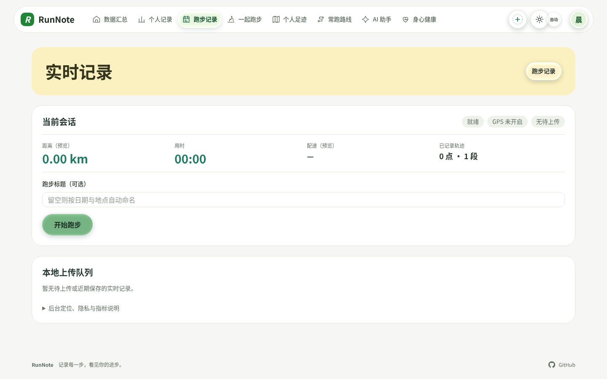
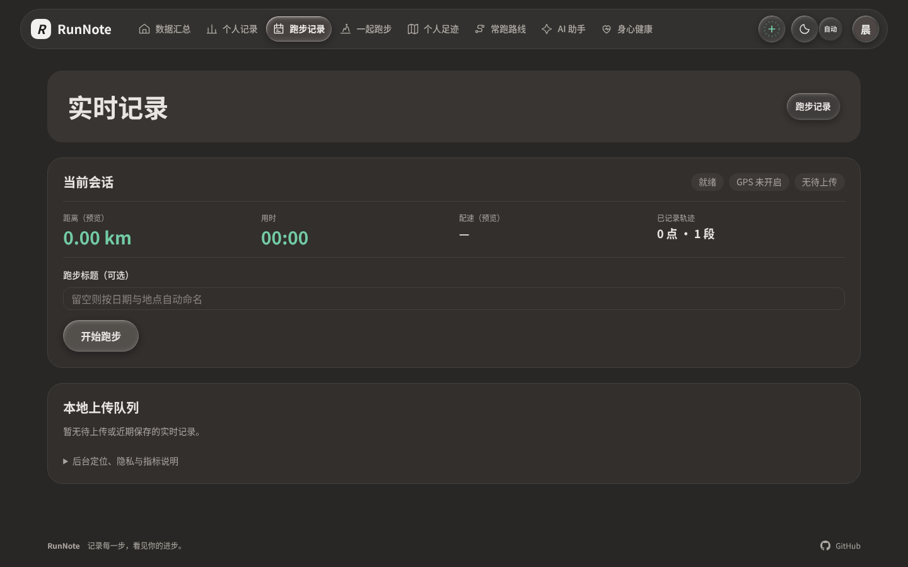

# Android Phase 3：Capacitor 原生运动记录

范围为 #134（父 issue #130），基于 Phase 2 基线 `8aa7131d`（v2.4.0，见 [98 Phase 2 记录](98-android-capacitor-phase2.md)）实施。将版本同步升级至 **`2.5.0`**（Android `versionCode = 20500`），在不改 Web SSR 架构、不重写服务端权威指标算法、不做数据库 Schema 迁移、不重设计全局导航的前提下，交付完整可独立审查的运动记录切片：

1. **跨平台 Web 记录界面（`/activities/record` 与 `/workspace/activities/record`）**：开始、暂停、继续、结束、放弃确认；距离（预览）、用时、配速（预览）、轨迹点数/段数、GPS 状态与上传状态；权限拒绝、定位关闭、大致位置、通知拒绝、GPS 丢失、离线模式、进程终止恢复与防误退出保护；复用 RunNote 设计系统令牌与组件，适配 390×844 / 768×1024 / 1440×900 与浅/深色主题。
2. **Android 原生后台定位与前台服务（`LocationRecorderPlugin` + `RecordingForegroundService` + `LocationRecordingPolicy`）**：主动记录期间启动 `foregroundServiceType="location"` 的前台服务并展示常驻通知，支持锁屏、切后台与 Doze 期间持续记录与即时落盘；严格接口解耦以便未来 iOS（Core Location）直接复用同一套 Web UI。
3. **本地轨迹、账号隔离队列与零迁移幂等上传**：复用现有 `POST /api/v1/gpx-imports` 端点并扩展可选 `Idempotency-Key`（UUID）头实现真正服务端幂等重放与冲突检测；断网/飞行模式记录后在恢复网络时自动上传一次，失败按指数退避重试，退出登录或切换账号立即清空本机草稿与队列。

---

## 1. 架构决策与后台 GPS 插件选型

### 1.1 候选跨平台后台 GPS 方案评估

| 方案 | Capacitor 8 兼容性 | 许可与依赖 | 权限、隐私与恢复能力评估 | 结论 |
| --- | --- | --- | --- | --- |
| `@capacitor-community/background-geolocation` | 未官方声明支持 Capacitor 8.6.2，依赖 Play Services (`play-services-location`) | MIT，但绑定 GMS | 强依赖 Google Play Services，AOSP/无 GMS 设备不可用；缺乏针对 RunNote 暂停分段（`<trkseg>`）、账号隔离及崩溃截断行容错的原子持久化 | **不采用** |
| `@transistorsoft/capacitor-background-geolocation` | 支持 | 商业闭源许可（Android Release 需付费 License Key） | 与 MIT 开源项目 RunNote 许可冲突，且引入高复杂度闭源黑盒状态机与冗余权限 | **不采用** |
| `@capacitor/geolocation` | 支持 | MIT | 仅限前台定位，无 Android Foreground Service，锁屏/切后台/Doze 会立即被系统中断 | **不采用** |
| **仓库内最小原生桥接 `LocationRecorderPlugin` + `RecordingForegroundService`** | 原生适配 Capacitor 8.6.2 | MIT（零第三方商业依赖，零 GMS 强依赖） | 基于 Android 标准框架 `LocationManager` + `ServiceCompat.startForeground(..., FOREGROUND_SERVICE_TYPE_LOCATION)`；精确控制最小权限白名单、零坐标日志、每点即时落盘 NDJSON 崩溃恢复与账号隔离；对外暴露平台无关 `LocationRecorder` 合约，未来 iOS 直接以 Core Location (`allowsBackgroundLocationUpdates`) 实现同名 Swift 插件即可复用 100% Web UI | **采用** |

### 1.2 Web / SSR 与未来 iOS 复用边界

- **Web SSR 硬约束**：`frontend/src/lib/capacitor-recorder.ts` 在非原生环境（SSR 与普通浏览器）下绝不访问原生桥接；在标准浏览器中优雅回退为前台 `navigator.geolocation` 模式并提示“浏览器切后台或锁屏可能暂停定位，后台持续记录请使用 Android 客户端”。
- **未来 iOS 对接面**：`frontend/src/lib/capacitor-env.ts` 定义了平台无关的 `CapacitorLocationRecorderPlugin` 接口（`getCapabilities`、`checkPermissions`、`requestPermissions`、`openAppSettings`、`openLocationSettings`、`startSession`、`pauseSession`、`resumeSession`、`stopSession`、`discardSession`、`getSessionState`、`getSessionPoints`、`clearAccountSessions`、`addListener('sessionUpdate', ...)`）。未来接入 iOS 时只需实现 Swift 插件，**无需修改任何 Svelte 页面、序列化器或上传队列**。

---

## 2. 权限清单、隐私边界与前台/后台定位政策评审

### 2.1 Android Manifest 最小权限清单（经 `aapt2 dump permissions` 核实）

| 权限 | 适用 API | 用途 | 政策说明 |
| --- | --- | --- | --- |
| `android.permission.ACCESS_FINE_LOCATION` | API 29+ | 跑步精确 GPS 轨迹采集 | 仅在用户主动点击「开始跑步」或授权时申请 |
| `android.permission.ACCESS_COARSE_LOCATION` | API 31+ | Android 12+ 需与 `FINE` 联合申请 | 若用户仅授予大致位置，UI 显式提示开启精确位置 |
| `android.permission.FOREGROUND_SERVICE` | API 29+ | 运行运动记录前台服务 | 仅在主动记录会话期间运行 |
| `android.permission.FOREGROUND_SERVICE_LOCATION` | API 34+ | Android 14+ 声明位置型前台服务 | 与 `<service android:foregroundServiceType="location" android:exported="false" />` 一致 |
| `android.permission.POST_NOTIFICATIONS` | API 33+ | 展示常驻运动进度通知 | 若用户拒绝，前台服务仍正常运行，UI 提示状态栏通知已隐藏 |

### 2.2 Google Play 后台定位与前台服务政策评审结论

- **刻意不声明 `ACCESS_BACKGROUND_LOCATION`**：根据 Google Play 位置权限政策与 Android 10–16 官方规范，仅由用户在前台主动触发、并伴随可见常驻通知的 `foregroundServiceType="location"` 前台服务，**天然享有锁屏与切后台持续定位能力，无需申请「始终允许（`ACCESS_BACKGROUND_LOCATION`）」**，从而避免不必要的后台常驻定位审查风险与隐私过度索权。该约束已由 JUnit `LocationRecordingPolicyTest.manifestDeclaresMinimalForegroundLocationPermissionsAndNoBackgroundLocation` 与 `aapt2 dump permissions` 门禁双重强制。
- **Android 14–16 前台服务启动限制合规**：
  - `RecordingForegroundService` 使用 `START_NOT_STICKY`，绝不在 `BOOT_COMPLETED` 或后台静默拉起位置前台服务（避免触发 `ForegroundServiceStartNotAllowedException`）。
  - 每次启动前显式校验定位权限与系统定位开关；捕获 `SecurityException` 与 `IllegalStateException` 转为 `interrupted` 可恢复态而不崩溃。
- **「仅本次允许」（Android 11+ One-Time Permission）处理**：
  - 运动期间前台服务运行中权限保持有效；若服务中止、或用户在系统设置中中途撤销权限，服务捕获 `SecurityException` 或心跳检测到失权后立即落盘所有已采轨迹点、将状态标记为 `interrupted`（`interruptedReason="permission_revoked"`），恢复应用后展示显式恢复面板，绝不丢弃已有轨迹。
- **隐私与零敏感日志保证**：
  - 原生 `Logger`（`RunNoteRecorder`）与前端代码**绝不输出**经纬度坐标、海拔、原始 GPX、Cookie、CSRF Token 或健康数据（API 29 / 单测与代码审计确认 0 泄露）。
  - 应用私有存储 `files/recordings/` 受 `android:allowBackup="false"` 保护，不参与系统云备份；本地 IndexedDB 队列由 `assertSafeCachePayload()` 拦截敏感键名；退出登录、401 或切换账号时清空私有记录数据与原生会话文件，严防串账号。

---

## 3. 幂等上传契约（复用现有接口，零数据库迁移）

### 3.1 后端契约：`POST /api/v1/gpx-imports`（新增可选 `Idempotency-Key` 头）

无需新增表或 Alembic 迁移，直接复用既有 `POST /api/v1/gpx-imports`、`GpxImport`（唯一索引 `uq_gpx_imports_owner_raw` / `uq_gpx_imports_owner_canonical`）、每用户 `pg_try_advisory_lock` 导入互斥锁，以及 SSR 代理已放行的 7 个标准请求头白名单（其中已包含 `idempotency-key`）：

| 场景 | 请求条件 | 服务端行为 | HTTP 状态 |
| --- | --- | --- | --- |
| 普通导入（兼容旧行为） | 不带 `Idempotency-Key` | 原有创建/去重逻辑完全不变 | `201` / `409 GPX_DUPLICATE` |
| 非法键格式 | `Idempotency-Key` 非合法 UUID | FastAPI 参数校验直接拒绝（解析前） | `422 VALIDATION_ERROR` |
| 首次实时记录上传 | 合法 UUID `Idempotency-Key` + 有效 GPX | 创建 `Activity` + `GpxImport`（内部 `original_filename="idempotency:<uuid>.gpx"`，仅本人私密、不公开）+ `ActivitySegment`/`ActivityPoint`，递增 `activity_data_version` | `201 Created`（`ApiResponse[ImportView]`） |
| 重复提交 / 弱网重放 | 同账号 + 同 `Idempotency-Key` + 相同 GPX 字节（`raw_sha256` 一致） | 不新建活动、不重复递增 `activity_data_version`，单次聚合查询还原同一 `ImportView` 返回（零 N+1） | `200 OK`（同一 `activity.id` 与 `import_id`） |
| 键冲突误用 | 同账号 + 同 `Idempotency-Key` + 不同 GPX 内容 | 拒绝覆盖已有记录 | `409 IDEMPOTENCY_CONFLICT` |
| 跨账号提交同键同轨迹 | 用户 B 使用与用户 A 相同的 `Idempotency-Key` 和 GPX | 严格按 `user_id == owner` 隔离，为用户 B 创建独立活动，不泄露用户 A 的任何 ID | `201 Created`（独立 `activity.id`） |

- **服务端指标权威**：前端记录界面的距离与配速明确标注为“预览”（Haversine 估算）；结束生成确定性 GPX 1.1（暂停/继续自动拆分为独立 `<trkseg>`，确保 PostGIS 不跨暂停段连线）并以 `time_mode="absolute"` 上传，最终里程、用时、配速、路线与足迹全部由服务端 PostGIS 管线权威计算。

### 3.2 本地上传队列与退避重试

- **确定性序列化（`frontend/src/lib/gpx-serializer.ts`）**：同一已完成会话重复序列化产生字节级完全一致的 GPX 1.1（7 位小数坐标、ISO-8601 UTC 时间戳），保证重试时 `raw_sha256` 与 `canonical_sha256` 严格一致。
- **退避策略（`frontend/src/lib/recording-uploader.ts`）**：单飞并发控制；离线自动暂存、恢复联网（`online` 事件）自动触发一次上传；遇 `503`/`429`/网络超时执行指数退避（`5s → 15s → 45s → 120s → 300s`）；遇 `409 GPX_DUPLICATE`（含 `existing_activity_id`）直接幂等关联已有活动；遇 `401` 暂停队列提示重新登录而不静默丢弃用户轨迹；遇 `400`/`422` 永久校验错误停止无限重试并允许用户显式丢弃。上传成功后立即释放本地原始 GPX 文本并触发 `runnote-activities-changed` 驱动 Phase 2 增量同步。

---

## 4. 失败与异常恢复矩阵

| 故障 / 场景 | 本地持久化与原生行为 | 前端可见状态与恢复操作 | 数据完整性保证 |
| --- | --- | --- | --- |
| 定位权限拒绝 | 不启动前台服务 | 展示「未授予定位权限」错误卡片，提供「请求定位权限」与「打开应用设置」 | 无崩溃，可重新授权 |
| 仅授予大致位置（Android 12+） | 允许记录但标记 `preciseLocation=false` | 展示「当前仅授予了大致位置权限」提示与系统设置入口 | 不阻断，但明确告知精度风险 |
| 通知权限拒绝（Android 13+） | 前台服务仍可运行，通知被系统隐藏 | 展示「通知权限未开启」提示与「打开通知设置」 | 记录不中断 |
| 系统定位开关关闭 | 拒绝启动；记录中关闭触发 `onProviderDisabled` | 展示「系统定位服务已关闭」+「打开定位设置」；常驻通知同步提示 | 已采点位已落盘保留 |
| GPS 信号丢失（> 15s 无定位） | 心跳检测置 `gpsStatus="lost"`，常驻通知更新 | 展示「GPS 信号暂时丢失」告警，引导移至空旷处 | 已有轨迹点不受影响 |
| 锁屏 / 切后台 / Doze | `RecordingForegroundService` 持续接收定位并即时追加写入 `points.ndjson` | 回到前台通过 `handleOnResume()` + `visibilitychange` 无缝同步最新指标 | 0 数据丢失 |
| 记录中按返回键 / 跳转其他页 | 原生端前台服务继续运行；Web 端提示会暂停采集 | 弹出原生 `<dialog>` 确认框，支持「留在记录页」或「确认离开」 | 防误操作中断 |
| 进程被杀 / 系统内存回收 / 设备重启 | 重启后检测到磁盘存在未结束会话且服务未运行，自动归类为 `interrupted`（`points.ndjson` 跳过电力中断导致的截断尾行） | 顶部展示「检测到未完成的跑步记录」恢复面板，明确提供 **继续记录**（新 `<trkseg>`）、**结束并保存** 或 **安全丢弃**（二次确认 `<dialog>`） | 绝不静默丢数据 |
| 飞行模式 / 断网完成记录 | 生成 GPX 并写入账号隔离 IndexedDB 队列 | 提示「已保存到本地上传队列，恢复网络后自动上传一次」，队列标为「等待联网」 | 恢复网络后自动仅上传一次 |
| 退出登录 / 切换账号 | 停止活动服务并调用 `clearPrivateRecordingData()` + `clearAccountSessions()` | 清理旧账号全部本机记录与未上传队列 | 绝不串账号上传或泄露轨迹 |

---

## 5. 验证命令与真实执行结果

### 5.1 后端单元测试、契约校验、Ruff 与隔离 PostGIS 集成测试

- 契约生成与代码检查：
  - `cd backend && DATABASE_URL=postgresql+psycopg://run_note@127.0.0.1:15432/run_note_ci .venv/bin/python -m app.contract.typescript` — **PASS**（同步 `frontend/src/lib/api/generated/api.ts`）
  - `cd backend && .venv/bin/ruff check app migrations tests && .venv/bin/ruff format --check app migrations tests` — **PASS**（`All checks passed! 294 files already formatted`）
- 后端单元测试：
  - `cd backend && DATABASE_URL=postgresql+psycopg://run_note@127.0.0.1:15432/run_note_ci .venv/bin/pytest tests/unit -q` — **597 passed**（含新增 `test_gpx_idempotency.py`、`test_architecture.py`、`test_api_contract.py`、`test_version.py` 2.5.0 同步断言）
- 隔离临时 PostgreSQL + PostGIS 集成测试（临时集群端口 `15449`，测试库 `run_note_phase3_test`，测后自动销毁，未触碰开发库）：
  - `alembic upgrade head`（确认零新增迁移，`0001_postgis` → `0034_drop_ai_reports`）— **PASS**
  - `.venv/bin/pytest tests/integration/test_gpx_import.py tests/integration/test_cross_user_access.py -v` — **55 passed**（含新增 `test_gpx_import_idempotency_replay_conflict_isolation_and_no_n_plus_one`：覆盖非法 UUID 422、首次上传 201、重复提交 200 重放且不增版本号且 SQL 次数 `<= 12` 无 N+1、同键不同载荷 409 `IDEMPOTENCY_CONFLICT`、跨用户同键同轨迹完全隔离 201）
- 运维脚本单元测试：
  - `backend/.venv/bin/python -m unittest discover -s infra/native/tests -q` — **139 tests OK**

### 5.2 前端单测、类型/样式检查、生产构建与 Playwright 端到端/视觉验收

- `cd frontend && pnpm check` — **PASS**（`0 errors and 0 warnings`）
- `cd frontend && pnpm lint:style` — **PASS**
- `cd frontend && pnpm test` — **PASS**（**76 test files passed**，含新增 `gpx-serializer.test.ts`、`recording-store.test.ts`、`recording-uploader.test.ts`、`capacitor-recorder.test.ts` 与既有 `architecture.test.ts`、`api-contract.test.ts`）
- `cd frontend && pnpm build` — **PASS**（`@sveltejs/adapter-node` 生产 SSR 构建通过）
- `cd frontend && COMPANION_USE_PROD_BUILD=1 PHASE3_CAPTURE_SCREENSHOTS=1 pnpm exec playwright test --config playwright.companion-phase3.config.ts --reporter=list` — **5 passed**（生产构建上验证未登录重定向、Web 前台模式、权限拒绝/大致位置/通知拒绝/定位关闭、GPS 搜星/良好/丢失/暂停/继续/返回键防误退/断网暂存/联网单次幂等上传、进程被杀恢复与二次确认丢弃、以及 390×844 / 768×1024 / 1440×900 明暗主题零横向溢出）
- `cd frontend && COMPANION_USE_PROD_BUILD=1 pnpm exec playwright test --config playwright.companion-phase2.config.ts --reporter=list` — **4 passed**（Phase 2 无回归）
- `cd frontend && pnpm exec playwright test --config playwright.ui.config.ts tests/ui/ui-shell.spec.ts --reporter=list` — **PASS**（壳层交互无回归）

### 5.3 Android 原生构建、JUnit 单测、APK 权限审计与 API 29 模拟器实测

- **Gradle 构建与单测**：`pnpm --dir android sync && (cd android/native && ./gradlew --no-daemon testDebugUnitTest assembleDebug)` — **BUILD SUCCESSFUL**，JUnit **32/32 passed**（含新增 `LocationRecordingPolicyTest` 4 组完整用例：Manifest 最小权限与禁用 `ACCESS_BACKGROUND_LOCATION` 审计、API 29–36 权限与 FGS 类型评估、GPS 信号分级与精度/速度跳变/分段过滤、原子落盘/截断尾行容错/进程被杀状态归类/账号切换清理；`ServerUrlPolicyTest` 2.5.0 / 20500 断言）。
- **合并后 Debug APK 权限审计（`aapt2 dump permissions android/native/app/build/outputs/apk/debug/app-debug.apk`）**：
  - 仅包含 `INTERNET`、`ACCESS_NETWORK_STATE`、6 项 `android.permission.health.READ_*`（0 项 `WRITE_*`）、`ACCESS_FINE_LOCATION`、`ACCESS_COARSE_LOCATION`、`FOREGROUND_SERVICE`、`FOREGROUND_SERVICE_LOCATION`、`POST_NOTIFICATIONS`（**0 项 `ACCESS_BACKGROUND_LOCATION`**、**0 项宽泛存储权限**）；`versionCode=20500`、`versionName=2.5.0`。
- **API 29 模拟器运行时实测（`RunNote_Phase0_API29`，`-no-window -gpu off`，WebView `133.0.6943.137`，`adb reverse tcp:15297` 对接本地生产 SSR + 合成 API）**：
  - 安装与启动：`com.tingchieh.runnote`（`versionCode=20500`、`versionName=2.5.0`）安装成功；CDP 确认 `Capacitor.isNativePlatform() === true`、`Plugins.LocationRecorder` 与 `Plugins.HealthData` 均已注册、`document.cookie.length === 0`。
  - 权限与能力：`getCapabilities()` 返回 `platform="android", backgroundSupported=true, requiresNotificationPermission=false, sdkInt=29`；`checkPermissions()` 返回 `location="granted", notification="not_required", preciseLocation=true, canRecord=true`。
  - 前台服务与常驻通知：经 WebView CDP 调用 `LocationRecorder.startSession(...)` 后，`dumpsys activity services` 确认 `RecordingForegroundService` 运行在真实前台服务态（`isForeground=true foregroundId=30501`），`dumpsys notification` 确认常驻通知通道 `channel=runnote_recording category=workout vis=PUBLIC` 正常展示；同时验证外部直接 `am start-foreground-service` 因 `android:exported="false"` 被系统权限拦截。
  - 锁屏后台 GPS 落盘与强杀恢复：锁屏（`KEYCODE_POWER`）后通过 `adb emu geo fix` 注入合成定位点，确认 `files/recordings/active_session.json` 与 `files/recordings/points.ndjson`（3 条定位记录）即时落盘；执行 `am force-stop com.tingchieh.runnote` 模拟进程强杀并唤醒重启应用后，`LocationRecorder.getSessionState()` 正确返回 `status="interrupted"`、`interruptedReason="process_terminated"`、`pointCount=3`、`activeDurationMs=2350`（并由此实测发现且修复了 `+layout.svelte` 冷启动匿名态误清中断会话的真实缺陷）。
  - 隐私日志审计：`adb logcat -d -s RunNoteRecorder:* Capacitor:*` 检索全部合成坐标，确认 **`PII_COORDINATE_LEAKS=0`**。

### 5.4 视觉验证截图（合成数据，生产构建，明暗主题）

| 手机 390×844（浅色 · 就绪） | 手机 390×844（深色 · 记录中） | 平板 768×1024（深色） |
| --- | --- | --- |
|  |  |  |

| 平板 768×1024（浅色） | 桌面 1440×900（浅色） | 桌面 1440×900（深色） |
| --- | --- | --- |
|  |  |  |

---

## 6. 未关闭门禁、未运行检查与已知限制（如实标注，不声称通过）

1. **真机验证（PKT110 / Android 17 / WebView 144）：未完成**。
   - 本机当前 USB 连接设备为 `F50`（Android 13 / SDK 33，`dumpsys webviewupdate` 缺少 WebView 116+，见 [97 Phase 1 记录](97-android-capacitor-phase1.md)）；`PKT110` 未接入，无法在本机执行真机飞行模式记录→恢复网络单次上传、真机锁屏/切后台/杀进程/重启、真实 GPS 丢失与真机安全区验证。待接入 `PKT110` 后补跑真机签收门禁。
2. **国产 ROM 后台保活与杀进程实测（MIUI/HyperOS、ColorOS、OriginOS、HarmonyOS）：未验证**。
   - 当前无对应真机，已明确标注为未验证项。
3. **API 29 模拟器补充说明**：使用 `-gpu off` 已在 API 29 模拟器完成安装、WebView 133 加载、前台服务（`isForeground=true` + 常驻通知）、锁屏落盘、`am force-stop` 强杀恢复与 0 坐标日志泄露验证；但无头 `-gpu swiftshader_indirect` 模式在本机仍触发 QEMU 段错误，且模拟器 GPS 移动轨迹距离增长与完整飞行模式真机断网重连链仍需在真机（PKT110）上闭环签收。
4. **全量真实后端 Playwright E2E（`playwright.config.ts`）与签名 Release APK 构建：未在本机运行**（PR CI 将覆盖全量后端集成测试、前端单测/构建/合成 UI 与运维演练）。
5. **已知限制**：
   - 应用沿用 Phase 1/2 的在线 `server.url` 加载模式；若在冷启动阶段即完全断网且页面未加载，需联网加载一次页面后方可在离线/飞行模式下发起并暂存记录。
   - 本期不实现 iOS App / Core Location、不写 Health Connect/HealthKit、不做离线底图、实时位置分享或语音播报。
   - **回滚方式**：无数据库 Schema 迁移，后端仅对现有 `POST /api/v1/gpx-imports` 增加了向后兼容的可选 `Idempotency-Key` 头；直接 revert PR 提交并重新构建发布包与 APK 即可安全回滚。
