# Editorial Receipt：品牌与界面规范

> 状态：**负责人已确认（决定见 §12），按页迁移中**。第 1 阶段已实施：令牌与共享样式、`PageHeader`、数据汇总页（`/dashboard`）。其余页面在迁移前仍以 [tokens.md](tokens.md)、[components.md](components.md)、[patterns.md](patterns.md) 描述的代码事实为准。本文是 Editorial Receipt 落地的单一事实来源。
> 依据：负责人写入 [README](README.md) 的 Editorial Receipt 品牌语言（`main @ 734a038`）、年度/回顾分享图实现、[Web 审计](web-audit.md)、[移动端方案](../mobile-ui-design/README.md)。
> 原型：[prototypes/index.html](prototypes/index.html)（Web 6 页、Mobile 6 屏、浅/深色）。

## 0. 文档分工（单一事实来源）

| 问题 | 唯一来源 | 说明 |
| --- | --- | --- |
| 品牌语言、场景边界、Agent 流程 | [README.md](README.md) | 负责人维护的总纲；本文不重复，只落地 |
| 品牌原则、拟议令牌增量、排版/网格/图表/组件/状态规则、三端共享与差异 | **本文** | 实施后，增量令牌并入 tokens.md，本文 §3 改为引用 |
| 当前令牌实际值 | [tokens.md](tokens.md) → `frontend/src/app.css` | 代码事实；本文 §3 的"现有"列与之一致 |
| 组件 API、页面模式 | [components.md](components.md)、[patterns.md](patterns.md) | 实施时按本文 §6 更新对应条目 |
| 移动端信息架构、导航模型、记录流状态机、真机清单 | [mobile-ui-design/README.md](../mobile-ui-design/README.md) | **视觉部分以本文为准**（见该文顶部说明） |
| Web 现状诊断 | [web-audit.md](web-audit.md) | 一次性审计记录 |

## 1. 品牌命题与原则

**Every run leaves a receipt.** RunNote 是一份个人跑步档案：每次跑步留下一张可核对的小票，周期结束时汇总成账页。界面的权威感来自真实数字与地图，而不是装饰。

1. **数字是主角。** 每页有且只有一个主数字（年度里程、本次距离、周跑量），96–120px、等宽数字、紧字距；其他数字按 28 / 20 / 16 三档退让。
2. **排版建立层级，而不是容器。** 只有主区块（每页的主数字/里程碑、趋势、地理）用 2px 墨色节线开头；次级分组（目标、个人记录、日历、浏览）用 1px 发丝线或留白；行用发丝线分隔，列用竖发丝线。卡片只留给真实的分组、交互边界或状态，不画装饰性圆角卡。
3. **印刷感来自克制。** 只用一种强调色（`--primary`）、一种标记色（票据黄）；单位用等宽小写；柱子直角、细；没有渐变、彩色图标底座、环形进度和投影卡片。
4. **票据元素按场景使用。** 黄色票头、打孔虚线、点线引导、锯齿边只出现在"票据页"（§2）；操作型界面以可用性为先。
5. **真实数据，不虚构图形。** 图表必须对应真实字段；打孔方块、印刷条是数据的刻度化表达，不是装饰。缺失值写 `—` 并附读屏说明。

去掉 Logo 后的识别要素：① 暖白纸色 + 墨绿字 + 唯一的票据黄标记；② 超大等宽主数字配等宽小写单位（`km`、`/km`）；③ 2px 墨色节线 + 发丝线的账页结构；④ 直角细柱、峰值黄、进行中斜线的图表语言；⑤ 票据页的黄票头与打孔。

## 2. 场景分级

| 级别 | 页面 | 允许的票据元素 | 不允许 |
| --- | --- | --- | --- |
| **票据页** | 跑步详情、跑步完成、月度/年度回顾、年度故事、分享图 | 黄色票头（日期/时段/周期）、票据纸面 `--paper`、打孔虚线 + 侧缺口、点线引导、每公里印刷条、打孔方块节律；锯齿边仅完成页与分享图；印章仅分享图（沿用现有实现） | 每页重复多个票头；把操作按钮放进票据纸 |
| **档案页** | 数据汇总、跑步记录、个人足迹、个人记录、常跑路线 | 节线 + 发丝线、大数字、印刷柱、热力日历 | 黄票头、打孔、点线引导、锯齿、印章、英文编号眉题 |
| **操作页** | 设置、导入、编辑、站点与用户管理、身心健康录入 | 节线分组、标准控件 | 任何票据元素；大数字装饰 |
| **记录中** | 准备开跑、记录中、暂停 | 无 | 装饰、地图（记录中）、表单、品牌色块；见 §6.9 |

英文等宽编号（`01 ·`、`ANNUAL RECEIPT`）只在分享图与回顾的"章节"里出现，因为那里编号表达顺序；其他页面用中文标题。

## 3. Design Tokens

命名延续 `app.css`，**不建 `--ds-*` 平行色板**。"现有"= 第 1 阶段前已在 `app.css`；"已新增"= 第 1 阶段加入 `app.css`（实际值见 [tokens.md](tokens.md)）；"拟调整/拟停用"= 随各页迁移落地，不做全局切换。所有颜色值均取自 `app.css` 或分享图渲染器。

### 3.1 颜色 · 品牌与表面

| Token | 浅色 | 深色 | 状态 | 用途 |
| --- | --- | --- | --- | --- |
| `--background` | #f6f7f4 | #292725 | 现有 | 页面纸色 |
| `--surface` | #ffffff | #33312f | 现有（拟收窄） | 只用于输入框、弹层、SaveBar；内容区不再使用 |
| `--recap-paper` → 别名 `--paper` | #fcfcf7 | #312f2c | 现有 / 别名已新增 | 票据纸面 |
| `--recap-desk` → 别名 `--desk` | #eaece4 | #201e1c | 现有 / 别名已新增 | 票据背后的桌面（完成页、分享图） |
| `--recap-well` | #f2f4ec | #272523 | 现有 | 图表凹槽、缩略图底 |
| `--foreground` | #202d23 | #f2f0ee | 现有 | 正文、主数字、2px 节线 |
| `--muted-foreground` | #5c695e | #b1aca6 | 现有 | 标签、元信息 |
| `--border` | #e0e6da | #46433f | 现有（拟收窄） | 只作结构发丝线 |
| `--rule` | = `--foreground` | = `--foreground` | 已新增 | 区块 2px 节线 |
| `--control-border` | #7c8e82 | #827d77 | 已新增 | 输入框、次级按钮描边，≥3:1 |
| `--primary` | #17745c | #77d4ac | 现有 | 唯一强调色：链接、单位、柱、路线、主操作 |
| `--recap-gold` → 别名 `--receipt` | #f5c519 | #f5d36c | 现有 / 别名已新增 | 票据黄：票头底色 |
| `--receipt-ink` | #1e2c22 | #1c1b19（作底） | 已新增（取自 `drawReceipt`） | 黄票头文字；深色票头底色（文字用 `--primary`） |
| `--receipt-mark` | #e0ab00 | #f5c519 | 已新增（取自 `drawReceipt` 的 `receiptGold`） | 纸面上的黄标记：峰值柱、今天、最快一公里 |
| `--header-tint` | #fbf0bd | #3a3735 | 现有（保留） | `PageHeader` 底色，负责人决定保留（§12）；页头改为紧凑排版，不再是只含标题与说明的大色块 |
| `--recap-forest` / `-deep` / `-ink` / `-muted` | #124e3d / #0b3529 / #f6f7f4 / #b7d7cb | #1e2421 / #151917 / #f2f0ee / #a9b6ae | 现有 | 分享图深绿地图面板；Web 不使用大面积深绿 |
| `--sport-brand` | #218538 | #f2f0ee | 现有 | 只用于顶部条 Logo（不改） |
| `--sport-green/blue/coral/yellow-accent` | — | — | 现有（拟停用于指标） | 不再用于指标图标与进度；保留给仍需区分类别的旧组件直到迁移 |

### 3.2 颜色 · 数据、图表与状态

| 角色 | 浅色 | 深色 | 规则 |
| --- | --- | --- | --- |
| 主序列 | `--primary` #17745c | #77d4ac | 柱、线、路线、进度。`--chart-series` 拟并入 `--primary` |
| 峰值 / 当前标记 | `--receipt-mark` #e0ab00 | #f5c519 | 每图最多一个；**必须同时有加粗标签与数值文本**（黄对纸仅 2.0:1，不能单靠颜色） |
| 进行中 | `--primary` 斜线填充 + 2px 顶线 | 同左 | 当前未结束的周期 |
| 无数据 | 2px `--border` 短线或 1.5px 虚框 | 同左 | 不画 0 高柱 |
| 日历热力 | `--calendar-0..4` | 深色色阶 | 现有，计数含义不变 |
| 地图 | `--route` = `--primary`；本地背景 #eef0e8 网格 #dfe4d8 水 #d9e3e3 | #302e2c（`map-style.ts` 现值） | 底图失败/关闭即此背景 |
| 成功 / 警告 / 错误 | `--success` / `--warning` / `--error` 及 `-soft` | 现有深色值 | 只表示状态；状态条 = 3px 左边线 + soft 底 + 图标 + 文字 |

### 3.3 字体与字号

字体栈不变：`--font-body`（系统字体）、`--font-mono`（等宽）。等宽只用于：日期/时段/周期、单位、元信息行、月份标题、坐标轴刻度、分享图眉题。中文标题不用等宽。

| Token | 值 | 状态 | 角色 |
| --- | --- | --- | --- |
| `--text-caption` | 12px | 现有 | 元信息、图例、轴刻度 |
| `--text-small` | 14px | 现有 | 标签、按钮、表头 |
| `--text-body` | 16px | 现有 | 正文、行标题；移动端输入框下限 |
| `--text-card` | 18px | 现有 | 设置分组标题、弹层标题 |
| `--text-section` | 20px | 现有 | 区块 h2、列表行内数字 |
| `--text-stat` | 28px | 现有 | 页面 h1（`--text-sport-title` 已改引用它）、表格大数、三联指标 |
| `--text-title` | 40px | 现有 | 主数字旁的 KPI |
| `--text-figure` | clamp(4rem, 6.2vw, 5.5rem)：64→88px | 已新增 | 单次跑步主数字 |
| `--text-recap-hero` | clamp(2.75rem, 7.6vw, 6rem) | 现有（不变） | 回顾页周期主数字；回顾迁移时再决定是否改用下行 |
| `--text-period-hero` | clamp(3.5rem, 8.9vw, 8rem)：56→128px | 已新增 | 档案页周期主数字（数据汇总年度距离）；单列一个令牌，避免放宽 `--text-recap-hero` 而连带改动未迁移的回顾页 |
| `--text-rec-hero` / `--text-rec-sub` | 136px / 52px（手机 ≤31vw） | 拟新增（替代移动规范 68/32px） | 记录中距离 / 用时与配速 |

页面 h1 从 40px 降为 28px（第 1 阶段已全站生效）：标题不是主角，数字才是。

### 3.4 字重、字距、行高

字重只用 400/500/600/700（沿用"禁止 550/650/750"）。主数字 700 + `--tracking-tight`（-0.03em）+ 行高 0.95–1；记录中距离 -0.04em。单位 600 等宽、字距 0。正文行高 1.65，标题 1.25。

### 3.5 间距与网格

间距沿用 `--space-1…12`（4/8/12/16/24/32/48）。区块之间 48px，区块标题到内容 16px，行内上下 10–14px。

| 端 | 网格 | 页面边距 | 栏距 |
| --- | --- | --- | --- |
| Web ≥1024 | 12 栏，`--content-width` 86rem | clamp(1rem, 3vw, 3rem) | 32px |
| Web 800–1023 | 12 栏，按 c7/c5、c8/c4 降为单栏 | 同上 | 24px |
| 手机 Web / App <800 | 单栏；三联指标 3 等分 | 20px（App）/ 24px（Web 768） | — |
| 平板 600–1023（App） | 双栏（列表/地图 + 详情） | 32px | 32px |

### 3.6 圆角、线与阴影

| Token | 值 | 状态 | 用途 |
| --- | --- | --- | --- |
| `--radius-control` | 0.625rem（10px） | 按页调整（全局仍 0.75rem） | 按钮、输入框、选择器；已迁移页面的根元素 `.editorial-page` 把它覆盖为 10px |
| `--radius-sheet` | 0.25rem（4px） | 已新增 | 票据纸、地图外框 |
| `--radius-card` | 1.5rem | 现有（拟停用于内容区） | 只留给弹层与对话框 |
| `--radius-pill` | 9999px | 现有（拟收窄） | 只留给顶部条、底部 Tab 栏、地图浮层控件 |
| 节线 | 2px `--rule`（`.section-rule`） | 已新增 | 主区块开头 |
| 次级节线 | 1px `--border`（`.section-hairline`） | 已新增 | 次级分组开头 |
| `--radius-header` | 1rem | 已新增 | 已迁移页面的黄色页头（紧凑色带） |
| 发丝线 | 1px `--border` | 现有 | 行与列 |
| 打孔 | 2px dashed `--border` + 20px 侧缺口（缺口色 = 所在底色） | 拟新增 | 票据页分段 |
| 点线引导 | 2px dotted `--border` | 拟新增 | 票据页指标行 |
| 阴影 | 只用于浮层、顶部条、Tab 栏、分享图纸张 | 现有 | 按钮与内容区无阴影 |

## 4. 排版结构

**页头**：左 h1（28/700）+ 下方一行等宽元信息（`PageHeader` 的 `meta`：周期 · 截至日期 · 计数）；右侧动作（主操作最多一个）。默认不加 description；保留现有 `--header-tint` 底色（负责人决定，§12）。

**主数字区**（档案页/票据页）：2px 节线 → 标签（14 muted）→ 主数字 + 等宽单位 → 一句数据结论（同期对比、完成率），结论里的增减用 `--success`/`--error` 文本色。

**区块**：2px 节线 → 标题行（h2 20/600 左，等宽元信息或一个文字链接右）→ 内容。区块之间 48px。

**表格化列表**：列头 12px muted；行 ≥56px（Web）/≥64px（触屏），发丝线分隔；数字右对齐、等宽；行内标题 16/600 + 12px 副行。

**票据纸**：`--paper` 底、1px `--border`、4px 圆角、内边距 28–40px；顶部黄票头（等宽 12/700，左日期或周期、右时段或范围）；纸内只放数据与一个"添加备注"类轻链接，操作按钮在纸外。

## 5. 图表规则

1. 柱：直角、≤28px 宽、主色；柱顶或柱下印等宽数值；峰值 `--receipt-mark`；进行中斜线；无数据短线。不画网格线与纵轴（值已印在柱上），保留基线。
2. 折线：2px 主色；参考线（均值）1px 虚线 + 等宽注记；海拔等次要量用 `--recap-well` 面积。
3. 打孔方块（每格 = 最高值 / 10）：只在回顾、分享图、手机首页本周、完成页。
4. 进度：4px 直条 + 2px 竖刻度表示"按日期应达到的位置"。不使用环形进度。
5. 每个图表必须有 `role="img"` 与中文 `aria-label` 写出结论，下方 `
` 完整数据表（沿用现有模式）。
6. 地图是主体时不加卡片：4px 细框；浮层控件（底图、回放、缩放）沿用玻璃材质与 `BasemapPicker`；起点实心圆、终点实心方块。

## 6. 组件规则

| 组件 / 模式 | 规则 | 对现有实现的影响 |
| --- | --- | --- |
| 6.1 按钮 | 44px 高、10px 圆角、14/600。主：`--primary` 实心；次：1px `--control-border`；文字：主色无底；危险：`--error` 文字，放在"更多"或分组末尾 | 内容区按钮不再挂 Liquid Glass；顶部条与地图浮层保留 |
| 6.2 视图切换 | 下划线文字标签（当前项 600 + 2px 墨色下划线），≥44×44 | 替代页内胶囊分段（`.settings-tabs`、`.mode-switch` 的页内用法） |
| 6.3 选择/字段 | 44px（触屏 48px、16px 字号）、10px 圆角、`--control-border`；单位用后缀等宽 | `.text-field` 36px 提到 44px |
| 6.4 页头 | 见 §4；`PageHeader` 保留 API 并新增可选 `meta`，`description` 默认不传，**保留底色** | 设置页头的 `SettingsTabs` 改下划线（随设置页迁移，见 §12） |
| 6.5 指标 | 数字 + 等宽单位 + 标签；三联/四联用竖发丝线 | `MetricSummary` 的 `icon` 拟废弃；`RecordsBanner` 去徽章 |
| 6.6 目标 | 一张 3 行表 + 时间刻度进度条 | `GoalOverview` 卡片网格改表格；顶部条 `GoalRing` 弹层不在本次范围 |
| 6.7 账页列表 | 按月分组：等宽月份 20/700 + 右侧月合计；行见 §4 | `ActivityTimeline` 月份胶囊改标题；`ActivityPreview` 右栏保留 |
| 6.8 票据纸 | 见 §4；完成页与分享图加锯齿下边 | 新增共享样式类（不是新组件） |
| 6.9 记录中 | 背景 `--rec-bg`（浅 #fcfcf7 / 深 #161514）、文字 `--rec-ink`（浅 #10251b / 深 #f6f4f1，对比 15.7 / 16.6:1）；距离 136px、用时/配速 52px，全部墨色（不用绿色区分）；状态一行纯文字（● 记录中 · GPS ±6 m · 离线）；锁屏 52px；单一 76px「暂停」；结束只在暂停态出现（沿用移动规范长按 + 单击确认兜底） | `RecordingWorkspace` 视觉；状态机不变 |
| 6.10 状态条 | 3px 左边线 + soft 底 + 图标 + 一句可操作文字 | 替代圆角提示卡 |
| 6.11 SaveBar | 吸底、10px 圆角、`--control-border`、无玻璃（身心健康页的玻璃变体保留） | — |
| 6.12 顶部条 / Tab 栏 | 桌面顶部条不改；手机（<800px）不显示顶部条，只有底部 Tab 栏（§12 第 7 条） | — |

## 7. 状态规则

| 状态 | 规则 |
| --- | --- |
| 加载 | 保持区块骨架（节线 + 灰条），主数字位用 `—` 占位，不闪烁大块 |
| 空 | 区块内一句话 + 一个动作（"还没有跑步记录" + 「记录跑步」/「导入轨迹」），不画插画 |
| 错误 | 只影响该区块：状态条 + 「重试」，保留其他区块已加载内容（沿用 patterns.md） |
| 缺失值 | `—` + `sr-only` 说明；表格中同样处理 |
| 离线 / 缓存 | 页头元信息行加"离线 · 2 小时前缓存"，受限操作置灰并说明原因；不用全屏遮罩 |
| 待上传 | 完成页与记录列表顶部状态条："已保存在本机，联网后自动上传一次"；绝不显示为已同步；本机预览数字注明以服务端计算为准 |
| 进行中周期 | 主数字后元信息写"截至 11.26"；当前柱斜线 |

## 8. Web / Mobile / Share：共享与差异

| 维度 | 共享（同一令牌/规则） | Web（1440 / 768） | Mobile App（390 / 768） | Share（1080×1920） |
| --- | --- | --- | --- | --- |
| 颜色 | §3 全部 | 同 | 记录中另用 `--rec-*` | 固定浅/深两套，不跟随页面主题 |
| 主数字 | 等宽、紧字距、等宽单位 | 96–128px | 80px（首页）/ 136px（记录中）/ 64–76px（详情、完成） | 174px |
| 结构 | 节线 + 发丝线；票据页规则 | 12 栏、多区块并排、表格化列表 + 预览栏 | 单栏纵读、三联指标、整行可点 | 单张票据纸 |
| 导航 | — | 现有悬浮顶部条（不改）；<800 现有手机壳层 | 4+1 底部 Tab 栏（移动规范方案 B） | 无 |
| 输入 | 44px 下限 | 鼠标 + 键盘；hover 行高亮 | 48px 字段、16px 字号、拇指区主操作 | 无交互 |
| 图表 | §5 | 月柱、热力日历、配速折线 | 本周打孔方块、每公里印刷条；不放热力日历首屏 | 打孔节律 + 里程指纹条 |
| 票据元素 | §2 | 详情、回顾 | 完成、详情、分享 | 全部（含锯齿与印章） |
| 地图 | 本地优先、底图控制器 | 详情 560px、足迹 620px | 详情顶部满宽 340px；记录中不显示地图 | 分享图不含坐标（现有隐私规则） |

## 8.1 双层体系：Editorial Receipt × Liquid Glass

RunNote 是两层，不是一层替换另一层：

| 层 | 承担 | 规则 |
| --- | --- | --- |
| **内容层 = Editorial Receipt** | 个人运动档案：数字、字重、对齐、留白、暖白 + 墨绿 + 票据黄；真实数据、图表与地图是主体 | 少用无意义的卡片、嵌套容器与装饰图标；不加机械印章、锯齿、英文编号（分享图除外，见 §2） |
| **交互层 = Liquid Glass** | 导航、浮动控件、空间层级与交互反馈 | 沿用现有实现、组件、渲染、动效与调节器；**不承载数据内容**；不得用不透明条替换玻璃导航 |

**玻璃边界**

| 用玻璃 | 保持实底/清晰 |
| --- | --- |
| 桌面顶部条与手机底部 Tab 栏；地图浮层控件（投影、缩放、定位、底图、回放）；浮动工具栏；菜单、选择器弹层、AnchoredPanel；空间交互面板 | 数据统计、活动列表、目标与趋势图、活动详情数据、月度/年度回顾、分享海报；已迁移页面内容区的按钮与视图切换 |

实现：内容区由 `.editorial-page` 排除（`liquid-glass.ts` 选择器与 `liquid-glass.css` 的 `:where(:not(.editorial-page *), [data-glass-overlay] *)`），页面内的浮层容器加 `[data-glass-overlay]` 继续用玻璃。玻璃参数不锁死为一个值，按背景与用途调：`attachFloatingGlass(node, recipe)`（`lib/styles/menu-glass.ts`）在共享设置之上叠加每条栏的配方——顶部条 `TOP_BAR_GLASS`（折射 ×0.85、额外模糊 1px），底部 Tab 栏 `TAB_BAR_GLASS`（折射 ×0.4、额外模糊 4px，底色 `--glass-fill-base` 约 39%），因为图表和列表会在 Tab 栏下滚动、它的文字必须可读。WebKit 走磨砂（`rn-frosted-glass`），`prefers-reduced-transparency` 与强制色回退为实底，`prefers-reduced-motion` 停止动效。玻璃渲染、调节能力与 DEV 调节器（`LiquidGlassTuner`，仅 `import.meta.env.DEV` 加载，生产不出现）全部保留，不另建第二套组件体系。

## 8.2 跨端规则（单一设计系统）

三端共享同一套品牌色与语义（§3）、字体与数字规则（§3.3–3.4：统计数据用等宽，正文与标题不用；标题/正文/次要/数据标签四级，最小 12px 且不得低对比）、间距与布局（§3.5）、圆角与线（§3.6）、图表与地图规则（§5）、交互状态与动效（§7），以及上文的玻璃边界。组件与布局不必相同，各端目标不同：

| 端 | 目标 | 取向 |
| --- | --- | --- |
| Web | 分析与档案 | 12 栏、横向空间并排主区块，按重要性分配高度；表格化列表 |
| Mobile App | 记录与效率 | 按使用场景重排（先看本周/本月进度，再看趋势），不是桌面缩小版；拇指区主操作 |
| Share | 证明与收藏 | 单张票据纸，固定浅/深两套，不含坐标 |
| 跑步中 | 户外可读、效率、防误触 | 全墨色高对比、超大数字、单一主操作、结束需确认（§6.9） |

第 1 阶段只实现 Web 数据汇总与共享基础；Mobile 与 Share 的实现在后续阶段按本节执行。

## 9. 原型与截图

打开 [prototypes/index.html](prototypes/index.html)，或直接访问 `web.html?page=<dashboard|activities|detail|footprints|report|settings>&theme=<light|dark>`、`mobile.html?screen=<home|prerun|recording|done|detail|share>&theme=…`。原型纯静态、零外部请求、合成数据；`brand.css` 即 §3 令牌的参考实现，`proto.js` 只做切换与合成数据。

| Web 1440 | 浅色 | 深色 | Web 768 | 浅色 | 深色 |
| --- | --- | --- | --- | --- | --- |
| 数据汇总 | [▣](prototypes/screenshots/web-dashboard-1440-light.png) | [▣](prototypes/screenshots/web-dashboard-1440-dark.png) | 数据汇总 | [▣](prototypes/screenshots/web-dashboard-768-light.png) | [▣](prototypes/screenshots/web-dashboard-768-dark.png) |
| 跑步记录 | [▣](prototypes/screenshots/web-activities-1440-light.png) | [▣](prototypes/screenshots/web-activities-1440-dark.png) | 跑步记录 | [▣](prototypes/screenshots/web-activities-768-light.png) | [▣](prototypes/screenshots/web-activities-768-dark.png) |
| 跑步详情 | [▣](prototypes/screenshots/web-detail-1440-light.png) | [▣](prototypes/screenshots/web-detail-1440-dark.png) | 跑步详情 | [▣](prototypes/screenshots/web-detail-768-light.png) | [▣](prototypes/screenshots/web-detail-768-dark.png) |
| 个人足迹 | [▣](prototypes/screenshots/web-footprints-1440-light.png) | [▣](prototypes/screenshots/web-footprints-1440-dark.png) | 个人足迹 | [▣](prototypes/screenshots/web-footprints-768-light.png) | [▣](prototypes/screenshots/web-footprints-768-dark.png) |
| 年度回顾 | [▣](prototypes/screenshots/web-report-1440-light.png) | [▣](prototypes/screenshots/web-report-1440-dark.png) | 年度回顾 | [▣](prototypes/screenshots/web-report-768-light.png) | [▣](prototypes/screenshots/web-report-768-dark.png) |
| 设置 | [▣](prototypes/screenshots/web-settings-1440-light.png) | [▣](prototypes/screenshots/web-settings-1440-dark.png) | 设置 | [▣](prototypes/screenshots/web-settings-768-light.png) | [▣](prototypes/screenshots/web-settings-768-dark.png) |

| Mobile | 390 浅 | 390 深 | 768 浅 | 768 深 |
| --- | --- | --- | --- | --- |
| 今天 | 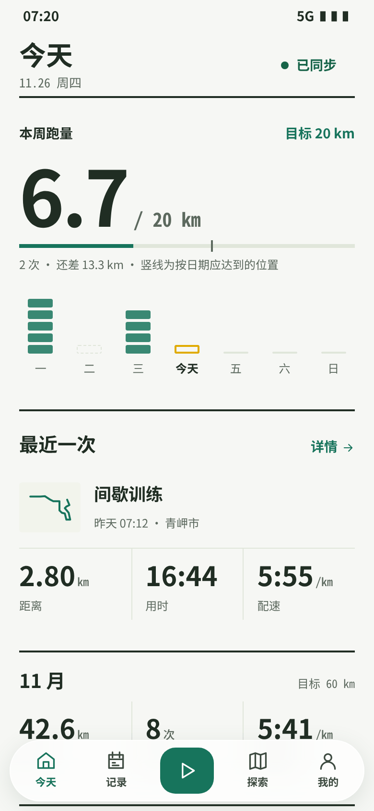 | 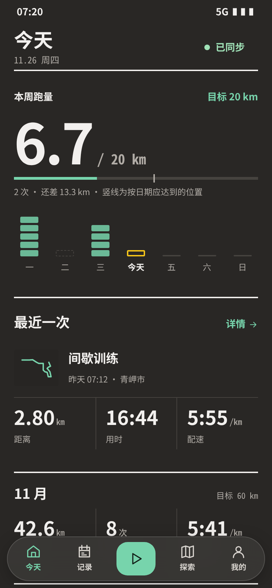 | [▣](prototypes/screenshots/mobile-home-768-light.png) | [▣](prototypes/screenshots/mobile-home-768-dark.png) |
| 准备开跑 | 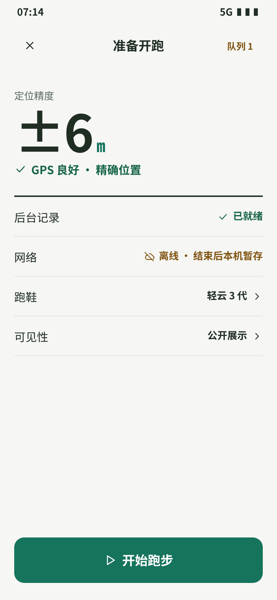 | 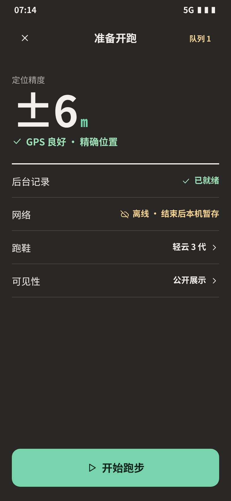 | [▣](prototypes/screenshots/mobile-prerun-768-light.png) | [▣](prototypes/screenshots/mobile-prerun-768-dark.png) |
| 记录中 | 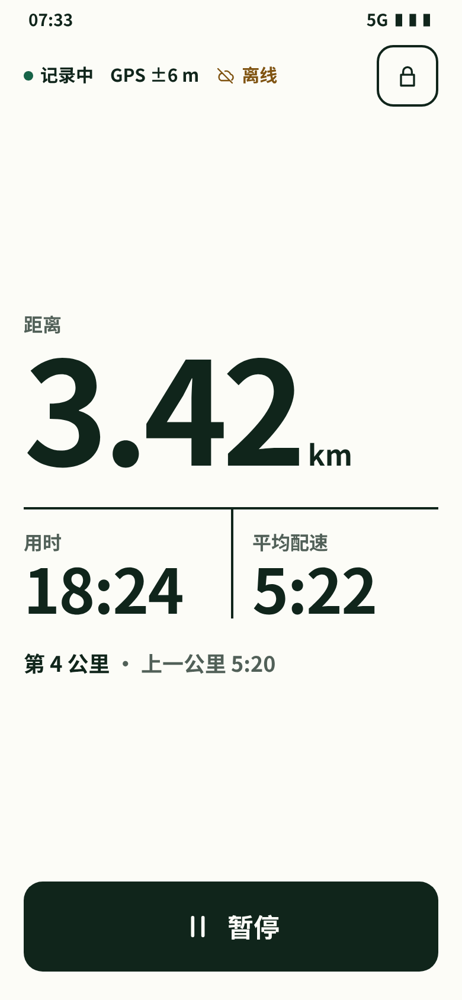 | 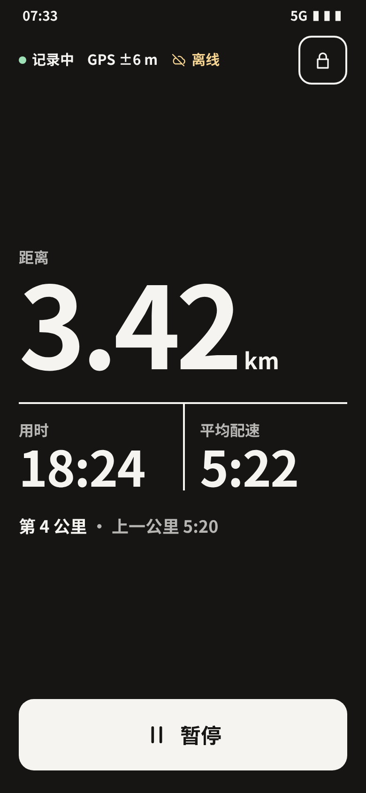 | [▣](prototypes/screenshots/mobile-recording-768-light.png) | [▣](prototypes/screenshots/mobile-recording-768-dark.png) |
| 跑步完成 | 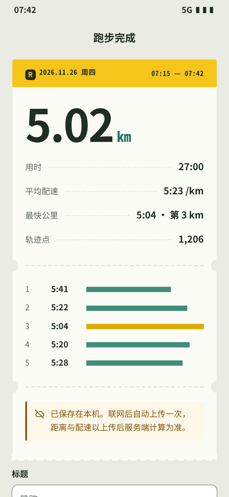 | 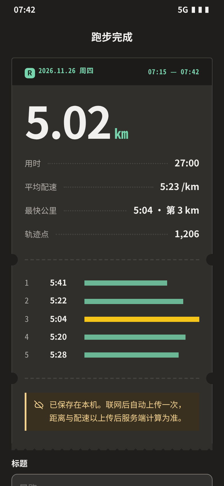 | [▣](prototypes/screenshots/mobile-done-768-light.png) | [▣](prototypes/screenshots/mobile-done-768-dark.png) |
| 跑步详情 | 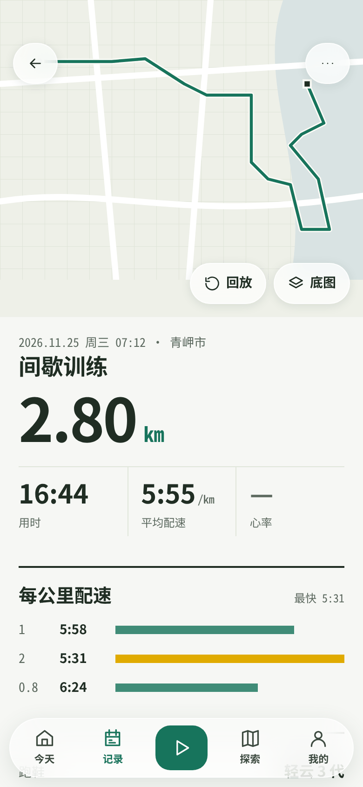 | 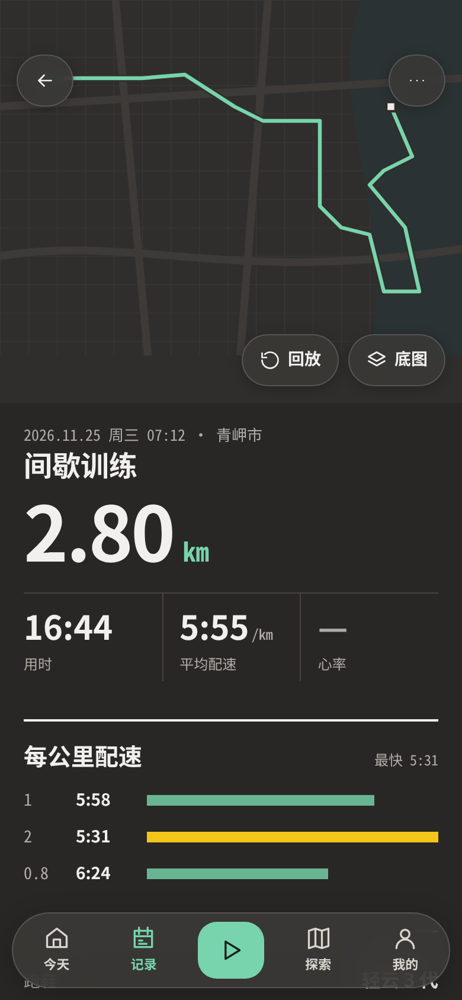 | [▣](prototypes/screenshots/mobile-detail-768-light.png) | [▣](prototypes/screenshots/mobile-detail-768-dark.png) |
| 分享图 | 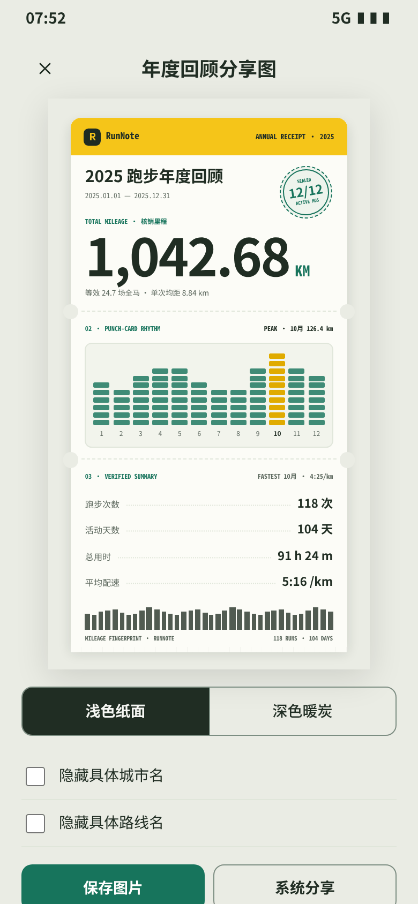 | 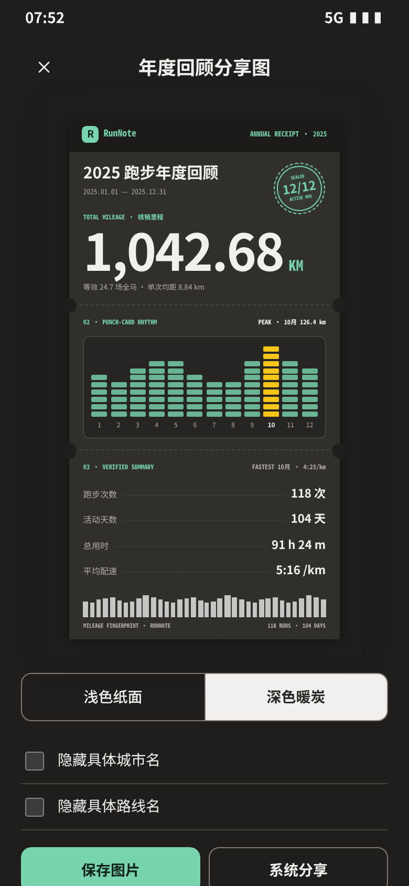 | [▣](prototypes/screenshots/mobile-share-768-light.png) | [▣](prototypes/screenshots/mobile-share-768-dark.png) |

另有 390 整页长图（`mobile-*-390-light-full.png`）与 320×640 极窄屏（`mobile-home-320-light.png`、`mobile-recording-320-light.png`）。

**自检（2026-11-26，本机 Chrome + Playwright 1.65，`file://` 加载，共 56 次渲染）**：控制台/页面错误 0；横向溢出 0（320/390/768/1440）；可交互元素 <44×44 CSS px：0（排除项：Web 顶部条导航项 40px 高，按负责人要求保持现有设计未改）。脚本见交付说明，不入库。

## 10. 关键取舍

| 取舍 | 选择 | 理由 |
| --- | --- | --- |
| 黄色用在哪 | 票据页票头 + 图表峰值标记；档案页无黄色块 | 分享图里黄色是票头和峰值，不是背景；大面积黄横条在 Web 上只占高度不给数据（W-01） |
| 卡片 vs 节线 | 内容区全部去卡片 | 账页语言本身就是"线 + 对齐"；保留卡片等于"卡片换票据边框" |
| h1 字号 | 40 → 28px | 让主数字成为首屏最大元素 |
| 内容区玻璃 | 移除，仅留顶部条/Tab 栏/地图浮层/弹层 | 玻璃是悬浮层的材质；内容区玻璃按钮与票据纸面冲突 |
| 记录中颜色 | 全墨色、无品牌绿 | 户外强光下最高亮度对比（15.7–16.6:1）；颜色不承担含义 |
| 手机首页"开始跑步"按钮 | 移除，只留 Tab 栏中间「开跑」 | 避免重复入口（AGENTS）；Tab 栏中键已在拇指区 |
| 周目标展示 | 打孔方块 + 时间刻度条，替代环形 | 环形无法同时表达"每天跑了多少"与"是否落后" |
| 分享图 | 沿用现有 `drawReceipt` 版式，不重做 | 它就是品牌基准；原型 HTML 只是镜像，用于证明三端一致 |
| 英文编号/印章 | 只在分享图与回顾章节 | 避免"机械添加"；编号在章节里表达顺序 |

## 11. 实施计划与进度

1. 令牌：在 `app.css` 增加 §3 "拟新增"项与别名，不删旧令牌；`tokens.md` 同步。
2. 共享样式：节线/发丝线/票据纸/打孔/点线/下划线标签/按钮新外形进 `@layer components`；按钮外形变化需同步 `liquid-glass-controls.css` 的排除选择器。
3. 按页迁移（每页一个 PR，前后截图）：数据汇总（第 1 阶段，已完成）→ 跑步记录 → 跑步详情 → 足迹 → 回顾/年度故事 → 设置 → 手机记录流。迁移方式：页面根元素加 `.editorial-page`（10px 控件圆角、内容按钮无玻璃），共享组件用可选 `appearance` 进入新外观，未迁移的调用方保持原样。
4. 组件：`MetricSummary` 去 icon、`GoalOverview` 表格化、`ActivityTimeline` 月份标题、`RecordsBanner` 去徽章；均保持 props 兼容。
5. 视觉基线：`playwright.design-system.config.ts` 快照需要在审阅后更新。

## 12. 负责人决定（2026-11-27）

第 1 至 5 条为首轮确认，第 6 条及第 1–3 条中的“后续细化”来自同日的方向锁定（Editorial Receipt × Liquid Glass，见 §8.1）。

| # | 问题 | 决定 | 落地 |
| --- | --- | --- | --- |
| 1 | 顶部条 | **保留现有全局顶部菜单条**（结构、胶囊当前项、40px 控件）与手机底部 Tab 栏的 Liquid Glass；附件中的白底下划线顶部条只是概念稿。后续细化（见下）：可改善折射、模糊/不透明度、边缘高光与阴影、图标文字对比与动效，但不移除玻璃 | 结构与尺寸未改；按 §8.1 为两条栏分别调了玻璃配方，Tab 栏在图表上方不再强折射 |
| 2 | 页头 | **保留黄色页头**（`--header-tint`），但减少空白高度，优化圆角、排版与年份选择；黄色必须承载品牌或数据含义；接受 h1 28px 与等宽元信息行 | h1 全站 28px（`--text-sport-title` → `--text-stat`）；`PageHeader` 新增可选 `meta`（14px 等宽）；已迁移页面的页头内边距收紧、圆角 `--radius-header` 1rem；数据汇总的年份是一个连体步进器（‹ 年份 ›），不是三个独立描边按钮 |
| 3 | 内容区按钮去玻璃 | 接受；后续细化明确：**保留全部玻璃代码、效果、调节能力与 DEV 调节器**，只让数据内容表面保持实底，不把玻璃重新引入数据区 | 同 §8.1：`.editorial-page` 内容区排除、`[data-glass-overlay]` 浮层保留；未删除任何玻璃代码 |
| 4 | 控件圆角 12→10、去 24px 内容卡片 | **按页迁移**，每页一个 PR，不做全局切换 | 由 `.editorial-page` 覆盖 `--radius-control`；数据汇总已去卡片，其余页面在各自 PR 中处理 |
| 6 | 版面节奏 | 不给每个区块相同权重：强调里程碑、趋势、地理；压缩目标、个人记录与次要统计；用好桌面横向空间；移动端按场景重组 | 数据汇总：年度里程碑整行 → 目标压成一条四栏 → 趋势 7 栏 + 足迹地图 5 栏 → 日历 → 个人记录 → 运动足迹；主区块 2px 节线，次级 1px 发丝线；手机上目标紧跟年度数字 |
| 7 | 手机顶部条 | **手机上不显示顶部条**，并优化页面开头 | <800px 删除 `.mobile-bar`（不留空条、不留第二条玻璃栏）；页面从顶部安全区开始，第一屏是黄色页头；导航只有底部 Tab 栏；主题切换移到“我的”页的“更多”面板（未登录时在页脚，附“登录”）。≥800px 桌面顶部条完全不变 |
| 5 | 峰值黄对比度 | 使用规范要求的加粗标签与数值文本；只有在仍难区分时才加 1px 墨色描边，且不得削弱对比 | `trendChartOption` 计算峰值黄与页面底色的对比度，低于 3:1（浅色约 2.0:1）时加 1px `--foreground` 描边；深色（约 9:1）不加 |

**第 1 阶段范围之外（待设置页迁移）**：`SettingsTabs` 的下划线外观。现有设置分区测试（`settings-hub.spec.ts` 的移动端玻璃透镜飞行、透镜对齐与 `top-navigation.spec.ts` 的“segmented lens label”）把玻璃透镜写成了行为契约；改成下划线要退役这些测试，属于设置页迁移 PR 的评审内容。第 1 阶段只提供共享的 `.underline-tabs` 并用于数据汇总的趋势切换。
