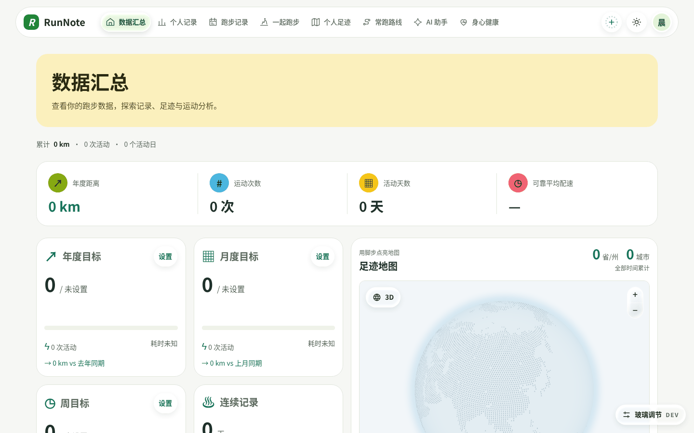
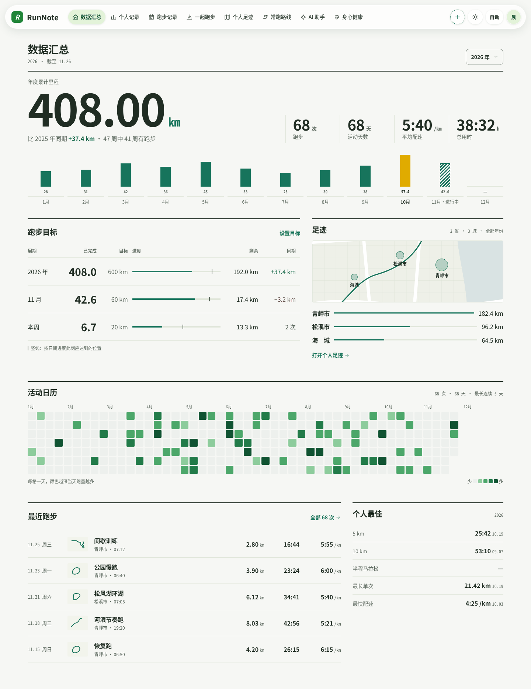
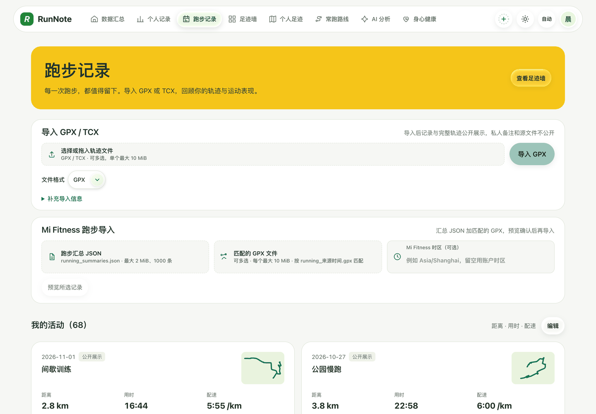
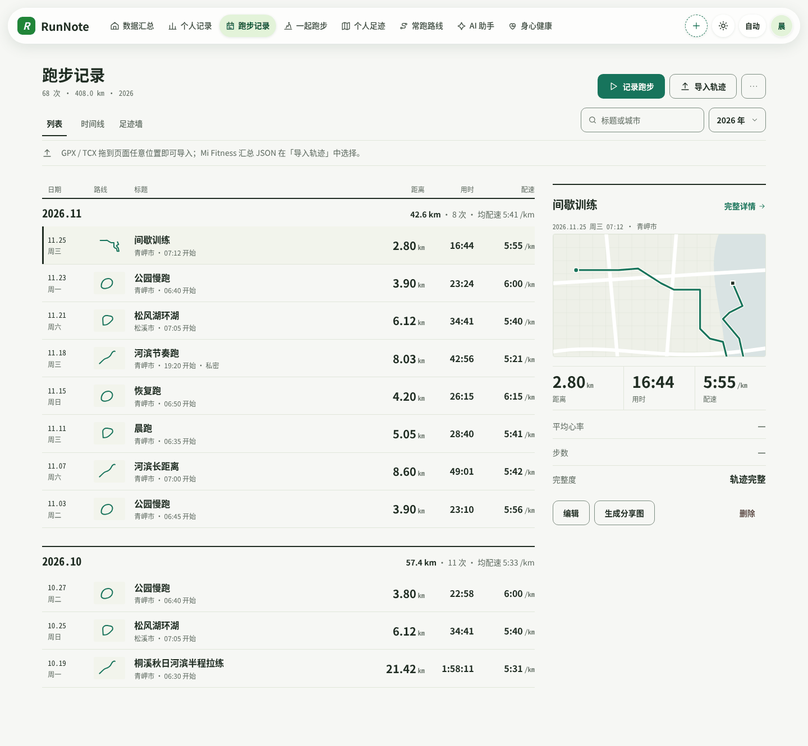
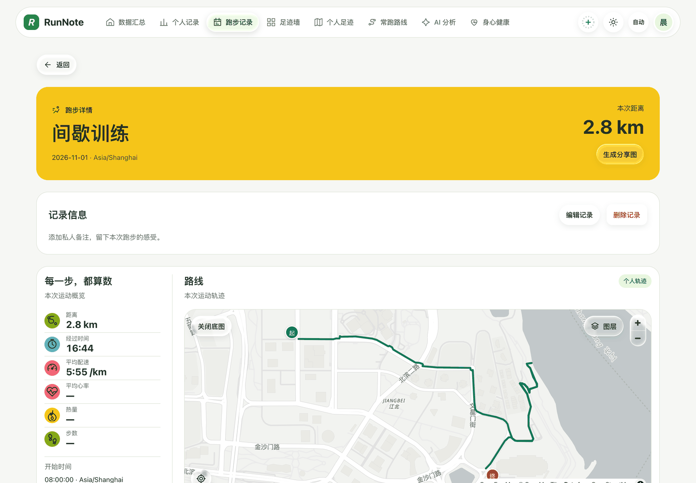
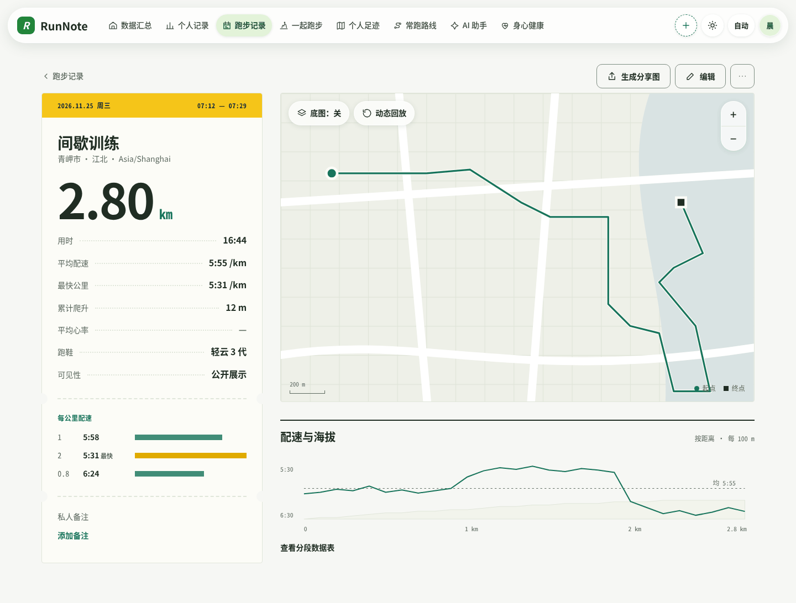
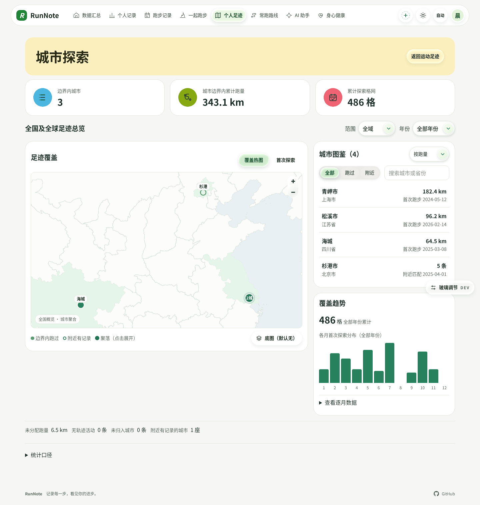
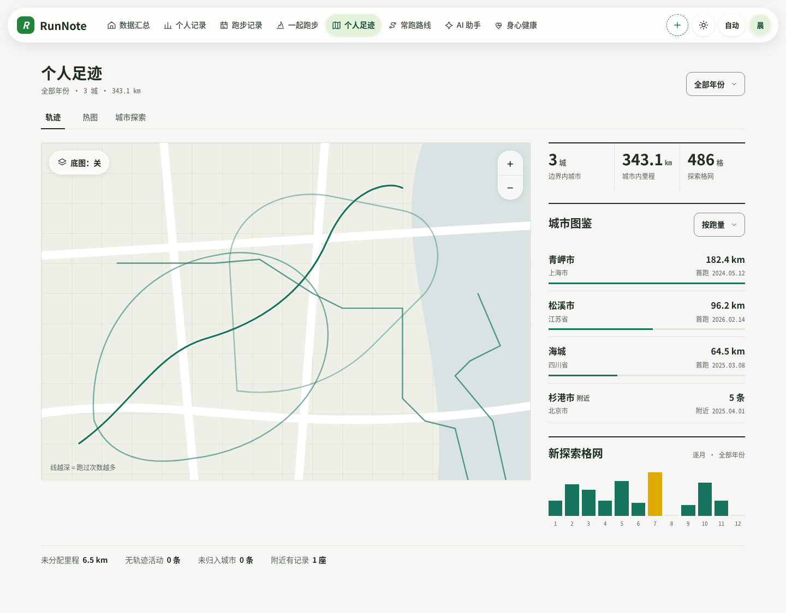

# Web 品牌审计：Editorial Receipt（2026-11-26）

> 状态：**设计评审稿，待负责人确认**。本文只记录诊断与处理建议，没有修改任何生产代码、接口、路由或数据。
> 基线：`main @ 734a038`（代码等同 `7b3d1dd`，734a038 只改文档）。品牌语言以 [Design System](README.md) 中负责人写入的 **Editorial Receipt Design** 为准；落地规范见 [brand.md](brand.md)，原型见 [prototypes/](prototypes/index.html)。

## 1. 范围与证据

| 类型 | 来源 |
| --- | --- |
| 品牌基准 | 年度故事分享图（`StoryShareDialog` + `lib/share/story-poster-render.ts`）、回顾分享图 C「存根」（`lib/share/recap-render.ts` 的 `drawReceipt`）；截图 `docs/assets/2026-11-21-annual-story/prod-screenshots/prod-poster-{light,dark}.png` |
| 当前 Web | `routes/dashboard`、`routes/activities`（含 `[id]`）、`routes/footprints`、`/records/recap` 与年度故事、`routes/settings/*`；`app.css` 令牌、`PageHeader`、`MetricSummary`、`GoalOverview`、`RecordsBanner`、`ActivityTimeline`、`ActivityPreview`、`AppNavigation`、`MobileTabBar` |
| 截图（修改前） | [数据汇总 1440](prototypes/screenshots/before-dashboard-1440-light.png)、[数据汇总 390](prototypes/screenshots/before-dashboard-390-light.png)、[城市探索 1440](prototypes/screenshots/before-city-1440-light.png)：取自 `main` 的 2026-11-23/25 验收截图，合成数据。[跑步记录](prototypes/screenshots/before-activities-1440-light.png)、[跑步详情](prototypes/screenshots/before-detail-1440-light.png) 是 **2026-11-01 存档**，页头黄色此后已改为淡奶油黄 `#fbf0bd`（以 [tokens.md](tokens.md) 为准），只作结构参考，当前结构以下表引用的代码为准 |
| 负责人提供 | 一张"当前 Web"附件（黄色 `RUNNOTE / RUNNING ARCHIVE` 横条、408.00 KM、虚线分隔）。仓库与各工作树中**找不到对应代码**，按外部概念稿处理：它的方向（大数字、细线分隔）被本方案吸收，黄色横条的问题见 W-01 |

## 2. 结论

当前 Web 的底子是对的：暖纸色背景、暖炭灰深色、`--primary` 强调、等宽数字、`
` 数据表兜底、地图本地优先、分享图已经形成票据语言。问题集中在**层级靠容器而不是排版**：每块信息都放进 24px 圆角卡，卡片标题配多色圆形图标，首屏被不含数据的黄色页头占据，最重要的数字（年度里程、本次距离）字号与普通指标相同。结果是"黄绿配色的通用 SaaS Dashboard"，和分享图的印刷感、档案感脱节。

处理原则：**保留数据结构、交互与功能；替换承载方式。** 去掉卡片外框与装饰色，用 2px 墨色节线、1px 发丝线、对齐和大字号数字建立层级；票据元素（黄色票头、打孔虚线、点线引导、锯齿边）只用在详情、回顾、完成页与分享图。

## 3. 问题清单与处理

处理：**保留** = 不动；**调整** = 保留功能换写法；**移除** = 删除该视觉元素（功能不受影响）。

| ID | 问题 | 证据 | 处理 | 理由 |
| --- | --- | --- | --- | --- |
| W-01 | 黄色页头占首屏但不含数据 | `PageHeader` 输出淡奶油黄 24px 圆角卡 + `description`（`dashboard/+page.svelte:313`「查看你的跑步数据，探索记录、足迹与运动分析。」；`activities/+page.svelte:463`）。1440 下数据汇总首屏 150px 被标题与一句说明占据，年度里程到 y≈430 才出现 | **调整** | 页头改为排版：h1 28px + 等宽元信息（周期、截至日期）+ 右侧动作，紧接 2px 节线与本页主数字。黄色退回票据页票头（见 brand.md §3.1）。符合 AGENTS「默认省略 description」 |
| W-02 | 核心指标用多色圆形图标 | 数据汇总年度指标与 `MetricSummary` 的 `icon`（`--sport-green/blue/yellow-accent/coral` 圆底）；城市探索三张统计卡；`RecordsBanner` 圆形徽章 | **移除**（指标处） | 四种色暗示了并不存在的分类，与"数据色、状态色、品牌色不混用"冲突；图标信息量为零（"距离"旁画箭头）。改为"数字 + 等宽单位 + 标签"。导航与操作按钮的线性图标保留 |
| W-03 | 年/月/周目标重复大卡片，信息密度低 | `GoalOverview.svelte:140` 每张 `--radius-card` 卡约 290px 高，四张（年/月/周/连续）占两行；进度条用第四种绿 `--sport-green`；行内编辑输入框高 1.65rem（<44px） | **调整** | 合并为一张 3 行表：已完成（28px 大数）/目标/进度条/剩余/同期。进度条加"按日期应达到"刻度，回答"我落后了吗"。编辑走设置页或弹层，目标值修改保持现有接口 |
| W-04 | 层级依赖容器，卡片套卡片 | 城市探索：3 张统计卡 + 地图卡 + 列表卡 + 趋势卡；详情：「记录信息」卡 + 「每一步，都算数」卡内再分左右栏；`.aux-panel`、`.dashboard-card`、`.settings-block` 全部是 surface + border + 24px | **调整** | 区块 = 2px 墨色上节线 + 标题行；行 = 1px 发丝线；列 = 竖发丝线。内容区不再有独立圆角面。只有地图、票据纸与浮层有外框 |
| W-05 | 缺少大字号核心数字 | 年度里程 28px，与"运动次数"同级；详情距离 2.8 km 在黄 hero 右上，次于标题；手机首页"0 km"与"0 次"同级 | **调整** | 每页一个主数字：周期页 96–120px，详情/完成 64–88px，表格内 28px，统一 `tabular-nums`、`-0.03em`。单位用等宽小写 `km`、`/km` 主色，取自分享图 `KM` 写法 |
| W-06 | 胶囊与按钮阴影泛滥 | 页头内玻璃胶囊（「查看足迹墙」「生成分享图」「返回运动足迹」），独立「← 返回」胶囊，状态胶囊（「公开展示」「个人轨迹」「首跑轨迹」），筛选/分段胶囊；均带玻璃阴影 | **调整** | 按钮 10px 圆角、无阴影：主操作实心 `--primary`，次操作 1px `--control-border` 描边，文字操作不加底。状态标签改为纯文字（`公开`/`私密`）。视图切换用下划线文字标签。**保留**：顶部条（负责人要求不改）、地图浮层控件与弹层的玻璃材质 |
| W-07 | 详情页首屏被 hero 和管理卡占据，地图下沉；删除在首屏 | `activities/[id]/+page.svelte:257` `.sport-hero`；`:298`「每一步，都算数」「本次运动概览」；`:351`「本次运动轨迹」；「删除记录」与「编辑记录」并列在首屏 | **调整** | 左侧票据存根（日期时段票头、标题、88px 距离、点线引导指标、每公里配速印刷条）+ 右侧 560px 地图；配速/海拔图与分段数据表在地图下。删除收进「更多」菜单，沿用原生 dialog 确认 |
| W-08 | 跑步记录首屏被导入表单占据 | 存档截图中 GPX/TCX 与 Mi Fitness 两张导入卡约 700px；当前代码 `activities/+page.svelte:614` 仍有展开的导入区块 | **调整** | 「导入轨迹」按钮 + 整页拖放提示一行；首屏可见 8 条记录。**保留** `ActivityTimeline` 的按月分组与 `ActivityPreview` 右栏（≥1024px），月份胶囊换成等宽月份标题 + 月合计 |
| W-09 | 叙述式文案 | 页头 description、「每一步，都算数」「本次运动概览」「本次运动轨迹」「用脚步点亮地图」 | **移除** | AGENTS「Do not narrate the interface」。保留单位、统计口径、空态/错误与隐私说明 |
| W-10 | 颜色体系里有 5 个相近的绿 | `--primary #17745c`、`--sport-brand #218538`、`--sport-green #86a912`、`--chart-series #27815c`、`--success #176448` 同时出现在一屏 | **调整** | 数据与强调统一 `--primary`；`--sport-brand` 只留给顶部条 Logo；`--sport-green` 不再用于进度；`--success` 只表示状态。日历色阶不动 |
| W-11 | 图表语言基本正确但不统一 | `TrendChart`/`records-chart` 圆角柱、最高期全色；城市覆盖趋势全绿圆角柱；进行中月份无标识 | **调整** | 直角细柱（≤28px）、峰值用票据黄 `--receipt-mark`、进行中斜线、无数据短线或虚框、柱顶等宽数值；打孔方块只在回顾/分享/完成页。保留 `
` 数据表 |
| W-12 | 年度故事/回顾已最接近品牌，但仍包在奶油黄卡与胶囊章节导航里 | [prod-desktop-1440](../assets/2026-11-21-annual-story/prod-screenshots/prod-desktop-1440-light.png)：`ANNUAL STORY` 等宽眉题与 1,042.68 大数是对的；外层黄卡、白色指标卡、6 个胶囊章节按钮仍是 Dashboard 写法 | **调整** | 作为票据页范式：整页一张票据纸（黄票头 + 120px 主数 + 打孔节律 + 点线合计 + 编号章节），右侧常驻分享台 |
| W-13 | 设置页沿用黄色页头与玻璃分段标签、卡片块 | `SettingsTabs` 在 `PageHeader` footer；`.settings-block` 卡片网格 | **调整** | 下划线分区标签；每组"左标签列 + 右字段列"、组间发丝线；44px 字段、3:1 边框；SaveBar 吸底。**不加任何票据装饰** |
| W-14 | 表单/次级描边对比度不足 | `--border #e0e6da` 对白 1.27:1，被用作输入框与次级按钮边框 | **调整** | 采用移动规范已提出的 `--control-border`（`#7c8e82` / `#827d77`，≥3:1）；`--border` 只作结构发丝线 |
| W-15 | 顶部导航条 | `AppNavigation` 悬浮玻璃条、8 个入口、当前项淡绿胶囊、右侧 + / 主题 / 自动 / 头像 | **保留** | 负责人要求不改结构与设计。原型逐项复刻（含 <1360px 只显示图标）。审计中的"胶囊式导航"问题只适用于页内分段/筛选（W-06），不适用于顶部条 |
| W-16 | 深色外观 | 暖炭灰 `#292725/#33312f`、薄荷 `#77d4ac`、正文对比 ≥11:1 | **保留** | 已成熟。黄色在深色下收敛为 `#f5d36c`，只作峰值/票据标记；票头按 `drawReceipt` 用 `#1c1b19` 底 + 薄荷字 |
| W-17 | 活动日历、省份/城市数据色、地图本地背景与底图控制器 | `--calendar-0..4`、`footprint-colors.ts`、`basemap-controller.ts`、`BasemapPicker` | **保留** | 有数据含义或已是架构约束。地图外框从 24px 卡改为 4px 细框 |
| W-18 | 手机 Web 壳层（<800px） | `MobileTabBar` 4+1、紧凑顶部条（v2.6.0） | **保留** | 原型在 768 下沿用该壳层，只替换内容区写法 |

## 4. 修改前后对照

| 页面 | 修改前 | 原型 1440 |
| --- | --- | --- |
| 数据汇总 |  |  |
| 跑步记录 | （2026-11-01 存档） |  |
| 跑步详情 | （2026-11-01 存档） |  |
| 足迹 / 城市 |  |  |

完整截图矩阵见 [brand.md §9](brand.md#9-原型与截图)。

## 5. 不在本轮范围

AI 助手、身心健康、一起跑步、常跑路线、用户管理、公开展示页没有单独出原型；它们按 brand.md 的通用规则（排版页头、节线分组、无多色图标）迁移。身心健康的 `--well-*` 每项一色是该页的识别方式（见 tokens.md），保留，不在本方案中统一。
