# RunNote 移动端专属 UI 设计方案（Item 49）

> **状态**：设计评审稿（Design-Only，待 Owner 确认方向；本分支**未修改**任何应用业务代码、后端、数据库迁移或部署配置）
> **基线提交**：`main @ 801729e4`（v2.5.0，已合并 Android Companion Phase 2 只读健康桥接/离线增量同步与 Phase 3 原生 GPS 记录）
> **适用范围**：`<800px` 移动端壳层（共享于 Android Capacitor、未来 iOS Capacitor 与手机浏览器），同时明确 `768×1024` 平板与 `1440×900` 桌面的连续过渡策略。
> **交互式高保真原型**：[mockups/index.html](mockups/index.html)（9 屏 390×844 浅/深色可切换 + 交互演示） · [mockups/responsive.html](mockups/responsive.html)（390 / 768 / 1440 断点对照）

---

## 1. 设计读解与核心命题（Design Read & Thesis）

- **设计读解**：面向日常跑步训练与户外实时记录的个人运动日志应用，以「户外一瞥即读、单手拇指可达、断网/中断绝对诚实」为导向，服务于 Android 与未来 iOS 共享的 WebView 壳层。
- **核心命题**：当前 RunNote 是一套打磨成熟的桌面响应式 Web 应用，但尚未拥有以手机单手与户外运动场景为中心的信息架构。本方案在不推翻既有暖浅色 / 暖炭灰视觉语言与桌面体验的前提下，建立**移动端专属导航模型（4 平级 Tab + 居中「开跑」触发器）、沉浸式高对比记录流（含防误停机制）、地图优先详情页与原生感分组设置中心**。

---

## 2. 现状盘点（390×844 代码审计与本地 Chromium 实测）

通过审查前端与 Android 原生源码（`app.html`、`app.css`、`AppNavigation.svelte`、`RecordingWorkspace.svelte`、`CompanionHealthPanel.svelte`、`CompanionCachePanel.svelte`、`activities/[id]/+page.svelte`、`MainActivity.java`、`capacitor-back.ts`），并在本地合成 API（`frontend/tests/fixtures/ui-api.mjs`）+ Chromium `390×844 @2x` 环境下逐页抓取 DOM 与视觉指标，现状盘点如下：

### 2.1 分模块现状汇总

| 区域 | 现有路由与入口 | 390×844 实测问题与痛点 |
| --- | --- | --- |
| **导航与壳层** | 顶部胶囊栏 `.mobile-bar` + 右上角汉堡菜单下拉卡片（8–9 项平铺 + 内联目标卡 + 账号块） | ① **核心动作断层**：「记录跑步」未进入主导航，用户需点击右上角汉堡 → 扫描 8 项进「跑步记录」→ 点击次级按钮「记录跑步」→ 再点「开始跑步」（**4 步 + 2 次顶部远拇指区拉伸**）。② **菜单内容裁切**：实测 `aside.app-sidebar.nav-open` 高度 `scrollH=810px > clientH=732px`，底部账号身份与「设置」图标按钮被截断在首屏之外。③ **顶栏空间浪费**：顶栏右侧同时放置主题图标 +「自动」两个按钮，挤占空间；下滑隐藏顶栏后切换页面需先上滑再拉伸至右上角。④ 下拉菜单内「退出登录」占满主宽，而「设置」仅为一个 38×44px 无文字图标。 |
| **实时记录流** | `/activities/record`（`RecordingWorkspace.svelte`） | ① **误停高危**：`status === 'recording'` 时，`暂停` 与 `结束并保存` 并排放置且均为**单次点击即触发**，无长按/二次确认保护。② **户外不可读**：`<479px` 媒体查询将距离与用时反而缩小至 `20px`（`--text-section`），配速缩小至 `16px`（`--text-body`），强光跑步中几乎无法一瞥即读。③ **首屏主操作被挤出视口**：顶栏 + `PageHeader`（~170px）+ 权限提示 + 标题输入框占满首屏，`开始跑步` 在权限缺失/提示展开时完全落到 844px 视口以下。④ **运动中混入表单**：`跑步标题（可选）` 文本框夹在实时指标与暂停/结束按钮之间，易在跑步中误触弹出软键盘。 |
| **跑步详情** | `/activities/[id]` | ① 整页高 `3005px`（3.56 屏），首屏被顶栏 + 独立「← 返回」胶囊 + 黄色 Hero +「记录信息」卡占满，**路线地图需向下滚动超过 1.5 屏才可见**。② 破坏性操作「删除记录」紧挨「编辑记录」置于首屏上半部，缺乏收拢保护。③ 「管理跑鞋 →」「记录日记」使用 `.button-compact`（高 33px）。 |
| **历史记录** | `/activities` | ① `PageHeader`（含大段副标题 +「生成分享图」）+ 3 个等权次级按钮（「记录跑步」「导入轨迹」「编辑」）+ 默认展开的导入卡片，导致空/导入态首屏 0 条记录可见。② 三个按钮视觉层级完全相同，未能突出「记录跑步」。 |
| **健康与离线同步** | `/settings/preferences` 底部的 `CompanionHealthPanel` & `CompanionCachePanel` | ① 页面总高 `3409px`（4 屏），健康数据与离线同步被埋在最底部；页面顶部 5 项设置标签 2 列网格即吃掉 `345px`（41% 视口）。② `CompanionHealthPanel` 在外层卡片内嵌套 6 张独立圆角小卡（卡片套卡片），6 个数字占满一整屏。③ 全站缺少统一的轻量级顶部/内联同步状态提示（仅在进入设置深层页或触发报错后可见）。 |
| **设置与账号** | `/settings`、`/settings/shoes`、`/settings/preferences` | ① 2 列分段标签网格占用首屏近半高度。② 表单 `.text-field` 高度统一为 `36px`（`<44px`）。③ 桌面 3:7 列表/详情模式在手机上退化为超长纵排。 |
| **认证登录** | `/admin`（`AuthForm.svelte`） | 结构清晰、0 横向溢出；但「显示密码」独立占位一行偏靠右，底部链接「返回展示页面」高 `20px`（`<44px`）。 |
| **浅/深色主题** | `runnote-theme` + `app.html` 首屏无闪烁脚本 + `SystemAppearancePlugin` | **优势明显**：浅色暖米白 `#f6f7f4` + 奶油黄 `#fbf0bd` 与深色暖炭灰 `#292725` / `#33312f` + 薄荷绿 `#77d4ac` 均已达到 AA 级正文对比度（见第 5 节实测表）。主要短板在于表单边框 `--border` 在浅/深色下对比度仅 `1.27:1` / `1.32:1`（低于 WCAG 1.4.11 的 3:1）。 |

> 现有生产构建 390×844 现状参考（仓库既有验收基线）：[实时记录浅色](../assets/phase3-mobile-light.png) · [实时记录深色（记录中）](../assets/phase3-mobile-dark.png) · [Health Connect 卡片嵌套现状](../assets/phase2-mobile-light.png)

### 2.2 触控目标、安全区、返回键与溢出定量实测

| 审计维度 | 本地 Chromium（390×844）实测结果 | 风险分级 |
| --- | --- | --- |
| **横向溢出** | 全部 11 组被测页面均为 `scrollWidth: 390 === innerWidth: 390`（**0 溢出**）。 | 良好 |
| **安全区（Safe Area）** | `frontend/src/app.html:6` 仅写 `width=device-width, initial-scale=1`，**缺少 `viewport-fit=cover`**；全站 `frontend/src/` 仅 `TogetherRecordSheet.svelte` 使用 `env(safe-area-inset-bottom)`；`MainActivity.java` 在 Android 15+/17 强制 edge-to-edge 下未对 WebView 应用 `WindowInsets`。 | **P0** |
| **触控目标 `<44×44px`** | 各页普遍存在 4–15 处 `<44px` 控件：`.text-field`（高 `36px`）、`.button-compact`（高 `32–33px`，含上传队列「重试/丢弃/立即上传」及详情「管理跑鞋/记录日记」）、`.rn-select-toggle`（`32×32px`）、地图 `+/−` 缩放按钮（`32×32px`）、趋势分段 `周/月`（`34×40px`）、`
`（高 `23–26px`）、手机菜单内设置按钮（`38×44px`）。 | **P1** |
| **iOS 聚焦自动缩放** | `/dashboard`、`/activities`、`/activities/[id]`、`/settings` 存在 `font-size: 14px` 的 `<select>` / `<input>`，在 iOS Safari / WKWebView 聚焦时会强制放大页面。 | **P1** |
| **嵌套滚动与裁剪** | 手机汉堡菜单（`aside.app-sidebar.nav-open`）出现内部滚动且首屏裁切账号区（`810px / 732px`）。其余页面无意外嵌套滚动陷阱。 | **P1** |
| **Android 系统返回键** | `MainActivity.java` + `capacitor-back.ts` 已建立「断网遮罩 → `dialog[open]` → `[popover]:popover-open` → 手机菜单 → `history.back()` → `exitApp()`」的可靠链路；但尚未区分「非首页 Tab 返回首页 Tab」与「首页 Tab 退出」，且未与 Android 14+ Predictive Back 动画对齐。 | **P2** |

### 2.3 仅可在 Owner 今晚真机（PKT110 / Android 17）验证的清单

以下项目无法通过无头 Chromium / 合成 API 验证，**明确标为未验证（Unverified — Real Device Required）**，建议纳入今晚实机检查表：

1. **Android 17 强制 Edge-to-Edge 安全区**：顶部状态栏/前摄挖孔（display cutout）与底部手势指示条（以及三键导航模式）是否遮挡 `.mobile-bar`、吸底按钮或 `SaveBar`。
2. **户外强光可读性**：阳光直射下的浅色与深色对比度、预览指标阅读距离与眩光表现。
3. **Health Connect 真实系统交互**：真机 Health Connect provider 检测、授权弹窗、部分勾选、在系统设置中撤销权限后回到 App 的即时状态同步。
4. **真机后台 GPS 与飞行模式闭环**：锁屏/切后台/Doze 期间持续落盘、常驻通知 `VISIBILITY_PRIVATE` 锁屏脱敏、飞行模式结束记录 → 恢复网络后单次幂等上传。
5. **Android Predictive Back 与边缘手势冲突**：右滑返回与横向筛选条、地图平移、底部面板拖动是否互相打架。
6. **WebView 144 材质与滚动性能**：Liquid Glass `backdrop-filter` 在高刷屏惯性滚动时的帧率、地址栏/顶栏收放抖动及软键盘（IME）弹出后焦点输入是否被遮挡。
7. **系统辅助设置与触觉**：系统字体调至 130% / 200% 时的真机重排，以及未来接入原生 Haptics 后的按压/长按结束手感。

---

## 3. 外部设计 Skill 试用评估报告

按任务要求，已在临时目录拉取并完整研读两个外部 Skill 仓库（**未拷贝或引入任何代码至本仓库**）：

### 3.1 `RubenGlez/mobile-design`

- **采纳并落地的具体设计决策**：
  1. **Design Read + 每屏单一标志物（Signature）**（`references/design-process.md`）：拒绝把手机首页做成「问候语 + 4 张等权数据卡」模板；改为以 RunNote 最具辨识度的**奶油黄周目标进度环卡片 + 本周运动日点阵 + 一键开跑**作为「今天」首屏主角。
  2. **反生成式模板自检（Craft Floor & Reflexes）**（`references/craft-floor.md`）：
     - 消除「汉堡菜单作为手机主导航」→ 改为底部 4+1 导航栏；
     - 消除「卡片套卡片」→ 将 `CompanionHealthPanel` 6 张嵌套子卡重构为单卡 3 列发丝线摘要；
     - 消除「无意义呼吸/闪烁红点」→ 运动中「● 记录中」采用静态高对比色块，仅在状态变化时过渡；
     - 统一矢量图标家族，移除设置列表中混用的彩色 Emoji；
     - 跨平台触控目标按 Android 48×48dp / iOS 44×44pt 从严取整，且相邻目标留 ≥8px 间距。
  3. **高风险能力预检与状态加固**（`references/states-edge-cases.md`）：完整覆盖离线带缓存年龄、待传队列永不伪装为成功、进程强杀恢复、仅大致位置阻断、503 指数退避倒计时、Health Connect 撤销/部分授权/7 天空态，以及长按结束的**单击弹窗无障碍替代**（满足 WCAG 2.5.1）。
  4. **批判工具（Critique Instruments）**（`references/critique.md`）：用 5 秒测试与「单手出汗跑者」「大字号辅助用户」视角审视现网截图，直接揪出记录页误停与 20px 指标过小问题。
- **不匹配点与局限**：
  - 偏重原生 SwiftUI / Jetpack Compose 语义（如假设可自由调用 Material 3 Dynamic Color、SF Symbols、原生 NavigationStack），而 RunNote 是 **Capacitor + SvelteKit 共享单套前端**，不能为了双端原生差异维护两套 UI；
  - 原则上反对自定义毛玻璃，而 RunNote 既有 Design System 将 Liquid Glass 定义为品牌识别资产（`docs/design-system/README.md`）。本方案的折中策略与该 Skill 的细则一致：**仅将玻璃材质保留在悬浮于滚动内容之上的底部导航栏与浮层弹层，普通内容卡片一律保持实色不透明**。

### 3.2 `ArnavPuri/designskills`

- **采纳并落地的具体设计决策**：
  1. **Web 移动端硬性 CSS 护栏**（`skills/mobile-ui-design/SKILL.md`）：直接定位并修复了 RunNote 的三大 Web 运行时漏洞——补充 `viewport-fit=cover` 与叠加式安全区写法 `calc(10px + env(safe-area-inset-bottom))`、统一使用 `100dvh`/`svh` 替代 `100vh`、强制所有移动端输入框与选择器字号 `≥16px`（消除 iOS Safari 聚焦缩放）、显式 `overscroll-behavior-y: contain` 与 `touch-action: manipulation`。
  2. **深色模式亮度层级与对比度校核**（`skills/dark-mode/SKILL.md`）：对照其「亮度分级替代阴影」「弱化次级文字须守住 4.5:1」「输入控件边框须守住 3:1」三条硬指标，精确算出了 RunNote 浅/深色正文全部达标（5.37:1–14.37:1），但发现 `--border` 仅 1.27:1/1.32:1，从而提出 `--control-border` 增量令牌。
  3. **自动化 Chromium 审计范式**（`skills/design-critique/scripts/audit.mjs`）：参考其 Playwright 渲染 + DOM 指标量化脚本思路，构建了覆盖 390×844 / 320×640 / 768×1024 / 1440×900 浅深色双主题的本地确定性验证脚本。
- **不匹配点与局限**：
  - 仓库大量内容偏向营销海报、社交媒体图与 Gemini 生图工作流，默认 Tailwind Indigo (`#2563EB`) + Inter 审美与 RunNote 的暖米白/暖炭灰品牌资产冲突，不可照搬；
  - 其自带 `audit.mjs` 仅以 `24px`（WCAG AA 下限）检测小目标，对手机触控过于宽松（本方案提升为 44/48px 门禁），且仅在最宽桌面视口测深色模式，也不检测 `viewport-fit=cover` 或运动记录等复杂状态机；
  - 其深色模式建议全局对图片施加 `brightness(0.85)`，不适用于 RunNote 已有独立深色配色的 MapLibre 轨迹图与海报画布，予以拒绝。

### 3.3 综合结论

两套 Skill 高度互补：`mobile-design` 决定**移动端产品信息架构、单手人机工程与高风险状态完整度**；`designskills` 补齐 **WebView/CSS 安全区、16px 输入规则、深色对比度数学与 Chromium 自动化验证方法**。两者均服从 RunNote 既有的 `docs/design-system/` 视觉不变量，不覆盖品牌语言。

---

## 4. 移动端信息架构与导航模型（Android / iOS 共享）

### 4.1 导航模型取舍：4+1 底部胶囊栏（推荐） vs 4-Tab + 右下 FAB

| 维度 | 方案 B（推荐）：底部 4 平级 Tab + 居中「开跑」主触发器 | 方案 A（备选）：4-Tab 底部胶囊 + 右下独立 56px FAB |
| --- | --- | --- |
| **结构** | `[ 今天 ｜ 记录 ｜ (▶ 开跑) ｜ 探索 ｜ 我的 ]` | 底部 4 Tab 胶囊 + 悬浮于右侧上方的圆形/胶囊 FAB |
| **左右手可达性** | **双利手完全对称**，左右拇指均在最舒适弧线内 | 偏右手，左手单持跨屏困难 |
| **内容遮挡** | 零额外悬浮遮挡，列表底行只需避让单层底栏 | FAB 常遮挡列表末行右对齐配速数字或地图右下角「动态回放」按钮 |
| **语义纯度** | 居中键在 DOM 上为 `<a href="/activities/record">` 独立动作触发器（非 stateful tab），点击推入**隐藏底栏的沉浸式记录流** | 严格分离导航栏与动作按钮，符合 Material 3 规范 |
| **运行中反馈** | 记录中返回浏览时，底栏上方停靠轻量「● 记录中 · 3.42 km · 返回」常驻条，居中键切换为绿色「记录中」直达 | 同需额外顶部/底部状态条 |

**推荐理由**：跑步 App 的高频动作极度聚焦于「开始跑步」，方案 B 在双利手可达性、不遮挡列表右侧等宽里程/配速数据与地图右下角控件上显著更优，且跑者心智熟悉度最高。

### 4.2 一级导航与二级页面映射

| 底部入口 | 对应既有路由 | 承载内容（移动端精简聚焦） | 二级栈页（Push，隐藏底栏或保留视上下文） |
| --- | --- | --- | --- |
| **今天** | `/dashboard`（移动端视图） | 奶油黄周目标环卡片（含一周活跃点 +「开始跑步」）、最近一次跑步、近 7 天 Health Connect 单卡 3 列摘要、顶栏静默同步芯片 | 完整年度统计/热力日历/省份图（通过「完整数据汇总 →」进入） |
| **记录** | `/activities` | 顶栏「导入」+「···」（分享图/批量编辑）、待传离线队列置顶条（仅 `pending > 0` 显示）、44px 筛选胶囊、按月分组时间线 | 跑步详情 `/activities/[id]`、动态回放弹窗、路线海报弹窗、GPX/TCX 导入底部抽屉 |
| **▶ 开跑** | `/activities/record`（全屏沉浸流） | 跑前准备（GPS 精确锁 + 后台就绪 + 吸底「开始跑步」）→ 运动中（68px 距离 + 单一「暂停」）→ 暂停（继续 + 长按 1.5s 结束 + 右上放弃）→ 跑后总结（离线/在线诚实态 + 标题/跑鞋表单） | 本地上传队列管理抽屉 |
| **探索** | `/footprints`（页内分段切换） | 顶部 `.settings-tabs` 切换「个人足迹 / 常跑路线 / 个人记录（PR 与年度回顾）」 | 城市探索详情、单条常跑路线详情、年度故事 |
| **我的** | `/settings`（分组入口中心） | 身份卡 + 原生分组列表：跑量目标、我的跑鞋（带提醒角标）、设备健康数据、离线缓存与增量同步、内联外观切换（浅/深/自动）、隐私与公开展示、条件项（身心健康 / AI 助手 / 一起跑步 / 管理员入口）、底部退出登录 | 各独立二级设置页（跑鞋列表、健康数据详情、同步详情、账户编辑、站点与用户管理） |

### 4.3 跨端返回栈、安全区与响应式连续性

- **Android 系统返回 & Predictive Back 优先级**：
  1. 顶层原生 `<dialog>` / 底部抽屉 / `[popover]:popover-open` → 关闭；
  2. 正在运动记录（`recording` / `paused`）→ 弹出原生 `<dialog>` 离开确认（说明 Android 前台服务会继续后台采集；Web 模式提示会暂停）；
  3. 二级 Push 页面（详情、子设置页等）→ `history.back()` 并恢复滚动位置与筛选状态；
  4. 非「今天」的根 Tab（记录/探索/我的）→ 切回「今天」Tab；
  5. 已在「今天」根 Tab → 退出应用（`exitApp()`），绝不锁死返回键。
- **iOS 侧滑返回**：保留 WKWebView 原生左边缘右滑返回，不在屏幕左边缘 24px 内放置冲突横向手势；底部导航与吸底按钮统一叠加 `env(safe-area-inset-bottom)` 避让 Home Indicator。
- **三档断点连续性（[mockups/responsive.html](mockups/responsive.html)）**：
  - **Compact `<600px`（390×844 手机优先）**：底部 4+1 液态玻璃胶囊栏 + 52px 精简上下文顶栏 + 单列流。
  - **Medium `600–1023px`（768×1024 平板/折叠屏展开）**：左侧 84px 导航轨（顶部置「开跑」主按钮 + 4 个导航项）+ 2 列内容栅格。
  - **Expanded `≥1024px`（1440×900 桌面）**：**完整保留现有 RunNote 悬浮顶部玻璃导航栏不变**，仅在顶栏右侧增设「● 开始记录」入口，零破坏桌面用户体验。

| 平板 768×1024（浅色 · 左侧导航轨） | 桌面 1440×900（深色 · 保留现有悬浮顶栏） |
| --- | --- |
| 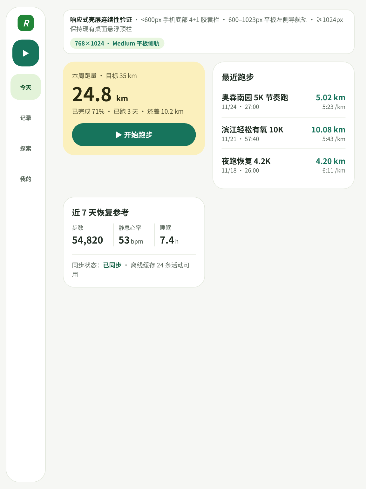 | 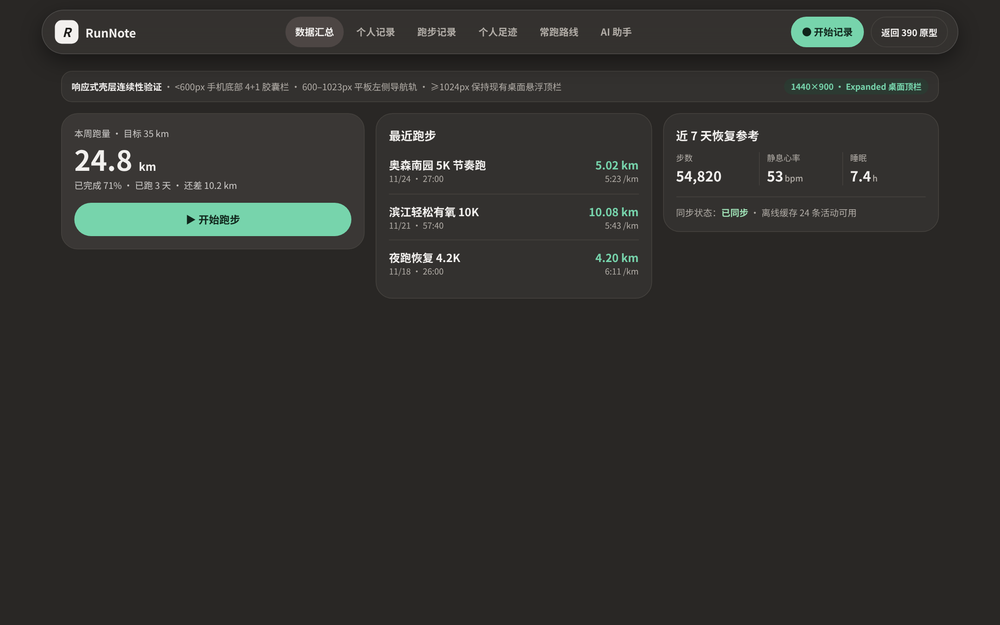 |

---

## 5. 视觉系统复用与最小 Token 增量

### 5.1 既有令牌实测对比度（WCAG 2.1 AA 核验）

| 语义角色 | 浅色组合 | 浅色对比度 | 深色组合 | 深色对比度 | 判定 |
| --- | --- | --- | --- | --- | --- |
| 正文 / 页面底 | `#202d23` on `#f6f7f4` | **13.37:1** | `#f2f0ee` on `#292725` | **13.09:1** | PASS (AAA) |
| 正文 / 卡片面 | `#202d23` on `#ffffff` | **14.37:1** | `#f2f0ee` on `#33312f` | **11.40:1** | PASS (AAA) |
| 次级文字 / 卡片 | `#5c695e` on `#ffffff` | **5.77:1** | `#b1aca6` on `#33312f` | **5.75:1** | PASS (AA) |
| 主强调 / 卡片 | `#17745c` on `#ffffff` | **5.69:1** | `#77d4ac` on `#33312f` | **7.28:1** | PASS (AA) |
| 主按钮文字 / 主色 | `#ffffff` on `#17745c` | **5.69:1** | `#10251b` on `#77d4ac` | **9.06:1** | PASS (AA/AAA) |
| 奶油页头文字 / 底 | `#2a2a12` on `#fbf0bd` | **12.72:1** | `#f2f0ee` on `#3a3735` | **10.39:1** | PASS (AAA) |
| 错误 / 成功 / 警告 | `#a52b32` / `#176448` / `#805412` on `*-soft` | **6.39 / 6.47 / 6.22:1** | `#ffadb1` / `#9fe1b6` / `#f5d391` on `*-soft` | **7.83 / 8.20 / 9.00:1** | PASS (AA/AAA) |
| 卡片发丝线 `--border` | `#e0e6da` on `#ffffff` | 1.27:1（仅装饰分隔） | `#46433f` on `#33312f` | 1.32:1（仅装饰分隔） | 仅作结构分隔 |
| **新增 `--control-border`** | **`#7c8e82` on `#ffffff`** | **3.37:1** | **`#827d77` on `#33312f`** | **3.15:1** | **PASS (WCAG 1.4.11 ≥3:1)** |

### 5.2 拟新增移动端专用 Token（最小集合，不另建平行色板）

| 拟增 Token | 建议值（Light / Dark） | 用途 |
| --- | --- | --- |
| `--control-border` | `#7c8e82` / `#827d77` | 移动端输入框、选择器、次级描边按钮边框，补齐户外 ≥3:1 控件边界对比度 |
| `--mobile-tabbar-height` | `4rem`（`64px`） | 手机底部导航栏固定高度，供主内容区 `padding-bottom` 联动计算 |
| `--safe-top` / `--safe-bottom` | `env(safe-area-inset-top, 0px)` / `env(safe-area-inset-bottom, 0px)` | 配合 `app.html` 新增 `viewport-fit=cover`，统一安全区留白 |
| `--text-rec-hero` | `4.25rem`（`68px`, weight `700`, `tabular-nums`, line-height `1`） | 仅用于实时记录页户外大号距离主读数 |
| `--text-rec-sub` | `2rem`（`32px`, weight `700`, `tabular-nums`, line-height `1.15`） | 仅用于实时记录页运动用时与预览配速读数 |

---

## 6. 核心页面高保真原型与标注（390×844 Light / Dark）

以下 9 组截图均由真实 Chromium 从 [mockups/index.html](mockups/index.html) 渲染输出。完整交互与逐屏标注卡可直接在浏览器打开该 HTML 文件查看。

### 6.1 今天（Home）与跑前准备（Pre-Record）

| 01 · 今天（浅色） | 01 · 今天（深色） | 02 · 跑前准备（浅色） | 02 · 跑前准备（深色） |
| --- | --- | --- | --- |
| 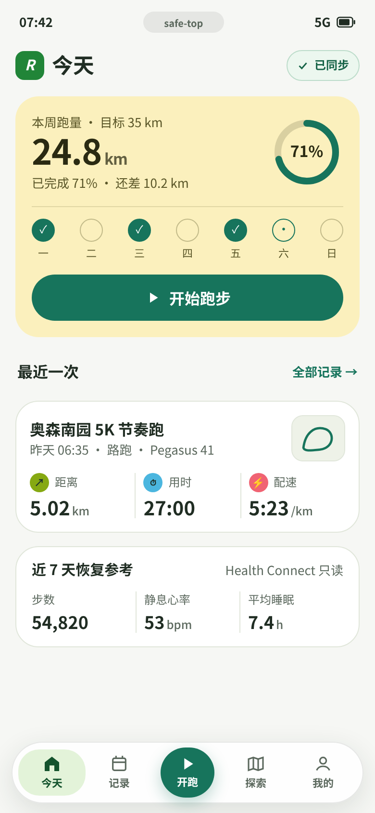 | 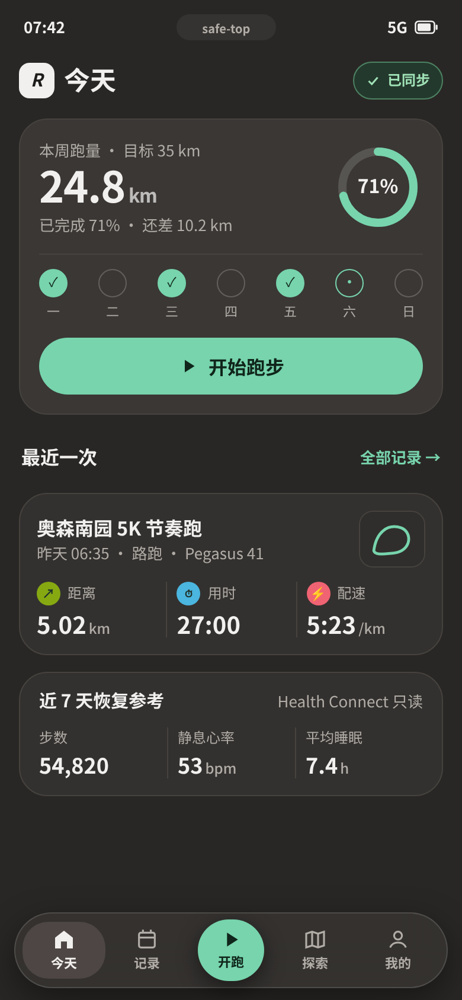 | 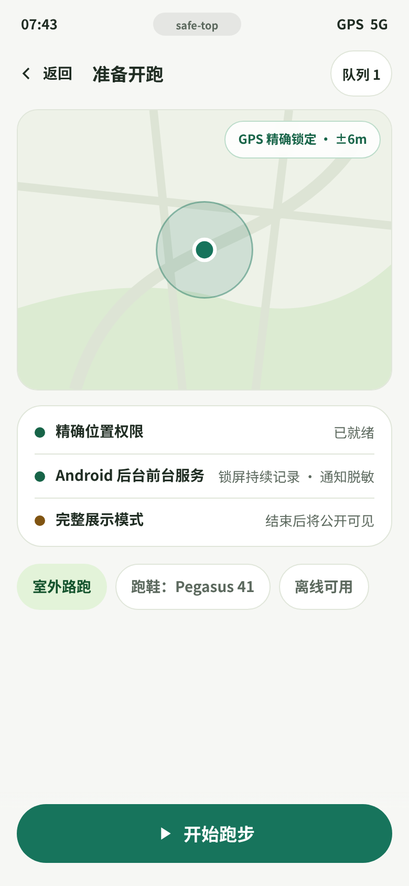 | 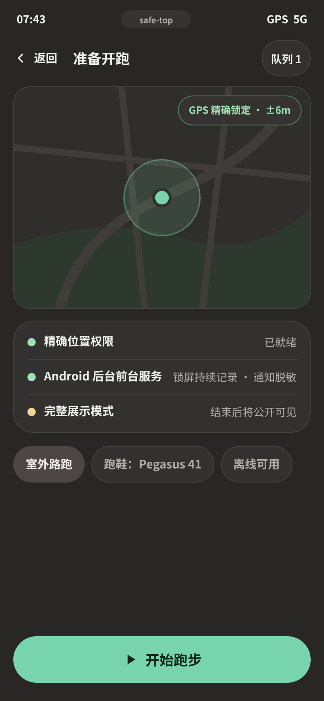 |

- **01 今天**：目的为 2 秒掌握本周目标（71% · 24.8/35 km）、最近一跑与近 7 天恢复参考；主操作「开始跑步」位于周目标卡与底栏居中「开跑」键（双利手 1 步直达）；Health Connect 压缩为单卡 3 列发丝线，消除卡片套卡片；顶栏右上角仅呈现静默同步状态芯片。
- **02 跑前准备**：沉浸式路由（隐藏底栏防误触）；上方可视化 GPS 精确锁定（±6m）+ 后台前台服务脱敏就绪 + 完整展示模式可见性披露；底部吸底 56px「开始跑步」按钮，移除跑前标题文本框，避免误唤软键盘；右上角「队列 1」仅在存在待传记录时显示。

### 6.2 运动记录中（Active Recording）与已暂停防误停（Paused）

| 03 · 运动记录中（浅色） | 03 · 运动记录中（深色） | 04 · 已暂停防误停（浅色） | 04 · 已暂停防误停（深色） |
| --- | --- | --- | --- |
| 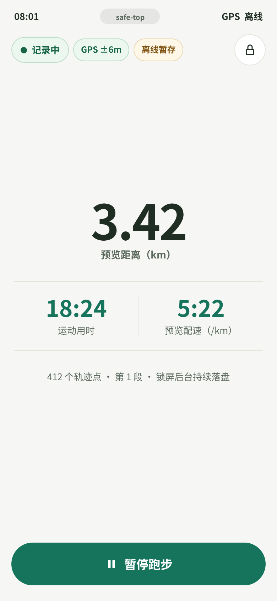 | 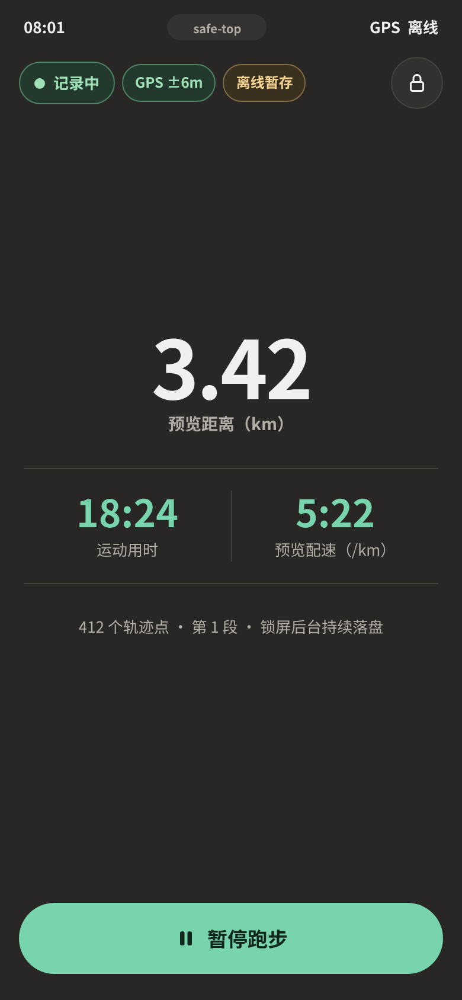 | 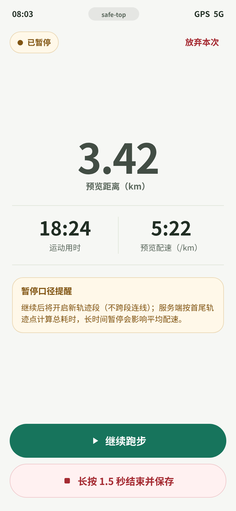 | 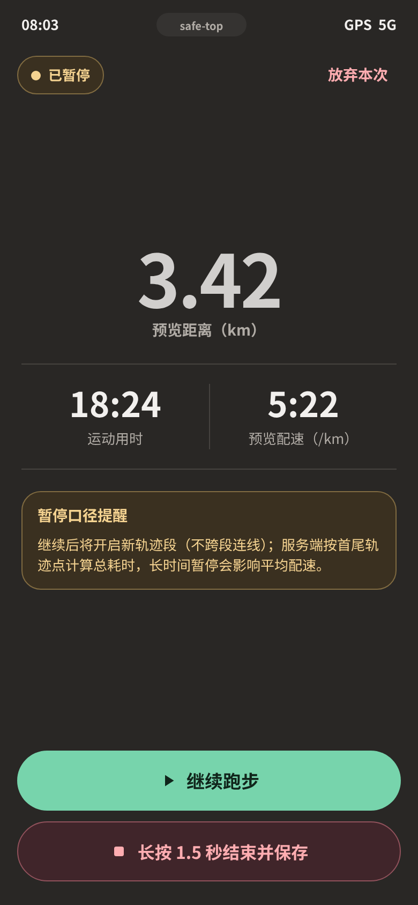 |

- **03 运动记录中**：彻底清空导航栏、表单与上传队列干扰；距离 68px、用时/配速 32px 等宽数字满足强光一瞥即读；顶部静态「● 记录中」+ `GPS ±6m` + 离线时「离线暂存」芯片 + 右上角 44px 锁屏防误触按钮；**底部仅有单一 60px「暂停跑步」按钮，彻底杜绝跑步中单击误停**；系统返回键弹出离开保护确认框。
- **04 已暂停**：明确展示暂停口径提示（新轨迹段不连线 + 服务端按首尾点算总用时影响配速）；主绿按钮「继续跑步」在上，下方「长按 1.5 秒结束并保存」带填充进度条且支持**单击弹出原生确认框作为无障碍替代**；危险操作「放弃本次」隔离至右上角远拇指区，点击必须经二次确认。

### 6.3 跑后总结（Post-Run）与跑步详情（Run Detail）

| 05 · 跑后总结（浅色） | 05 · 跑后总结（深色） | 06 · 跑步详情（浅色） | 06 · 跑步详情（深色） |
| --- | --- | --- | --- |
| 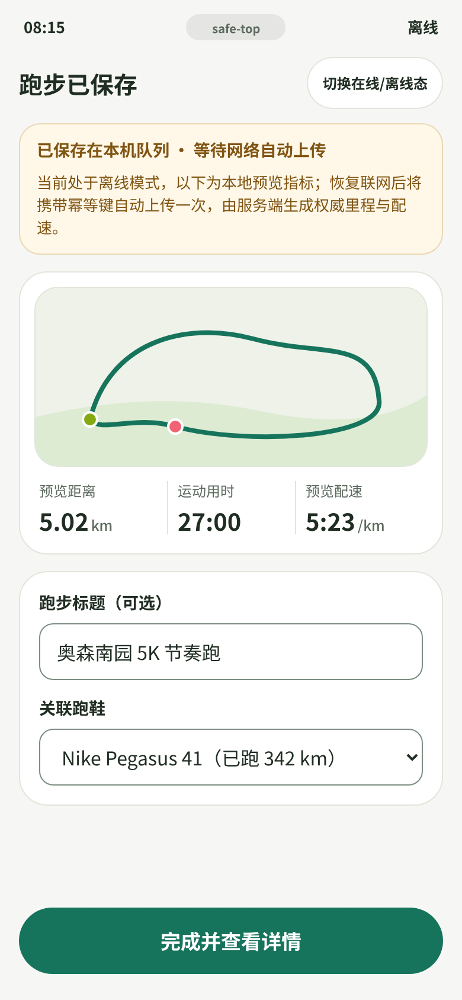 | 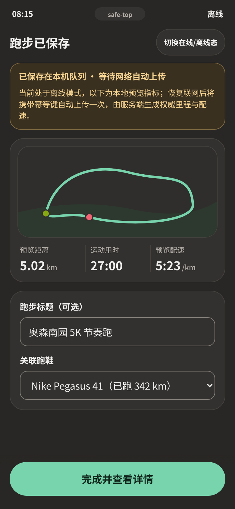 | 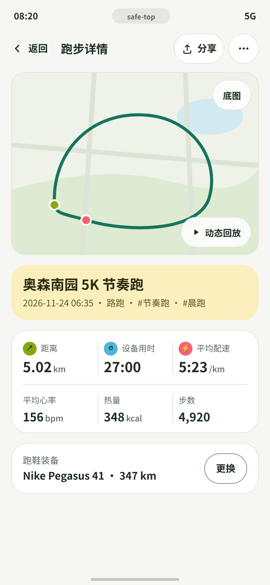 | 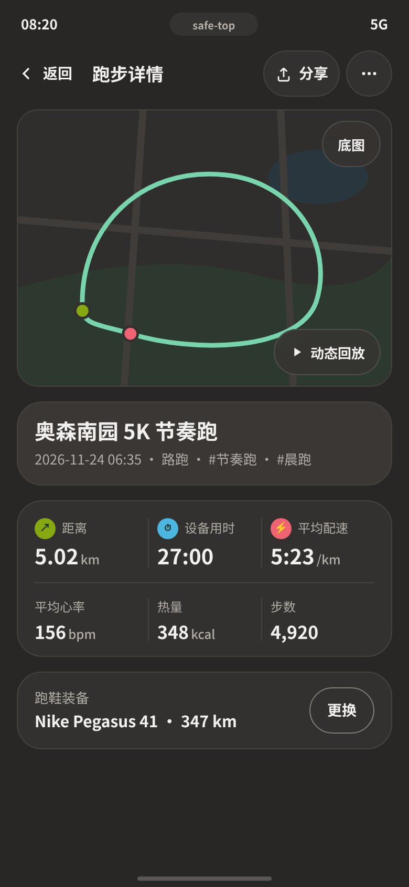 |

- **05 跑后总结**：顶部诚实反馈上传状态（离线队列待上传显示琥珀提示与「预览指标」，在线完成后显示绿色「服务端权威指标已生成」，绝不把 pending 伪装为 synced）；将原记录页的「跑步标题」「关联跑鞋」移至跑后自然时机，所有输入框 ≥48px 高、16px 字号、3:1 边框。
- **06 跑步详情**：首屏改为**路线地图置顶**（内置 ≥44px「底图」「动态回放」浮层胶囊）+ 紧凑奶油黄/炭灰标题带 + 3 列发丝线核心指标 + 跑鞋卡片；破坏性「删除记录」收拢进顶栏「···」菜单，避免浏览时误触；底图离线/超时时保持本地轨迹与指标可读。

### 6.4 历史记录（History）、异常态矩阵（States）与我的设置（Settings）

| 07 · 历史记录（浅色） | 07 · 历史记录（深色） | 08 · 离线/权限/同步异常态（浅色） | 08 · 异常态（深色） |
| --- | --- | --- | --- |
| 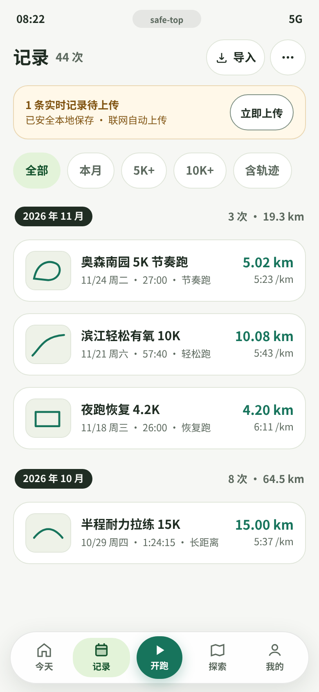 | 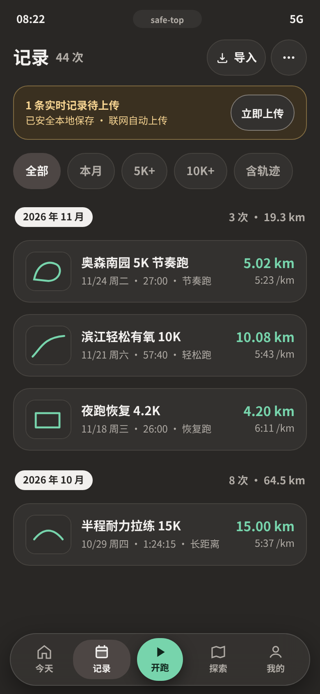 | 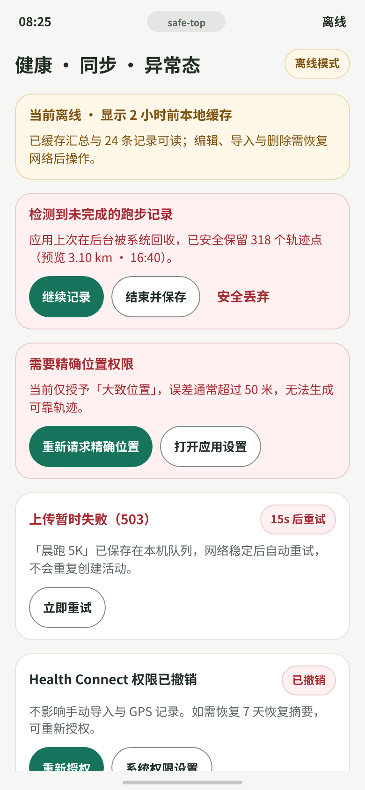 | 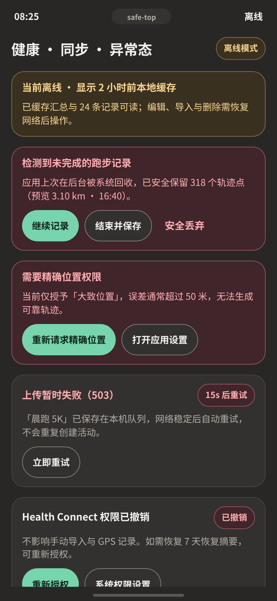 |

| 09 · 我的与设置（浅色） | 09 · 我的与设置（深色） |
| --- | --- |
| 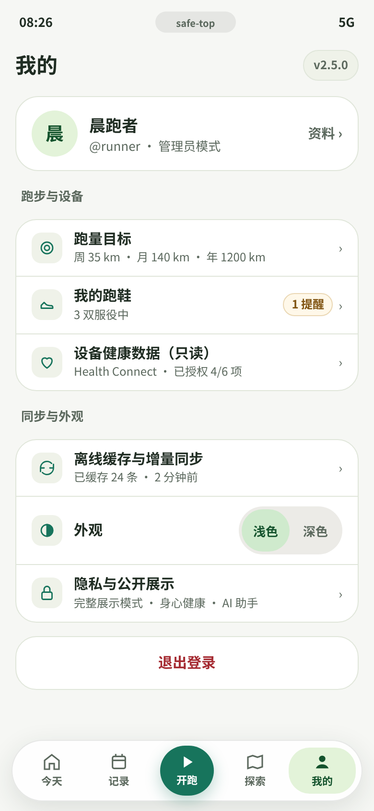 | 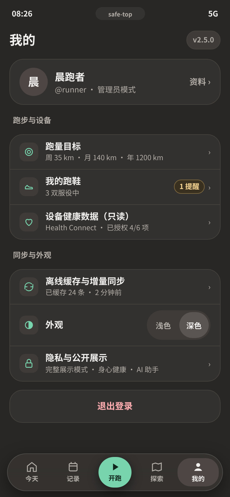 |

- **07 历史记录**：精简顶栏（「记录 44 次」+「导入」抽屉入口 +「···」），存在待传实时记录时在顶部置顶琥珀提醒条；44px 横滑筛选胶囊；每行活动 76px+ 整行可点，左缩略图 + 中标题日期 + 右等宽里程/配速，首屏可见 4 条活动。
- **08 离线 / 权限 / 同步 / 空态矩阵**：覆盖 Phase 2 & 3 全部边界场景，确保每种异常均具备「文字+图标+具体恢复操作」三要素，不依赖纯颜色表达状态：
  - **离线缓存态**：内联琥珀条写明缓存年龄（「2 小时前本地缓存」）及受限操作说明（编辑/导入/删除需联网）。
  - **进程强杀中断恢复**：红色告警卡写明已保留点数/预览距离，提供「继续记录 / 结束并保存 / 安全丢弃」。
  - **位置权限拒绝 / 仅大致位置**：阻断开始，给出「重新请求精确位置」与「打开应用设置」双出口。
  - **同步失败（503 / 退避）**：展示剩余重试倒计时与「立即重试」，明确承诺幂等不会重复建活动。
  - **Health Connect 撤销 / 部分授权 / 7 天空态**：说明不影响记录与导入，提供「重新授权」「系统权限设置」直达。
  - **首次空态**：引导「开始第一次跑步」与「导入轨迹」两个清晰入口。
- **09 我的与设置**：用原生感分组列表替代原 345px 高度的 5 项设置标签网格与 3409px 超长单页；将外观切换移入设置列表释放顶栏空间；每组内直接展示状态摘要（周/月/年目标、跑鞋提醒角标、Health Connect 4/6 授权进度、同步时间）；「退出登录」独立沉底隔离。

---

## 7. Chromium 原型自动化验证记录

通过独立 Playwright 脚本在真实 Chromium 中对 `mockups/index.html` 与 `mockups/responsive.html` 执行了 26 次独立上下文渲染检查（全部 9 屏 × Light/Dark `390×844`、极端窄屏 `320×640` 3 屏、平板 `768×1024` × Light/Dark、桌面 `1440×900` × Light/Dark 及画廊首页）：

| 验证项 | 实测结果 | 备注 |
| --- | --- | --- |
| Console Errors / Page Errors | **0 / 26 次运行** | 零外部 CDN 依赖，100% 本地离线可渲染 |
| 横向溢出（`scrollWidth > innerWidth`） | **0 处**（覆盖 320 / 390 / 768 / 1440px） | 320px 极端窄屏下全部文字与按钮正常重排 |
| 触控目标 `<44×44 CSS px` | **0 处**（初检发现设置内联「浅/深」宽 35px，已修正为 ≥44×44px 并复测清零） | 主操作 CTA 统一 48–60px 高 |
| 输入框/选择器 `<16px` | **0 处** | 全部表单控件 `font-size: 16px`、`min-height: 48px` |
| `viewport-fit=cover` 与 `prefers-reduced-motion` | **全部就位** | 原型与规范已同步定义降动效路径 |
| **真机实测项（见 2.3 节）** | **未验证（待 Owner 今晚 PKT110 实机测试）** | 仅在无头 Chromium 模拟视口验证 |

---

## 8. 待 Owner 确认的开放问题（Open Questions）

在进入 Phase 4 代码实施前，请 Owner 结合今晚真机体验拍板以下 5 个方向性问题：

1. **底部导航模型**：采用推荐的 **方案 B（4 Tab + 居中「开跑」触发器）**，还是 **方案 A（4 Tab 胶囊 + 右下独立 FAB）**？
2. **「今天」与原「数据汇总」的关系**：手机端首屏「今天」是否优先呈现轻量 3 块（周目标环 + 最近一跑 + 近 7 天健康摘要），把年度热力日历、趋势图与省份地图下沉到二级入口「完整数据汇总」；还是希望继续在首页长滑展示全部图表？
3. **跑后总结页的后端范围**：跑后总结里的「关联跑鞋」与「一句话日记」在离线队列态需要本地暂存并在上传成功后补调绑定接口；Phase 4 首期是否先支持**「标题（已有接口支持）+ 在线后直接跳详情绑跑鞋」**，还是同步补齐离线元数据暂存？
4. **运动中防误停交互**：暂停态的「结束并保存」采用**长按 1.5 秒（带单击弹确认框的无障碍兜底）**，还是改为纯单击触发原生 `<dialog>` 二次确认？
5. **Android 17 实机 Edge-to-Edge 策略**：今晚在 PKT110 真机验证后，确认是由原生 `MainActivity` 为 WebView 注入统一 `WindowInsets` 还是完全交由 Web CSS `viewport-fit=cover` + `env(safe-area-inset-*)` 绘制沉浸式底栏/顶栏（二者需只选其一避免双倍留白）。
