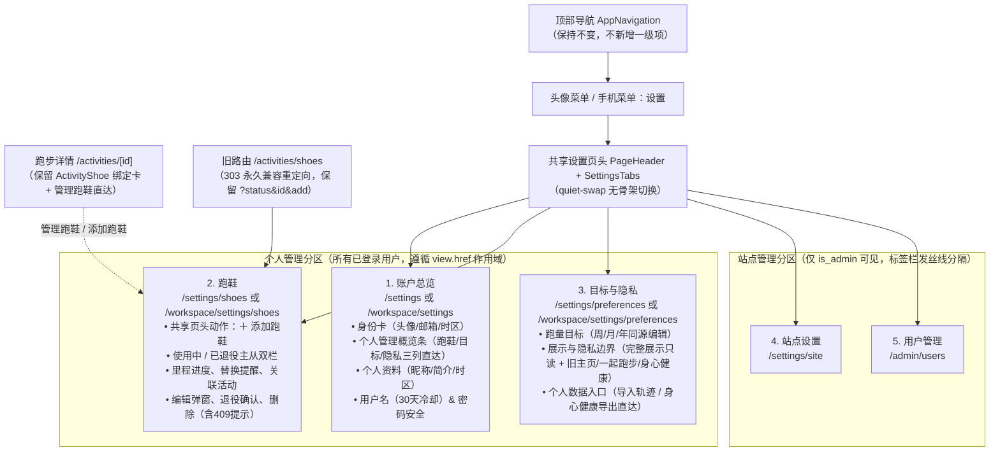
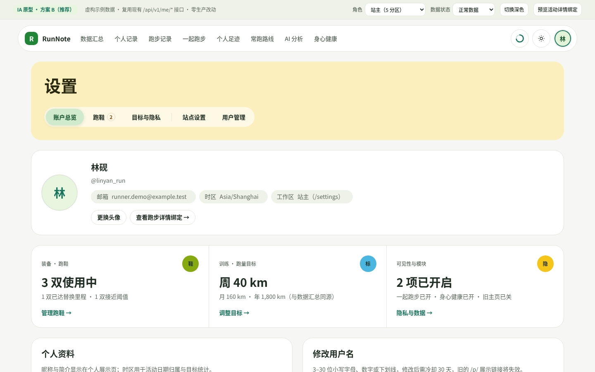
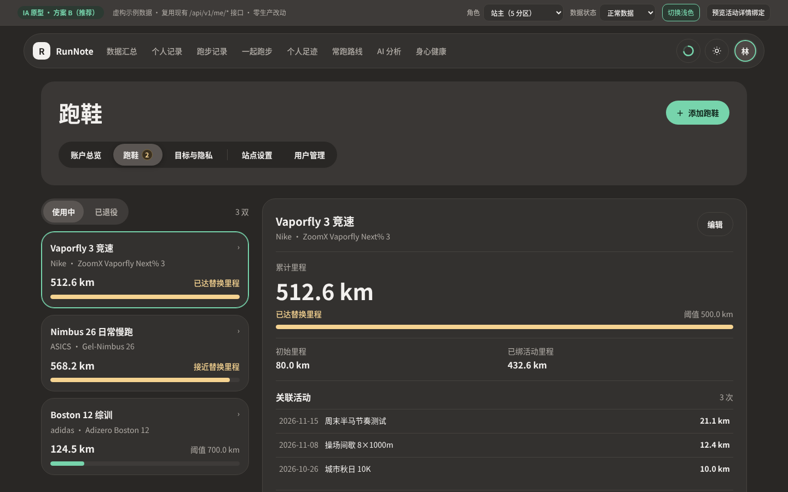
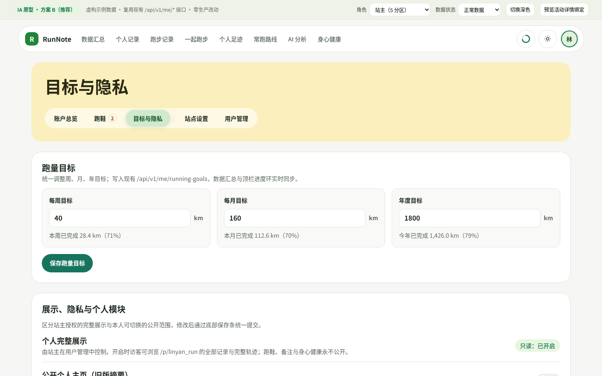
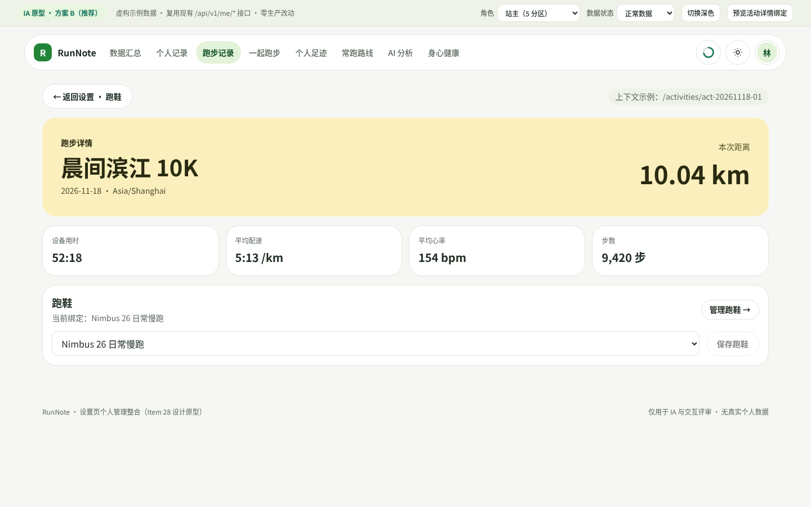
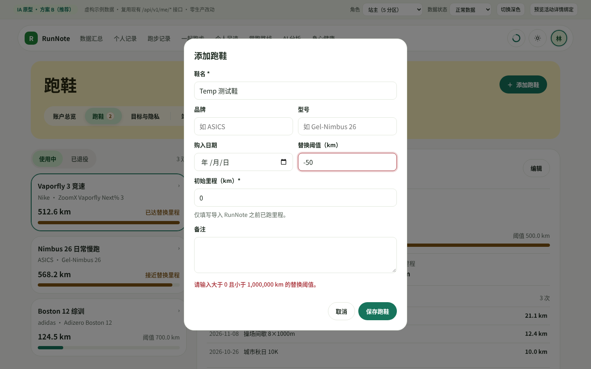
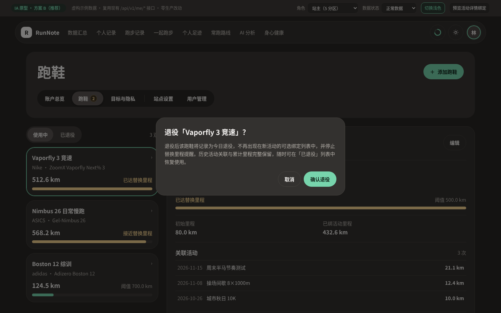

# 设置页个人管理整合（含跑鞋入口）— 信息架构与交互设计提案（Item 28）

> 状态：**Phase 1 设计与 IA 探索（待 Owner 审批）** · 日期：2026-11-21  
> 范围边界：仅设计提案与交互原型（`docs/` 内），**未改动任何后端路由、数据库 Schema、鉴权逻辑或生产前端代码**。

---

## 1. 背景、目标与设计硬约束

跑鞋里程追踪（v1.3.0）上线后，暴露出明显的**信息架构断层**：跑鞋属于用户长期维护的个人装备资产（接口位于 `/api/v1/me/shoes*`，与账户资料、跑量目标同属 `/api/v1/me/*` 个人管理命名空间），当前却只以一颗次级按钮藏在「跑步记录（`/activities`）」标题栏中，既没有进入设置体系，也与账户、跑量目标、隐私开关和个人数据入口彼此割裂。

### 核心目标
1. 将 `/settings`（及 `/workspace/settings`）从单一的「账户设置」页升级为清晰的**个人管理中枢（Personal-Management Hub）**。
2. 让**跑鞋管理**成为设置页内的一级个人管理分区，同时**完整保留**活动详情页（`/activities/[id]` 与 `/workspace/activities/[id]`）中的跑鞋绑定入口。
3. 梳理账户、跑鞋、跑量目标、展示与隐私、个人数据入口之间的职责边界，消除重复入口与历史遗留的导航/权限缺口。

### 硬约束（本次设计与后续实施共同遵守）
- **不重设计全局顶部导航 / 手机导航**（`AppNavigation.svelte` 维持现有 8–9 项上限与「进度环 → 主题 → 头像」顺序，不在顶栏新增「跑鞋」一级入口）。
- **不引入数据双写或新数据源**：复用现有 `/api/v1/me*`、`/api/v1/site*`、`/api/v1/admin/*` 接口与既有设计系统组件/语义令牌（`docs/design-system/`）。
- **不改动权限、CSRF、隐私边界**：跑鞋与身心健康保持纯私人数据边界，绝不进入公开展示 `/p/{username}/*` 或摘要分享。

---

## 2. 现状全量审计（Audit）

基于当前仓库源码（`frontend/src/routes/`、`frontend/src/lib/`、`backend/app/modules/`）的逐项盘点：

### 2.1 现有个人管理与设置相关界面盘点

| 领域 | 当前路由 / 组件 | 入口位置 | 后端接口 | 现状问题 |
| --- | --- | --- | --- | --- |
| 账户与隐私 | `/settings`、`/workspace/settings`（`routes/settings/+page.svelte`） | 顶栏头像菜单「设置」；手机菜单底部齿轮图标；`/admin` 卡片；`/together` 空态链接 | `PATCH /api/v1/me`、`PUT/DELETE /api/v1/me/avatar`、`PATCH /api/v1/me/username`、`PATCH /api/v1/me/password` | ① 非站主访问 `/settings` 会渲染**空白页**（缺 `+page.server.ts` 重定向）；② 普通用户在 `/workspace/settings` 下 `SettingsTabs` 仅渲染**单个标签**；③ 个人展示（管理员控）、旧版公开主页、一起跑步、身心健康四类语义混在单卡；④ `SaveBar` 文案固定为「保存公开设置」；⑤ 后端 `PATCH /api/v1/me` 已支持 `timezone`，但前端仅只读展示；⑥ 身份卡内孤立挂着一条「管理记录与分享 →」链接 |
| 站点设置 | `/settings/site`（仅 `is_admin`） | `SettingsTabs` 第 2 项 | `GET/PATCH /api/v1/site`、`PUT/DELETE /api/v1/site/images/{kind}`、`GET /api/v1/admin/version` | 逻辑清晰；但 `/admin` 首页快捷网格漏掉了 `/settings/site` 入口 |
| 用户管理 | `/admin/users`（仅 `is_admin`） | `SettingsTabs` 第 3 项；`/admin` 卡片 | `/api/v1/admin/users*` | 已与设置共享根布局 `PageHeader`（`settings-header.svelte.ts` 注册「新增用户」）；归属与交互成熟 |
| 站主/工作区着陆页 | `/admin`（`routes/admin/+page.svelte`） | 直接访问 `/admin` 登录后的页面 | — | 硬编码 `href="/workspace/settings"`（连站主也被导到工作区），缺少站点设置与跑鞋入口 |
| 跑鞋管理 | `/activities/shoes`、`/workspace/activities/shoes`（`ShoesPage.svelte`） | 仅在 `/activities`「我的活动」标题行放了一颗「跑鞋」次级按钮；`ActivityShoe` 空态的「添加跑鞋」链接 | `/api/v1/me/shoes*` | ① 藏在活动列表操作区（与「导入轨迹」「编辑」混排），脱离个人管理体系；② 自带独立 `PageHeader` 与「跑步记录 › 跑鞋」面包屑；③「退役跑鞋」按钮点击即提交，缺少确认提示；④ `ShoeEditor.svelte` 未复用 `.text-field` 样式 |
| 活动详情绑定 | `/activities/[id]`、`/workspace/activities/[id]`（`ActivityShoe.svelte`） | 详情页指标/路线工作区下方 | `GET/PATCH /api/v1/me/activities/{id}/shoe`、`GET /api/v1/me/shoes?status=active` | 绑定流程轻量好用；但用户已有跑鞋时**缺少**跳转到跑鞋详情/管理页的快捷入口；空态链接仍指向 `/activities/shoes?add=1` |
| 跑量目标 | `GoalOverview.svelte`（`/dashboard`）；`RunningGoal.svelte`（顶栏 `GoalRing` 弹层） | 数据汇总页 + 全局顶栏进度环 | `GET /api/v1/me/running-goals`、`PUT /api/v1/me/running-goals/{period}` | 实查代码 `AppNavigation.svelte:149` 传入 `readonly={!view.manage}`（即本人在顶栏弹层与数据汇总两处均可编辑，设计系统文档 `components.md:133` 的「只读」描述已滞后于代码）；但在设置页完全不可见，缺少一处安静集中检视周/月/年三项目标的面板 |
| 个人数据与分享 | 轨迹导入（`/activities` 折叠区）；旧版分享（详情页 `SharePanel`）；身心健康 CSV（`/wellbeing`） | 各自领域页面 | `/api/v1/gpx`、`/api/v1/tcx`、`/api/v1/mifitness`、`/api/v1/activities/{id}/shares`、`/api/v1/me/wellbeing/report.csv` | 设置页无法一览数据入口与分享隐私说明；同时不应把重型导入表单搬入设置造成双入口 |

### 2.2 审计中发现的具体代码缺陷与风险（将在 Phase 2 一并修复）
1. **非站主访问 `/settings` 出现空白页**：`frontend/src/routes/settings/` 缺少 `+page.server.ts`。`hooks.server.ts` 仅拦截未登录用户；已登录普通用户若访问 `/settings`（例如点击 `frontend/src/routes/together/+page.svelte:276` 硬编码的 `<a href="/settings">去设置里加入</a>`），`viewContext('/settings', false)` 返回 `manage: false`，而 `settings/+page.svelte:72` 用 `{#if view.manage}` 包裹全部内容，导致页头下方完全空白。对比之下，`/activities/shoes/+page.server.ts` 与 `/wellbeing`（`hooks.server.ts:37`）均正确重定向非站主至 `/workspace/*`。
2. **`/settings` 保存条文案与表单范围错配**：`settings/+page.svelte:147` 始终显示「保存公开设置」，且保存成功提示固定围绕主页开关，即使用户只改了昵称或「身心健康」开关。
3. **缺少 `showcase_enabled` 本人只读状态**：用户无法在设置页直观看到站主是否已为其开启 `/p/{username}` 完整展示，容易把 `profile_is_public`（旧版摘要主页）误认为完整展示开关。

### 2.3 权限与路由作用域矩阵

| 角色 / 视图 | `/settings*`（根路径） | `/workspace/settings*` | `/settings/site` & `/admin/users` | `/activities/[id]` 跑鞋绑定 | `/p/{username}/*` |
| --- | --- | --- | --- | --- | --- |
| 匿名访客 | 303 → `/admin?next=...` | 303 → `/admin?next=...` | 303 → `/admin?next=...` | 不渲染 `ActivityShoe` | 只读公开展示，无任何设置/跑鞋 |
| 普通启用用户（`!is_admin`） | **现状空白页** → **目标：303 重定向至 `/workspace/settings*`** | 完整读写个人管理（3 个个人分区） | 403 无权访问（隐藏标签） | 仅在 `/workspace/activities/[id]` 渲染（`view.manage === true`） | 只读展示，隐藏设置 |
| 站主（`is_admin`） | 完整读写个人管理 + 站点管理（3 个人 + 2 站点分区） | 可用（3 个人分区 + 2 站点管理链接回根路径） | 完整读写 | 根路径与工作区均渲染 | 仅本人查看自己展示时无管理控件（按 `view.manage`） |

### 2.4 移动端（`<800px` / `390×844`）行为审计
- **壳层导航**：`<800px` 收起为悬浮 `.mobile-bar` + 文档流 `.app-sidebar.nav-open`，设置在展开菜单底部 `.account-inline` 的 `44×44` 齿轮按钮。
- **分区标签**：`app.css:2134` 已对 `<=479px` 的 `.settings-tabs` 配置单行横向滚动胶囊带（`overflow-x: auto; scrollbar-width: none`），3–5 个 2–4 字短标签可顺畅单手切换；若超过 6 项则会造成明显横向寻址负担。
- **跑鞋主从切换**：`ShoesPage.svelte:620` 在 `<1024px` 采用列表/详情单列切换（由 `?id=` 驱动），并带 `← 跑鞋列表` 返回与滚动/焦点恢复。纳入设置共享页头后，需保持设置页头常驻（不隐藏 `PageHeader`），避免用户在手机查看跑鞋详情时丢失顶部返回与分区上下文。

---

## 3. 目标信息架构（Target IA）

### 3.1 总体架构图（推荐方案 B）

### 3.2 迁移、保留与禁止重复清单

| 决策类别 | 具体条目 | 说明 |
| --- | --- | --- |
| **迁移（Move）** | 跑鞋主路由迁至 `view.href('/settings/shoes')` | 成为设置页一级个人分区；共享根布局 `PageHeader` 与 `SettingsTabs`，移除 `ShoesPage` 内重复页头与「跑步记录 › 跑鞋」面包屑 |
| **迁移（Move）** | 旧路由 `/activities/shoes`、`/workspace/activities/shoes` 改为 303 重定向 | 完整保留 `?status=active\|retired`、`?id=<uuid>`、`?add=1` 参数，不破坏书签与外链 |
| **迁移（Move）** | 移除 `/activities` 标题行的「跑鞋」按钮 | 活动列表聚焦浏览、导入、批量编辑，不再混入装备管理入口 |
| **迁移（Move）** | 隐私与模块开关从 `账户总览` 迁入 `目标与隐私` | 解耦「个人身份资料」与「公开隐私/模块开关」，让两页的 `SaveBar` 文案和保存粒度各自准确 |
| **补齐（Fix）** | 新增 `/settings/+page.server.ts`（含 `/settings/shoes`、`/settings/preferences`） | 已登录非站主访问根路径 `/settings*` 时 303 重定向至 `/workspace/settings*`，根除空白页缺陷；同步修正 `/together` 与 `/admin` 的硬编码链接 |
| **保留（Stay）** | 活动详情页 `ActivityShoe.svelte` 绑定卡 | 原地保留在 `/activities/[id]` 与 `/workspace/activities/[id]`；更新空态链接至 `/settings/shoes?add=1`，并在卡片头部增加轻量「管理跑鞋 →」直达当前绑定鞋详情 |
| **保留（Stay）** | `/dashboard` 的 `GoalOverview` 与顶栏 `GoalRing` | 保持仪表盘进度可视化、同期对比与连续记录；设置页与它们读写同一 `/api/v1/me/running-goals` 源，经既有 `runnote-goals-changed` 事件同步 |
| **保留（Stay）** | `/activities` 折叠导入区、`/settings/site`、`/admin/users` | 现有路由、权限校验、表格交互与站点预览均原样保留 |
| **禁止重复（Do Not Duplicate）** | 不在全局 `AppNavigation` 新增「跑鞋」或「设置」一级导航 | 避免 800–1359px 图标顶栏拥挤，维持既有导航密度上限 |
| **禁止重复（Do Not Duplicate）** | 不把 GPX/TCX/小米导入表单搬进设置页 | 设置页「数据与记录入口」仅提供直达链接与边界说明 |
| **禁止重复（Do Not Duplicate）** | 不在设置页复制 `GoalOverview` 图表、连续记录或 `admin/users` 完整展示开关 | 完整展示状态在个人设置中仅作**只读状态徽章**呈现，杜绝权限冲突与双写 |

---

## 4. 三套差异化 IA 方案与权衡对比

本阶段评估了三种结构本质不同的导航与信息架构方案（而非视觉皮肤变体）：

### 方案 A：中心索引卡片制（Hub-and-Spoke Index）
- **结构**：`/settings` 作为纯索引首页（身份卡 + 4–6 张功能入口卡片：账户与安全、跑鞋、跑量目标、隐私与模块、数据入口；站主下方另列「站点管理」卡片组）。取消顶层 `SettingsTabs`，所有子页以独立路由呈现并用 `← 返回设置` 面包屑回退。
- **优势**：纵向扩展能力最强，即使未来增长到 8+ 个设置域也不会挤占标签栏；个人管理与站点管理分组天然清晰；移动端首屏只需卡片列表，无横向滚动。
- **劣势**：所有高频操作（如查看跑鞋、改资料、切隐私开关）都**多增加 1 次点击**；放弃了 `docs/63-settings-ui-refresh.md` 已建立的共享页头 + `quiet-swap` 零骨架瞬时切换体验；横向跳转（如刚查完跑鞋想调目标）必须先退回索引页。

### 方案 B（推荐）：持久顶栏分区制 + 个人中枢首屏（Persistent Tabbed Hub in Existing Settings Shell）
- **结构**：延续现有根布局共享 `PageHeader` + `SettingsTabs` + `quiet-swap` 壳层，将所有个人管理收敛为 **3 个正交的一级个人分区**：
  1. **账户总览**（`/settings`）— 身份卡 + 扁平三列「个人管理概览条」（跑鞋提醒计数 / 周月年跑量目标 / 隐私模块状态，延续 `RecordsBanner` 视觉语言，一键直达对应分区）+ 个人资料（含时区）+ 用户名 + 密码安全；
  2. **跑鞋**（`/settings/shoes`）— 全宽承载现有 `3:7` 主从双栏，共享页头右上角通过扩展 `settings-header.svelte.ts` 渲染「＋ 添加跑鞋」，带替换提醒角标与退役确认弹窗；
  3. **目标与隐私**（`/settings/preferences`）— 跑量目标集中编辑 + 展示/隐私/模块开关（区分只读完整展示与可编辑开关）+ 数据入口卡片。
  - **站主（`is_admin`）** 在同一标签栏内以一条竖向发丝线分隔后追加既有 2 个站点管理分区：**站点设置**（`/settings/site`）与 **用户管理**（`/admin/users`），总计 5 项；**普通用户**看到 3 个清晰个人分区，彻底消除此前的「单标签栏」尴尬。
- **优势**：
  - **零三栏挤压**：跑鞋分区独享 100% `--content-width`，完整保留 `ShoesPage` 的 `3:7` 主从双栏与桌面读鞋效率；
  - **零额外点击 + 兼得总览视野**：打开设置即可直接编辑资料或一览跑鞋/目标/隐私摘要，且在所有分区间 `quiet-swap` 一步直达；
  - **100% 贴合 RunNote 设计系统**：直接复用 `PageHeader`、`SettingsTabs`、`SaveBar`、`.settings-grid`、`settings-header.svelte.ts` 与既有 `<=479px` 横滑胶囊规则；
  - **渐进改造成本最低**：无需新建平行导航框架，对 `/settings/site` 与 `/admin/users` 几乎零侵入。
- **劣势**：标签总数上限约 5–6 个；若未来个人管理再增加 3 个以上独立重型模块，届时需在「账户总览」或「目标与隐私」内做分组或演进为侧栏。

### 方案 C：设置内分组侧栏制（Scoped Two-Column Settings Left Rail）
- **结构**：全局顶栏不变，但在 `/settings/*` 内容区内取消水平 `SettingsTabs`，改为左侧 `14rem` 吸顶目录栏（明确分「个人管理」「站点管理」两组，共 6–8 个细粒度子项）+ 右侧内容区；`<1024px` 退化为下拉选择器或折叠菜单。
- **优势**：层级分类最直观；可容纳 8–10 个独立设置页而不拥挤；个人与站点分组标题最显眼。
- **劣势**：**与跑鞋主从布局结构冲突**——`ShoesPage` 本身已是 `3:7` 双栏，嵌套在左侧目录栏中会在 `1024–1280px` 屏幕形成拥挤的三栏（侧栏 224px + 跑鞋列表 260px + 跑鞋详情 460px），迫使跑鞋退回单栏或折叠列表；与现有 `SettingsTabs` 设计规范及站点设置右栏吸顶预览（`.site-layout`）同样产生多栏竞争；移动端需额外维护一套设置内切换控件。

### 权衡对比表

| 评估维度 | 方案 A：中心索引卡片制 | 方案 B（推荐）：持久顶栏分区 + 中枢首屏 | 方案 C：设置内分组侧栏制 |
| --- | --- | --- | --- |
| 到达跑鞋 / 资料的点击深度 | 2 步（先到总览再进子页） | **1 步**（资料首屏直达，跑鞋顶栏一步切） | 1 步（桌面）；2 步（手机下拉） |
| 横向跨区切换效率 | 较低（需返回索引） | **高**（`quiet-swap` 零骨架直切） | 高（桌面）；中（手机） |
| 与跑鞋 `3:7` 主从布局兼容性 | 优秀（全宽） | **优秀（全宽，零三栏挤压）** | 差（1024–1280px 三栏严重挤压） |
| 与站点设置 `.site-layout` 兼容性 | 优秀 | **优秀** | 中（左侧栏 + 表单 + 右侧吸顶预览三栏拥挤） |
| 390px 移动端体验 | 良好（竖排卡片，但返回链路长） | **良好**（复用现有横向胶囊条 + 个人 3 项一屏可见） | 一般（需新增移动端分区切换器） |
| 普通用户（非站主）观感 | 完整（4–5 张卡） | **完整（3 项均衡胶囊，解决原 1 项尴尬）** | 完整 |
| 个人 vs 站点权限边界清晰度 | 高（分组卡片） | **高**（竖向发丝线分隔 + 仅站主可见） | 最高（带分组小标题） |
| 未来扩展上限（>6 模块） | 最高 | 中（5–6 项内最优，超出需合并或升级） | 高 |
| 设计系统一致性与改造成本 | 中（需撤掉现有 `SettingsTabs`） | **最高 / 最低**（100% 沿用现有设置壳层） | 低 / 高（重写壳层与多页断点） |

**结论**：**推荐方案 B**。它在保持 RunNote 既有设计语言与全宽主从跑鞋体验的前提下，以最小改造成本一次性解决「跑鞋归属」「个人管理中枢」「普通用户单标签」「资料/隐私保存条解耦」四个核心问题。

---

## 5. 推荐方案（方案 B）关键交互细节

1. **共享页头动作泛化（`settings-header.svelte.ts`）**：
   - 将现有 `{ create, createDisabled }` 扩展为通用动作描述（如 `{ label, variant: 'primary' | 'secondary', disabled, onclick, id }`），`/settings/shoes` 注册「＋ 添加跑鞋」（主操作），`/admin/users` 继续注册「新增用户」（次操作），彻底消除跑鞋页双重 `PageHeader`。
2. **跑鞋提醒角标（低干扰信号）**：
   - 仅当存在 `reminder === 'due' || reminder === 'near'` 的使用中跑鞋时，在「跑鞋」标签右侧展示紧凑数字徽章（语义色 `--warning-soft / --warning` + `aria-label="N 双接近或已达替换里程"`）；无提醒时不渲染角标。
3. **退役确认 vs 删除确认的语义区分**：
   - **退役跑鞋**：新增轻量 `<dialog>` 确认（说明：记录为今日退役、不再出现在新活动可选列表中、停止替换提醒；历史活动与累计里程完整保留，随时可恢复使用）。
   - **删除跑鞋**：保留破坏性确认 `<dialog>`，沿用后端 `409 SHOE_IN_USE` 保护逻辑（仍有关联活动时提示先解绑或改用退役，绝不级联清空活动）。
4. **移动端 `<1024px` 跑鞋详情交互**：
   - 点击跑鞋卡进入详情时，保留顶部的共享 `PageHeader` + `SettingsTabs`（不隐藏），仅折叠左侧列表并展示「← 跑鞋列表」返回按钮（点击后恢复滚动位置与焦点到原卡片）。
5. **个人资料补齐时区编辑 & 拆分 `SaveBar`**：
   - `账户总览` 的 `SaveBar` 仅监听 `display_name` / `bio` / `timezone`，标签改为「保存个人资料」。
   - `目标与隐私` 中，隐私与模块开关（`profile_is_public`、`together_enabled`、`wellbeing_enabled`）走独立 `SaveBar`（「保存隐私与功能设置」）；跑量目标沿用现有字段校验与 `PUT` 提交并派发 `runnote-goals-changed`。
6. **活动详情 `ActivityShoe.svelte` 双向衔接**：
   - 保留原地 `<select>` + 「保存跑鞋」交互不变；在卡片头部增加安静的「管理跑鞋 →」链接（已绑定时指向 `view.href('/settings/shoes?id=' + current.id)`，未绑定时指向 `view.href('/settings/shoes')`）；空态按钮指向 `view.href('/settings/shoes?add=1')`。

---

## 6. 数据与接口映射（零新增后端接口）

### 6.1 复用现有接口清单（单事实源，无双写）

| 页面 / 模块 | 操作 | 现有后端接口 | 备注 |
| --- | --- | --- | --- |
| 账户总览 · 身份卡 | 头像上传 / 删除 | `PUT /api/v1/me/avatar`、`DELETE /api/v1/me/avatar` | 复用 `ImageUpload` |
| 账户总览 · 概览条 | 跑鞋数与提醒摘要 | `GET /api/v1/me/shoes?status=active&order=reminder&limit=20` | 客户端从返回 `total` 与 `items` 计算提醒数 |
| 账户总览 · 概览条 & 目标区 | 读 / 写周月年目标 | `GET /api/v1/me/running-goals`、`PUT /api/v1/me/running-goals/{period}` | 与 `GoalOverview` / `RunningGoal` 同源，经 `runnote-goals-changed` 同步 |
| 账户总览 · 个人资料 | 修改昵称、简介、时区 | `PATCH /api/v1/me` | `ProfileUpdate` 已内置 IANA `timezone` 校验 |
| 账户总览 · 用户名 / 密码 | 改用户名 / 改密码 | `PATCH /api/v1/me/username`、`PATCH /api/v1/me/password` | 沿用 30 天冷却与全会话吊销 |
| 跑鞋分区 | 列表 / 详情 / 增改删 / 退役 / 关联活动 | `GET/POST /api/v1/me/shoes`、`GET/PATCH/DELETE /api/v1/me/shoes/{id}`、`GET /api/v1/me/shoes/{id}/activities` | 完全复用 `lib/api/shoes.ts` |
| 目标与隐私 · 隐私开关 | 切换旧主页 / 一起跑步 / 身心健康 | `PATCH /api/v1/me` | `showcase_enabled` 仅从 session `UserView` 只读呈现 |
| 活动详情绑定 | 读 / 改单次活动绑定跑鞋 | `GET/PATCH /api/v1/me/activities/{id}/shoe` | 原地保留，零改动 |
| 站点设置 / 用户管理 | 站主管理 | `/api/v1/site*`、`/api/v1/admin/version`、`/api/v1/admin/users*` | 原样保留 |

### 6.2 可选未来后端提案（仅提案，**不纳入 Phase 2 必需范围**）
1. `DELETE /api/v1/me/running-goals/{period}`：当前跑量目标设置后只能修改正数，不能清空为「未设置」；若未来需要「清除目标」功能再新增。
2. `GET /api/v1/me/shares`（分页或仅计数）：当前旧版分享链接只能按活动维度查询（`GET /api/v1/activities/{id}/shares`）；因旧版摘要分享已停用，仅在确有批量审计需求时才考虑。
3. `GET /api/v1/me/shoes/summary`：当前 `GET /api/v1/me/shoes?status=active&limit=20` 已足够支撑总览卡片；仅当个人活跃跑鞋超过 20 双时才有聚合优化价值。

---

## 7. 交互原型与视觉 / 无障碍验证记录

### 7.1 交互原型位置与使用方式
- 静态自包含原型：[index.html](../prototypes/2026-11-21-settings-ia/index.html)（无外部依赖，直接复用 `frontend/src/app.css` 浅色/深色语义令牌，全部为虚构示例数据 `林砚 / @linyan_run / runner.demo@example.test`）。
- 顶部演示控制栏支持即时切换：**角色**（站主 5 分区 / 普通用户 3 分区）、**外观**（浅色 / 深色）、**数据状态**（正常 / 跑鞋空态 / 加载态 / 读取错误态）以及一键跳转「活动详情绑定」验证双向闭环。

### 7.2 视觉与多视口截图覆盖（共 24 张）

使用隔离本地静态服务 + 无头 Chromium（Playwright 缓存的 Chromium 1255）实际渲染截屏并人工逐张核对，覆盖全部要求视口、主题与交互状态：

| 类别 | 视口与主题 | 截图文件 |
| --- | --- | --- |
| 设置中枢（站主 5 分区） | 1440×900 浅/深、768×1024 浅/深、390×844 浅/深 | [01-hub-1440-light.png](../prototypes/2026-11-21-settings-ia/screenshots/01-hub-1440-light.png)、[02-hub-1440-dark.png](../prototypes/2026-11-21-settings-ia/screenshots/02-hub-1440-dark.png)、[03-hub-768-light.png](../prototypes/2026-11-21-settings-ia/screenshots/03-hub-768-light.png)、[04-hub-768-dark.png](../prototypes/2026-11-21-settings-ia/screenshots/04-hub-768-dark.png)、[05-hub-390-light.png](../prototypes/2026-11-21-settings-ia/screenshots/05-hub-390-light.png)、[06-hub-390-dark.png](../prototypes/2026-11-21-settings-ia/screenshots/06-hub-390-dark.png) |
| 设置中枢（普通用户 3 分区） | 1440×900 浅 | [07-hub-member-1440-light.png](../prototypes/2026-11-21-settings-ia/screenshots/07-hub-member-1440-light.png) |
| 跑鞋列表与详情 | 1440×900 浅/深、768×1024 浅、390×844 列表（浅）& 详情（深） | [08-shoes-1440-light.png](../prototypes/2026-11-21-settings-ia/screenshots/08-shoes-1440-light.png)、[09-shoes-1440-dark.png](../prototypes/2026-11-21-settings-ia/screenshots/09-shoes-1440-dark.png)、[10-shoes-768-light.png](../prototypes/2026-11-21-settings-ia/screenshots/10-shoes-768-light.png)、[11-shoes-390-list-light.png](../prototypes/2026-11-21-settings-ia/screenshots/11-shoes-390-list-light.png)、[12-shoes-390-detail-dark.png](../prototypes/2026-11-21-settings-ia/screenshots/12-shoes-390-detail-dark.png) |
| 目标与隐私 | 1440×900 浅/深、390×844 浅 | [13-preferences-1440-light.png](../prototypes/2026-11-21-settings-ia/screenshots/13-preferences-1440-light.png)、[14-preferences-1440-dark.png](../prototypes/2026-11-21-settings-ia/screenshots/14-preferences-1440-dark.png)、[15-preferences-390-light.png](../prototypes/2026-11-21-settings-ia/screenshots/15-preferences-390-light.png) |
| 活动详情保留绑定入口 | 1440×900 浅/深、390×844 浅 | [16-activity-binding-1440-light.png](../prototypes/2026-11-21-settings-ia/screenshots/16-activity-binding-1440-light.png)、[17-activity-binding-1440-dark.png](../prototypes/2026-11-21-settings-ia/screenshots/17-activity-binding-1440-dark.png)、[18-activity-binding-390-light.png](../prototypes/2026-11-21-settings-ia/screenshots/18-activity-binding-390-light.png) |
| 关键交互状态 | 空态 / 加载态 / 错误态 / 表单校验错 / 退役确认（深）/ 409 删除冲突 | [19-state-empty-shoes-light.png](../prototypes/2026-11-21-settings-ia/screenshots/19-state-empty-shoes-light.png)、[20-state-loading-shoes-light.png](../prototypes/2026-11-21-settings-ia/screenshots/20-state-loading-shoes-light.png)、[21-state-error-shoes-light.png](../prototypes/2026-11-21-settings-ia/screenshots/21-state-error-shoes-light.png)、[22-state-validation-error-dialog-light.png](../prototypes/2026-11-21-settings-ia/screenshots/22-state-validation-error-dialog-light.png)、[23-state-retire-confirm-dialog-dark.png](../prototypes/2026-11-21-settings-ia/screenshots/23-state-retire-confirm-dialog-dark.png)、[24-state-delete-in-use-dialog-light.png](../prototypes/2026-11-21-settings-ia/screenshots/24-state-delete-in-use-dialog-light.png) |

#### 精选视觉预览

| 桌面 · 设置中枢（浅色） | 桌面 · 跑鞋分区（深色） |
| --- | --- |
|  |  |

| 桌面 · 目标与隐私（浅色） | 桌面 · 活动详情跑鞋绑定（浅色） |
| --- | --- |
|  |  |

| 交互态 · 表单校验错误 | 交互态 · 退役确认弹窗（深色） |
| --- | --- |
|  |  |

### 7.3 浏览器控制台与无障碍（A11y）实测结果
- **控制台与异常**：24 组视口/状态全量运行期间 `consoleErrors = 0`、`pageExceptions = 0`。
- **横向溢出检查**：1440×900、768×1024、390×844 全部 `scrollWidth <= innerWidth`（0 溢出）。
- **标题与标签语义**：每页严格 1 个可见 `<h1>`；所有表单控件（`input` / `select` / `textarea`）`unlabeled = 0`；分区导航遵循既有契约使用 `aria-current="page"`（不误用 `role="tab"`）；开关使用 `role="switch"` + `aria-checked`。
- **键盘与焦点管理**：打开添加/编辑/退役/删除原生 `<dialog>` 时焦点自动落入弹窗内（`focusedInside = true`），取消或按 `Escape` 关闭后焦点准确回到触发按钮（`focusRestored = true`）。
- **对比度（WCAG AA）**：
  - 浅色主题关键元素实测 `5.69:1`（主按钮）至 `14.37:1`（正文与大数字）；
  - 深色主题关键元素实测 `6.47:1`（当前标签）至 `11.40:1`（正文与大数字），主操作按钮使用 `--primary`（`#77d4ac`）+ `--primary-foreground`（`#10251b`）达到 `9.06:1`（验证过程中发现原型初版用实心 `--action` 仅 3.25:1，已当场修正，Phase 2 实施时需确认深色玻璃按钮在降级实心底色下的对比度）。
- **触控目标**：主/次按钮及输入字段均满足 `>= 44px`（`min-height: 2.75rem`）；`.settings-tabs` 延续既有 `40px`（`2.5rem`）设计系统契约；`smallButtons = []`。
- **减少动态效果（`prefers-reduced-motion: reduce`）**：实测开启模拟偏好后，骨架呼吸动画与按钮过渡时长均降至 `0.01ms`（有效关闭动效）。

---

## 8. 开放问题、风险与 Owner 审批清单

### 剩余风险与实施注意事项（供 Phase 2 参考）
1. **既有测试更新范围**：Phase 2 落地时，合成 UI 测试（`frontend/tests/ui/shoes*.spec.ts`、`ui-shell.spec.ts`、`p2.spec.ts`）与 E2E 测试中凡断言 `/activities/shoes` 或 `/activities` 页「跑鞋」按钮的用例，需要同步更新为 `/settings/shoes` 并补充旧路径 303 重定向回归测试。
2. **标签栏动效与分隔线兼容**：`liquid-glass-indicator.ts` 的 `enhanceSegmented` 遍历 `.settings-tabs` 直接子项计算滑块几何；Phase 2 为个人/站点两组之间添加视觉分隔线时，需确保分隔元素不影响滑块索引，或采用伪元素 / `margin-inline-start` 间距实现，不破坏 `createIndicator`。
3. **总览页额外请求数**：在 `账户总览` 渲染「个人管理概览条」需并发读取 `GET /api/v1/me/shoes?status=active&limit=20` 与 `GET /api/v1/me/running-goals`；两者均独立加载与降级（任一失败仅影响该概览格，绝不阻断个人资料编辑）。

### 需要 Owner 拍板的决策项
请在审阅本提案与交互原型后确认以下 4 项，批准后再启动 Phase 2 生产实现：
1. **IA 方案确认**：是否批准 **方案 B（持久顶栏分区制 + 个人中枢首屏：账户总览 / 跑鞋 / 目标与隐私 + 站主分隔线后的站点设置 / 用户管理）**？或改选方案 A / 方案 C？
2. **跑量目标纳入范围**：是否同意在「目标与隐私」中提供周/月/年跑量目标的同源集中编辑（复用 `GET/PUT /api/v1/me/running-goals`），还是保持仅在数据汇总与顶栏编辑、设置页只展示状态摘要？
3. **退役确认弹窗**：是否同意为「退役跑鞋」增加轻量确认 `<dialog>`（保护用户误触，同时明确告知可恢复与保留历史里程）？
4. **旧路由与入口清理范围**：是否确认移除 `/activities` 标题栏的「跑鞋」按钮并将 `/activities/shoes`（及 `/workspace/activities/shoes`）保留为 303 兼容重定向，同时顺带修复非站主访问 `/settings` 空白页缺陷？
